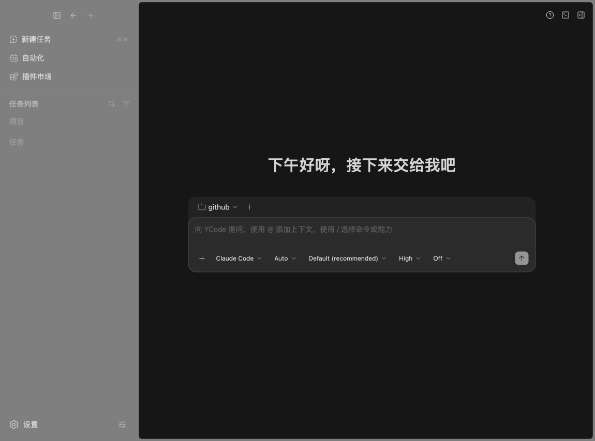

<div align="center">
  
  <h1>YCode</h1>
  <p><strong>你的 AI 编程工作台</strong></p>
  <p>让模型、Agent、代码与工具，在同一个工作区协作。</p>

[](https://github.com/OpenX123/ZCode/actions/workflows/build.yml)
[](https://github.com/OpenX123/ZCode/releases/latest)
[](https://github.com/OpenX123/ZCode/releases)
[](LICENSE)


  <p>简体中文 · <a href="README.en.md">English</a></p>
  <h3><a href="https://github.com/OpenX123/ZCode/releases/latest">下载安装包</a> · <a href="#快速开始">开发指南</a> · <a href="https://github.com/OpenX123/ZCode/actions/workflows/build.yml">构建状态</a></h3>
</div>



YCode 是基于 Electron、React 和 TypeScript 的开源 AI 编程工作台。使用自己的 API Provider，或在本地桌面会话中选择 Claude Code、Codex，集中完成对话、工具调用、代码修改和项目管理。

## 能做什么

- **多种 Agent 引擎**：内置 Agent 支持自定义 Provider；Claude Code 和 Codex 通过 ACP 适配器接入，沿用各自的 CLI 登录和配置。适配器需在设置中显式安装；外部引擎目前面向本地桌面工作区。
- **连续的工作流**：流式回答、推理与工具结果、权限确认、停止和历史续聊，在同一会话中展示。
- **围绕代码工作**：项目与任务管理、文件与 Diff、Git、集成终端，以及独立的 Claude Code 原生终端入口。
- **按需扩展**：Skills、插件、MCP、Subagents、定时自动化与动态工作流；支持自托管插件市场和自定义来源。
- **本地与远程**：桌面工作区、SSH 远程开发，以及共用界面的本地 Web 开发入口；深浅主题与中英文界面。

API 凭据由用户配置，模型费用遵循所选供应商规则；外部 CLI 的授权与订阅由各自提供方管理。当前版本不依赖应用官方账号或套餐服务。各引擎能力并不完全相同，外部引擎的回滚、编辑重发等操作以界面实际可用状态为准。

## 下载与安装

在 [GitHub Releases](https://github.com/OpenX123/ZCode/releases/latest) 下载对应架构的安装包。每次 `main` 更新，GitHub Actions 会自动构建以下四个目标；四项全部成功后发布 Release，并附 `SHA256SUMS`。

版本从 **V1.0（`1.0.0`）** 开始，每次新的正式打包自动递增补丁号：`1.0.1`、`1.0.2`……四个平台共享同一版本；构建失败不会公开不完整的版本。

从 `1.0.0` 起，桌面应用会在启动时和每 6 小时检查本仓库 GitHub Releases；发现新版后，侧栏显示更新按钮，也可从帮助菜单随时手动检查。点击更新后下载当前系统和架构的安装包，核验文件大小与 SHA-256 后打开安装器，由用户完成安装；不会强制退出正在运行的任务。macOS 仍按下方说明拖入「应用程序」，必要时重新执行 `xattr` 命令。检查或下载更新需要能访问 GitHub。

旧 `3.16.2` / `build-*` 安装包不包含此更新入口，请先手动安装一次 `1.0.0`；覆盖安装时保留原有用户数据目录。

安装包内置本机编码运行时；远程运行资源作为同一 Release 的独立附件发布，首次连接 SSH / WSL / Docker 时仅下载对应系统与架构，校验后缓存复用。默认由本机下载后上传，远端无需访问 GitHub。完全离线首次部署需提前准备资源，见[离线导入说明](docs/desktop/offline-source-server-import-spec.md)。

| 系统    | 设备                    | 安装包                                   |
| ------- | ----------------------- | ---------------------------------------- |
| macOS   | Apple Silicon（M 系列） | `YCode-<version>-mac-arm64.dmg` / `.zip` |
| macOS   | Intel                   | `YCode-<version>-mac-x64.dmg` / `.zip`   |
| Windows | Intel / AMD 64 位       | `YCode-<version>-win-x64.exe`            |
| Windows | ARM64                   | `YCode-<version>-win-arm64.exe`          |

### macOS

打开 `.dmg`，将 **YCode.app** 拖入「应用程序」。当前 GitHub 构建不含 Developer ID 签名与 Apple 公证；确认下载来自本仓库后，若首次打开提示“已损坏”或无法验证开发者，在终端执行：

```bash
sudo xattr -rd com.apple.quarantine "/Applications/YCode.app"
```

随后重新打开应用。如果安装在其他目录，请相应替换命令中的路径。

### Windows

选择对应架构的 `.exe` 并运行安装向导。当前构建未配置代码签名；首次运行可能显示 SmartScreen 提示，请先核对下载来源和校验摘要。

## 技术栈

| 层           | 当前实现                                                                                               |
| ------------ | ------------------------------------------------------------------------------------------------------ |
| 桌面容器     | Electron 41，Main / Host / Renderer 分层                                                               |
| 界面         | React 19、TypeScript 6、Vite 8、Tailwind CSS 4、Radix UI / shadcn/ui                                   |
| 状态与交互   | Zustand 5、Motion、Lexical、xterm.js                                                                   |
| 服务与通信   | Node.js、Hono、HTTP / WebSocket、类型化 RPC；桌面 Agent 使用 stdio                                     |
| Agent 与扩展 | 内置 TypeScript 运行时、AI SDK 6、MCP、ACP 外部引擎                                                    |
| 数据与远程   | SQLite、本地文件持久化、ssh2 / SFTP、node-pty                                                          |
| 工程与发布   | pnpm workspace、Turborepo、tsup、Vitest、WebdriverIO、Oxlint / Oxfmt、electron-builder、GitHub Actions |

## 快速开始

准备 Git、**Node.js 24.14.0**、**pnpm 10.33.2**，版本以 [mise.toml](mise.toml) 和 [package.json](package.json) 为准。

```bash
git clone https://github.com/OpenX123/ZCode.git
cd ZCode
pnpm bootstrap
pnpm dev:desktop
```

启动后在设置中配置 API Provider，或安装外部 Agent 适配器并完成对应 CLI 的登录。外部引擎说明见 [接入规范](docs/desktop/external-agent-engines-spec.md)。

| 命令                                           | 用途                                |
| ---------------------------------------------- | ----------------------------------- |
| `pnpm dev:desktop`                             | 桌面开发                            |
| `pnpm dev:desktop:test`                        | 测试环境桌面开发                    |
| `pnpm dev:web`                                 | 同时启动 Web 界面与本地后端         |
| `pnpm bootstrap:with-remote`                   | 准备包含远程资源的开发环境          |
| `pnpm typecheck`                               | 类型检查                            |
| `pnpm lint`                                    | 代码检查                            |
| `pnpm verify:pre-push`                         | 提交前架构、Schema 与受影响单测检查 |
| `pnpm bundle:desktop -- --os mac --arch arm64` | 构建 macOS ARM64 安装包             |
| `pnpm bundle:desktop -- --os win --arch x64`   | 构建 Windows x64 安装包             |

Web 开发默认访问 `http://localhost:5173`，后端默认监听 `http://localhost:3030`。独立开发数据目录可通过 `ZCODE_DATA_BASE_DIR` 设置。包名、环境变量、内部 CLI 名称与历史数据路径保留兼容标识。

## 目录

| 目录                                                   | 职责                                     |
| ------------------------------------------------------ | ---------------------------------------- |
| `packages/desktop`                                     | Electron、桌面宿主与安装包               |
| `packages/ui` / `packages/web`                         | 共享界面与 Web 入口                      |
| `packages/services` / `packages/server`                | 业务服务、持久化和 HTTP / WebSocket 服务 |
| `packages/shared` / `packages/rpc` / `packages/client` | 共享契约、通信与客户端 SDK               |
| `packages/provider` / `packages/provider-node`         | 模型供应商配置与 Node 实现               |
| `apps/zcode-cli`                                       | Agent CLI、TUI、运行时、工具与扩展       |
| `scripts` / `.github/workflows`                        | 本地构建与自动发布                       |

## 许可与说明

采用 [Apache-2.0](LICENSE) 许可，保留原始版权及第三方声明。使用范围和风险说明见 [NOTICE.md](NOTICE.md)，发行依赖说明见 [third-party/README.md](third-party/README.md)。
