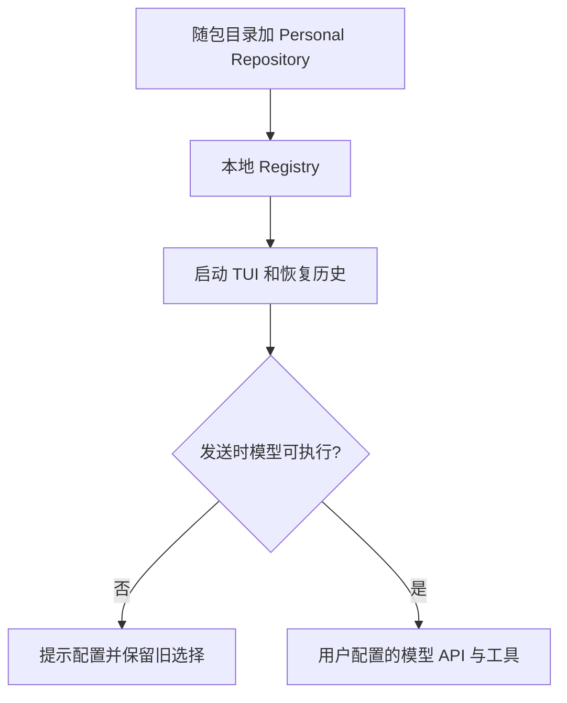

# 独立 CLI 的模型配置边界

2026-10-24：CLI 不再提供官方产品账号登录、退出和 Coding Plan 入口。旧凭据保持原文件但不读取，不生成 Account Overlay，不请求官方项目令牌，不隐式注入官方 MCP 身份头。

Built-in 目录仅来自随包资源；Personal Repository 继续拥有用户模型配置和默认选择。GLM 与其他 API 模型一样使用用户提供的 API Key。无模型时允许进入 TUI、查看历史和执行本地命令；发送前提示配置，通过 `/model` 手动选定。旧官方模型选择不得自动切到另一计费来源。

MCP 自己的 OAuth、用户配置的请求头、密钥加密、文件锁及并发安全不变。端到端验收以根目录 `docs/desktop/standalone-coding-harness-spec.md` 为准。

