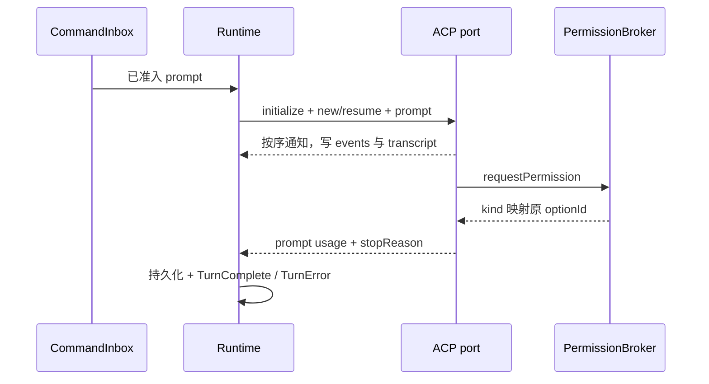

# 外部 Agent 引擎 CLI 接口

会话创建时固定 engine（zcode、claude-code、codex），SQLite 增量添加 engine、externalSessionId；旧记录缺省 zcode。引擎上下文由官方 CLI 持有，YCode 仅保存 id，并将 ACP 输出写回既有事件与 transcript。

状态所有者：runtime 拥有串行 turn、权限与持久化；adapter 端口拥有进程和 JSON-RPC 请求表。进程退出拒绝全部 pending 请求，异步通知按到达顺序处理，旧进程不能写入新进程状态。关闭 runtime 时先取消并关闭 adapter。

启动只使用 shared 锁定版本的管理目录入口，不隐式安装。ZCODE_EXTERNAL_ENGINES_DIR 指定安装根，缺失或入口不可访问时报 engine_not_ready。ZCODE_EXTERNAL_ENGINE_USER_HOME 若存在必须为绝对路径，优先于宿主 HOME；缺失沿用当前用户 HOME，非法值拒绝启动。不读取任何凭据文件。真实 HOME 恢复后删除 shared descriptor 指定的环境变量；官方 CLI 路径遵守用户 PATH。无请求时不启动子进程或联网。

外部引擎不进入 ZCode Provider、标题 sidecar、记忆、compact 或工具执行路径；/compact 透传 ACP。事件与 turn 终态复用现有生命周期。cancel 发送 session/cancel 后等待停止结果，关闭时清理进程树。恢复必须成功 session/resume/load，不静默 session/new。prompt 的空 usage 合法；停止时连接故障由 Runtime 自动调用既有 prepareSession 恢复原会话及已确认配置，投影 connecting/ready，失败才 error，禁止重发 prompt，关闭时不重连。

验收：双引擎 new/resume、文本/思考/工具/diff/usage、拒绝权限原 id、取消、退出拒绝 pending、非法帧、旧 session migration，连续 turn 不启动 Provider。远程工作区一期明确拒绝。

外部引擎运行中不可 steer；guide 请求归一为普通 queue 并复用既有 admission intent 与队列持久化，下一轮串行执行，不保留无法消费的 guide。

结构化失败与计划审批（2026-11，细则见根仓 docs/desktop/native-plan-errors-spec.md）：adapter 在边界把 typed sessionFailure（仅为 Codex 声明 AIR `sessionFailure` 与 `terminal_output_delta`）、Codex 非 typed `_meta.codex.error`（含 additionalDetails）及 prompt RPC 错误归一脱敏为 EngineConnectionFailure，经 onFailure / 结果 failure 交付；Runtime 按失败 ID 与 revision 幂等发布重试，终态失败抛出 session/prompt 请求失败并把诊断写入 assistant.error.data.failure，冷恢复据此还原失败轮。计划审批按 Claude `name`/“Approve Plan”/计划输入识别，原生选项与推荐项随 PermissionRequested 投影，broker 回传精确 nativeOptionId；停止、断联或收尾时取消在途审批并先发布 PermissionResolved(cancelled)。runTurn 无健康连接时先投影 connecting。

## 连接配置（2026-11-07）

产品规则见 `docs/desktop/external-agent-engines-spec.md`「连接与认证规则」。CLI 侧只读 Host 写入的 `<ZCODE_EXTERNAL_ENGINES_DIR>/connections.json`，不写连接配置：

- 绑定：`createSession.config.engineConnectionProfileId` 只在草稿首次 `prepareExternalEngineSession` 前写入 runtime；未提供时 adapter 取该引擎的上次使用配置，旧原生会话无绑定时 Codex 为 `inherit`、Claude 为 `official`。解析结果经 `onConnectionProfile` 持久化到 external_engine_config entry，并在 `ExternalEngineConfigUpdated` 携带 `engineConnectionProfileId`，同一次准备的重试固定首次解析值。配置缺失或凭据缺失分别报 `configuration` / `authentication`，不回落其他身份。
- 环境：共享 `buildEngineConnectionEnv` 按方式构造（Claude 沿用 CLI 保留 ANTHROPIC_*，官方登录剔除三项计费变量，API Key 只在子进程环境注入密钥；Codex 不变）。随后 `applyNetworkEgressEnv` 从 `ZCODE_TOOL_ENV_PASSTHROUGH_JSON` 恢复用户代理与证书变量，`ZCODE_HTTP_PROXY` / `ZCODE_NO_PROXY` / `ZCODE_AGENT_CA_CERT` 显式配置优先。
- `ZCODE_EXTERNAL_ENGINE_NODE`：仅当 Windows 上 PATH 缺 node、adapter 前置 `node.cmd` 补位时，由 adapter 写入 ACP 子进程环境，值为当前运行时路径；`node.cmd` 以 `"%ZCODE_EXTERNAL_ENGINE_NODE%" %*` 调用它，保证批处理内容为纯 ASCII（cmd 按控制台代码页解码批处理，中文用户名路径不能内嵌）。继承值一律被覆盖，不读取用户设置；缺失时 node.cmd 启动失败并按 initialize / transport 失败上报。POSIX 仍使用指向当前运行时的符号链接 `node`。测试覆盖纯 ASCII 内容、继承值覆盖与中文空格路径下的真实执行。
- 连接测试：JSON-RPC `externalEngine/testConnection {operationId, engine, connectionProfileId}` 与 `externalEngine/cancelConnectionTest {operationId}` 不进入串行队列。handler 用独立 `createExternalEnginePort` 与临时 cwd 调用 `runExternalEngineConnectionTest`：发送 `Reply with OK`，拒绝全部权限，首个原生失败（`_meta.codex.error`、AIR `sessionFailure`、prompt JSON-RPC 错误）即结束，90 秒超时；结束后 closeSession 并删除临时目录。返回 success / unexpectedReply（脱敏摘要）/ failed（EngineConnectionFailure）/ cancelled，不写 SQLite、任务索引或日志正文。
