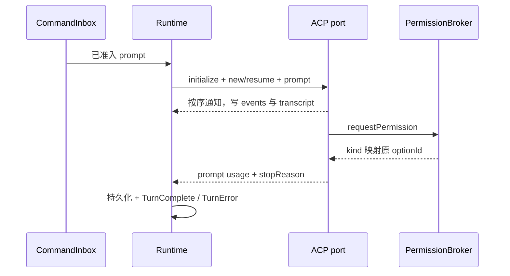

# 外部 Agent 引擎 CLI 接口

会话创建时固定 engine（zcode、claude-code、codex），SQLite 增量添加 engine、externalSessionId；旧记录缺省 zcode。引擎上下文由官方 CLI 持有，YCode 仅保存 id，并将 ACP 输出写回既有事件与 transcript。

状态所有者：runtime 拥有串行 turn、权限与持久化；adapter 端口拥有进程和 JSON-RPC 请求表。进程退出拒绝全部 pending 请求，异步通知按到达顺序处理，旧进程不能写入新进程状态。关闭 runtime 时先取消并关闭 adapter。

启动只使用 shared 锁定版本的管理目录入口，不隐式安装。ZCODE_EXTERNAL_ENGINES_DIR 指定安装根，缺失或入口不可访问时报 engine_not_ready。ZCODE_EXTERNAL_ENGINE_USER_HOME 若存在必须为绝对路径，优先于宿主 HOME；缺失沿用当前用户 HOME，非法值拒绝启动。不读取任何凭据文件。真实 HOME 恢复后删除 shared descriptor 指定的环境变量；官方 CLI 路径遵守用户 PATH。无请求时不启动子进程或联网。

外部引擎不进入 ZCode Provider、标题 sidecar、记忆、compact 或工具执行路径；/compact 透传 ACP。事件与 turn 终态复用现有生命周期。cancel 发送 session/cancel 后等待停止结果，关闭时清理进程树。恢复必须成功 session/resume/load，不静默 session/new。prompt 的空 usage 合法；停止时连接故障由 Runtime 自动调用既有 prepareSession 恢复原会话及已确认配置，投影 connecting/ready，失败才 error，禁止重发 prompt，关闭时不重连。

验收：双引擎 new/resume、文本/思考/工具/diff/usage、拒绝权限原 id、取消、退出拒绝 pending、非法帧、旧 session migration，连续 turn 不启动 Provider。远程工作区一期明确拒绝。

外部引擎运行中不可 steer；guide 请求归一为普通 queue 并复用既有 admission intent 与队列持久化，下一轮串行执行，不保留无法消费的 guide。

结构化失败与计划审批（2026-11，细则见根仓 docs/desktop/native-plan-errors-spec.md）：adapter 在边界把 typed sessionFailure（仅为 Codex 声明 AIR `sessionFailure` 与 `terminal_output_delta`）、Codex 非 typed `_meta.codex.error`（含 additionalDetails）及 prompt RPC 错误归一脱敏为 EngineConnectionFailure，经 onFailure / 结果 failure 交付；Runtime 按失败 ID 与 revision 幂等发布重试，终态失败抛出 session/prompt 请求失败并把诊断写入 assistant.error.data.failure，冷恢复据此还原失败轮。计划审批按 Claude `name`/“Approve Plan”/计划输入识别，原生选项与推荐项随 PermissionRequested 投影，broker 回传精确 nativeOptionId；停止、断联或收尾时取消在途审批并先发布 PermissionResolved(cancelled)。runTurn 无健康连接时先投影 connecting。

## 连接配置（2026-11-07）

产品规则见 `docs/desktop/external-agent-engines-spec.md`「连接与认证规则」。CLI 侧只读 Host 写入的 `<ZCODE_EXTERNAL_ENGINES_DIR>/connections.json`，不写连接配置：

- 绑定：`createSession.config.engineConnectionProfileId` 只在草稿首次 `prepareExternalEngineSession` 前写入 runtime；未提供时 adapter 取该引擎的上次使用配置，旧原生会话无绑定时 Codex 为 `inherit`、Claude 为 `official`。解析结果经 `onConnectionProfile` 持久化到 external_engine_config entry，并在 `ExternalEngineConfigUpdated` 携带 `engineConnectionProfileId`，同一次准备的重试固定首次解析值。配置缺失或凭据缺失分别报 `configuration` / `authentication`，不回落其他身份。
- 环境：共享 `buildEngineConnectionEnv` 按方式构造（Claude 沿用 CLI 保留 ANTHROPIC_*，官方登录剔除三项计费变量，API Key 只在子进程环境注入密钥；Codex 不变）。随后 `applyNetworkEgressEnv` 从 `ZCODE_TOOL_ENV_PASSTHROUGH_JSON` 恢复用户代理与证书变量，`ZCODE_HTTP_PROXY` / `ZCODE_NO_PROXY` / `ZCODE_AGENT_CA_CERT` 显式配置优先。
- `ZCODE_EXTERNAL_ENGINE_NODE`：仅当 Windows 上 PATH 缺 node、adapter 前置 `node.cmd` 补位时，由 adapter 写入 ACP 子进程环境，值为当前运行时路径；`node.cmd` 以 `"%ZCODE_EXTERNAL_ENGINE_NODE%" %*` 调用它，保证批处理内容为纯 ASCII（cmd 按控制台代码页解码批处理，中文用户名路径不能内嵌）。继承值一律被覆盖，不读取用户设置；缺失时 node.cmd 启动失败并按 initialize / transport 失败上报。POSIX 仍使用指向当前运行时的符号链接 `node`。测试覆盖纯 ASCII 内容、继承值覆盖与中文空格路径下的真实执行。
- 连接测试：JSON-RPC `externalEngine/testConnection {operationId, engine, connectionProfileId}` 与 `externalEngine/cancelConnectionTest {operationId}` 不进入串行队列。handler 用独立 `createExternalEnginePort` 与临时 cwd 调用 `runExternalEngineConnectionTest`：发送 `Reply with OK`，拒绝全部权限，首个原生失败（`_meta.codex.error`、AIR `sessionFailure`、prompt JSON-RPC 错误）即结束，90 秒超时；结束后 closeSession 并删除临时目录。返回 success / unexpectedReply（脱敏摘要）/ failed（EngineConnectionFailure）/ cancelled，不写 SQLite、任务索引或日志正文。

## 异步准备、备用进程与闲置关闭（2026-11-07，1.1）

产品规则见 `docs/desktop/external-agent-engines-spec.md`「外部引擎进程与异步准备」。CLI 侧契约：

- `createSession`（外部引擎）调用 `AgentRuntime.startExternalEngineSessionPreparation({connectionProfileId?})`：同步绑定所选连接配置，复用 `prepareExternalEngineSession` 的 single-flight，在 `ExternalEngineConfigUpdated(connecting)` 写入后返回；握手结果只经 `engineConfigState` 投影 ready / error，后台拒绝不再冒泡到 ACK。发布 connecting 前的失败仍删除 deferred 记录并 ACK failed。Runtime 进入 `shuttingDown` 后，迟到的 `onConfigOptions` 与错误不再发布。
- `ExternalEngineProcessPool`（`adapters/src/external-engine/process-pool.ts`）由协议 server 为每个 CLI 进程创建，经 `ZCodeAppOptions.externalEngineProcessPool` 注入各会话 app 的 `createExternalEnginePort`；`server.shutdown()` 调用 `pool.close()`。TUI、headless 与测试连接不传 pool，行为与 1.0.x 相同。
- 预建会话（2026-11-08 起取代只 initialize 的备用进程）键为（engine, connectionProfileId, cwd）；预建时完成 spawn、`initialize`（含连接级 setup）、该 cwd 的 `session/new` 与新会话默认配置（Claude Auto），缓存 `session/new` 响应、配置选项与领用前到达的通知，从不提交 prompt。只在新会话时领用（同步、健康、键一致），领用前已按会话完成连接配置解析与 `onConnectionProfile` 持久化；领用后 `execute()` 跳过 initialize 与 `session/new`，以缓存的原生会话 ID 调用 `onSession`，再按原规则下发会话自带的 `configValues` 并 `onConfigOptions`。补位在该键的新会话就绪后后台进行，至多一个；10 分钟未领用关闭；失败只写日志。实现为 `AcpConnection.prebuild(engine, cwd)`：不调用任何会话回调，领用前 `sessionReady` 保持 false，期间的通知留在初始通知缓冲；领用时 `handshake.completed` 的 `initializeMs` 为 0，`sessionMs` 只含 `onSession` 持久化耗时。2026-11-08 本机实测两家未提交 prompt 的会话关闭后都不写原生会话历史，adapter 不做关闭清理。规则与依据见根仓 docs/desktop/external-agent-engines-spec.md「预建会话」。
- 闲置关闭：port 按会话记录在途计数、最近使用时间与“可恢复”（resume/load 建立或已提交过 prompt）；pool 每 60 秒扫描，关闭满 15 分钟、不在最近 3 个可恢复会话内、无在途操作的连接。只关闭进程，Runtime 状态不变；下次 turn / 配置沿既有恢复路径重连。
- 常驻池 `DEFAULT_SESSION_RESIDENT_IDLE_TIMEOUT_MS` 改为 30 分钟。
- V4 `setEngineConfigOption` 的 ACK 结果（2026-11-08 起）为 `{ type: "setEngineConfigOption", engineConfigOptions }`，即 `runtime.setEngineConfigOption` 发布配置后的确认列表。依据：草稿首发要等本机记忆恢复收口，引擎接受却保留旧值时只靠后续 snapshot 无法区分"帧未到"与"未生效"，首发会一直等待；Renderer 改按 ACK 结果推进恢复。schema 见 `packages/shared/src/zcode-protocol-v4/command.ts`，旧客户端按可选字段读取。
- 不新增环境变量；时间与数量常量在 pool 内具名定义，测试经 options 覆盖。
- 性能事件（info，无正文）：`external_engine.handshake.completed|failed`、`external_engine.spare.claimed|miss|ready|expired|failed`、`external_engine.idle_close`、`external_engine.idle_resume.completed|failed`。

验收：受控 ACP 夹具覆盖 ACK 先于握手、后台 ready/error、握手中关闭、预建会话领用/补位/过期/配置隔离（P09：领用不再 initialize 与 `session/new`、取得预建 ID 与配置、已保存配置领用后下发、领用前通知交给会话）、闲置关闭后透明恢复（ID 与配置保留、prompt 只发一次）、最近 3 个豁免与草稿不关闭、关闭 pool 清理备用进程。

## 原生子智能体（2026-11，1.1.0）

产品规则、事件顺序与验收见根仓 `docs/desktop/external-agent-engines-spec.md`「外部引擎原生子智能体」。CLI 侧要点：

- adapter：initialize 两家都声明 `clientCapabilities.subagents: {}`（Codex 另保留 AIR sessionFailure 与 terminal_output_delta）。`subagent-frames.ts` 把 AIR 草案（`subagent_spawned` / `subagent_state_update`）与 RFD（`subagent_update` / `session_message`）归一为 `onSubagent` 事件；已宣告子 sessionId 的更新经 `onChildUpdate`，其权限请求带 `childNativeSessionId` 进入同一 `requestPermission`；未知非主 ID 丢弃（权限回 cancelled）并经 `onDiagnostic` 记 debug。load/fork 回放期间丢弃全部子智能体帧。`cancelSubagent` 只对原生声明可取消的子会话发送 `session/cancel`。
- Runtime：父会话外部引擎 Runtime 是子智能体唯一 owner（`core/src/external-engine/subagents.ts`）。子会话 ID 由父会话 ID 与原生子 ID 确定性派生；每个子会话由一个不跑模型、不连 adapter 的子 Runtime 承载持久化（taskType `subagent_child`、parentID 为直接父会话、engine 同父、无 externalSessionId），先落库再在父会话发布合成 Agent 行与 SubagentSpawned；子正文复用 `ExternalTranscriptWriter` 写入子会话 message/part 并经父 sink 路由到子 V4 topic；结束发布 SubagentStopped，父轮收尾时仍运行的子会话记 lost。`subagent_child` 会话的 resume / prepare 不发起原生连接。
- 权限：子会话请求以父 sessionId 进入 broker，携带 `origin(kind=subagent)`，应答按 kind 选该请求自身的原生 optionId。
- 停止：可取消子会话发布 `BackgroundTaskStarted(cancellable)`，`cancelBackgroundTask(childSessionId)` 先由外部子智能体 owner 处理并转为 `cancelSubagent`。
