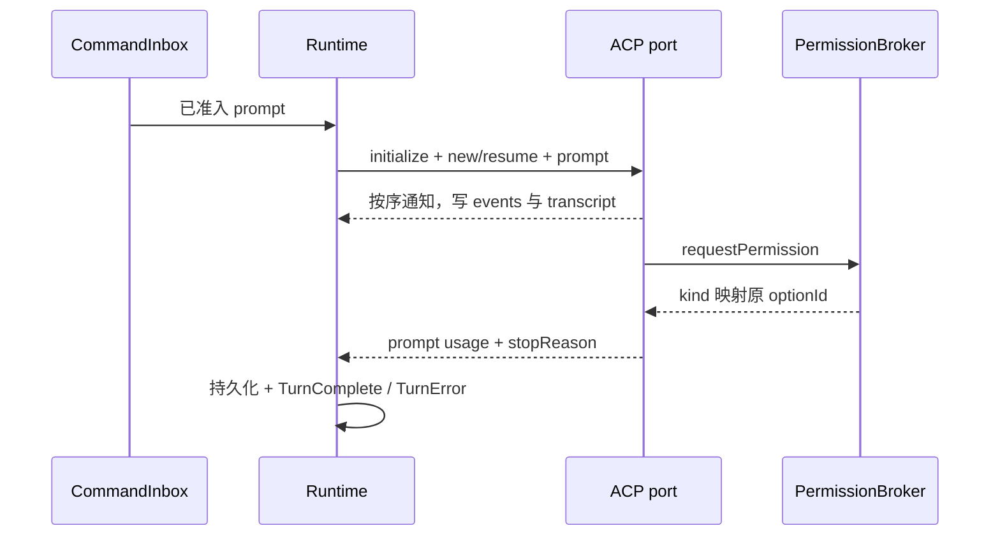

# 外部 Agent 引擎 CLI 接口

会话创建时固定 engine（zcode、claude-code、codex），SQLite 增量添加 engine、externalSessionId；旧记录缺省 zcode。引擎上下文由官方 CLI 持有，YCode 仅保存 id，并将 ACP 输出写回既有事件与 transcript。

状态所有者：runtime 拥有串行 turn、权限与持久化；adapter 端口拥有进程和 JSON-RPC 请求表。进程退出拒绝全部 pending 请求，异步通知按到达顺序处理，旧进程不能写入新进程状态。关闭 runtime 时先取消并关闭 adapter。

启动只使用 shared 锁定版本的管理目录入口，不隐式安装。ZCODE_EXTERNAL_ENGINES_DIR 指定安装根，缺失或入口不可访问时报 engine_not_ready。ZCODE_EXTERNAL_ENGINE_USER_HOME 若存在必须为绝对路径，优先于宿主 HOME；缺失沿用当前用户 HOME，非法值拒绝启动。不读取任何凭据文件。真实 HOME 恢复后删除 shared descriptor 指定的环境变量；官方 CLI 路径遵守用户 PATH。无请求时不启动子进程或联网。

外部引擎不进入 ZCode Provider、标题 sidecar、记忆、compact 或工具执行路径；/compact 透传 ACP。事件与 turn 终态复用现有生命周期。cancel 发送 session/cancel 后等待停止结果，关闭时清理进程树。恢复必须成功 session/resume/load，不静默 session/new。prompt 的空 usage 合法；停止时连接故障由 Runtime 自动调用既有 prepareSession 恢复原会话及已确认配置，投影 connecting/ready，失败才 error，禁止重发 prompt，关闭时不重连。

验收：双引擎 new/resume、文本/思考/工具/diff/usage、拒绝权限原 id、取消、退出拒绝 pending、非法帧、旧 session migration，连续 turn 不启动 Provider。远程工作区一期明确拒绝。

外部引擎运行中不可 steer；guide 请求归一为普通 queue 并复用既有 admission intent 与队列持久化，下一轮串行执行，不保留无法消费的 guide。
