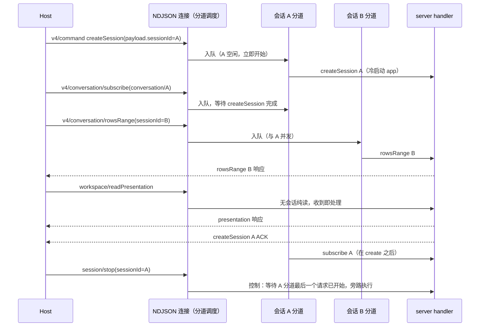
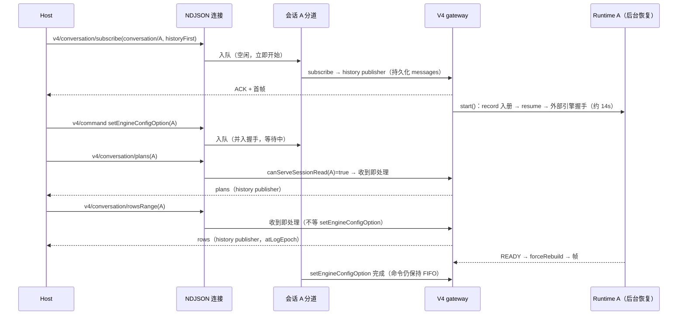
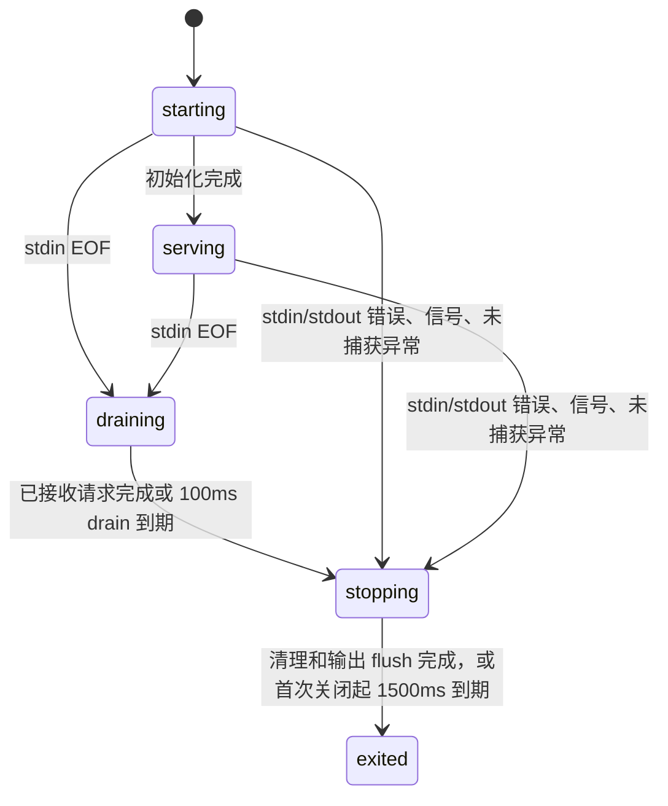
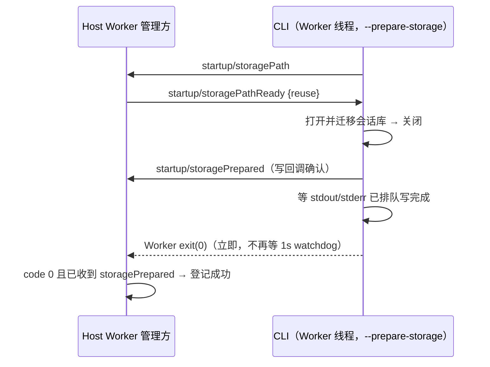
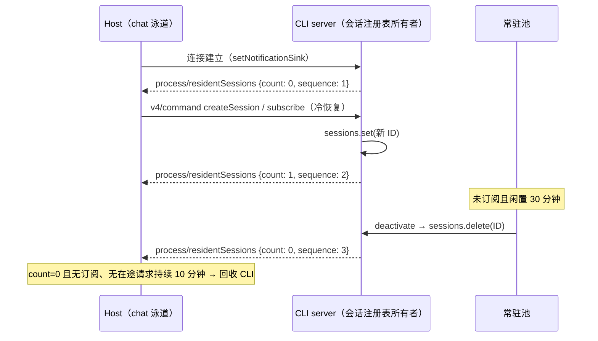

# ZCode Protocol Agent Server

## 背景

z-code 桌面端后续不再通过 ZCode app-server 兼容多 agent，而是只把 zcode-cli 作为私有 agent server 集成。桌面、SSH、Docker 场景里，GUI/host process 需要以薄客户端方式连接 zcode-cli，由 server 统一持有 session、模型、思考深度、模式、消息和运行态。

## 范围

- 新增 `zcode app-server --stdio` 入口，输出只承载 ZCode Protocol NDJSON frame。
- `agent-server --stdio` 作为同一能力的别名，方便后续命名切换。
- ZCode Protocol schema 仍由外层 z-code workspace 的 `packages/shared/src/zcode-protocol/index.ts` 单文件导出。
- v1 只实现 stdio transport；WebSocket 留给 cloud IDE/remote sandbox 后续复用同一 envelope。

## 状态归属

插件 `plugins/referenceCatalog` 与 `plugins/referenceCatalogWithCategory` 沿现有 listing join
按完整 plugin ID 投影可选 `description` / `descriptionI18n`。字段仅用于 Picker 按语言展示描述，
不进入 Session 冻结的能力身份或 model-only reminder；旧 Host 缺字段时 UI 留空。
语言回退与验收规则见[Plugin 对话引用](../../../../../docs/plugin-reference-mention.md#2-已确认的四项产品决策)。

- server 负责维护 session 核心状态：当前模型、可选模型、上次模型、思考深度、模式、权限、projection、eventSeq、stateRevision、消息和事件。
- TUI/GUI 只维护展示偏好，例如滚动位置、焦点、面板折叠状态和未提交草稿。
- `session/subscribe` 返回订阅确认、缺口事件和可选 snapshot；client 不把这层包装误当成 snapshot。

## 入口链路

```txt
zcode app-server --stdio
  -> runZCodeProtocolAgent
  -> ZCodeProtocolNdjsonConnection
  -> ZCodeProtocolAgentServer
  -> createZCodeApp / AgentRuntime / SessionStore
```

## stdio 输出边界

`app-server --stdio` 与 `agent-server --stdio` 的 stdout 是严格的 ZCode Protocol NDJSON
帧通道，不是通用日志流。宿主继续对每个非空 stdout 行执行严格的 schema
解析；不得为了兼容污染而忽略非 JSON 行。

CLI 在识别出 stdio protocol 命令后，必须在加载 `run.ts`、bootstrap 与三方 SDK
之前安装进程级 console 边界：`console.log/info/warn/debug/error` 统一写入 stderr，
只有协议 output 才允许写入 stdout（包括启动存储状态帧）。进程退出前保持该边界；
独立装配测试通过 disposer 恢复原 console。入口与 run 复用参数定义，只根据实际命令
启用生命周期，不能将 prompt/cwd 等选项的值误识别为 app-server。

```txt
ZCodeProtocolNdjsonConnection -> stdout -> Host JSON/schema parser
console.* / dependency logs    -> stderr -> Host log collector
```

该边界同时适用于桌面本地与 SSH/WSL/Docker 远程 agent；它不改变 protocol
message、desktop continuous 或 web remote replayable 的交付语义。

## 请求调度分道

一个 CLI 进程服务整个 workspace 的全部会话。`ZCodeProtocolNdjsonConnection` 是请求调度的唯一所有者；
分类规则集中在 `bootstrap/src/zcode-protocol/transport.ts` 的 `planProtocolDispatch`，handler 不再自行假设"前序请求已完成"。
过去除少数旁路外所有请求走同一条严格 FIFO，A 会话的冷恢复会让 B 会话的订阅、行范围和工作区展示
等待数秒到十几秒（1.0.5 生产日志：`subscribeConversationV4` p90 13s，`readWorkspacePresentation` p90 18s）。

| 类别 | 方法 | 调度 |
| --- | --- | --- |
| 响应 / 观测 | 反向请求的 response、`process/networkCapture` 通知 | 收到即处理，不进入任何分道 |
| 无会话纯读 | `workspace/readPresentation`、`session/list`、`v4/sessionsIndex/reconcile`、`v4/commands/query`（`clock: true`）、`plugins/list`/`describe`/`overview`/`referenceCatalog`/`referenceCatalogWithCategory`/`listUiSurfaces`、`skills/referenceCatalog`、`workflows/list`/`get`/`runs`/`forRun`、`usage/stats`、`v4/usage/stats`、`process/childProcesses`、`runtime/capabilities`、`v4/connection/flow`、`v4/conversation/visibility` | 收到即处理 |
| 会话只读（2026-11-08） | 携带 `sessionId` 的 `v4/conversation/rowsRange`、`plans`、`fileChanges`、`fileRewindPreview`、`backgroundBashOutput`、`usage`、`attachmentRead`/`attachmentStat`、`workflowRuns`/`workflowRunEvents`/`workflowRunArtifacts`/`workflowRunArtifactData`/`workflowRunArtifactRead`/`workflowRunWorkspace`/`workflowRunNodeResult`，以及 `v4/attachment/read`、`v4/attachment/previewSource` | 该会话**已有可读投影或激活在途**（history-first 打开中、READY 在途、record 已在内存、初始化已失败）时收到即处理，不排在会话分道之后，也不阻塞它；否则（冷会话，读取会触发激活）仍进会话分道 FIFO |
| 自串行 owner | `provider/refreshRegistry` | 收到即处理；Registry service 按 generation 合并并发刷新，Host 在依赖它的请求前等待其响应 |
| 控制 | `session/stop`、`workspace/cancelGenerateText`、`plugins/cancelOperation`、MCP App 请求 | 等所在分道上一个请求进入 handler（已建立 abort 入口）后旁路执行，不等其完成 |
| 会话分道 | 携带 `sessionId`、`conversation/<id>` topic、`commands[].sessionId`、v4 命令信封 `sessionId` 或 `createSession.payload.sessionId` 的请求 | 同会话 FIFO；不同会话并发；涉及多个会话的请求同时占用这些分道，全部轮到后才开始 |
| topic 分道 | 会话索引、工作区配置 topic 的 subscribe / resync / unsubscribe | 同 topic FIFO |
| 模型分道 | `workspace/generateText`、`provider/testModelConnectivity` | 彼此 FIFO；不阻塞全局写，也不被全局写阻塞 |
| 全局分道 | 其余无会话请求：hook 信任、偏好同步、无 ID 的 `session/create`、`mcp/list`、插件写操作、工作流写操作、未知方法 | FIFO |

保序保证：

- 同一会话内的写命令与订阅按到达顺序开始；会话只读在“可读”时不参与该顺序（见下），冷会话的读取仍按到达顺序开始。`createSession`（Host 预留 `payload.sessionId`）先于
  同会话的 `conversation/<id>` 订阅；命令 ACK 在各自分道内保持到达顺序。
- 控制请求只越过当前执行，不越过排在它前面、尚未开始的请求：它等待到达时分道上最后一个请求的"已开始"。
- 跨会话、跨分道没有顺序承诺。依赖其它请求结果的调用方必须等待响应（Host 现有发送前
  `provider/refreshRegistry`、偏好同步均已等待响应）。
- EOF 后停止接单；所有分道及收到即处理的在途请求完成后关闭，或 100ms drain 到期强制关闭；
  stdin/stdout 错误与 abort 立即终止，语义与原先相同。



### 会话只读不排队（2026-11-08，P4）

决策：外部引擎会话恢复（握手）期间，同一会话的只读查询不再排在会话分道之后，直接读已持久化数据；写操作与命令仍保持该会话 FIFO。

依据（1.1.0 Windows 生产日志 2026-11-07，CLI trace `9bd6c5cf`）：冷打开 Claude 会话后 history-first 订阅很快返回，runtime 恢复在后台进行（`zcode_protocol.session.resume_completed` 15804ms，其中 `external_engine.handshake.completed` session/resume 14166ms）。同会话的 `v4/conversation/plans` 在分道里等待整个 READY（含握手），`zcode_protocol.request.slow` 16450ms；排在它后面的 `rowsRange` `queue_wait` 16465ms，用户约 16s 无法上翻、计划面板无反应。

规则：

- 调度：会话只读方法由 `planProtocolDispatch` 归为 `session-read`；连接按 server 提供的 `canServeSessionRead(sessionId)` 同步判定（gateway：该会话有 history-first 打开、READY 在途、record 已在内存或初始化已失败）。可读则收到即处理（日志 lane 记 `session-read`），不排队、也不占分道；不可读（冷会话，读会触发激活）退回会话分道 FIFO，与旧行为一致，避免读请求抢在同会话订阅之前触发非 history-first 的冷激活。旧连接（未注入判定）一律退回会话分道。
- 读源：history-first 打开期间，`rowsRange` 与 `plans` 都读 history publisher（已持久化 messages + 事件合成的完整投影），不等待 READY；初始化已失败时读该 publisher。workflow 的 journal 读面只需会话 record（run service 读 SQLite journal，不依赖 runtime 恢复进度）：打开期间等 record 入册即读，不等 READY（含握手）。其余只读（fileChanges、附件、usage 等）handler 语义不变，可能仍等待 READY，但已不在分道内，不阻塞同会话其它读。
- 写与命令：`v4/command`、订阅族、`session/*` 写方法等保持会话分道 FIFO，不变。

一致性论证（读到的是稳定且与客户端快照同源的数据）：

1. 恢复握手不改历史行。核心恢复（消息 hydration、中断工具标记、compact 恢复）在 `runtime.resume()` 中先于握手完成；握手阶段 Runtime 只写 `ExternalEngineConfigUpdated`（connecting/ready/配置项）、可选命令/用量/标题与计划状态 entry；adapter 在 `session/load` 回放期间丢弃全部正文、工具与子智能体帧，只接纳配置与元数据（`connection.ts` 的 `loadingHistory` 过滤）。这些都不是 conversation rows，也不进入 `plans` 目录（终态 ExitPlanMode 工具行）。
2. history publisher 与订阅首帧同源：客户端此刻持有的快照正是由它生成，读结果与快照处于同一 logEpoch / revision 基线。
3. READY 后 publisher 以 forceRebuild 在同一 logEpoch 重建：尾窗结构不变时只 upsert 尾窗内有变化的行（核心恢复只改动最后一轮的中断工具等尾部行）；结构变化（如 compact 修复）时所有订阅以完整 snapshot 重同步，客户端窗口首行随之改变，在途 `rowsRange` 按游标规则作废（`conversationProjectionStore.loadOlder`：`atLogEpoch` 不匹配整体丢弃、首行变化作废）。`rowsRange` 只取窗口首行之前的旧行，这些行在握手期间不变（第 1 条）；`plans` 结果携带 `atSeq`/`atLogEpoch`；`fileChanges`/`fileRewindPreview` 要求 `baseRevision`/`baseLogEpoch` 精确匹配。这与 1.1 起 `rowsRange` 在 history-first 打开期间已读 history publisher 的既有行为一致，本次只把 `plans` 对齐并取消分道排队。
4. 对热会话，读越过在途写命令的效果等同于“读先于写到达”：结果带当时的水位，客户端按 rowId 合并、按纪元/游标防护，与读响应和帧本来就异步交错的现状相同。



性能观测：等待超过 50ms 的请求记录 `zcode_protocol.request.queue_wait`（`method`、`lane`、`waitMs`），
handler 耗时 ≥ 500ms 记录 `zcode_protocol.request.slow`（`method`、`lane`、`durationMs`、`queueWaitMs`），
均为 info，字段不含路径与正文。产品规则见
[内置引擎性能规格](../../../../../docs/desktop/engine-performance-1.1-spec.md)。

## 协议进程生命周期

CLI 入口在第一次异步初始化前接管 stdin/stdout 和信号，拥有唯一 shutdown deadline。
启动时用有背压的输入缓冲接住协议字节，不能为了观察 EOF 丢弃请求。bootstrap 通过
`RunZCodeProtocolAgentOptions.lifecycle` 接收取消信号、发起退出并读取同一个绝对 deadline；
它只释放运行时资源，不决定进程退出码。`--prepare-storage` Worker 和 plugin-host 保持各自生命周期。



- EOF 停止接单；有限的已接收请求可完成响应，挂起 handler 不能无限延长退出。
  首次关闭锁定原因、退出码和 deadline；后来的 SIGTERM、EOF、error 不重置预算。
- 仅 stderr 错误不关闭健康协议。入口对真实 stderr 安装写入边界：同步 throw、异步 error
  都只将出口置为不可用，之后不再写该流，不递归上报写入失败；所有 console/诊断共享该边界。
- 已被业务层处理的模型、工具、请求错误保留原协议行为。到达进程边界的未知
  uncaughtException/unhandledRejection 只诊断一次，随后取消运行、清理并以非零码退出。
- server 先拒绝新请求、取消反向请求和操作，再关闭所有已创建的 app，最后释放 gateway。
  迟到的 app 创建也必须关闭。此路径不调用产品 session/close，不发 session.removed，不删持久会话。
  bootstrap 在同一剩余预算内关闭 sampler、MCP/broker、共享存储、Registry 和遥测；单项失败不能阻止其他项被尝试。
- Host 立即使旧协议失效，但 stderr 保持收集至流关闭或有界 drain；exit 报告在 drain 后
  绑定原 runtime 身份与首次原因。正常 EOF 宽限 1800ms，进程树强杀仍受原总预算约束。
  CLI 的 E2E coverage 可额外预留 500ms 写盘，Host 沿用 coverage EOF 窗口。
- Host 按既有按需机制创建新 generation，不自动重发用户命令。手机 attachment 断开
  不触发共享 CLI 退出；desktop continuous / mobile replayable 的 owner 和恢复语义不变。

验收包括真实断管不自激、仅 stderr 断开仍能响应、启动中/空闲/在途 EOF、未知异常和
重复信号有界退出、短请求半关闭响应、挂起与迟到 handler 清理、最后一行诊断收集。

### 存储准备（`--prepare-storage`）完成即退出（2026-11-08）

- 依据：Host 在 Worker 中运行同一 CLI bundle 做会话库准备（`app-server --stdio --prepare-storage`），实测约 1.9s 中约 1.0s 是 CLI 发出 `startup/storagePrepared` 后等待一次性 CLI 退出 watchdog（1s）：Worker 的 stdio 句柄让事件循环不会自然排空。Host 不能提前结束 Worker，SILENTDB-06 要求“只有成功关闭并以 0 退出的 Worker 可登记”，退出确认仍由 CLI 给出。
- 规则：`--prepare-storage` 的 `run()` 返回后（成功时会话库已关闭、`storagePrepared` 帧的写回调已确认；失败时 `storageState failed` 帧已写出），入口先等 stdout / stderr 已排队的写回调完成，再立即以该退出码退出，不再安排 1s watchdog。成功 0、失败非 0，语义不变；Worker 中 `process.exit` 只结束该 Worker 线程。
- 不变：其它一次性命令仍用 1s watchdog；`app-server` / `agent-server` 仍由协议生命周期退出；plugin-host 成功返回后不安排 watchdog。
- 所有者：CLI 入口（`cli/src/main.ts`）按 `cliOneShotExitPlan({ argv, exitCode, pluginHost })` 决定退出方式（`immediate` / `watchdog` / `none`），执行面 `exitCliAfterOneShot` 在 `cli/src/shutdown.ts`（等流的写回调，不设等待期限）。
- 本机对比（2026-11-08，Windows，系统 Node 在 Worker 中运行 `--desktop-agent` bundle，各 5 次中位数）：`storagePrepared` → Worker 退出 1013ms → 5ms，Worker 启动到退出 2182ms → 1276ms；失败路径（会话库路径不可创建）`storageState failed` → 退出 1006ms → 52ms，退出码仍为 1、帧序列不变。Electron Node 下的绝对值以 Host 打点 `exitMs` 为准。



## 常驻会话数通知（2026-11-08）

决策（用户）：工作区 CLI 在“0 个常驻会话、无会话订阅、无在途请求”持续 10 分钟后由 Host 回收。Host 自己知道订阅与在途请求，但看不到 CLI 内的常驻会话；此前只能用“连接发过可能让会话常驻的请求”失败关闭地近似（见根仓 docs/desktop/host-idle-resources-1.1-spec.md §2），承载过会话的 CLI 本代永不回收。

- 事实所有者：协议 server 的会话 record 注册表（`context.sessions`，常驻池与所有创建 / 恢复 / 分叉 / 关闭 / 去激活路径共用的唯一注册表）。“常驻会话数” = 注册表中的 record 数，含草稿（未持久化的预热会话）与已恢复的历史会话；常驻池去激活、会话关闭或删除后减少。
- 通知：`process/residentSessions`，参数 `{ residentSessionCount, sequence }`（strict；`residentSessionCount` 非负整数，`sequence` 本进程从 1 起单调递增），schema 为 `packages/shared/src/zcode-protocol/index.ts` 的 `zcodeResidentSessionsNotificationSchema`，方法名 `zcodeProtocolNotifications.processResidentSessions`。
- 何时发：Host 连接的通知出口建立时立即发一次当前值（初始快照，通常为 0）；此后注册表的 record 数每变化一次发一次（新增新 ID、删除存在的 ID、清空），同一 ID 的替换不发。注册表变化与通知在同一同步片内完成，NDJSON 保序，Host 以最后一条为准。不周期重发。
- 初始值语义（给 Host）：收到第一条通知之前常驻数**未知**，必须按失败关闭处理（视为可能承载会话，沿用 `mayHostSessions` 近似）；旧 CLI 永不发送该通知，Host 行为与现在相同。收到后以 `residentSessionCount === 0` 作为“没有常驻会话”的事实，计数变为非 0 立即取消回收计时。
- 不含会话 ID、路径或正文；不进入任何分道（通知由 CLI 主动发出）。



## v1 方法

- session: `create`、`resume`、`list`、`read`、`messages`、`events`、`subscribe`、`send`、`stop`、`setModel`、`setThoughtLevel`、`setMode`、`close`
- workspace: `readState`
- process: `childProcesses`——返回 MCP tracker 内存里仍有存活进程的 MCP 子进程 `{ pid, serverName, mcpSource, pluginName? }`。纯内存、无 I/O；`pluginName` 来自 `plugin:<name>:<key>` 命名空间，官方插件由 host CLI 注入的 MCP（如 `node_repl`）按 `OFFICIAL_PLUGIN_DEFINITIONS.hostMcpServerNames` 反查。桌面资源管理器用它把 Host 侧 `ps` 进程树上的 pid 归到内置 / 社区插件（见桌面仓库 `docs/electron/resource-manager.md`），CPU/内存采样不在 CLI 内完成。
- blocking request: 后续由 `interaction/requestPermission`、`interaction/requestUserInput` 通过 server-to-client request 扩展

## 验证

### 桌面字节码试验的启动约定

- `ZCODE_DESKTOP_AGENT_BYTECODE=1` 是 Dev desktop 启动器传给 Host 的实验开关，默认关闭；
  普通 Dev 启动显式关闭，`pnpm dev:desktop:bytecode` 显式开启。不开启时忽略残留字节码。
- 仅 Electron 的工作区 dist 解析路径选择同目录 `zcode.bytecode.cjs`；显式
  `ZCODE_AGENT_SERVER_COMMAND` 保持最高优先级，非 Electron/远端保持原入口。
- 开启后字节码入口缺失直接报错；禁止回退到 JS，避免 A/B 数据失真。
- `app-server --stdio`、`--surface`、cwd、stdin EOF、stdout 帧以及 stderr 诊断契约不变。
  `storagePreparationEntry` 仍指向普通 `zcode.cjs`，不改变 Host Worker 的准备协议。
- 字节码绑定生成时的 Electron/Node/V8、平台/架构和 V8 缓存标识，升级后必须重建。
  coverage 构建与字节码试验互斥；完整构建/测量边界见
  [桌面打包文档](../../../../../docs/electron/desktop-bundle.md#桌面-stdio-agent-字节码试验)。

- bootstrap 单元测试覆盖 create/read/subscribe 的返回形态，以及 server-owned model state mutation 的 `state.updated` 通知。
- CLI 单元测试覆盖 `app-server --stdio` 分发到 `runZCodeProtocolAgent`。
- CLI protocol 入口测试覆盖三方代码调用 `console.debug` 时 stdout 仍为空且日志进入 stderr，并验证命令结束后 console 恢复。
- 真实子进程回归使用不声明 `tools` capability 的 MCP server，约束 `mcp/list` 返回合法 JSON 且 transport 不出现 `protocol_parse_error`。
- app 联调烟测覆盖 `IZCodeAgentService.initialize()` 启动 stdio agent、`session/create` 返回 snapshot、`session/read` 读取同一 session。
