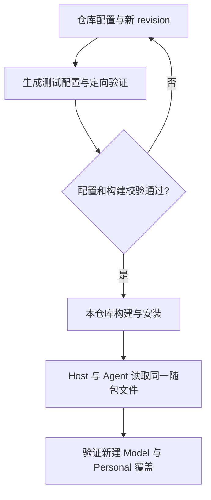

# Built-in Provider 随版本交付

2026-10-24 起，独立桌面 Coding Harness 的 Built-in 配置只随仓库产物交付。官方控制面下载、CDN 指针、Active/LKG 缓存、Endpoint 隔离缓存、TTL/lease 刷新和 Account 配对均已退役；旧在线交付记录不能作为现行操作指令。

## 配置交付

1. 在正式配置源修改模板、型号或规则，内容变化使用新 revision；同步生成测试配置并执行相关配置和 Resolver 测试。
2. 按明确的 `ZCODE_ENV` 构建，检查包资源或嵌入内容的 revision、hash 与目标模板。环境选择和资源位置见[配置规范](./configuration.md#构建选源与最终资源)。
3. 安装本仓库构建的产物，确认 Host 与 Agent 使用同一随包文件。仅文件、JSON 或 Schema 有效不足以证明真实模型请求可用。
4. 验证新实例、已有继承实例、Personal 覆盖和本次受影响的请求；分别记录回放、真实 API 和各平台的验证结果。

## 生效与恢复

Built-in Source 仅读取调用方指定的随包文件，不尝试旧缓存，不写锁或刷新控制文件。内嵌资源通过既有 materializer 以原子写入方式释放为唯一随包基线；升级替换随包内容，不保存下载历史副本。

随包文件变化可通过本地监听让后续 Registry 消费新内容；已经取得的执行 Model 不原地改变。Personal Repository 继续独立拥有用户配置、备份、锁和原子更新，Built-in 更新不改写用户意图或历史模型选择。

坏 JSON 或 Schema 直接读取失败，不用官方下载缓存伪装恢复。需要回退时安装已验证的仓库构建并重新核验实际资源；无需修改在线指针或删除用户目录。提交、合并、发布和部署仍以任务的明确授权为准。

实现：[随包 Source](../../packages/provider-node/src/zcode-builtin-provider-config-source.ts)、[资源释放](../../packages/provider-node/src/zcode-builtin-provider-config-materializer.ts)、[Registry](../../packages/provider/src/registry-service.ts)。
