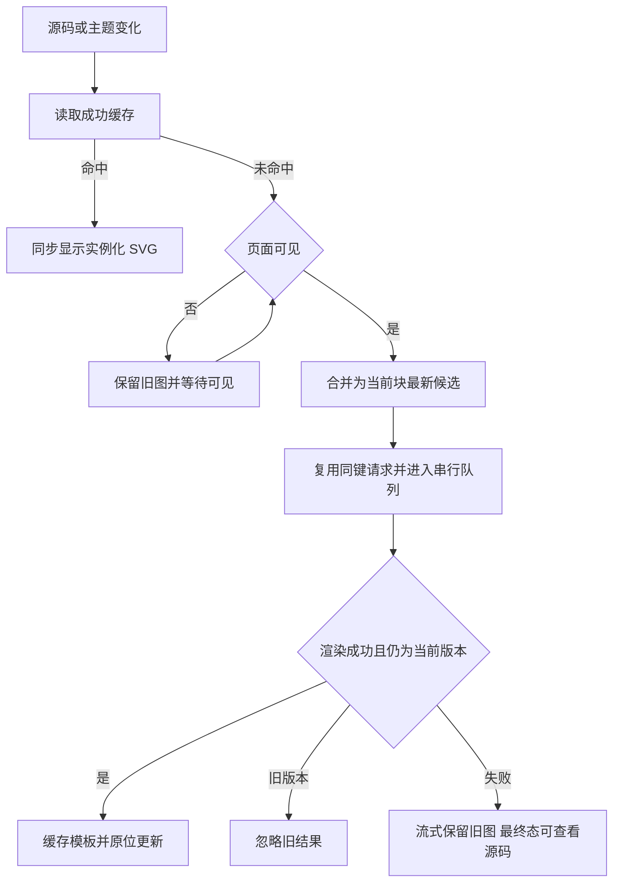

# Mermaid 渲染

## 范围

- 聊天消息、Markdown 预览、工具输出里标记为 `mermaid` / `mmd` 的 fenced code block 会渲染为 Mermaid 图表；未标语言但首行明显是 Mermaid 图表语法的纯文本 code block 也会自动渲染。
- 右侧代码查看器识别 `.mmd` / `.mermaid` 文件时也会直接展示图表。

## 实现

- 语言识别统一走 `packages/ui/src/lib/mermaidLanguage.ts`，避免不同入口手写判断。
- 图表渲染组件为 `packages/ui/src/components/ai-elements/mermaid-block.tsx`，使用 `@streamdown/mermaid` 的 Mermaid 实例，并读取当前主题 token 生成 Mermaid `themeVariables`。
- `mermaid-rendering` 模块拥有当前 renderer 进程内唯一的成功结果缓存、同键进行中请求和串行渲染队列，避免多个图表同时初始化 Mermaid 全局配置时互相覆盖主题。
- 缓存按完整源码及实际 Mermaid 配置（主题 token、字体、渲染版本）精确匹配；成功结果按条数和字节数限制 LRU，不写会话数据库。组件挂载同步读取成功缓存，避免切 Tab 时先出现 loading。缓存淘汰、源码或配置变化后允许重新渲染。
- SVG 缓存为模板，聊天和放大预览各自分配实例命名空间，同时替换 ID、样式选择器与 fragment 引用，避免双栏相互引用 marker 或样式。

## 放大预览

- Mermaid 作为正文图表自然展开，画布透明，不套代码块边框、语言标题或 420px 内部滚动区。SVG 按可用宽度等比缩放，高度随图表完整展示；聊天列表或文件预览面板拥有唯一滚动区。
- 默认节点使用当前主题的浅蓝底色、清晰的蓝色文字、圆角矩形和细连线。流程图的默认判断节点采用紧凑的虚线矩形，判断语义由条件文字、分支标签和虚线边框表达；原始 Mermaid 文本及复制结果不改写，其他显式形状和源码自定义样式保留。
- 流程图使用 Mermaid 的 ELK 正交布局，让节点按行列排列、连线沿水平和垂直方向路由；转角仅作小幅圆滑，避免插值折线带来的短台阶和入口偏转。布局插件仅在实际渲染图表时加载，复用现有串行渲染、成功缓存与流式保图，不新增另一套调度。源码显式指定布局或曲线时仍优先。
- 节点尺寸与行列间距以文字可读、分支清楚为准；相邻处理节点保持协调的宽度，条件节点不再使用高大的菱形。主题、字体和渲染预算沿用现有入口，超预算源码与普通代码块保留原有代码框。
- 放大与复制位于图表右上角轻量操作栏，预留空间以免遮住节点。精细指针设备在悬停或键盘聚焦图表内控件时显示，触屏常驻；图表尚未完成时放大按钮禁用。点击入口或双击图表区域打开既有预览弹窗。
- 只有首次异步生成成功的图表以 180ms opacity / 4px 位移过渡出现；缓存重挂载即时显示，流式更新和主题更新原位替换，不重播入场，不动画图表高度。减少动态效果时只保留短淡入，加载图标静止。Markdown 正文不逐 token 重播动画。
- 预览弹窗由通用图表预览组件承载，桌面端使用接近全屏的 Dialog，移动端占满可用视口。弹窗只展示已渲染的 SVG，不重新解释 Markdown，也不改变流式消息边界。
- 打开后初始焦点放在预览弹窗自身，避免工具按钮自动弹出 Tooltip 并抢占第一次 Esc；Tab 仍可依次访问工具栏。
- 预览打开后默认按弹窗可视区域和 SVG 可见图形边界执行 zoom-to-fit；小图也会在缩放上限内放大，Mermaid 外层背景画布不参与 fit。工具栏提供放大、缩小、缩放比例菜单（zoom to 50% / 100% / 200%、zoom to fit、reset zoom）和关闭；快捷键支持 `Esc` 关闭、`+` / `-` 缩放。
- 预览视口支持鼠标拖拽平移、滚轮平移、按指针位置缩放。macOS 触摸板捏合在浏览器里表现为 `ctrlKey` wheel 事件，弹窗内将其解释为以当前指针为中心的缩放；普通双指滚动保持为平移。
- 移动 Web 端通过 Pointer Events 支持单指拖拽平移和双指捏合缩放。所有手势只在弹窗内容区接管，避免影响聊天列表、远控 replayable 消息恢复和桌面 continuous 主链路。
- 图表主题继续复用当前 Mermaid themeVariables，预览容器使用 `--color-popover` / `--color-border` / `--color-foreground` 等设计 token，兼容亮色、暗色和 Zai 主题。

## 流式边界

- 首图前显示轻量生成状态；流式源码可解析后显示图表，后续候选失败时保留最近成功图。更新在完整行边界合并调度，单个图表最多一项执行中和一项最新待执行候选，不为每个 token 累积布局任务。
- 原始 Markdown 中图表围栏闭合即提交最终候选，不必等待整条消息结束；消息结束同样提交最后版本。异步结果只有仍匹配当前源码和配置才可提交，旧结果不能覆盖新图。
- 最终非法源码显示明确失败提示并可展开查看源码；已有成功图继续保留。失败结果不进入成功缓存。
- 页面隐藏时暂停新渲染，保留已显示图，恢复可见时处理最新候选。分栏缩放只改变 SVG 可用显示宽度，不触发 Mermaid 布局；主题 token 或字体变化会生成新配置版本，成功后原位替换。

## 阅读验收（MMD05–MMD06）

- 长流程图的首尾节点都在正文正常布局中，无图表内部纵向滚动；375px 窄屏、横屏及桌面均无页面横向溢出。
- 默认纵向与横向流程图的连线主干均水平或垂直，箭头正确进入节点，标签不压在线上或节点上；用分支、汇合、回边和长中文标签的图核对行列与节点尺寸，不能只用简单串行图验收。
- 浅深主题的默认节点文字与底色对比至少 4.5:1；字体设置能改变图表文字大小。普通代码、表格、引用和标题继续可读。
- 复制保留完整 Mermaid 源码；键盘可进入操作栏、打开放大预览并用 Esc 关闭；触屏可直接找到操作按钮。
- 流式保图、无错误闪烁、缓存重挂载即时显示的回归继续适用。组件浏览器候选不等价于真实 Agent 输出或实体手机验收。

