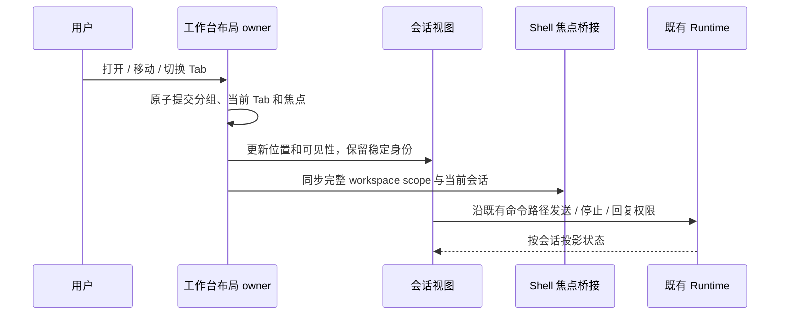

# 双栏会话工作台

状态：2026-10-27，已实现并完成本地自动验证；真实账号和 SSH 实机验收范围见末节。

## 范围与交互

- 首版仅单栏或左右两栏；每栏保留独立的会话绑定和当前会话，宽度可拖动调整。对话区不显示额外的顶部会话 Tab 栏，也不显示当前栏的选中边框。
- 非焦点栏仅叠加 8% 的主题背景色作轻微区分，不额外降低亮度或饱和度，保持正文与输入区清晰可读。
- 每个会话可使用已有的 ZCode、Codex 或 Claude Code 引擎，保持创建后引擎不可变及外部引擎仅本地桌面的既有门禁。本地与 SSH 会话可混排，不扩大远程引擎能力。
- 点击侧栏任务在当前焦点栏打开或激活 Tab。已在另一栏的会话只聚焦其原位置，不创建双视图。
- 左侧会话行的右键菜单提供在左栏/右栏打开、移动到另一栏、交换左右栏和关闭会话视图；复用同一工作台 owner，移动保留目标栏已有绑定。右上角提供分栏按钮及布局菜单，草稿也能分栏、交换、关闭和重新切换。分栏创建同工作区独立草稿，不复制已有会话。原顶部 Tab 的排序和拖动入口移除。
- 侧栏右键一级菜单只显示“分栏”，左右栏打开、移动、交换和关闭视图收进其子菜单，避免挤占原任务操作。右上角保持一个分栏图标，通过菜单选择分栏或管理布局。
- 定向打开由 `openSession(binding, side?)` 原子提交；单栏中仅有一个会话却明确要求在右栏打开时，左栏创建独立草稿保留左右两栏。其他移动仍遵循空栏合并，不创建临时占位绑定。
- 双栏复用现有顶栏高度，每栏独立显示“项目名 · 会话标题”、该会话的菜单和关闭分栏 ×，不新增会话 Tab 栏；终端等全局工具仍只有一份并跟随焦点。非焦点栏的会话菜单必须按该栏完整 workspace scope 和 sessionId 操作。
- 草稿显示“项目名 · 新会话”；尚未选择项目时显示“选择项目 · 新会话”。标题项目入口复用现有选择器，只更新指定草稿的项目和目录；已有会话仅展示所属项目，不改变绑定目录。
- 关闭分栏 × 将该栏所有前后台会话和草稿一次合入剩余栏，保持剩余栏当前会话并聚焦剩余栏；草稿身份、内容和后台执行不变。右上合栏菜单复用同一原子移动命令，不逐项移动造成中间焦点切换。
- 每栏最后一个 Tab 被关闭或移走后自动合并。最后一个工作台 Tab 关闭后进入新会话草稿。
- 关闭 Tab 只改变布局，不停止、删除、归档会话；只有明确停止操作中断运行。
- 每个草稿有稳定 Tab 身份，文字、附件、模型、引擎、项目放置意图及预热载体独立。草稿首次发送原地绑定 session，不能改变其 Tab 身份或重发输入。
- 编辑器首次就绪后的输入优先于尚未执行的草稿恢复；下一帧恢复不得覆盖期间的新输入，分栏、打开菜单和交换布局不得触发同 scope 的旧稿回填。
- 从草稿创建项目时，弹框打开即固定同 workspace 的焦点草稿 Tab 身份；保存和目录刷新后仅在原 Tab 仍聚焦且保持草稿时接续其实时正文、附件和分组。焦点切到其他 Tab、原 Tab 关闭或已发送时仅保存项目，不捕获另一份草稿。
- 两个会话沿用各自已有目录，不自动建立 worktree。同目录的 Agent 操作同一份磁盘文件。
- 共享 Side Pane、终端、搜索和快捷键跟随焦点会话的完整 workspace scope；另一栏权限或用户输入请求不得抢走输入焦点，不使用遮住整个工作台的后台弹窗。
- 持久化布局、Tab、宽度比例和草稿；启动恢复本身不发送消息或开启新一轮执行。远端离线时保留 Tab 和错误/等待状态，不能回落本地连接或因列表尚未加载误判删除。
- 窄屏暂时只显示焦点栏，允许切换两栏，保留隐藏栏和运行状态；恢复宽度后恢复双栏。

## 状态与接口

会话事实、已接受输入、权限及运行队列继续归 CLI Runtime。工作台布局归 renderer 中唯一的工作台 store；整合现有 pane/group 导航，禁止维护第三份互相竞争的活跃布局。

Tab 绑定携带 workspacePath、workspaceIdentity、remoteSessionId、sessionId 或稳定 draftId。身份隔离复用 workspaceIdentity.trim() || workspacePath 及既有远程路由工具。Tab 移动只更新归属，组件保持稳定 key 和共同父节点，复用既有连接 registry。SSH 连接换代时，工作台按完整 workspaceIdentity 精确刷新该工作区全部前后台 Tab 的 remoteSessionId，保留 Tab、草稿及会话身份；同路径的其他 Source 不受影响，缺省 endpoint 不能清除已知连接。

先原子提交工作台分组/当前 Tab/焦点，再同步 shell 导航与工具上下文；shell activeTaskId 不得反向覆盖另一栏内容。新会话 accepted 时先绑定所属 Tab，再同步 shell。旧分屏持久化会话迁移为两栏 Tab，保留会话，不复制 CLI 或数据库事实。

## 验收场景

1. 同项目左右分别新建 Codex 与 Claude 草稿，输入、附件和配置独立；两边发送、流式输出和停止互不串线。
2. 通过侧栏右键在左右栏打开、移动、交换和关闭，保持会话身份、草稿、滚动及运行；移动到另一栏不覆盖目标绑定，空栏自动合并。顶部没有重复会话 Tab 栏，当前栏没有选中边框；右上按钮可操作独立草稿。
3. 点击侧栏分别覆盖当前栏新增、原栏激活和另一栏聚焦；关闭运行中 Tab 后 Runtime 继续。
4. 本地与 SSH 混排，焦点切换使工具操作路由正确；SSH 断连不触发本地查询，重连可继续使用原会话；连接 endpoint 换代同步更新同 identity 的前后台会话与草稿，同路径不同 identity 保持隔离。
5. 同时待权限时非焦点栏不抢输入；用户聚焦后能正常确认，响应仍携带原 session。
6. 重启/刷新恢复布局、草稿和比例，无自动发送；旧布局迁移不丢会话。创建项目接续原草稿的正文、附件与分组；同目录另一 Tab 获焦、原 Tab 关闭或首发期间的迟到保存不得接续其他草稿。
7. 左右独立标题显示各自项目与会话；右侧草稿选项目不改左侧；非焦点栏菜单定位其会话；关闭任意整栏后目标当前会话不变，源栏后台草稿仍可恢复且不会停止执行。
8. 深浅主题、窄屏切栏、键盘导航和国际化；Mermaid 在切 Tab、移动、分栏缩放和预览中复用且无 SVG ID 冲突。

实现前先补相关状态机与交互回归；交付执行相关测试、架构检查、pnpm typecheck 和 pnpm lint，真实外部账号与 SSH 环境未覆盖时明确记录。

## 初版验证（2026-10-27）

- 相关单测 21 文件、234 项通过，覆盖草稿与配置隔离、项目接续、同会话唯一放置、父子会话导航、连接 endpoint 换代、权限焦点及 Mermaid 缓存与流式候选。
- `pnpm typecheck`、桌面 `typecheck:e2e`、架构检查通过；`pnpm lint` 为 0 错误，保留仓库已有 93 条警告。
- macOS Electron 的 pending 用例验证独立输入、交换左右、窄屏切栏、刷新恢复、关闭合栏及跨栏拖动；详情和证据位置见 [覆盖矩阵](../testing/conversation-session-e2e-coverage-matrix.md)。
- 真实 Codex 与 Claude 账号并行、运行中关闭后续流、真实 SSH 断线重连及真实 Agent Mermaid 输出尚未验收。自动化用例保留 pending，未加入 CI。

## 界面调整验证（2026-10-27）

- 顶部会话栏及焦点边框移除；侧栏普通、置顶、项目和分组右键菜单复用左右栏打开、移动、交换与关闭；右上布局菜单保留后台草稿的切换入口。相关契约、菜单、布局、草稿和项目创建回归通过。
- Electron 回归曾发现编辑器就绪后新输入被迟到初始化回填覆盖，已用真实 Composer 单测复现，并通过编辑 revision 门禁拒绝旧回填；原流程重跑 1/1 通过，验证独立输入、菜单交换/移动、合栏、窄屏和刷新恢复。
- `pnpm typecheck`、桌面 `typecheck:e2e`、架构检查通过；`pnpm lint` 为 0 错误、93 条已有警告。当前 checkout 的开发窗口已确认无顶部会话栏、无选中框，并可打开右上与侧栏菜单。桌面证据见覆盖矩阵。
- 侧栏“分栏”子菜单及右上单图标收纳调整：4 文件 22 项相关单测通过，Electron 原流程 1/1 通过；类型、Lint 和架构检查通过。开发窗口确认一级菜单不展开布局操作，悬停“分栏”才显示子菜单。

## 每栏标题与关闭分栏验证（2026-10-27）

- 每栏项目、会话标题及菜单按完整 workspace 身份投影；草稿项目菜单精确绑定稳定 Tab，异步准备后再次检查目标仍为原未发送草稿。文字、附件和配置沿既有交接路径保存；不会重置目标目录其他会话的导航。
- 关闭 × 和布局合栏复用批量 moveTab 单次提交，保留目标 active 及源栏所有草稿；单栏隐藏 ×。标题与正文使用相同比例，保留原有顶栏高度和单份全局工具。
- 相关回归 12 文件 185 项通过；标题/项目菜单/项目创建/原会话菜单另完成 4 文件 104 项验证，包括迟到保存、首发和关闭目标的失效规则。类型、Lint 和架构检查通过，Lint 保留 93 条已有警告。
- macOS Electron pending 流程 1/1 通过，验证独立标题、× 合栏保留另一栏当前内容、两份真实编辑器草稿保留及菜单找回；证据见覆盖矩阵。真实账号并行及 SSH 实机仍未覆盖。
