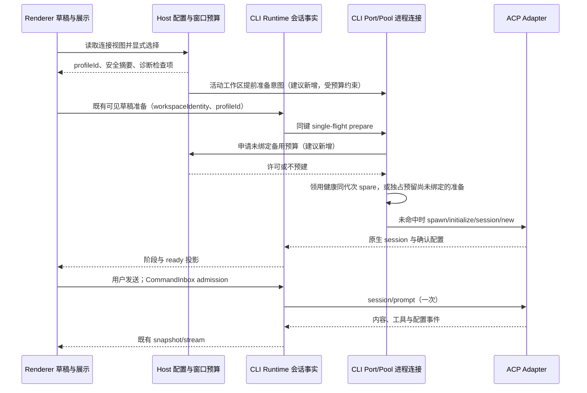

# ACP 连接、配置与交互优化建议

日期：2026-11-09。状态：方案已获用户接受并进入实施；本文保留调研时的现状和建议，当前产品规则以 [外部引擎规范](../desktop/external-agent-engines-spec.md) 为准，实际检查结果见 [验证记录](../testing/2026-11-09-acp-experience-verification.md)。未完成的真实供应商性能测量不视为已验收。

## 结论与范围

建议围绕三条主线改造：**提高已有预建会话的覆盖率、让实际生效配置可解释、把诊断和修复动作放到用户遇到问题的位置**。

codeg 值得借鉴的是预检数据合同、配置变化提示和紧凑的连接管理交互。ZCode 已有异步建会话、两层 single-flight、连接复用、备用进程及检测缓存，重建一套连接管理器的收益有限。先保留现有所有者与绑定语义，补足测量和交互。

首期范围为桌面本机 Claude Code / Codex。SSH 当前不支持外部引擎，本方案不扩大这个边界；Web 无本机服务时不展示不可执行的管理入口。普通 API Provider 和外部 Agent 仍使用各自执行合同。

本次源码基线：ZCode `4f367fabeac7ca0dabf7eb93d8397d8e49f3ac4d` 加开工时已有工作区改动。外部参考固定到 codeg `39fe4cc0950e9fab65aa1a04ed85db8614ce3d53`，详见[源码调研](../research/2026-11-09-codeg-acp-reference.md)。

## 已确认现状与证据边界

| 结论                                                                             | 当前证据                                                                                           | 对方案的影响                                               |
| -------------------------------------------------------------------------------- | -------------------------------------------------------------------------------------------------- | ---------------------------------------------------------- |
| 预建会话已经实现到 `initialize → session/new → 新会话默认配置`，每会话仍独占连接 | `apps/zcode-cli/packages/adapters/src/external-engine/process-pool.ts:1`、`connection.ts:435`      | 继续优化命中率；不提议所有会话共享一个 ACP 进程            |
| 备用进程只在新会话成功后补位；首次使用、恢复历史和测试连接不会创建备用           | `apps/zcode-cli/packages/adapters/src/external-engine/index.ts:267`，当前外部引擎 spec「预建会话」 | 首次进入与过期后的首次使用仍有冷启动窗口                   |
| 领用备用前仍完整运行 `resolveLaunch`                                             | 同文件 `:203`、`:210`                                                                              | 这是可测量的短路径优化点，不是已证明的主要瓶颈             |
| Host `ready` 只表示 adapter 与 CLI 可启动                                        | `packages/services/src/external-engine/node.ts:373`                                                | 设置页“就绪”不能向用户暗示认证和会话握手已成功             |
| 配置已由 Host 唯一写入；编辑生成新 ID 并保留旧绑定，删除只隐藏                   | `packages/services/src/external-engine/connections.ts:154`、`:190`、`:226`                         | 这是应保留的安全基础，无需先重写存储模型                   |
| 新草稿默认来自上次使用；已有会话绑定配置不可变                                   | 当前 spec「连接配置」「会话绑定」                                                                  | UI 必须区分新任务默认、草稿选择、历史会话绑定              |
| 模型与思考深度目前按引擎记忆                                                     | `packages/ui/src/hooks/external-engine/useEngineConfigMemory.ts:151`、`:250`                       | 不同网关目录可能不同，后续适合增加连接配置维度             |
| 当前已存在只读请求越过会话分道的实现                                             | `apps/zcode-cli/packages/bootstrap/src/zcode-protocol/transport.ts` 的 `SESSION_READ_METHODS`      | 旧扫描中的“恢复阻塞历史查询”不能直接认定仍存在，应回归验证 |

本轮只聚合读取本机 `cli/log/zcode-2026-11-09.jsonl` 的分类与数值，没有写入或复制原始用户日志：

| 日志路径分类              | 样本量 | 总耗时                   | 阶段证据                                                              |
| ------------------------- | ------ | ------------------------ | --------------------------------------------------------------------- |
| Claude 新会话，备用未命中 | 1      | 6,218 ms                 | launch 149 ms；initialize 4,282 ms；session 1,626 ms；配置恢复 160 ms |
| Claude 新会话，备用命中   | 3      | 中位 137 ms，最大 207 ms | initialize 与 session 均为 0；主要剩余开销在 launch 解析              |
| Codex 新会话，备用未命中  | 1      | 1,332 ms                 | initialize 333 ms；session 862 ms                                     |
| Codex 新会话，备用命中    | 1      | 148 ms                   | launch 解析 146 ms                                                    |
| Codex 原会话恢复          | 1      | 2,530 ms                 | initialize 935 ms；session 1,438 ms                                   |

这只是现有日志的少量样本，未隔离构建版本、调试活动和机器负载，不能当作发布性能基准或证明 codeg 更快。该文件还出现 1 次认证失败；本轮未进一步确定凭据根因。11-08 的日志混有大量不同耗时形态的记录，不纳入性能目标基线。旧 `.scratch/perf-scan-2026-11-08.md` 仅用于定位，不能替代当前源码和新的受控实测。

## 从 codeg 借鉴什么

| 思想                                           | 在 ZCode 中的落点                                                                                   | 优先级   |
| ---------------------------------------------- | --------------------------------------------------------------------------------------------------- | -------- |
| 分项 preflight，检查项携带状态、说明与修复动作 | Host 的安装/路径/认证诊断提供结构化结果；CLI 提供真实握手与会话生命周期投影；UI 只组合展示          | P0       |
| 区分原生 CLI、ACP adapter、认证与会话连接      | 设置页显示“运行环境可用”；当前会话单独显示“准备中/已连接/休眠/失败”                                 | P0       |
| 连接详情按需展开，正常状态低显著               | Composer 常驻一个短连接摘要；点击查看当前身份、配置来源、连接状态和针对性动作                       | P0       |
| 配置指纹识别 stale 并解释需重新连接            | 对沿用 CLI 的文件、认证、代理变化标记“环境已变化”；新预热不领用失效备用；运行中的会话不强行切换身份 | P1       |
| 左侧列表、右侧详情，单项检查和修复             | 设置页由两家引擎各自堆满操作，改成引擎选择 + 连接列表 + 当前详情                                    | P1       |
| 会话选项统一入口、能力驱动控件                 | 保留模型/思考深度/权限的语义与确认链，在一个浮层内分组编辑；选项多时搜索，未知值不显示成“关闭”      | P1       |
| 恢复连接的跨握手 single-flight 与健康连接复用  | 核对 ZCode 已有实现并补竞争场景回归，不再建立平行管理器                                             | 保留现状 |

不照搬 codeg 的框架、后端存储、超大设置组件、任意自定义命令入口或全部 Agent 目录。初期继续用锁定版本 adapter 与现有白名单引擎。codeg 的具体实现、局限与固定源码链接见独立调研；没有运行两个项目的同环境对比基准。

## P0：先让等待可见，让配置可解释

### 1. 分开“环境可用”和“会话连接”

不要把状态压成一个全局红绿灯。建议展示三个独立事实：

- **运行环境**：CLI 是否找到、adapter 是否安装，结果来自 Host。
- **认证与路由**：沿用 CLI / 官方登录 / API Key，实际生效路由与覆盖来源；未知即显示未检查，不能由安装状态推定登录成功。
- **当前会话**：未连接、准备中、已连接、休眠、失败，结果来自 CLI runtime/port。

兼容现有 `engineConfigState` 的含义。它在 idle close 后仍可保留 `ready`，表达配置可用；若要展示休眠，新增由连接 owner 发布的生命周期字段，不让 Renderer 根据时间猜测。Host 的 launch-ready 和真实 handshake-ready 用不同文案表达。

建立中显示真实阶段：“启动引擎 → 初始化 → 恢复会话 → 应用配置”。已有阶段耗时先用于诊断；若要流式展示阶段，需要新增由 CLI 发出的阶段事件，不能用定时器伪造百分比。

### 2. 预检与真实请求测试分开

复用现有 `getStatus/isLaunchReady/testConnection`，不新增第二条执行链。新增合同只是把结果组织成可展示、可操作的检查项：

```ts
// 调研阶段的建议草案；实际安全投影以 shared/external-engine 的 schema 为准。
type EngineCheck = {
  id: "cli" | "adapter" | "auth" | "route" | "environment";
  status: "ok" | "warning" | "error" | "unknown";
  summaryKey: string;
  action?: "installAdapter" | "login" | "editConnection" | "refresh";
};
```

“检查环境”不发送 prompt，也不暗中安装或登录；“测试模型响应”沿用现有临时会话测试，并明确将发送一个测试请求、可能计费。设置页打开先呈现已有配置，逐项更新结果，不等两家全部诊断结束才给出反馈。版本与完整认证探测留在设置/诊断，健康续聊不增加进程探测。

错误先显示用户能采取的动作，再提供可复制的脱敏详情：缺 adapter → 安装；认证失效 → 登录或编辑密钥；配置错误 → 打开对应连接；握手失败 → 重连；模型网关拒绝 → 检查网关或手动重试请求。进程重连与重发 prompt 保持不同动作，已提交 prompt 不自动重发。

### 3. 当前连接摘要

Composer 的原生模型、思考深度、权限/模式继续复用已有控件。新增短摘要，例如：`Claude Code · 工作连接 · 已连接`。点击展开：

```text
当前会话连接
Claude Code                 已连接
连接配置    工作连接
连接方式    API Key
实际路由    已配置的网关域名
模型来源    当前会话已确认
作用范围    当前会话；新任务默认另行设置

[管理此连接]  [检查环境]  [查看诊断]
```

草稿可以切引擎和连接；已有会话保持只读绑定。失败弹层提供“重新连接”，休眠提供“下次发送自动恢复”。不得使用“应用最新配置”偷偷将旧会话从旧 profile ID 改绑到新 ID；需要切身份时引导新建会话。

可借鉴 codeg 的统一会话选项浮层：宽屏保留紧凑摘要，窄屏收成一个入口；浮层内按模型、思考深度、权限/模式分组，按 ACP 返回的能力提供搜索列表或分段控件。连接摘要负责身份与健康，会话选项负责执行配置，两者不混成一张长表单。对未知/default 状态保留原生含义，不将其误标为关闭；变更仍逐项等待 Runtime 确认。

## P1：把已有加速路径覆盖到真正需要的时刻

### 1. 从“成功后补位”扩展为“活动工作区提前准备”

当前“可见草稿预热”已经存在，不再把它列为新增优化。建议补充的时机是：窗口恢复后，当前活动本地工作区、默认引擎及 profile 已确定，且该 workspace CLI 已因前台需要启动时，在用户打开下一份草稿之前低优先准备一个备用。只处理当前活动工作区，不为所有恢复标签启动 CLI，也不阻塞历史和首屏。若窗口启动即显示草稿，则仍走已有草稿准备，不额外再建一份。

另一处增量是当前 `claimSpare` 遇到 warming 直接未命中，随后另起进程。建议允许第一个新草稿请求原子预留并等候这个**尚未绑定的备用**；其他新会话独立准备，不能把两个草稿合并到同一个原生会话。若估计剩余等待已超过冷启动收益或准备已失败，则按明确规则放弃预留并走冷路径。取消与关闭遵守现有 owner 生命周期，不依赖延时去重。

后台预算建议先定为每窗口最多 1 个未领用备用，优先当前可见草稿；活跃会话连接不计为备用，两个可见草稿不能互相抢走已绑定连接。窗口级预算由 Host 调度，实际进程仍属于 workspace CLI 的 pool；不把跨 workspace 的进程转交给另一个 cwd。后台与前台争用时，取消未绑定的低优先准备，前台优先。

该预算会改变当前“每个用过的 workspace CLI 都可补位”的规则，必须先补 spec 和资源验收。保留现有 10 分钟备用/草稿、15 分钟不可见已用会话的回收规则，首轮不同时调整所有 TTL。冷启动失败不自动安装或触发计费测试。首次打开一个此前没有 CLI 的工作区仍可能需要完整冷启动，界面应准确展示阶段，不承诺用预热消除所有首次等待。

### 2. 备用有效性与短路径

现有 profile ID 已不可变，应直接作为身份边界使用。备用有效性建议补充：adapter/runtime 版本、执行环境代次、工作区 identity 与 cwd。沿用 CLI 的配置和凭据外部变化由受控失效机制表示，不将密钥放入日志、UI 或 fingerprint 原文。

先分别测量路径定位、环境构造、配置读取、凭据读取与 Node 补位。只有确认稳定描述符能按代次正确失效后，才缓存不敏感的启动描述；命中健康且同代次备用时，跳过无变化的完整探测。不要长期缓存明文密钥，也不要为了几十毫秒绕过绑定检查。

### 3. 首发不重复恢复配置

当前 adapter 会恢复会话配置，Renderer 又拥有新草稿的 model/effort 偏好恢复。先增加独立耗时：`handshakeReady → rememberedConfigConfirmed → promptSubmitted → firstContent`，避免把“引擎已连上”误当“首发已经可以执行”。

若实测显示这部分占比明显，再让新草稿创建携带已选配置意图，由 runtime 在同一次 prepare 中按“模型确认后再恢复思考深度”执行。UI 继续只保存偏好与用户意图，最终配置以引擎确认值为准；保留手动修改抢占恢复、取消及错误保留草稿语义。

## P1：整理配置的信息架构

### 概念和优先级

| 概念         | 用户看到什么                 | 唯一事实源                                                    |
| ------------ | ---------------------------- | ------------------------------------------------------------- |
| 引擎         | ZCode / Claude Code / Codex  | 共享引擎定义与会话创建配置                                    |
| 连接配置     | 用哪个身份、地址和配置来源   | Host connection service；凭据仍独立保存                       |
| 新任务默认   | 下一份草稿预选什么           | 现有设置与 `lastUsed`；第一阶段保持现有“上次使用”语义并写清楚 |
| 当前会话配置 | 当前模型、思考深度、权限模式 | Runtime 的已确认配置                                          |

已有会话：持久化绑定 ID 与已确认配置优先，不能被新默认覆盖。

新草稿：用户显式选择 > 现有上次使用偏好 > 内置默认；新草稿模型采用显式选择 > 当前连接的兼容偏好 > 配置默认/原生默认。建议模型偏好从仅按 engine 扩展为按 engine + profile 解析，旧引擎偏好只作为兼容初始化，不覆盖新连接已保存选择。修改连接文件不修改原生 CLI 的用户配置。

### 设置页布局

```text
Agent 引擎                                      [检查环境]
[Claude Code] [Codex]

连接列表                    当前连接详情
● 沿用本机 CLI              工作连接
  来源：本机 CLI            API Key · 新任务上次使用
● 工作连接  上次使用        运行环境   可用
  API Key · 网关            认证       已保存，尚未测试
○ 备用连接                  实际路由   已配置的网关域名
                            配置来源   YCode 管理
[添加连接]                  [测试模型响应] [编辑] [更多]
                            高级：CLI/adapter 版本、路径、诊断
```

列表显示每条连接自己的状态，不能把默认连接的认证结果套到所有配置。状态旁显示检查时间与“未检查”，避免把陈旧结果当作实时可用。内置“沿用 CLI”提供来源说明；官方登录只显示相应登录动作；API Key 不常驻显示无关登录命令。编辑用对话框或右侧表单，减少列表内长表单挤压。

保存后说明“用于新会话；已打开会话继续使用原配置”。已绑定隐藏配置的旧会话显示“历史配置”，仍可查看安全摘要，禁止静默换身份。暂不引入稳定逻辑 ID + revision 的数据库迁移；当前新 ID 机制足以保持历史。

外部配置冲突以来源说明表达，例如“Claude 本机配置覆盖了所选路由”。先准确读取已支持的必要字段；解析失败显示未知，不擅自删除原生文件。对运行中连接只提示变化，下次安全重连才解析同一身份的新环境，不中断正在执行的轮次。

遵守 `DESIGN.md`：复用 Settings、Popover、Dialog、ErrorDiagnostics 和 `text-ui-*`、语义 token；正常连接弱化显示，故障就地强调；提供键盘操作、可读状态与深浅主题。窄屏将双栏变为列表→详情单栏，动作语义不变；无本机 Host 服务时仍遵守当前能力门禁。

## 状态所有者与建议事件顺序



图中窗口预算协调是建议新增的资源调度接口，不经过 Main，也不把业务会话状态移到 Host。具体跨进程取消和许可释放必须在 spec 中定义：未获许可则正常前台准备，关闭 CLI/Host 释放配额，已绑定会话不受备用回收影响。

## 实施顺序与验收

| 批次               | 交付                                                               | 主要验收                                                                                                  |
| ------------------ | ------------------------------------------------------------------ | --------------------------------------------------------------------------------------------------------- |
| A：诊断与状态      | 拆清 launch/认证/会话文案；检查项+修复入口；记录握手后偏好恢复耗时 | 缺 CLI、缺 adapter、未登录、网关错误、休眠均能给出不同且正确动作；健康续聊无新增诊断进程                  |
| B：配置与 Composer | 连接列表/详情、来源解释、当前绑定摘要、按连接偏好方案              | 改默认不影响旧会话；编辑/删除保留旧绑定；不同网关不误套模型偏好；深浅主题、键盘与窄屏可用                 |
| C：冷路径覆盖      | 活动工作区提前准备；warming 备用独占预留；窗口资源预算；有效性失效 | 同会话并发只启动一次；不同新草稿不共享原生会话；多项目切换不风暴；失败/取消无孤儿进程；旧结果不覆盖新选择 |
| D：短路径优化      | 按实测决定启动描述缓存、配置恢复合并                               | 阶段测量证明收益；不牺牲身份隔离和最终确认；相同条件资源占用不回退                                        |

建议性能验收口径（需先取得受控基线，以下不是完成承诺）：

- 同机器、相同构建和 adapter/CLI 版本，冷/暖各至少 30 次，分别记录 P50/P95、失败率和并发进程数；安装、登录与网络首内容单独统计。
- 现有已就绪连接首发/续聊不出现额外 `--version`、登录诊断、重复 spawn 或多余 `session/new`。
- 健康备用命中的本地 prepare P95 目标 ≤300 ms；可见草稿准备完成后不再走第二次冷握手。
- 冷准备以现有同条件 P95 改善 ≥30% 为首轮目标，若主要时间在官方 CLI 内部，则分别报告不可控阶段，不承诺所有冷连接都低于一秒。
- 从点击发送到本地 ACK 的 P95 目标 ≤150 ms，与模型 TTFT、握手耗时分列；ACK 不能冒充引擎 ready。
- 资源预算建议以窗口最多 1 个未领用备用为起点；验证多工作区下实际上限，记录工作集/私有提交，不以永久保活换取数字。

必测场景：首次启动、备用命中/准备中/过期、profile 快速切换、并行 prepare/send/config、取消/关闭、idle close 后草稿 new 与已用会话 resume、认证与文件变化、旧 profile 被隐藏、相同 path 不同 identity、SSH 门禁、提示已提交后的断线不重发。

实现前先更新 `docs/desktop/external-agent-engines-spec.md` 和受影响合同；交互场景进入现有会话 case catalog 与覆盖矩阵。测试优先复用 `external-engine-process-pool.test.ts`、`external-engine-recovery.test.ts`、`external-engine-profile.test.ts`、`external-engine-async-prepare.test.ts`、`external-engine-connection-binding.test.ts`、`externalEngineService.test.ts` 及 Composer 回归；新增桌面 E2E 走当前 manual-review 流程。根测试不覆盖全部 CLI 测试，需按目标包的实际入口执行。

## 影响简报（impact-only）

### 功能摘要

| 字段         | 内容                                                                                                                                                                                               |
| ------------ | -------------------------------------------------------------------------------------------------------------------------------------------------------------------------------------------------- |
| 意图         | 改善 ACP 连接速度、配置理解与故障恢复                                                                                                                                                              |
| 层级         | presentation、draft-default、validation、persistence、recovery                                                                                                                                     |
| 模式         | impact-only：提出建议，不修改现有产品 spec 或实现                                                                                                                                                  |
| 主要代码种子 | EngineSettings、EngineConnectionProfiles、EngineControls、useDraftSessionPrewarm、useEngineConfigMemory、createExternalEngineService、ExternalEnginePort、AcpConnection、ExternalEngineProcessPool |
| 首期范围外   | 通用任意 ACP Agent 接入、SSH 外部引擎、账户同步、手机官方远控、迁移既有会话身份                                                                                                                    |

### UI Surface Matrix

| 场景/入口      | 共享实现                                        | 展示/草稿 owner     | 默认/继承                 | 校验与提交                                    | 权威/存储                             | 隔离边界                                  |
| -------------- | ----------------------------------------------- | ------------------- | ------------------------- | --------------------------------------------- | ------------------------------------- | ----------------------------------------- |
| 引擎设置       | EngineSettings/EngineConnectionProfiles + hooks | 组件仅编辑表单      | Host lastUsed/内置配置    | connection commands、login、testConnection    | Host 文件锁+原子写；CredentialService | 本机服务；不写原生用户配置                |
| 新草稿         | EngineControls/useDraftSessionPrewarm           | Renderer 草稿 owner | 上次引擎/连接与模型偏好   | createSession、prepare、setEngineConfigOption | CLI snapshot 确认；Host 保存偏好      | workspace identity/profile 变化回收旧准备 |
| 既有会话       | EngineControls/SessionPane                      | Runtime 投影        | 持久化绑定和 configValues | prepare 原会话、幂等配置命令                  | CLI 会话存储/port 连接                | 不被新默认和隐藏配置影响                  |
| 模型/思考深度  | EngineConfigPicker/useEngineConfigMemory        | UI 意图与偏好       | 按引擎，拟细化到连接      | 先模型再 effort，等待确认                     | Runtime 原生 configOptions            | 普通 Provider 的选择链不改                |
| SSH/无服务 Web | 既有能力门禁                                    | 本地能力投影        | 内置引擎                  | 阻止不可用外部引擎选择                        | 现有服务能力                          | 不恢复退役远控或创建第二 Remote Host      |

### 共享与差异

| 关注点      | 共享部分                        | 必须保留的差异                                                   |
| ----------- | ------------------------------- | ---------------------------------------------------------------- |
| UI/候选     | 引擎定义、配置视图、原生 picker | 设置管理、新草稿选择、历史绑定各有提交边界                       |
| 默认        | Host 上次使用与设置偏好         | 默认仅初始化新草稿，不能覆盖活动会话                             |
| 校验        | 共享环境构造、严格 schema       | 安装可用、认证诊断、真实握手不是同一个 ready                     |
| 提交        | hooks/service/V4 命令           | Host 写连接，Runtime 接受 prompt 与发布确认                      |
| 持久化/恢复 | 绑定 ID 和原生 session ID       | 草稿未发 prompt 则 new；已有会话 resume/load；测试临时且不入历史 |

### 功能关系分级

| 级别           | 关系                                        | 原因/证据                                      |
| -------------- | ------------------------------------------- | ---------------------------------------------- |
| must-inspect   | Composer → 草稿 owner → Runtime → port/pool | 准备、取消、首次发送共用同一连接生命周期       |
| must-inspect   | 设置 → Host connection service → CLI 解析   | 配置绑定、凭据和实际路由须一致                 |
| should-inspect | 偏好 → model/effort 恢复 → 首发屏障         | 原生模型目录依赖连接，恢复有顺序               |
| conditional    | 环境变化 → 失效/备用 → 下次准备             | inherit 读外部文件；运行中连接不能被强制换身份 |
| invariant-only | SSH、workspace identity、普通 Provider      | 保留当前能力、隔离与执行所有权                 |
| evidence-only  | 现有测试与本地日志样本                      | 证明路径与场景，不能证明所有用户的根因或性能   |

### 所有者、提交与不变量

| 事实                           | 权威                      | 提交/存储                                  |
| ------------------------------ | ------------------------- | ------------------------------------------ |
| 连接配置/上次使用              | Host connection service   | updateConnectionProfiles；文件锁与原子更新 |
| 密钥                           | CredentialService         | 既有 save/load；不入 UI、日志和 argv       |
| 已确认模型/连接/会话状态       | CLI runtime               | V4 CommandInbox；snapshot/session store    |
| ACP 连接/准备在途/原生草稿事实 | port；pool 管进程生命周期 | single-flight；idle sweep/close            |
| 草稿输入与用户选择意图         | Renderer 草稿 owner       | createSession/send/config 命令             |
| 主题、语言、模型偏好           | 现有本机 SettingService   | hooks 写设置；不作为运行事实               |

必须保留：每会话连接隔离；`workspaceIdentity?.trim() || workspacePath` 身份键；cwd 使用路径；owner/lease 与 stale-run 防护；引擎/已绑定身份不可变；取消结果不晚到覆盖；prompt 不自动重发；敏感字段不进入协议投影；Main 不拥有会话状态；不用超时修补事件顺序。

### 代码图证据与漂移

本会话无可调用的 CodeGraph 工具；以精确符号、直接调用点、合同和测试进行源码追踪，实际深度 2（UI→hook/命令→owner），关键连接路径扩展至 port/pool。没有把文本搜索宣称为图查询。

| 种子                        | 已核对直接路径                                                                  | 解释                           |
| --------------------------- | ------------------------------------------------------------------------------- | ------------------------------ |
| EngineSettings              | useExternalEngineService、useEngineConnectionProfiles、EngineConnectionProfiles | 全部配置入口仍通过服务         |
| EngineControls              | ConversationComposer、SessionPane                                               | 草稿选择与已有会话只读展示不同 |
| useDraftSessionPrewarm      | createSession ACK → binding → snapshot readiness                                | ACK 不表示已连接               |
| createExternalEngineService | status cache、connection store、testConnection                                  | 安装诊断不进入健康发送路径     |
| ExternalEnginePort          | resolveLaunch → claimSpare/spawn → AcpConnection.prepare                        | 可以分别测 launch 与原生握手   |

功能语义图目前没有可检索的 ACP/外部引擎专属能力及界面节点，作为 graph-drift-candidate。建议后续登记 `external-agent-engines`、引擎设置/草稿连接/历史连接三类 surface，并关联 Host 配置、runtime、port/pool、偏好和本机能力边界。本轮只报告 proposed delta，不改图、不改变产品语义。

### 尚需在实施前定案的选择

1. 是否采用每窗口最多 1 个备用预算：建议采用，以可见草稿优先；会改变当前各 workspace 补位规则。
2. 新任务“默认”是继续跟随上次使用，还是固定默认 + 最近选择：首轮建议保持上次使用，只改清晰文案，避免顺手改变习惯。
3. 是否允许历史会话换 profile：建议继续禁止，明确引导新会话；配置 stale 提示不能突破这一边界。

以上均不阻碍评审本方案；实施相应行为前再将决定写入 spec。

## 本轮验证

- workspace freshness：通过，与 `origin/main` 同步。
- `pnpm typecheck`：通过。
- `pnpm lint`：退出码 0，91 warnings，0 errors；未修复既有警告。
- 两份新增 Markdown 已使用仓库 oxfmt 格式化并单独检查。
- 未修改产品实现，未运行全量单测、真实模型测试或桌面 E2E；现有日志不是本轮重放结果。
- 原有未提交产品/spec/测试改动保留，新增文件只包含本优化建议及独立 codeg 调研。
