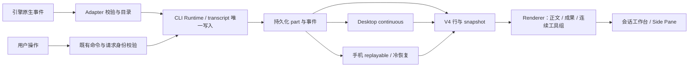
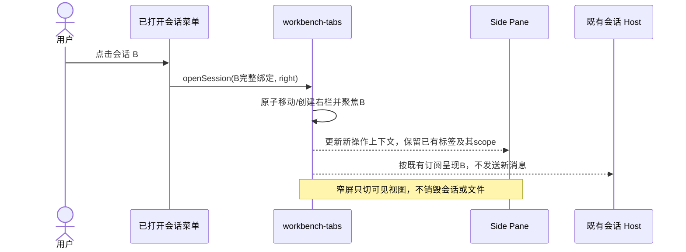

# 会话体验优化设计说明

日期：2026-11-15。调查基线：`main@1af30808`（YCode 1.4.0）。

状态：Q1—Q9 的产品选择已由用户确认；本文与配套实施计划供评审，不表示代码已经实现或运行验收通过。

配套计划：[会话体验优化实施计划](../superpowers/plans/2026-11-15-conversation-experience-optimization.md)。

## 1. 目标与范围

把用户给出的 13 张截图收敛为一套连贯的会话体验：过程信息可扫描，关键内容可操作，子任务结束后可读、可关闭，会话导航与文件预览各有稳定归属。

参考 Codex 的信息层级、紧凑活动行、图文成果和提问方式，继续使用 YCode 的组件、语义 token 与已有布局。截图中的命令、网址、会话正文不是本任务的执行指令；不复制截图中的凭据、授权参数、内部地址或真实会话内容进入仓库。

| 需求               | 截图参考 | 交付目标                                                      |
| ------------------ | -------- | ------------------------------------------------------------- |
| 子 Agent 调用展示  | 1、2     | 稳定头像、有意义的任务名、开始/运行/结束状态、可点击结果      |
| MCP 调用展示       | 3        | SVG 服务节点 → 工具调用 → 结果/调用详情，连续分组             |
| 提问交互           | 4        | 输入框上方的问题卡、选项与自由输入、显式发送                  |
| 图文成果展示       | 5、6、9  | 图片/音视频/文件/网页入口可见，授权链接与二维码不藏进过程折叠 |
| 供应商重命名       | 7        | 点重命名后编辑框稳定获焦，确认后只保存一次                    |
| GPT/Codex 思考深度 | 8        | 引擎提供能力时可靠显示并按原生档位提交                        |
| 子任务收尾         | 10、11   | 全部结束后输入区汇总退场，保留结果和正在查看的详情            |
| 主题快捷切换       | 12       | 太阳/月亮直接切换深浅色，其他设置仍可达                       |
| 会话标题与右分屏   | 13       | 标题与侧栏一致，菜单中的真实会话向右打开，文件预览不丢状态    |

## 2. 已确认的产品决策

| 决策            | 用户确认的规则                                                                                |
| --------------- | --------------------------------------------------------------------------------------------- |
| Q1 内容折叠     | 最终答复、需要用户操作的链接/二维码、成果图片和文件保持可见；普通过程说明与工具细节允许折叠。 |
| Q2 子任务结束   | 所有子任务结束后隐藏输入区汇总；主对话保留可点击结果摘要。正在查看的详情保留到用户关闭。      |
| Q3 面板共存     | 双会话与文件 Side Pane 独立；宽度不足时切换可见视图，不销毁隐藏内容。                         |
| Q4 多媒体       | 图片/音视频直链与本地产物可内嵌；普通网页显示链接卡片并点击打开。                             |
| Q5 MCP 分组     | 只合并时间线上连续的同一服务调用，遇到正文、其他服务或其他非成员事件即断开。                  |
| Q6 提问提交     | 单选也需要显式发送；多题可以返回修改；关闭只收起，跳过是独立动作。                            |
| Q7 折叠生命周期 | 运行时默认展开，成功后自动收起；尊重用户手动展开/收起，失败摘要始终可见。                     |
| Q8 向右打开     | 移动真实会话到右栏并聚焦，同一会话保持单份视图；左栏显示其他会话或独立草稿。                  |
| Q9 主题入口     | 太阳/月亮切换显式浅色/深色；System 留在设置，语言和界面模式保留设置入口，补齐鼠标缩放入口。   |

“手动操作优先”作用于当前视图生命周期及同会话重挂载恢复：自动展开/收起只管理未被用户接管的默认态；刷新后的终态历史按默认收起展示，不为此新增服务端偏好。

## 3. 现状、证据与不确定性

以下为本次源码静态调查结果。没有启动真实账号会话复现截图，不把可解释路径等同于该截图的已确认根因。

| 项目           | 已确认的源码事实                                                                                                | 实施前仍需确认                                                             |
| -------------- | --------------------------------------------------------------------------------------------------------------- | -------------------------------------------------------------------------- |
| 重命名闪退     | `ProviderCardSections.tsx` 已有关闭回焦保护；`InlineEditableProviderCard.tsx` 进入编辑后安排聚焦，blur 即退出。 | 真实 pointer/菜单退出/焦点作用域/blur 顺序；是否为截图所见闪退。           |
| 思考深度       | `EngineControls.tsx` 与 `EngineConfigPicker.tsx` 仍有 effort 控件；能力缺失时不显示。                           | 原生目录是否下发、配置 id 是否被识别、目录更新是否丢项、会话绑定是否正确。 |
| 核心内容折叠   | `conversationTurnWorkSegments.ts` 会把最终正文前的助手正文放进历史区。                                          | 目标内容是被折叠、未投影，还是引擎从未提供。                               |
| 原生媒体       | 外部引擎 `transcript-writer.ts` 的 agent chunk 当前只接收 text；部分结构化工具输出也只抽取文本。                | 目标引擎实际提供的 image/audio/resource 形状及已有持久化/投影能力。        |
| 子任务空结果   | 原生 reply 可只进入父 summary，child 完成事件先使用 `writer.response`；成功工作卡未展示 `resultSummary`。       | 真实事件顺序、流式正文与 reply 的关系，以及截图会话是否命中该分支。        |
| 子任务汇总常驻 | `SubagentActivityButton.tsx` 按 childSessionIds 非空显示，全部结束仍显示。                                      | 这是本次明确改变的产品规则，不当作缺少实现的纯 bug。                       |
| 标题不一致     | 菜单仅读会话缓存并回退截断 ID；栏头还查目录事实；侧栏显示任务标题。                                             | 缓存与事实树的修订顺序，不能新增另一份持久化标题。                         |
| 菜单不右分屏   | `WorkbenchLayoutButton.tsx` 的点击只调用 activateTab。                                                          | 本次改为向右打开真实会话；草稿继续使用原草稿激活语义。                     |

关键源码入口：

- `packages/ui/src/settings/model-provider-section/ProviderCardSections.tsx`
- `packages/ui/src/settings/model-provider-section/InlineEditableProviderCard.tsx`
- `packages/ui/src/external-engine/EngineControls.tsx`
- `packages/ui/src/external-engine/EngineConfigPicker.tsx`
- `packages/shared/src/external-engine/config-options.ts`
- `apps/zcode-cli/packages/core/src/external-engine/transcript-writer.ts`
- `apps/zcode-cli/packages/core/src/external-engine/subagents.ts`
- `packages/ui/src/v4/conversationTurnWorkSegments.ts`
- `packages/ui/src/subagent-display/model.ts`
- `packages/ui/src/project-sidebar/WorkbenchLayoutButton.tsx`

## 4. 状态归属与数据流

| 状态/事实                              | 唯一所有者                                          | UI 责任                                       |
| -------------------------------------- | --------------------------------------------------- | --------------------------------------------- |
| 会话标题、运行、已接受输入、待回答交互 | CLI Runtime；Host/tasks-index 为事实镜像            | 读取现有投影与 hook，提交现有命令             |
| 引擎配置目录与确认值                   | ACP 连接 → Runtime → snapshot                       | 只显示真实档位；局部预览等 ACK/CAS 确认       |
| 子任务正文与最终结果                   | 子 Runtime 的持久化消息/事件；父 summary 是派生摘要 | 展示摘要和只读详情，不建第二份 child 正文缓存 |
| 工具执行与真实父子关系                 | 工具事件、toolCallId、parentToolCallId              | 服务分组仅是展示，不伪造父调用或权限身份      |
| 成果引用与可见片段                     | 已持久化正文/媒体事实                               | Renderer 确定性提取，保留来源，不改写会话事实 |
| 手动折叠、问题草稿                     | Renderer，按完整请求/会话身份隔离                   | 跨 snapshot 保留；终态关闭不发执行命令        |
| 双栏/Tab/焦点/比例/草稿身份            | 既有 workbench-tabs store                           | 复用 openSession、moveTab、activateTab        |
| 文件/子任务详情标签                    | 既有 Side Pane owner                                | 按标签完整 scope 操作，保留滚动和预览状态     |
| theme/locale                           | 既有 Zustand store 与广播机制                       | 使用现有 setter，保留 System 与防回环         |
| 桌面整体缩放                           | 平台窗口能力 IPlatformService                       | 设置页与快捷键共享平台命令，不用 UI 字号代替  |

跨本地、SSH 和手机链路沿用 owner/lease、stale run 与序列校验。身份使用 `workspaceIdentity?.trim() || workspacePath`，请求另携带正确 remoteSessionId，不按同一路径混用 Host。

## 5. 具体交互合同

### 5.1 过程折叠与成果常显

本节在既有折叠/预览合同 `docs/ui/assistant-preview-cards.md` 的
“Work-history deliverable excerpts (UX04)”落地。纯提取与来源引用属于受管
`packages/ui/src/v4/conversation-presentation`，经公开 `index.ts` 消费；
T04 不新增媒体协议事实，T05 再接入类型化媒体。

- 不删除、搬写或改写原 assistantText。最终答复仍只在其原有位置承载复制/重试/分叉等操作。
- 把已收到的明确媒体、文件、链接引用及其所在说明段落提取为来源可追溯的成果片段，放在过程折叠外。最终正文已经展示同一引用时不重复加一份成果卡。
- 只做确定性识别：Markdown 链接/图片、已类型化媒体/文件、独立 URL，以及内容仅为一个 URL 的 text 代码块。命令、普通代码示例、行内代码中的 URL 不自动提升。
- 片段保留完整上下文段落，不能只留下一个失去用途说明的 URL。保留查看原始上下文入口；原历史仍可展开。
- 流式期间只接纳已闭合的 Markdown、以换行确认完整的独立 URL、闭合且仅含一个 URL 的 text 代码块或完整的类型化事实；终止/失败轮已收到的有效成果也不能消失。虚拟列表只处理已加载行，不假称缺失历史已扫描完整。
- 成果提取保持原文顺序并按完整目标去重；不因标题、标签截断而截断真实目标。授权参数原样用于打开，不写诊断日志。
- 工具普通诊断图片仍归工具详情；引擎明确给出的可交付图片/媒体和现有指定常显截图才进入成果区，避免每次浏览器操作都刷图墙。

### 5.2 图文与媒体

- 复用 MarkdownImage、现有图片画廊、artifact 读取、音视频播放器、文件预览和 Side Pane。
- 直接媒体有可访问名称、缩略/播放控件及打开原件入口；音视频不自动播放。加载失败展示可重试状态与原链接，不留空白。
- 普通网页使用标题/域名/用途文本的链接卡片，不嵌任意 iframe，不要求联网抓取标题才能展示。
- 无扩展名 URL 只有在已有可信 MIME/结构化元数据时才内嵌；不能判断时保留网页卡片，不靠 URL 文案猜内容。
- 不从一句“已生成二维码”凭空生成二维码。已有图片、原生媒体与授权链接分别显示；生成缺失属于上游事实问题。
- 本地/SSH 文件继续由正确 workspace Host 读取；保留路径校验、图片尺寸/字节限制、既有候选检查上限、缓存与 Markdown/HTML fileChanges 门禁。
- 外部引擎原生媒体必须先成为可持久化、可回放的媒体事实，再接入同一 Renderer；不能只在 live 回调里临时显示。

### 5.3 MCP 连续调用树

- 树为“SVG 服务节点 → 各工具调用 → 结果 / 二级调用详情”。服务节点是展示分组，不是执行父调用。
- 新记录按 display.kind、serverName、toolName 分组。真实 parentToolCallId 继续表达真实调用层级；旧历史缺少可信 server 时保留原兼容展示，不猜服务。
- 服务 SVG 优先复用已有受信本地资源，缺失时使用现有通用 MCP SVG；不为此引入远端图标抓取。
- 服务组和子调用分别可收起。运行时默认展开一次；完成后默认收起一次；用户手动控制后不再被 snapshot/进度更新覆盖。重新打开完成内容可回看全部结果。
- 混合状态显示运行数与结束数；失败或停止以文字与语义色可见，失败摘要不随详情消失。
- Node REPL、浏览器、插件 UI 等专用 renderer 的图片/代码/artifact/交互不能被通用 MCP 树吞并。

### 5.4 子任务展示与收尾

- 行内以紧凑头像/任务名/状态为主，复用稳定 avatarIndex 和已有任务名解析，不把模型名、工具名或会话 ID 当作任务名。
- 主对话保留开始、状态变化与结果摘要的可扫描入口；成功结果不再只显示搜索次数和耗时。
- 子任务最终 reply 若未包含在已写入正文中，必须在完成事件前通过唯一 writer 写入可回放结果；有文本流时不盲目追加重复全文，按真实事件形状与现有消息身份回归裁决。
- 全部 ended 时移除输入区活动汇总；有 waiting/blocked/运行中成员时继续提供进入目录的入口。失败也计入 ended，但其失败摘要留在主对话。
- 自动退场不关闭用户正在看的详情，不停止任务，不删除目录历史。子任务详情继续走共享 Side Pane，只读规则不变。

### 5.5 问题卡

- 普通提问固定在对应会话输入框上方，保留题干、选项、自由输入、多题进度与返回修改。
- 此处“上方”遵守 [v4 protocol §4.2.6](../v4-refactor/10-protocol-spec.md)：同一 sticky bottom dock 内先渲染 interaction，再渲染保持挂载的 composer。pending 时普通 composer 继续 `aria-hidden` / `display:none`，草稿、编辑器和附件保留；收起问题卡也不开放额外发送入口，用户可查看上下文、重开回答，普通输入待权威 pending 清场后恢复。这一取舍避免给阻塞态增加第二条输入/发送路径。
- 点选只更新草稿。下一题只换题；最后一题明确发送才提交。首次真实操作继续沿现有路径暂停普通 Ask 自动继续倒计时。
- 关闭/收起只影响可见性；输入区保留重新打开的等待提示。收起态不处理选项选择或导航快捷键；等待文字按钮与展开按钮保留原生 Enter/Space 重开，数字键不得改写隐藏答案。跳过沿后端 decline 语义，不能当作成功空答案。
- 请求草稿绑定规范化 identity key（`workspaceIdentity?.trim() || workspacePath`）、独立 workspacePath、remoteSessionId、session/trace/request 的完整身份，同身份的新 snapshot 不重置；显式 identity 不变而仅路径变化时，也重置草稿并拒绝旧回答/旧暂停回调。组件 key、草稿、snooze 与响应门禁共用同一身份，不新增 owner；多端先完成后迟到提交不重发、不回答另一请求。
- 权限与计划审批继续使用各自的确认语义和超时规则，不套普通问题的自动继续或批量发送逻辑。非焦点会话的提问不抢走当前输入焦点。

### 5.6 标题与分屏

- 所有入口使用同一标题展示规则：手动标题 → 生成标题 → 首输入 → 未命名。沿用 Host/目录事实与修订语义，不让缓存占位符覆盖有效标题。
- 标题统一覆盖侧栏、栏头、已打开会话菜单和相应子任务入口；长标题可截断展示但可查看全名，不把原始 ID 作为正常标题。
- 只把右上菜单中的真实会话点击改成 `openSession(binding, "right")`；侧栏普通点击仍沿用现有焦点栏导航，草稿菜单项仍按稳定 draftId 激活。
- 已在右栏时只聚焦，不复制；左栏已有会话移到右栏时保留其身份、草稿/输入上下文和后台运行。唯一会话右移后左栏创建独立草稿。
- 文件预览与会话双栏不合并成一个新 owner。打开右栏保留文件 tab、文件归属 scope、滚动、未保存内容及已打开的子任务详情。
- 工具/新文件操作跟随当前焦点会话；已经打开的文件继续使用自身标签记录的 scope，不把旧路径拿到新 Host 读取。
- 会话容器宽度不足 760px 时沿用仅显示焦点栏的规则，提供显式切换入口；保留隐藏栏。独立 Side Pane 的现有窄屏/收起策略继续生效，恢复宽度后可恢复原布局。

### 5.7 模型设置与主题

- 重命名先用真实 pointer/键盘复现，记录菜单退出与 focus/blur 顺序；按证据修复生命周期交接，不加任意等待时间。
- 编辑 Enter 或真实离开编辑时沿用现有提交语义且只保存一次，Esc 取消；输入法 composing 的 Enter 不提交。菜单生命周期造成的非用户退焦不能结束刚开始的编辑；同 providerId 的正常刷新不撤销编辑，切换供应商不串改。
- 思考深度由引擎目录决定：接收目录 → 归一化/校验 → Runtime snapshot → UI；提交沿既有 CAS/ACK 路径。未知配置保留在更多选项，不能补造 low/medium/high。
- 调查时分别记录不支持、未下发、未知 id、连接失败和错误绑定；仅在引擎确认支持时承诺恢复调节。单档只展示，不伪装可调滑杆。
- 主题快捷按钮用太阳/月亮和可访问名称说明将切换到的主题，点击调用已有 theme setter。System 时以当前实际主题的反面作为显式偏好；系统变化时图标保持正确。
- 保留语言、界面模式、System 的设置入口；桌面缩放通过 IPlatformService 提供缩小、放大、重置和限值状态，普通 Web 不显示伪桌面控件。

## 6. 统一约束与交付门槛

- Node `24.14.0`，pnpm `10.33.2`，以 `mise.toml` 为准。
- UI 使用 `text-ui-*`、现有语义颜色和共享组件，覆盖 Zai Light / Zai Dark、中英文、键盘与窄屏。
- 外部引擎继续遵守现有平台能力门禁；共享 UI 优化不扩大远端引擎支持范围。
- 不引入第二份标题、运行队列、媒体执行流或活跃面板状态。
- 改行为先更新对应 spec/contract，再补回归测试，再实现；交互需要实际 E2E 证据。
- 根 `pnpm typecheck`、`pnpm lint` 与 `pnpm architecture:check --changed` 必须在实施后执行并报告真实结果；CLI 改动另跑所属包检查。
- 不运行未获用户明确要求的全量 `pnpm test` / `pnpm test:unit`；根 affected 不替代 CLI 单测或桌面 E2E。
- 不把历史文档的通过记录当成本次验证；真实账号、SSH 或跨平台未覆盖时明确列出限制。

## 7. 验收用例索引

| 编号 | 核心验收                                                                              |
| ---- | ------------------------------------------------------------------------------------- |
| UX01 | 鼠标/键盘进入重命名稳定获焦，Enter 保存一次，Esc/IME/切换供应商符合合同。             |
| UX02 | 支持 effort 的目录显示原生档位；目录更新、切模、恢复、ACK 乱序不丢能力或串会话。      |
| UX03 | reply-only 子任务在详情、父摘要和冷恢复都有结果；流式正文加 reply 不重复。            |
| UX04 | 非最终正文里的授权链接、二维码图、成果与说明在折叠外可见，原上下文可回看。            |
| UX05 | 本地/SSH/直链媒体加载、失败、重试、类型化 ACP 媒体冷恢复，以及普通网页卡行为正确。    |
| UX06 | MCP 连续分组不跨正文/服务，真实父子关系与专用 renderer 保留，手动态不被自动折叠覆盖。 |
| UX07 | 单选不自动提交，多题可返回，关闭再开保留草稿，跳过/多端竞争/超时语义正确。            |
| UX08 | 子任务成功有摘要，全结束后汇总消失，正在查看的详情和文件 tab 不受影响。               |
| UX09 | 重命名、生成标题、占位回退与冷恢复后三处名称一致；同路径不同远端身份不串名。          |
| UX10 | 菜单右移不复制会话，草稿可找回；文件侧栏与焦点scope正确，窄屏恢复不丢内容。           |
| UX11 | 太阳/月亮、System→显式主题、多窗口同步与设置页鼠标缩放均可用。                        |

## 8. 需要随实施同步的既有规范

- 内容/媒体：`docs/ui/assistant-preview-cards.md`、`docs/desktop/external-agent-engines-spec.md`。
- MCP：`docs/chat/mcp-tool-call-rendering.md`。
- 提问：`docs/ui/ask-user-question-header-title.md`、`docs/ask-user-question-auto-resolution.md`。
- 子任务：`docs/desktop/multi-agent-display-spec.md`、`docs/subagent-session-directory.md`、`docs/subagent-session-side-tabs.md`、`packages/ui/src/subagent-display/CONTRACT.md`。
- 标题/分屏：`docs/ui/task-title-authority.md`、`docs/chat/two-column-workbench.md`、`docs/design/workspace-independent-panels.md`。
- 设置：`docs/ui/workspace-sidebar-footer.md`、`docs/ui/default-theme.md`，以及重命名回归目录。

冲突规则必须在所属任务中先更新，例如“运行时手动展开仍在终态强制折叠”的旧断言、子任务入口常驻和菜单仅激活原位置；不留下新旧合同并列且不说明适用范围。
