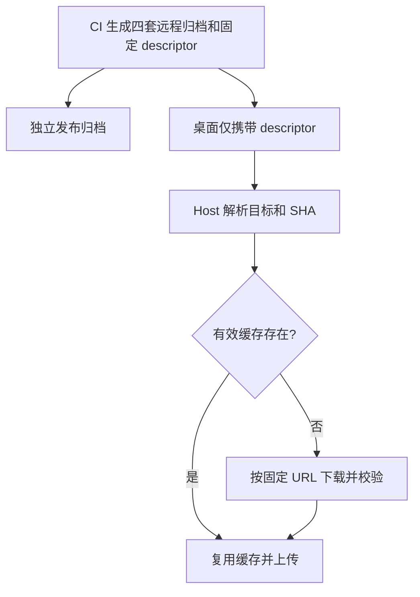

# 桌面安装包资源边界与体积审计

## 资源所有权

- 本机 Agent、PTY、搜索工具和 Main/Host 的真实 Node 依赖继续随当前目标平台安装包发布。
- CI 轻量发行包通过 `ZCODE_REMOTE_ASSET_DESCRIPTOR_ONLY=1` 只携带 `remote-assets/releases/<version>/source-server-release.json`；四套远程归档作为同一 GitHub Release 的独立附件发布。
- descriptor 包含四个平台的大小、SHA-256 与固定构建标签的绝对下载 URL。运行时不得解析 `latest` 或回退已退役的原厂来源。
- 开发态仍通过本轮 `mock-cdn` staging 消费完整 descriptor/archive；普通手动离线 bundle 可以继续随包完整资源。开发态内容寻址约束不因轻量发布改变。
- Host 负责目标选择、下载、验证与缓存；远端安装器负责已安装版本及兼容探测，Renderer 不另存资源可用状态。

## ASAR 裁剪合同

- renderer 由 Vite、插件沙箱由 tsup 输出自包含浏览器产物；只有 Main/Host/Worker 实际需要的外置 Node 包进入 `node_modules`。
- 本轮已核对源码与已有 Main/Host/Scheduler bundle：`echarts`、`mermaid`、`lucide-react`、`highlight.js`、`world-atlas` 仅被浏览器入口消费，没有 Node 入口或文件读取消费者，因此排除这些重复的完整包目录。浏览器静态产物、Gen UI vendor 固定快照及其许可证继续保留。
- 不对 PDF/Office 包、WASM、Playwright、Node 运行时 externals 做未经安装态验收的整目录删除。WASM 三副本的进一步收口仍需确认所有实际消费者。
- 保留 `THIRD-PARTY-NOTICES.md` 和 `licenses/`；未裁剪的 Node 包继续保留其许可证。删除 `node_modules` 副本不会删除 renderer 内联代码的声明。
- 沿用 native policy：仅保留目标平台 node-pty prebuild；排除准备源包、安装机 build/bin、renderer 不使用的 Canvas optional native；原生文件必须 unpack，不在 ASAR payload 内双份保留。
- 构建后机械审计拒绝上述 renderer-only 包目录回流；验收从安装产物启动并覆盖终端、图表、Mermaid、Markdown、PDF、Office 和插件，不能以开发依赖齐全代替安装态验证。

## 体积预算与报告

`packages/desktop/scripts/audit-bundle-size.mjs` 在 bundle 后对最终安装器字节数检查，并输出相邻的 `.size-report.json`：

- 轻量发行模式：Windows EXE 上限 **250,000,000 字节**；macOS DMG/ZIP 上限 **280,000,000 字节**。按十进制 MB，不给独立远程附件增加安装器额度。
- 轻量资源目录只允许一个不超过 64 KiB 的普通 descriptor 文件；必须覆盖四个唯一目标，并且每个目标包含固定 GitHub Release 构建标签的绝对 HTTPS 下载地址。不允许 `latest`、相对地址或归档混入。
- 手动离线模式：维持 500 MiB 基础额度加实际已校验离线资源字节的原有上限；四归档必须与 descriptor 大小和 SHA 一致，单套不超过 112 MiB、合计不超过 400 MiB。
- 报告记录最终安装器大小、预算、资源模式、独立远程归档声明大小、安装目录各资源组及 ASAR 分组。安装目录与 ASAR 为未压缩体积，不能当作下载大小或与安装器相加。
- 同平台、同格式与上次实际构建比较；预算是验收目标，未重新构建不得声称减重完成。

## 回归场景

- 轻量模式超过新阈值即失败，即使 descriptor 声明大量远程资源也不能换取额度。
- 相对 URL、latest URL、缺目标、重复目标、额外归档、符号链接、超大 descriptor 均失败。
- 完整离线模式继续校验四归档的 size/SHA/目录边界。
- 体积报告能区分安装器字节、资源目录与 ASAR 中各依赖的未压缩体积。
- renderer-only 裁剪不能删掉 `out/renderer` 或 `out/plugin-sandbox` 的图表、代码高亮等产物；Node 外置依赖和许可证保持可用。
