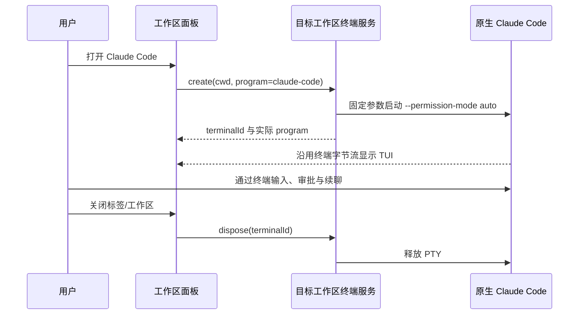

# Claude Code 原生终端接入

## 产品规则

YCode 提供工作区内的 Claude Code 原生终端入口，复用现有终端面板、PTY、服务路由与生命周期。不把 Claude Code 模拟成自研 Agent Provider，不将原生会话写入自研 CLI 的会话库。

- 编程模式的命令面板与右侧面板启动菜单均提供「Claude Code」入口，打开独立终端标签页。
- 用户显式打开时，在所选工作区的真实 cwd 启动 `claude --permission-mode auto`；工作区 identity 仅用于隔离，不作为 cwd。
- `auto` 是原生 CLI 的权限模式，由 Claude Code 的分类器判定工具权限；不添加 `--dangerously-skip-permissions`，不映射为自研 `guarded` 或 `yolo`。
- 沿用 CLI 的本机安装、原生登录及配置。不安装 CLI，不修改用户全局设置，不转存认证数据。CLI 未安装、未登录或 auto 不可用时保留原生提示，不伪报连接成功。
- 本地与 SSH/WSL/Docker 均使用现有终端服务路由，在目标机器查找其安装的 CLI。远程版本缺少新启动能力时必须报错，不能只打开普通 shell 并假称 Claude Code 已启动。
- PTY 创建失败或能力不匹配时立即释放不匹配的进程，通过面板内可访问的错误提示保留原因；xterm 随失败标签卸载回收，重挂允许重新创建，不复用失败实例。
- 终端标签保存启动类型；切换任务、工作区或临时隐藏面板沿用现有 PTY 保活逻辑，真正关闭标签或工作区时释放进程。重启后遵循现有终端恢复策略；原生 `/resume` 用于历史续聊。
- 普通终端启动行为保持原样。通用/办公模式继续隐藏技术面板入口。
- 这是原生 TUI 接入：登录、模型选择、流式文本、工具结果、审批、停止与历史续聊均在原生终端完成。YCode 聊天气泡、自研任务列表、工作流与 Bots 不接管这些会话。

## 状态所有者与接口

`ITerminalService.create` 增加可选 `program: "claude-code"`；缺省仍启动普通 shell。Host 终端服务校验 program，固定构造 CLI 命令与参数，禁止接受任意启动脚本。返回值包含实际 program，用于客户端检查服务版本是否支持该能力。

Claude Code 是正文、执行、权限与原生历史的唯一所有者。Host 仅持有 PTY、输入输出与资源生命周期；Renderer 仅持有面板导航和 xterm 展示。终端标签延用现有唯一 ID；不新增会话同步、owner/lease 或重试路径。



## 验收场景

| ID   | 场景                           | 断言                                                                               |
| ---- | ------------------------------ | ---------------------------------------------------------------------------------- |
| CC01 | 从命令面板或侧面板打开         | 标签明确命名 Claude Code；program 传至既有终端服务                                 |
| CC02 | macOS/Linux 启动               | 登录 shell 固定执行 `exec claude --permission-mode auto`；cwd 原样传入，不拼入命令 |
| CC03 | Windows PowerShell/cmd 启动    | 使用各 shell 对应的原生执行参数，均固定传入 auto；ConPTY 回退保留参数              |
| CC04 | CLI 未安装、未登录或模式不可用 | 显示原生错误/交互；不自动退为完全放行                                              |
| CC05 | 普通终端、非法 program、旧远端 | 普通终端行为不变；非法 program 明确拒绝；旧服务的能力不匹配释放 PTY 并显示错误     |
| CC06 | 切换工作区、面板隐藏与关闭     | 复用既有 identity 隔离、PTY 保活与资源释放                                         |
| CC07 | 真实交互                       | 原生登录/就绪界面可见，输入与缩放可用；API 推理需单独验证，不由进程启动推断        |

单元验证使用 PTY mock 检查参数、错误与回退；隔离浏览器场景覆盖入口至终端服务的契约，不调用收费模型，不等同于真实 Electron/SSH 验收。真实本机 CLI 启动验证单列证据；外部 SSH、其他平台及真实 API 未执行时如实报告。

## 验证记录（2026-10-25）

| 验证                                | 结果与边界                                                                                                                                                |
| ----------------------------------- | --------------------------------------------------------------------------------------------------------------------------------------------------------- |
| `pnpm typecheck`                    | 通过                                                                                                                                                      |
| `pnpm lint`                         | 通过，94 warnings、0 errors                                                                                                                               |
| `pnpm architecture:check --changed` | 通过，0 violations                                                                                                                                        |
| 相关单测                            | 6 文件、176 项通过；终端服务参数、Windows mock、面板状态、命令入口、焦点与 registry                                                                       |
| 隔离浏览器                          | 5 场景通过；Edge、1280×800 深浅主题、375×812 与 844×390、中文/英文、减少动效；真实 xterm + mock PTY，检查输入、重挂保活、旧 Host 拒绝、错误可见与失败重试 |
| 真实 macOS PTY                      | 本机 Claude CLI 2.1.310 收到启动输出并停在工作区信任确认；未完成就绪/auto 实际启用确认，未发送模型请求                                                    |
| 尚未执行                            | 真实 Electron 全链路、SSH/WSL/Docker、Windows/Linux 原生环境、真实 API 推理                                                                               |

浏览器候选用例保留在 `packages/ui/test/browser/manual-review/pending/claude-code-native.test.mjs`，可从仓库根目录复跑：

```sh
CHROME_EXECUTABLE_PATH='/Applications/Microsoft Edge.app/Contents/MacOS/Microsoft Edge' \
  node --test packages/ui/test/browser/manual-review/pending/claude-code-native.test.mjs
```

`CHROME_EXECUTABLE_PATH` 可替换为本机 Chromium 浏览器路径；不指定时使用已有 Chrome。截图输出到操作系统临时目录下的 `ycode-claude-code-native/`。
