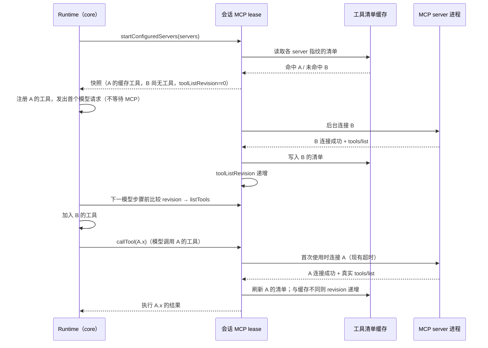

# YCode 1.1 内置引擎性能规格（CLI）

日期：2026-11-07。决策来源：[YCode 1.1 更新方案](./ycode-1.1-plan.md)「性能（问题 1）」，本文只写已拍板规则的落地细则、状态所有者与事件顺序，不重新讨论决策。

范围：`apps/zcode-cli` 内的 MCP 启动、内置插件摘要、CLI 传输调度、首轮 git 快照与本地性能事件。外部引擎 `createSession` / 握手语义、Host 发送路径、Renderer 订阅缓存不在本文范围。

## 证据（Windows 1.0.5 生产日志）

| 链路                                                                            | 实测                                     | 根因                                                                                                                |
| ------------------------------------------------------------------------------- | ---------------------------------------- | ------------------------------------------------------------------------------------------------------------------- |
| MCP 启动（首个模型请求前）                                                      | p50 2.5s，p90 4.5s，最大 7.4s            | `initializeMcp` 等待全部 server 连接；4 个默认启用的 office 插件各自以 Node 模式启动 YCode.exe 并加载 14.5MB bundle |
| 会话 app 插件阶段                                                               | p50 0.8s，p90 1.4s                       | 每次建 app 都同步重读并 SHA-256 约 42MB / 600 个内置插件文件                                                        |
| `rowsRange` / `plans` / `subscribeConversationV4` / `readWorkspacePresentation` | p50 4.4s / p90 10.6s / p90 13s / p90 18s | 一个 CLI 服务整个 workspace，除少数旁路外所有请求走同一条严格 FIFO                                                  |
| 首轮上下文初始化                                                                | p50 0.25s，p90 0.74s                     | 每个 runtime 启动 5–8 个 git.exe                                                                                    |

## 1. MCP 不阻塞首个模型请求

### 规则

- 首个模型请求不等待任何 MCP 连接。会话启动只做"登记 + 读缓存"，不等待进程启动、握手或 `tools/list`。
- CLI 按 server 的**解析后配置指纹**持久化上次成功的 `tools/list` 结果（工具清单缓存）。
  - 指纹输入：应用版本、server 名、transport、stdio 的 command / args / cwd、http/sse 的 URL（只取 origin + path）与 header **键名**、OAuth 类型、`timeoutMs` / `alwaysLoad` / `protocolVersion` / `isolation`、env **键名**，以及插件身份（`ZCODE_PLUGIN_ID`）与插件根目录（含版本目录）。
  - env、header、OAuth 的**值**一律不进入指纹或缓存文件；缓存文件只含指纹、server 名、保存时间与工具描述（名称、描述、schema、注解、UI 元数据）。
  - 位置：`<CLI 数据目录>/mcp/tool-manifests/<指纹>.json`，原子写入（临时文件 + rename），读写均为异步 IO；条目数有上限，超出按修改时间淘汰最旧的文件。
- 有缓存的 server：按缓存注册工具，**不启动进程**；第一次实际使用（工具调用、资源读取、MCP App 连接）时才连接，等待沿用现有连接超时（`timeoutMs`，缺省 30s；OAuth 等待沿用会话的 15s 预算），连上后再执行调用。
- 无缓存的 server：后台连接，不阻塞首个请求；连上后其工具从**下一次模型步骤**加入。
- 任一 server 连上后都用真实 `tools/list` 刷新缓存；与缓存不一致时以真实清单为准，registry 从下一次模型步骤起使用真实清单（签名覆盖完整描述，包括 inputSchema）。
- 首次调用时启动失败：返回结构化工具错误给模型并记 warn 日志，删除该指纹的缓存；不挂起轮次。失败后该 server 的工具从下一次模型步骤起移出 registry（与原先启动失败不注册工具一致）。
- 保持会话隔离与既有 lease / close 语义：工具清单缓存只决定"何时连接"，连接仍由会话自己的 lease 创建与释放。会话关闭时正在进行的首次连接立即让等待方以错误返回，连接本身沿原有空闲回收；lease 关闭后不再创建新连接。
- 不实现非阻塞启动的端口（TUI / headless 直连 adapter、测试替身、子智能体借用端口）保持原有"启动时连接全部 server"语义。

### 状态所有者

| 状态                   | 唯一所有者                                   | 其他层                                               |
| ---------------------- | -------------------------------------------- | ---------------------------------------------------- |
| 连接与"待首次使用"登记 | 会话 MCP lease（`adapters/src/mcp/pool.ts`） | runtime 只调用 `startConfiguredServers` / `callTool` |
| 工具清单缓存文件       | `adapters/src/mcp/tool-manifest-cache.ts`    | lease 在连接完成时写入，在登记时读取                 |
| registry 中的 MCP 工具 | runtime（`core/src/runtime/methods/mcp.ts`） | 只在模型步骤边界按 `toolListRevision` 刷新           |

### 事件顺序

- 子智能体借用父会话端口时读取**当前**连接状态与工具（而非启动时快照），"待首次使用"的 server 视为可用；子智能体的调用由父 lease 按同一规则首次连接。
- 插件引用提醒把"待首次使用"的 server 视为可用。

## 2. 内置插件摘要缓存与工作区展示复用

- 内置插件随应用版本不可变。文件系统来源的内置插件摘要（逐文件 SHA-256 与插件 hash）：
  - CLI 进程内按（插件根目录、插件名、插件版本、应用版本）记忆，进程内只计算一次。
  - 跨进程持久化到 `<插件存储>/official-plugin-digests.json`，键为应用版本 + 插件根目录 + 插件名与版本，校验值为**文件统计签名**（文件数、总字节数、最大 mtime、逐文件 path/size/mtime/mode 的摘要）。签名一致时直接复用摘要，不读文件内容；不一致时重新哈希并覆盖写入。
  - 复制到缓存时仍逐文件校验 SHA-256（不一致即报 hash mismatch，与原语义相同）。SEA 来源本来就使用清单内 hash，不变。
  - 非内置（用户安装、市场、项目）插件的完整性语义不变。
- 工作区展示（`workspace/readPresentation`）与会话快照的 `/` 命令目录：自定义命令发现对插件的解析结果（命令根目录）按（workspace、插件修订）在进程内记忆。插件修订由以下事实组成：生效配置中的插件段（启停、抑制、选项、额外市场）、插件存储中 `installed_plugins.json` 与 `known_marketplaces.json` 的统计签名、内置插件摘要。安装、卸载、更新、启停、恢复内置都会改变其中之一，下一次读取即重新解析；命令文件本身每次仍实时枚举。

## 3. CLI 传输分道

一个 CLI 进程服务整个 workspace。请求按下表调度，完整规则与时序图见 [CLI Agent Server 规格](../../apps/zcode-cli/docs/design/v2/zcode-protocol-agent-server.md#请求调度分道)：

| 类别                                                                                                                                                       | 调度                                                                |
| ---------------------------------------------------------------------------------------------------------------------------------------------------------- | ------------------------------------------------------------------- |
| 反向请求的响应、网络观测控制                                                                                                                               | 收到即处理（不变）                                                  |
| 无会话的纯读：工作区展示、`session/list`、会话索引对账、命令时钟探测、插件/技能/工作流目录读取、用量、进程与能力查询、连接流控、`provider/refreshRegistry` | 收到即处理，不排队                                                  |
| 控制：`session/stop`、`workspace/cancelGenerateText`、`plugins/cancelOperation`、MCP App 请求                                                              | 等同一分道上一个请求进入 handler 后旁路执行                         |
| 携带会话（`sessionId`、conversation topic、命令信封或 `createSession.payload.sessionId`）                                                                  | 该会话分道内 FIFO；不同会话并发；涉及多个会话的请求同时占用这些分道 |
| 其他 topic（会话索引、工作区配置的订阅族）                                                                                                                 | 按 topic 分道 FIFO                                                  |
| `workspace/generateText`、`provider/testModelConnectivity`                                                                                                 | 模型分道 FIFO                                                       |
| 其余无会话请求（含未知方法）                                                                                                                               | 全局分道 FIFO                                                       |

EOF 后停止接单，等待所有分道与在途请求完成或 100ms drain 到期，与原规则相同。

## 4. 首轮 git 快照

- 每个快照只启动必要的 git：`status --short --branch`（分支名取自首行）、`for-each-ref`（一次读出 `origin/HEAD`、`origin/main`、`origin/master`）、`config user.name`、`log --oneline -n 5`，并行执行；原先 5–8 个。
- 同一 CLI 进程内按仓库缓存与工作区无关的部分（主分支、用户名、最近提交），键为 git 目录、`HEAD` 内容与索引文件统计（mtime + 大小）。命中时只运行 `status`。
- 工作区文件改动不会改变 HEAD 或索引修订，因此状态行每次都读取，保证"会话开始时的快照"语义。
- 输出字段与格式不变：状态行仍是 `--short` 格式并按 2k 字符截断；`status` 失败时回退 `symbolic-ref` 取分支名，与原先每个字段独立失败的结果一致。

## 5. 每轮 `subagents/readRuntimeConfig`

保持每轮读取，不缓存。原因：Host 的子智能体配置没有修订号，也没有向 CLI 推送变更通知，缓存无法正确失效；按规则不引入 TTL。若后续 Host 提供修订号或变更通知，再在 CLI 侧按修订缓存。

## 6. 本地性能事件

均为 info 级（启动失败为 warn），只写本机日志，不含正文，路径不入字段（server 名、方法名、会话 ID 除外）。供 1.1 本地性能摘要汇总。

| 事件                                                 | 触发                         | 关键字段                                                                                       |
| ---------------------------------------------------- | ---------------------------- | ---------------------------------------------------------------------------------------------- |
| `zcode_protocol.request.queue_wait`                  | 请求在分道内等待 > 50ms      | `method`、`lane`（session/topic/model/global/control）、`waitMs`                               |
| `zcode_protocol.request.slow`                        | handler 耗时 ≥ 500ms         | `method`、`lane`、`durationMs`、`queueWaitMs`                                                  |
| `mcp.manifest_cache.hit` / `mcp.manifest_cache.miss` | 会话启动登记每个 server      | `mcpServerName`、`toolCount`（命中时）                                                         |
| `mcp.lazy_start.started` / `.completed` / `.failed`  | 首次使用触发连接             | `mcpServerName`、`trigger`、`durationMs`、`manifestChanged`（完成时）、`error`（失败时，warn） |
| `mcp.background_start.completed`                     | 无缓存 server 后台连接结束   | `mcpServerName`、`status`、`durationMs`、`toolCount`                                           |
| `mcp.manifest_cache.drift`                           | 真实清单与缓存不一致         | `mcpServerName`、`cachedToolCount`、`toolCount`                                                |
| `mcp.startup.completed`                              | 会话启动登记完成             | `durationMs`、`deferredCount`、`backgroundCount`、`mode`（lazy/eager）                         |
| `turn.first_model_request.started`                   | 每轮首个主模型请求发出前     | `durationMs`（自本轮执行开始）                                                                 |
| `bootstrap.official_plugin_digest.resolved`          | 每个进程首次解析内置插件摘要 | `source`（memory/persisted/hashed）、`pluginCount`、`durationMs`                               |

## 验收与验证

- 单测：缓存命中时调用前不启动进程；缓存未命中时首个请求不阻塞、连上后下一步加入工具；清单漂移；首次启动失败返回结构化错误；会话关闭/取消时首次连接干净结束。
- 单测：跨会话并发、同会话保序、`createSession` → subscribe 保序、控制旁路、无会话读不排队、EOF drain。
- 单测：内置插件摘要命中时不读文件内容；工作区展示在插件安装/启停后重新解析。
- 单测：git 快照首次 4 个命令、缓存命中只运行 `status`，字段与原先一致。
- 未在真实 Windows 生产包上复测的数值不写成通过；本地测得的耗时只作为同机前后对比。
