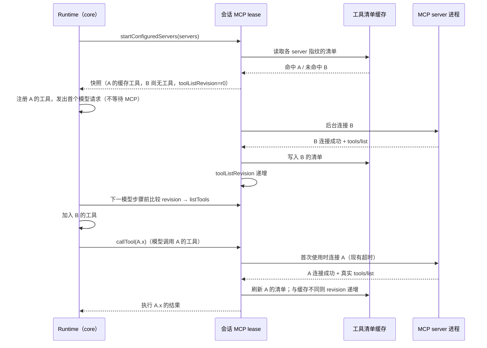
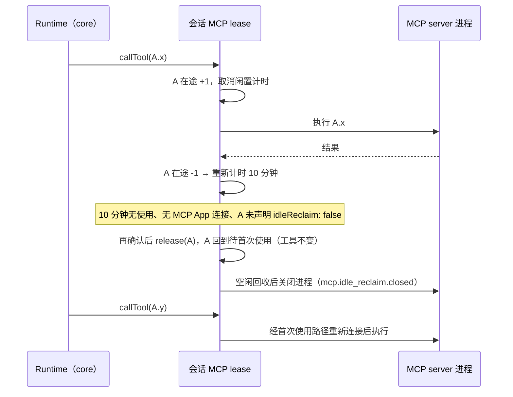
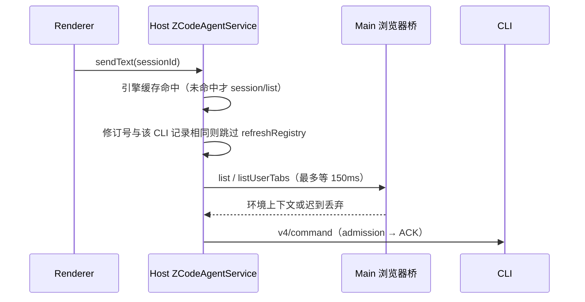
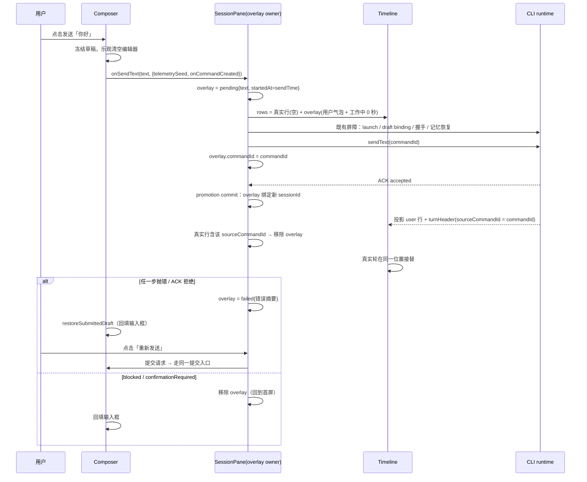
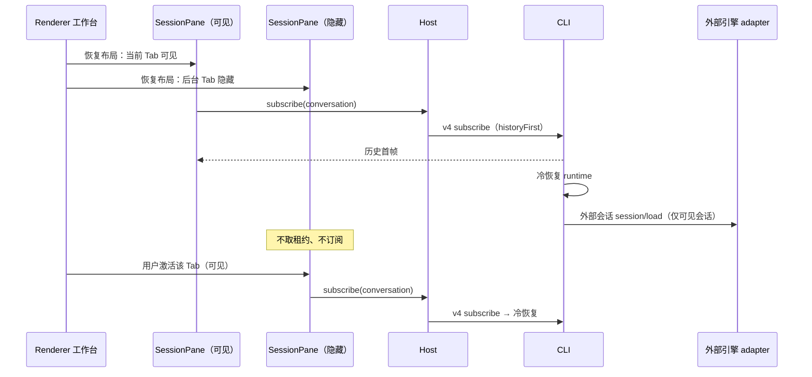
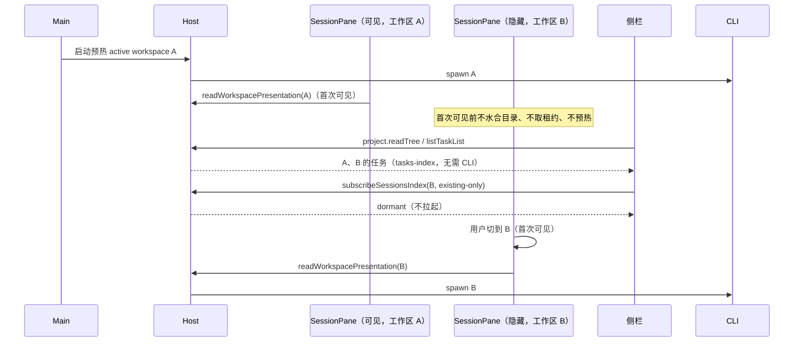
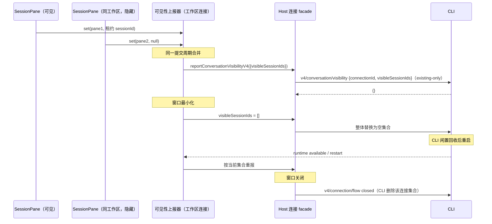
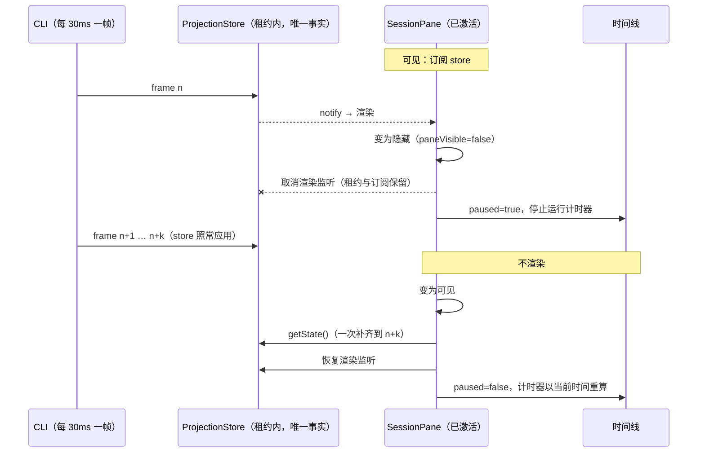
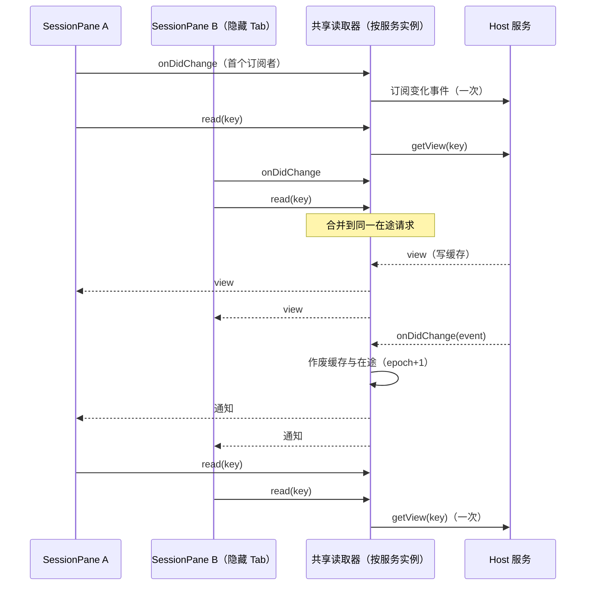

# YCode 1.1 引擎性能规格

日期：2026-11-07。决策来源：[YCode 1.1 更新方案](./ycode-1.1-plan.md)「性能（问题 1）」与附录 B，本文只写已拍板规则的落地细则、状态所有者与事件顺序，不重新讨论决策。

本文按工作流分节：§1–§6 为 CLI（内置引擎：MCP、内置插件摘要、传输分道、git 快照、性能事件），其后为 Host 发送路径、Renderer 发送路径、启动恢复、本地性能摘要与 Windows 工作区路径大小写。外部引擎 `createSession` / 握手、预热备用与闲置连接见 [外部引擎规范](./external-agent-engines-spec.md)。

## 证据（Windows 1.0.5 生产日志）

| 链路                                                                            | 实测                                     | 根因                                                                                                                |
| ------------------------------------------------------------------------------- | ---------------------------------------- | ------------------------------------------------------------------------------------------------------------------- |
| MCP 启动（首个模型请求前）                                                      | p50 2.5s，p90 4.5s，最大 7.4s            | `initializeMcp` 等待全部 server 连接；4 个默认启用的 office 插件各自以 Node 模式启动 YCode.exe 并加载 14.5MB bundle |
| 会话 app 插件阶段                                                               | p50 0.8s，p90 1.4s                       | 每次建 app 都同步重读并 SHA-256 约 42MB / 600 个内置插件文件                                                        |
| `rowsRange` / `plans` / `subscribeConversationV4` / `readWorkspacePresentation` | p50 4.4s / p90 10.6s / p90 13s / p90 18s | 一个 CLI 服务整个 workspace，除少数旁路外所有请求走同一条严格 FIFO                                                  |
| 首轮上下文初始化                                                                | p50 0.25s，p90 0.74s                     | 每个 runtime 启动 5–8 个 git.exe                                                                                    |

## 1. MCP 不阻塞首个模型请求

### 规则

- 首个模型请求不等待任何 MCP 连接。会话启动只做"登记 + 读缓存"，不等待进程启动、握手或 `tools/list`。
- CLI 按 server 的**解析后配置指纹**持久化上次成功的 `tools/list` 结果（工具清单缓存）。
  - 指纹输入：应用版本、server 名、transport、stdio 的 command / args / cwd、http/sse 的 URL（只取 origin + path）与 header **键名**、OAuth 类型、`timeoutMs` / `alwaysLoad` / `protocolVersion` / `isolation`、env **键名**，以及插件身份（`ZCODE_PLUGIN_ID`）与插件根目录（含版本目录）。
  - env、header、OAuth 的**值**一律不进入指纹或缓存文件；缓存文件只含指纹、server 名、保存时间与工具描述（名称、描述、schema、注解、UI 元数据）。
  - 位置：`<CLI 数据目录>/mcp/tool-manifests/<指纹>.json`，原子写入（临时文件 + rename），读写均为异步 IO；条目数有上限，超出按修改时间淘汰最旧的文件。
- 有缓存的 server：按缓存注册工具，**不启动进程**；第一次实际使用（工具调用、资源读取、MCP App 连接）时才连接，等待沿用现有连接超时（`timeoutMs`，缺省 30s；OAuth 等待沿用会话的 15s 预算），连上后再执行调用。
- 无缓存的 server：后台连接，不阻塞首个请求；连上后其工具从**下一次模型步骤**加入。
- 任一 server 连上后都用真实 `tools/list` 刷新缓存；与缓存不一致时以真实清单为准，registry 从下一次模型步骤起使用真实清单（签名覆盖完整描述，包括 inputSchema）。
- 首次调用时启动失败：返回结构化工具错误给模型并记 warn 日志，删除该指纹的缓存；不挂起轮次。失败后该 server 的工具从下一次模型步骤起移出 registry（与原先启动失败不注册工具一致）。
- 保持会话隔离与既有 lease / close 语义：工具清单缓存只决定"何时连接"，连接仍由会话自己的 lease 创建与释放。会话关闭时正在进行的首次连接立即让等待方以错误返回，连接本身沿原有空闲回收；lease 关闭后不再创建新连接。
- 闲置回收（本机 1.0.5 实测 61 个 `YCode.exe … __zcode-plugin-host` 进程、约 4.0GB RSS，部分运行 3 天：常驻会话的每会话 MCP / 插件宿主从不退出）：
  - 会话 lease 内已连接的 server 在没有在途请求（工具调用、资源读取与订阅）且 10 分钟没有使用后，由该 lease 释放连接（经既有 30s 空闲回收关闭进程），回到"待首次使用"。
  - 工具沿用回收时的真实清单（同时刷新缓存），registry 不变；下一次调用经同一首次启动路径重新连接。
  - 不回收：有在途调用的 server；有 MCP App 页面连接（lease 上登记了连接失效监听）的 server。窗口到期时再确认，条件不满足则重新计时。
  - 有状态 server 永不闲置回收：持有跨调用进程内状态的 server 由**声明**豁免，不按 server 名特判。官方单元在 `bootstrap/src/app/official-plugin-definitions.ts` 声明 `statefulMcpServers: true`（当前为 `node-repl-host`，其 node_repl 保留 REPL 变量），宿主据此在 server 配置上写入 `idleReclaim: false`（仅限宿主生成，公共配置 schema 拒绝该字段）；lease 的闲置策略读取该配置，对它从不计闲置窗口。首次使用时启动照常适用。
  - 只适用于会话 lease；设置页（`mcp/list`）的 lease 不回收，避免状态轮询把被回收的 server 显示成断开。
  - 计时器由 lease 持有并 unref；server 被释放或 lease 关闭时清除，会话关闭后不遗留。
- 不实现非阻塞启动的端口（TUI / headless 直连 adapter、测试替身、子智能体借用端口）保持原有"启动时连接全部 server"语义。
- 草稿不触发 MCP（2026-11-08，P10）：协议 server 以 deferred 持久化创建的草稿会话（Desktop 新建、尚未发送）构造 Runtime 时不调用 `startMcpStartup`，context 初始化（如 `/` 技能目录读取）也不调用；首次发送（turn 的 `initializeMcp`）、compact 或插件引用解析等首次需要工具时才按上述 lazy 规则登记与启动。已持久化会话（含冷恢复）、TUI / headless、外部引擎会话的行为不变。
  - 依据（2026-11-08 本机扫描 P10）：升级后首启 manifest 缓存 35 次未命中，起 31 个 MCP 进程，其中 28 个属于 7 个从未发送的草稿，连接 p50 8.2s，首启约 15s CPU 满载。
  - 所有者：Runtime 的 `mcpInitialized` 仍是唯一的“已启动”事实；是否推迟由创建期配置 `deferMcpStartupUntilFirstUse` 决定（只由协议 server 按 `persistence: "deferred"` 写入），不新增环境变量。首发前草稿的 registry 中没有 MCP 工具，首个模型步骤之前由 `initializeMcp` 补齐（缓存命中的 server 立即可用，未命中的后台连接、下一模型步骤加入，与非草稿规则一致）。

### 状态所有者

| 状态                                 | 唯一所有者                                                                                            | 其他层                                                                                                                                                      |
| ------------------------------------ | ----------------------------------------------------------------------------------------------------- | ----------------------------------------------------------------------------------------------------------------------------------------------------------- |
| 连接                                 | 会话 MCP lease（`adapters/src/mcp/pool.ts`）                                                          | runtime 只调用 `startConfiguredServers` / `callTool`                                                                                                        |
| "待首次使用"登记、闲置计时与在途计数 | lease 持有的 server 生命周期对象（managed 模块 `cli-mcp-lazy-start`，`adapters/src/mcp/lazy-start/`） | 回收条件由 lease 再确认，回收动作复用 release + 待首次使用登记；是否可回收来自 server 配置的 `idleReclaim` 声明（官方定义 `statefulMcpServers` 经宿主写入） |
| 工具清单缓存文件                     | `cli-mcp-lazy-start` 的 `tool-manifest-cache.ts`                                                      | lease 在连接完成时写入，在登记时读取                                                                                                                        |
| registry 中的 MCP 工具               | runtime（`core/src/runtime/methods/mcp.ts`）                                                          | 只在模型步骤边界按 `toolListRevision` 刷新                                                                                                                  |

### 事件顺序

闲置回收：

- 子智能体借用父会话端口时读取**当前**连接状态与工具（而非启动时快照），"待首次使用"的 server 视为可用；子智能体的调用由父 lease 按同一规则首次连接。
- 插件引用提醒把"待首次使用"的 server 视为可用。

## 2. 内置插件摘要缓存与工作区展示复用

- 内置插件随应用版本不可变。文件系统来源的内置插件摘要（逐文件 SHA-256 与插件 hash）：
  - CLI 进程内按（插件根目录、插件名、插件版本、应用版本）记忆，进程内只计算一次。
  - 跨进程持久化到 `<插件存储>/official-plugin-digests.json`，键为应用版本 + 插件根目录 + 插件名与版本，校验值为**文件统计签名**（文件数、总字节数、最大 mtime、逐文件 path/size/mtime/mode 的摘要）。签名一致时直接复用摘要，不读文件内容；不一致时重新哈希并覆盖写入。
  - 复制到缓存时仍逐文件校验 SHA-256（不一致即报 hash mismatch，与原语义相同）。SEA 来源本来就使用清单内 hash，不变。
  - 非内置（用户安装、市场、项目）插件的完整性语义不变。
- 缓存已是当前版本时不取 seed lock：目标目录的 seed marker（hash + 插件版本）与当前源一致、没有旧版固定 `.backup` 目录、且运行时 manifest 重新生成后与磁盘字节一致时，直接复用，不创建、不等待、不接管 `<target>.seed-lock`。只有需要写入（首次 seed、版本升级、manifest 需重写、遗留 backup 需清理）时才进锁，锁内仍二次检查。
  - 依据（1.1.0 Windows 生产日志）：窗口重载时多个工作区 CLI 并发建 app，一个进程释放锁时删目录遇 EPERM，留下无 `owner.json` 的空锁目录；其余进程每次建 app 都在锁内检查已是当前版本的缓存，遇到"无主且不足 60s"的锁不接管，同步等待满 15s 后降级，事件循环被阻塞，会话命令与外部引擎握手卡 15s / 31s / 46s。
  - 无主锁（锁目录内无 `owner.json`）只在 `mkdir` 与写 owner 之间的同一同步片内合法存在；等待者对存在 ≥ 2s 的无主锁按陈旧锁接管（原子改名后清理），有 owner 的锁仍只在 owner 进程已退出时接管。版本升级后首次启动多进程并发写缓存时，释放失败留下的遗留锁最多让其他进程等待约 2s。
  - 无锁读取的安全性：缓存替换是"临时目录写完 marker 后原子 rename"，读到的 marker 若为当前版本，其目录内容即完整；manifest 写入同样是原子替换。读取失败或不一致时回到原有锁路径，语义不变。
- 工作区展示（`workspace/readPresentation`）与会话快照的 `/` 命令目录：自定义命令发现对插件的解析结果（命令根目录）按（workspace、插件修订）在进程内记忆。插件修订由以下事实组成：生效配置中的插件段（启停、抑制、选项、额外市场、inline 目录）、插件存储中 `installed_plugins.json`、`known_marketplaces.json` 与官方插件缓存目录的统计签名。安装、卸载、更新、启停、恢复内置都会改变其中之一，下一次读取即重新解析；命令文件本身每次仍实时枚举。

## 3. CLI 传输分道

一个 CLI 进程服务整个 workspace。请求按下表调度，完整规则与时序图见 [CLI Agent Server 规格](../../apps/zcode-cli/docs/design/v2/zcode-protocol-agent-server.md#请求调度分道)：

| 类别                                                                                                                                                       | 调度                                                                |
| ---------------------------------------------------------------------------------------------------------------------------------------------------------- | ------------------------------------------------------------------- |
| 反向请求的响应、网络观测控制                                                                                                                               | 收到即处理（不变）                                                  |
| 无会话的纯读：工作区展示、`session/list`、会话索引对账、命令时钟探测、插件/技能/工作流目录读取、用量、进程与能力查询、连接流控、`provider/refreshRegistry` | 收到即处理，不排队                                                  |
| 控制：`session/stop`、`workspace/cancelGenerateText`、`plugins/cancelOperation`、MCP App 请求                                                              | 等同一分道上一个请求进入 handler 后旁路执行                         |
| 携带会话（`sessionId`、conversation topic、命令信封或 `createSession.payload.sessionId`）                                                                  | 该会话分道内 FIFO；不同会话并发；涉及多个会话的请求同时占用这些分道 |
| 会话只读（`rowsRange`、`plans`、`workflowRuns` 等，2026-11-08 P4）                                                                                         | 该会话已有可读投影或激活在途时收到即处理，不排在分道之后；冷会话仍进分道 |
| 可见性上报 `v4/conversation/visibility`                                                                                                                    | 收到即处理                                                          |
| 其他 topic（会话索引、工作区配置的订阅族）                                                                                                                 | 按 topic 分道 FIFO                                                  |
| `workspace/generateText`、`provider/testModelConnectivity`                                                                                                 | 模型分道 FIFO                                                       |
| 其余无会话请求（含未知方法）                                                                                                                               | 全局分道 FIFO                                                       |

EOF 后停止接单，等待所有分道与在途请求完成或 100ms drain 到期，与原规则相同。

会话只读不排队（P4）：外部引擎会话恢复握手期间，同会话只读直接读已持久化数据（history publisher、SQLite journal），写操作与命令仍保持该会话 FIFO。依据：2026-11-07 生产日志 `plans` 在分道内等待含 14.2s 握手的 READY（`request.slow` 16450ms），其后 `rowsRange` `queue_wait` 16465ms。调度判定、读源、一致性论证与时序图见 [CLI Agent Server 规格](../../apps/zcode-cli/docs/design/v2/zcode-protocol-agent-server.md#会话只读不排队2026-11-08p4)。

## 4. 首轮 git 快照

- 每个快照只启动必要的 git：`status --short --branch`（分支名取自首行）、`for-each-ref`（一次读出 `origin/HEAD`、`origin/main`、`origin/master`）、`config user.name`、`log --oneline -n 5`，并行执行；原先 5–8 个。
- 同一 CLI 进程内按仓库缓存与工作区无关的部分（主分支、用户名、最近提交），键为 git 目录、`HEAD` 内容与索引文件统计（mtime + 大小）。命中时只运行 `status`。
- 工作区文件改动不会改变 HEAD 或索引修订，因此状态行每次都读取，保证"会话开始时的快照"语义。
- 输出字段与格式不变：状态行仍是 `--short` 格式并按 2k 字符截断；`status` 失败时回退 `symbolic-ref` 取分支名，与原先每个字段独立失败的结果一致。

## 5. 每轮 `subagents/readRuntimeConfig`

保持每轮读取，不缓存。原因：Host 的子智能体配置没有修订号，也没有向 CLI 推送变更通知，缓存无法正确失效；按规则不引入 TTL。若后续 Host 提供修订号或变更通知，再在 CLI 侧按修订缓存。

## 6. 本地性能事件

均为 info 级（启动失败为 warn），只写本机日志，不含正文，路径不入字段（server 名、方法名、会话 ID 除外）。供 1.1 本地性能摘要汇总。

| 事件                                                 | 触发                         | 关键字段                                                                                       |
| ---------------------------------------------------- | ---------------------------- | ---------------------------------------------------------------------------------------------- |
| `zcode_protocol.request.queue_wait`                  | 请求在分道内等待 > 50ms      | `method`、`lane`（session/topic/model/global/control；收到即处理的 immediate / session-read 只出现在 slow）、`waitMs`                               |
| `zcode_protocol.request.slow`                        | handler 耗时 ≥ 500ms         | `method`、`lane`、`durationMs`、`queueWaitMs`                                                  |
| `mcp.manifest_cache.hit` / `mcp.manifest_cache.miss` | 会话启动登记每个 server      | `mcpServerName`、`toolCount`（命中时）                                                         |
| `mcp.lazy_start.started` / `.completed` / `.failed`  | 首次使用触发连接             | `mcpServerName`、`trigger`、`durationMs`、`manifestChanged`（完成时）、`error`（失败时，warn） |
| `mcp.background_start.completed`                     | 无缓存 server 后台连接结束   | `mcpServerName`、`status`、`durationMs`、`toolCount`                                           |
| `mcp.manifest_cache.drift`                           | 真实清单与缓存不一致         | `mcpServerName`、`cachedToolCount`、`toolCount`                                                |
| `mcp.idle_reclaim.closed`                            | 闲置回收释放会话连接         | `mcpServerName`、`idleMs`、`toolCount`、`sessionId`                                            |
| `mcp.startup.completed`                              | 会话启动登记完成             | `durationMs`、`deferredCount`、`backgroundCount`、`mode`（lazy/eager）                         |
| `turn.first_model_request.started`                   | 每轮首个主模型请求发出前     | `durationMs`（自本轮执行开始）                                                                 |
| `bootstrap.official_plugin_digest.resolved`          | 每个进程首次解析内置插件摘要 | `source`（memory/persisted/hashed）、`pluginCount`、`durationMs`                               |
| `zcode_protocol.v4.subscribe.cold_open`              | 冷会话 conversation 订阅返回首帧（2026-11-08 P11） | `sessionId`、`path`（historyFirst/coldReady）、`loadMessagesMs`、`resumeMs`（coldReady）、`loadEventsMs`、`rehydrateMs`、`replayMs`、`seedUsageMs`、`hydrateMs`、`snapshotEncodeMs`、`totalMs`、`messageCount`、`partCount`、`eventCount`、`synthesized`、`rowCount` |
| `zcode_protocol.v4.subscribe.runtime_ready`          | history-first 打开的后台 runtime 就绪（重建投影后） | `sessionId`、`resumeMs`、`rehydrateMs`、`totalMs`（自打开起）                                  |

冷订阅分阶段打点（P11，2026-11-08）：

- 依据：2026-11-07 生产日志中 4389 parts 的会话 history-first 订阅 `request.slow` 4918ms、无排队，原有 `session_snapshot.slow` 只覆盖旧 `session/*` 快照，不覆盖 V4 订阅。新事件为 info，每次冷打开各一条，只含耗时与计数，不含正文与路径。
- 本机剖析（同一会话的数据库副本，Ryzen 5 5600G，无争用）：handler 新进程中位 549ms、稳态 395ms；读库（`messages()`，SQLite 排序 24.6MB 溢写临时文件）约 39%，`rehydrate` 中为估算快照增长对约 38MB 增量逐条 `JSON.stringify` 约 17–25%，投影归约与 transcript 合成合计约 20%；快照构建与 wire 编码 < 2ms。生产 4.9s 与本机 0.5s 的差距主要来自当时 6 个 CLI 与多路引擎握手同时启动的 CPU 争用（本机 12 路忙循环加压只复现到 1.6s，其余差距未验证）。
- 未实施优化（均有取舍，按决策只打点）：①连接级 `pragma temp_store=memory` 可把读库从约 215ms 降到约 137ms，但 VACUUM / 迁移等临时数据也改走内存，峰值内存上升；②增长估算改用结构遍历上界可把 `rehydrate` 从约 170ms 降到约 103ms，但尾部快照接近 16MiB 上限时会退化为频繁精确测量。两项合计原型稳态 435ms → 277ms，结果逐字段一致。上线后按 `cold_open` 各阶段在生产数据上的分布再决定是否采纳。

## 验收与验证

- 单测：缓存命中时调用前不启动进程；缓存未命中时首个请求不阻塞、连上后下一步加入工具；清单漂移；首次启动失败返回结构化错误；会话关闭/取消时首次连接干净结束。
- 单测：闲置回收后下一次调用经首次启动路径重启；在途调用与 MCP App 连接阻止回收；声明有状态（`idleReclaim: false`）的 server 跨过闲置窗口仍保持连接而无状态 server 被回收；node_repl 由宿主声明有状态；会话关闭清除闲置计时器。
- 单测：跨会话并发、同会话保序、`createSession` → subscribe 保序、控制旁路、无会话读不排队、EOF drain。
- 单测：内置插件摘要命中时不读文件内容；工作区展示在插件安装/启停后重新解析。
- 单测：git 快照首次 4 个命令、缓存命中只运行 `status`，字段与原先一致。
- 未在真实 Windows 生产包上复测的数值不写成通过；本地测得的耗时只作为同机前后对比。

### 开发机前后对比（Windows 11，monorepo 源，非生产包）

| 项目                                | 之前                     | 之后                                                                        |
| ----------------------------------- | ------------------------ | --------------------------------------------------------------------------- |
| 内置插件摘要（496 个文件 / 30.3MB） | 每次建 app 约 225ms      | 同进程后续 0ms；新进程复用持久化摘要约 90ms（只 stat）                      |
| 首轮 git 快照（当前仓库，真实 git） | 6 个 git.exe / 150–170ms | 首个快照 4 个 / 约 118ms；同仓库后续 1 个 / 约 106ms（status 本身约 100ms） |

MCP 首个请求耗时与传输排队未在生产包上复测，只有单测覆盖；上线后以本节性能事件汇总的本地摘要为准。

## Host 发送路径

范围：`packages/services/src/zcode-agent/zcodeAgentService.ts` 的 `sendConversationCommandV4`、旧 `sendPrompt` 及共用的 `session/list`、`provider/refreshRegistry` 与浏览器环境上下文。目标是热会话点发送到 CLI admission 之间不再有每次发送的 CLI 往返或 Main 往返。

### 会话引擎缓存

- 所有者：Host 的 `ZCodeAgentService` 实例。键为 `workspaceIdentity?.trim() || workspacePath` 加 `sessionId`，值为 `SessionEngine`。会话引擎创建后不可变（`packages/shared/src/external-engine/CONTRACT.md`），缓存无需失效事件。
- 写入：`session/list` 查到该会话时写入（查不到不写，不把"未找到"缓存成 `zcode`），包括会话订阅前的项目谱系查询；V4 `createSession` 命令 ACK 为 `accepted` 且带 `sessionId` 时按命令配置写入；旧 `session/create` 成功后按请求引擎写入。
- 删除：V4 `deleteSession` 命令 ACK 为 `accepted` 时删除；容量上限 2048 条，超出按写入顺序淘汰最旧项。
- 读取：命中直接返回；未命中走原 `session/list` 查询。只读进程（无外部引擎装配）仍直接视为 `zcode`。
- 外部引擎就绪门禁、`createSession` 与握手语义不变。

### Provider 注册表刷新修订号

- 修订号所有者：Host 进程的 Provider Registry（`providerRuntime.registryService`）。修订号取其快照的 `sourceRevisions.config`，由随包配置与 Personal 配置的内容哈希组成；设置页、Provisioning 等 Host 内写入在返回前已等待注册表刷新，外部写入经 Personal 配置轮询进入同一快照。
- 每个 CLI 进程（`ZCodeProtocolClient` 实例）记录最近一次成功 `provider/refreshRegistry` 时的修订号。需要刷新的入口先读当前修订号：与该 CLI 记录相同则跳过刷新；不同、未记录或修订号不可读时照旧刷新，成功后记录发起前读到的修订号，失败不记录。
- CLI 进程换代即新的 client 实例，首次使用会刷新一次。并发请求可能各刷新一次，结果一致。
- 适用入口：V4 命令（`requiresProviderRegistryRefresh` 列出的类型）、旧 `session/send`、`session/create`、`session/resume`、会话订阅首帧前与 provider 就绪后的启动刷新。模型连通性测试与工作区文本生成仍每次强制刷新。
- 不用时间窗口判断是否刷新；判断只依据修订号相等。

### 浏览器环境上下文

- 环境上下文（标签数与当前 URL）是尽力附加的信息，不能阻止 prompt 准入。Host 当前没有页面存在性的廉价事实（标签列表归 Main 的 `BrowserGuestManager` 所有），因此不做"无页面跳过"的预判，改为限定等待。
- Host 收集 `list` / `listUserTabs` 的总等待上限为 150ms。超出时本轮不附带环境上下文，直接下发命令；迟到结果丢弃，不重试、不补发。Host→Main 浏览器桥的 30s 命令预算只用于 Agent 主动发起的浏览器命令，不再出现在发送路径上。
- 失败与超时都只记 debug 日志，不改变 prompt 正文。

### 验收

| Case  | 场景                                       | 断言                                                       | 验证层        |
| ----- | ------------------------------------------ | ---------------------------------------------------------- | ------------- |
| HSP01 | 同一会话连续发送两次                       | 第二次不调用 `session/list`                                | services 单测 |
| HSP02 | V4 `createSession` accepted 后发送         | 不调用 `session/list`；`deleteSession` accepted 后重新查询 | services 单测 |
| HSP03 | 修订号不变连续发送 / 修订号变化 / CLI 换代 | 只在首发、修订号变化和新 client 时刷新                     | services 单测 |
| HSP04 | Main 不回应环境上下文请求                  | 150ms 内下发命令且不带环境上下文                           | services 单测 |

## Renderer 发送路径

### 草稿模型就绪门禁

- 所有者：Host 的 Model Selection 服务；Renderer 的 `useDraftModelReadinessGate` 只持有订阅投影（挂载时一次 `getView` + `onDidChange` 事件）。
- 首发复查 `ensureReadyForSend` 读取订阅投影：`ready` 直接放行，不发 IPC；`check-failed` 放行并交给 Host 门禁；初始读取在途时等待同一次读取，不再新发请求；只有投影为 `missing` 时才做一次权威 `getView`，确认无模型才拒绝。
- 迟到结果仍按草稿生命周期 scope 丢弃，不覆盖新草稿。

### Gen UI 上下文

- 所有者：Desktop Local Host 的 Gen UI 状态存储。Renderer 每个 SessionPane 持有一个只读上下文读取器（`createGenUiModelContextReader`），按 `buildGenUiScopeKey`（workspace identity + sessionId）缓存 `listState` 结果。
- 失效契约：`onStateChanged` 收到同一 scope 的任何变更即删除该 scope 缓存；读取期间收到变更时，本次结果只用于本次发送，不写入缓存。Host 存储对已监听目录内的文件写入发布变更，包括其他窗口写入、本窗口尚未打开过的 widget 路径。
- 发送时命中缓存直接拼接上下文；未命中才读取一次。读取失败按原逻辑忽略上下文，不阻断发送。
- 已知边界：本窗口 Host 从未打开过该会话任何 widget、而另一窗口写入了该会话状态时，本窗口缓存可能缺少该状态，直到本窗口打开该会话的 widget 或 SessionPane 重建。

### 草稿首发的"正在发送"

- 1.1 决策取代 [草稿首发：任务列表与详情同时提交](../task-first-submit-visibility.md) 中"等目录真实行再结束转圈"的规则：`sendText` ACK 为 `accepted` 后立即提升草稿并导航到新会话。
- 侧栏真实行仍由 `ProjectDirectoryProvider` 的既有目录刷新带来，可以晚于详情出现；不构造乐观行。任务分组归属（organize）仍等真实行到达后提交。
- 目录读取失败只记 warn：会话已创建，不重发输入、不回滚导航。
- 2026-11-09（YCode 1.3 W5，用户反馈 5、6）起，"正在发送…"卡片（`composer-submission-preview`）删除，由下一节的即时会话布局取代。

### 草稿首发的即时会话布局（pending optimistic overlay）

**规则**

1. 新建会话首屏（`sessionId === null`）点击发送后，`SessionPane` 立即从首屏布局切到会话布局：不再显示问候语与草稿项目栏，Composer 取消居中；时间线显示一个 pending overlay 轮次——用户气泡（与本次 `sendText` 的正文、附件相同）+ 「工作中 N 秒」，计时起点是点击发送的时刻（`telemetrySeed.sendTime`）。
2. 已有会话的发送不建 overlay：删除预览卡后，发送键的转圈仍表示在途，accepted 后真实行由投影带来（行为与原先一致，只是不再有卡片）。
3. 发送链不变：launch 检查 → 等待 draft binding → 握手 / 记忆恢复（外部引擎）→ `sendText` ACK → promotion commit（`handleDraftSessionCreated`）。overlay 不参与任何屏障判断，也不改变 owner/lease、CommandInbox admission 或 promotion 语义。
4. 去重身份：`sendText` 信封的 `commandId`（`onCommandCreated` 回调取得），与真实 `userInput` / `turnHeader` 行的 `sourceCommandId` 一致。只要当前时间线真实行里出现该 `sourceCommandId`，overlay 立即移除，真实行在同一位置接替（首发前会话为空，overlay 与真实轮都是第一轮），不重复、不跳动。
5. promotion 时 overlay 绑定新会话 id；之后 pane 切到其它会话、工作区或草稿 Tab 变化，或者发送 accepted 却没有取得 `commandId`（草稿 `/goal` 等不走 `sendText` 的命令）时，overlay 直接移除，回到原有"等真实行"的显示。overlay 只按事件收口，不用超时。
6. 失败：发送被拒绝或抛错时，overlay 轮次转为失败态，复用既有行内错误行（`TurnFailureRow`，文案与输入框错误横幅同一本地化规则），提供「重新发送」；正文按既有语义回填输入框（Composer 的 `restoreSubmittedDraft`）。此时不再重复显示输入框错误横幅。「重新发送」通过 Composer 既有提交入口重发输入框里的内容，不另开发送路径；正文被用户改过时发送改后的内容。失败态保留到下一次发送、切换草稿 Tab 或工作区。
7. `blocked` / `confirmationRequired`（引擎未就绪引导、产品 guard、队列确认）不是失败：overlay 直接移除，回到首屏布局，输入框内容回填。
8. 首发期间编辑器立即清空（与"立即发送"同一套乐观清空 + 失败按冻结 editor state 恢复），避免气泡与输入框同时显示同一段正文。
9. 桌面与手机 Web 共用同一组件和行渲染，深浅色沿用行组件主题 token，不新增样式。

**状态所有者**

- overlay 归 `SessionPane`（`useDraftSubmissionOverlay`，`packages/ui/src/v4/draftSubmissionOverlay.ts`）：只是 Renderer 的 pending optimistic overlay，不写入 projection store，不进入 snapshot。真实行永远来自 CLI 投影。
- 草稿正文与恢复归 Composer（既有）。
- 会话事实（user 行、turnHeader、工时）归 CLI 投影；promotion 后计时改用真实 `turnHeader.startedAt`（比点击时刻晚 ACK 往返时间，秒数可能回退约 1 秒，这是以投影为准的结果，不做 UI 修正）。

**验收**

- UT：`v4SessionPaneExternalEngineDraft.test.ts`（点击后 sendText 前已有气泡与运行中轮次、首屏退出；真实行到达后只剩真实行；失败态显示错误与重新发送并不显示横幅；blocked 移除）、`v4ConversationComposerErrorBanner.test.ts`（无预览卡、首发编辑器立即清空、失败回填、提交请求重发）、`v4DraftSubmissionOverlay.test.ts`（合并/去重纯函数）、`v4AssistantPreviewCards.test.ts`（无“正在等待模型…”行，中途重连仍显示“正在启动引擎…”）。
- 桌面 E2E 候选：`conversation-session-external-engine-prewarm.test.ts` P11（冷握手 3s 内即出现气泡与"工作中"，无预览卡与"正在等待模型…"，真实行接替后不重复）与 P11b（握手失败：错误 + 重新发送 + 回填，恢复后重新发送只发一次）。

## 启动恢复

- 所有者：Renderer 工作台拥有 Tab 布局与可见性；SessionPane 决定何时订阅会话；CLI 在订阅到达时冷恢复 runtime（含外部引擎 `session/load` 连接），该行为不变。
- 规则：绑定已有会话的 SessionPane 在首次可见（工作台布局中未隐藏）前不取得 `SessionDataLayer` 租约，因此不订阅、不触发 CLI 冷恢复和外部引擎后台连接。首次可见后取得租约；之后即使隐藏也保留租约，切换 Tab 不重复订阅。
- 启动时只有每栏当前 Tab（窄屏或浮窗时只有焦点栏）会恢复；其他已打开 Tab 激活时恢复。
- 草稿 Tab 的预热（2026-11-08 起）复用同一可见性事实：首次可见后才 `createSession`，之后隐藏也保留，不回收、不重复创建（见 [外部引擎规范](./external-agent-engines-spec.md)「草稿只在可见时预热」）。
- 不受影响：自动化、定时任务、机器人与后台任务。它们经 Host 命令进入 CLI，CLI 在命令 admission 前按原冷恢复路径恢复 runtime，不依赖界面订阅。
- 隐藏 Tab 的恢复守卫（删除检测）仍走 sessions-index，不依赖会话订阅。

### 验收

| Case | 场景                        | 断言                                              | 验证层              |
| ---- | --------------------------- | ------------------------------------------------- | ------------------- |
| SR01 | 已有会话 Tab 以隐藏状态挂载 | 不调用 `layer.acquire`                            | UI 单测             |
| SR02 | 隐藏 Tab 变为可见后再隐藏   | 可见时取得一次租约，再隐藏不释放                  | UI 单测             |
| SR03 | 真实桌面重启，恢复 6 个 Tab | 启动后只有可见会话出现 resume 日志；首发确认 ≤ 1s | 待真实 Windows 验证 |

### 只为可见工作区启动 CLI（2026-11-08，P2）

- 依据（2026-11-07 22:33 本机 1.1.0 窗口打开，Host 日志）：Host 初始化预热 `C:\github\ZCode` 后，`zcode-session.readWorkspacePresentation` 在 22:33:37.455–.489 依次为另外 4 个工作区（含 1 个草稿工作区）各拉起一个 CLI，第 6 个草稿工作区由草稿预热拉起；每个 CLI spawn→协议就绪 2.8–3.0s、常驻约 160MB，5 次目录读取各耗时约 18s。其中 4 个 CLI 只承载从未发送的草稿或隐藏 Tab。
- 启动期请求分类（窗口打开时的全部 Agent/Session 相关读取）：

| 请求                                                                                                                                                                                               | 发起方                                                                              | 拉起 CLI                                   | 必须由 CLI 回答                         | 规则                                   |
| -------------------------------------------------------------------------------------------------------------------------------------------------------------------------------------------------- | ----------------------------------------------------------------------------------- | ------------------------------------------ | --------------------------------------- | -------------------------------------- |
| Host 初始化预热                                                                                                                                                                                    | Main 的 `agentWarmupTargets`（固定为 active workspace 1 个）                        | 是                                         | —                                       | 不变                                   |
| `zcode-session.readWorkspacePresentation`                                                                                                                                                          | 每个已挂载 SessionPane 的 workspace 目录水合（`useDraftConfigControl`，含隐藏 Tab） | 是（start-if-needed）                      | 是：mode 与 `/` 命令目录由 CLI 唯一装配 | 改为首次可见后才读                     |
| `sendConversationCommandV4`（createSession 预热）                                                                                                                                                  | 草稿 SessionPane                                                                    | 是                                         | 是                                      | 已于 2026-11-08 改为首次可见后（见上） |
| `subscribeConversationV4`、`conversationRowsRangeV4`、`conversationPlansV4`、`queryConversationCommandsV4`（时钟）                                                                                 | 会话租约（`SessionDataLayer`）                                                      | 是                                         | 是                                      | 已按 SR01 首次可见后才取租约           |
| `subscribeSessionsIndexV4`                                                                                                                                                                         | 侧栏活性叠加 / 恢复守卫                                                             | 否（existing-only，无 runtime 时 dormant） | —                                       | 不变                                   |
| `project.readTree`、`remote-projects.readDirectory`、`window-controller.listTaskList`、`task-groups.read`                                                                                          | 侧栏项目树与任务列表                                                                | 否                                         | 否：Host 项目库与 tasks-index           | 不变                                   |
| `model-selection.getView`、`bots.getBotStates`、`external-engine.getConnectionProfiles`、`subagents.list`、`zcode-task.getTaskMeta`、`hello/initializeConversationV4`、`syncAppRuntimePreferences` | 各面板与 Root                                                                       | 否                                         | 否：Host 服务或仅遍历已有 client        | 不变                                   |

- 所有者：可见性事实只有一个——SessionPane 的 `paneActivated` 锁存（工作台布局 `hidden` → `paneVisible`），与租约、草稿预热共用，不新增状态。Workspace 目录的唯一装配者是 CLI；Renderer 的 `zcodeSessionStore` 按 workspace 身份键缓存目录投影，同一工作区任一面板水合后其余面板直接复用。
- 规则：非可见工作区不因窗口打开而拉起 CLI。SessionPane 首次可见前不水合 workspace 目录；首次可见后照原规则水合（同工作区已水合则不读），之后隐藏不回收。因此窗口打开时拉起 CLI 的只有 Main 启动预热目标（active workspace 1 个）与可见 pane 所在的工作区；用户切到某工作区、打开其会话或草稿首次可见时才拉起该工作区 CLI。
- 侧栏不依赖 CLI：项目树来自 Host `project.readTree`（项目库与 tasks-index），活动叠加来自 Host window-controller（`listTaskList` 读 tasks-index 与实时投影）或 existing-only 的 sessions-index；未启动 CLI 的工作区任务照常显示，CLI 启动后活动状态再叠加。
- 输入不被阻塞：草稿首次可见即预热，`creating` / `connecting` 阶段可直接发送（见「外部引擎进程」与 Renderer 发送路径）；目录水合与 CLI 启动并行，`/` 菜单与模式选项在目录到达后出现。
- 不改变：显式重建（工作区 reload、custom provider 恢复）仍立即读取目录；自动化、定时任务与机器人经 Host 命令按需拉起 CLI；远程工作区规则相同（远端 CLI 由远端 Host 管理）。
- 未验证风险：Main 的 active workspace 若不是可见 Tab 所在工作区，启动预热仍会为它拉起 1 个 CLI；需在真实 Windows 重启时核对。

| Case | 场景                                     | 断言                                                     | 验证层              |
| ---- | ---------------------------------------- | -------------------------------------------------------- | ------------------- |
| VW01 | 挂载 3 个工作区的会话 Tab，只有 1 个可见 | 只读取可见工作区目录（只拉起 1 个 CLI）；只取 1 个租约   | UI 单测             |
| VW02 | 切到第 2 个工作区再切回                  | 首次可见时读 1 次，隐藏后不重复；从未可见的工作区不读    | UI 单测             |
| VW03 | 只有 1 个工作区可见、其余无 CLI          | 侧栏仍显示 3 个工作区的任务，且不调用 Agent/Session 服务 | UI 单测             |
| VW04 | 真实桌面重启，恢复多工作区 Tab           | 只出现可见工作区与启动预热目标的 spawn 日志              | 待真实 Windows 验证 |

### 会话可见性上报（2026-11-08，P3 Renderer / Host）

- 依据：CLI 以 Renderer 上报的可见集合豁免外部引擎会话的闲置关闭；从未上报一律视为不可见（协议与 CLI 语义见 [外部 Agent 引擎](./external-agent-engines-spec.md)「可见性输入」）。未接入前，正在看的外部引擎会话闲置 15 分钟也会被关闭，下次发送多一次 2–4.5s 的恢复。
- 所有者：
  - 可见事实：SessionPane。可见 = 工作台布局中 `paneVisible` 且窗口 `document.visibilityState` 不是 `hidden`；不新增状态。
  - 聚合与上报：每个工作区连接（`workspaceConnectionRegistry` 条目，即本窗口对该工作区的一条 Host 连接）一个可见性上报器，是 Renderer 内该连接可见集合的唯一所有者。
  - Host：连接 facade 按下游客户端注入 `connectionId`（与订阅相同，Renderer 不能自选）后转发，不缓存集合。
  - CLI：保存副本，只用于外部引擎闲置豁免。
- 规则：
  - 上报的会话 = 可见 pane 当前持有租约的会话（已有会话或草稿预热会话）；隐藏 pane、首次可见前的 pane、未预热的草稿不计。窗口隐藏（最小化等）时上报空集合，回到前台按当前布局重报。
  - 同一工作区连接的多个 pane 合并成一个集合（去重，至多 64 个，超出截断并记 warn）；同一提交周期内的多次变化合并为一次上报；集合未变不重报。
  - 串行：同一连接至多一个在途上报；在途期间的变化在其返回后以最新集合补发，保证后到覆盖先到。
  - 不拉起 CLI：Host 以 `existing-only` 取 client，CLI 不在时返回 runtime unavailable，Renderer 只记 debug、不轮询重试。CLI 启动（runtime `available`）、换代（runtimeRestart）或远端 proxy 换代后 CLI 侧集合为空，Renderer 按当前集合重报一次；集合为空则无需上报。旧 Host / 旧 CLI 不支持该方法时只记 debug，不影响会话。
  - 上报前只做连接握手（hello / initialize），不做 TTFT 时钟校准（校准请求是 start-if-needed，会拉起 CLI）。
  - Host 把收过上报的工作区登记为本连接的 flow 路由：连接关闭时 `v4/connection/flow closed` 也发往只收过可见性上报、没有订阅的 CLI，由 CLI 删除该连接的集合；该工作区 runtime `unavailable` 时撤销登记（新一代 CLI 没有旧集合，关闭时不为此拉起进程）。
  - Host 以观测请求发送（不计在途业务请求、不续期闲置回收、超时不判 runtime 故障），并列入"无会话方法"白名单（不置位 `mayHostSessions`）。

| Case | 场景                                     | 断言                                                                                         | 验证层              |
| ---- | ---------------------------------------- | -------------------------------------------------------------------------------------------- | ------------------- |
| VR01 | 同工作区两个 pane 先后可见/隐藏          | 合并为一次上报；集合未变不重报；在途期间变化按最新集合补发                                   | UI 单测             |
| VR02 | pane 隐藏、窗口最小化后恢复              | 上报空集合；恢复后重报当前集合                                                               | UI 单测             |
| VR03 | CLI 不在 / 之后启动                      | 首次上报失败只记 debug、不重试；runtime available 后重报一次                                 | UI 单测             |
| VR04 | SessionPane 可见并持有租约 / 隐藏        | 登记租约 sessionId / 登记为空                                                                | UI 单测             |
| VR05 | Host facade 转发                         | 注入连接 `connectionId`（剥离 Renderer 传入值）；未握手拒绝；超过 64 个拒绝；关闭时发 closed | services 单测       |
| VR06 | Host base 转发                           | existing-only 不拉起 CLI；发 `v4/conversation/visibility`；不置位 `mayHostSessions`          | services 单测       |
| VR07 | 真实桌面：可见的外部引擎会话闲置 15 分钟 | adapter 不被关闭；切走 15 分钟后关闭                                                         | 待真实 Windows 验证 |

### 隐藏面板暂停渲染（2026-11-08，P9）

- 依据（2026-11-08 本机扫描 P9，代码推导）：Tab 首次可见后租约保留，隐藏后 `useConversationProjection` 仍订阅 projection store；CLI 每 30ms 合并一帧时，隐藏的 SessionPane（4500+ 行）连同时间线每秒最多重渲染约 33 次；有运行中轮次时时间线还每秒按计时器重算一次。前台面板每帧按全部行重建 4 张工作流联接表，表引用每帧变化又让 `rowContext` 与可见行跟着重渲染。
- 所有者不变：projection store（`SessionDataLayer` 租约下的 `ConversationProjectionStore`）是会话投影的唯一事实；SessionPane 只是它的渲染订阅者。暂停只停渲染通知，不停数据。
- 规则：
  - SessionPane 隐藏（`paneVisible=false`）时，`useConversationProjection(lease, { paused: true })` 不向 store 注册渲染监听；store 照常应用每一帧，租约、订阅、pending 命令与恢复账本全部不变。
  - 重新可见的那次渲染直接读取 store 当前状态，一次补齐隐藏期间的全部变化，随后恢复监听。隐藏期间若因其他原因（父组件 props 变化）渲染，也读取当前状态，不使用冻结副本。
  - 时间线运行计时器（“工作中 N 秒”）在隐藏时停止，重新可见时立即以当前时间重算一次。
  - 隐藏期间依赖投影的面板内副作用（冷快照首轮补齐、计划目录刷新、预热订阅失败丢弃、状态面板分区开合、会话配置写入任务缓存）推迟到再次可见时按最新状态执行。Host/CLI 驱动的后台行为（命令 admission、自动化、机器人、外部引擎闲置回收）不依赖界面订阅，不受影响。隐藏面板不接收用户输入；回调经 `snapshotRef` 读取的是隐藏前最后一次渲染的快照。
  - 不使用 `<Activity mode="hidden">`：它在隐藏时清理子树全部 effect，而租约、草稿预热、选区副屏注册都挂在 effect 上，会违反“首次可见后隐藏仍保留租约”。
  - 前台工作流联接表（发起图、补全图、草稿位置、保存候选）只由工具行与带 `workflowLaunch` 的轮首/用户行决定。行窗口变化而这些行的引用（协议 apply 对未改动行保持引用）都未变时复用上一份表（引用不变）；任一相关行变化才整体重建，结果与全量构建逐项一致。
- 未覆盖（保留现状）：状态面板内后台任务/子智能体/工作流的秒级计时器只重渲染各自小组件，隐藏时仍运行；帧解码开销见下节「每帧解码开销测量」。

| Case | 场景                                | 断言                                              | 验证层  |
| ---- | ----------------------------------- | ------------------------------------------------- | ------- |
| HP01 | 已激活 Tab 隐藏后收到 N 帧          | SessionPane 与时间线渲染 0 次；不释放、不重取租约 | UI 单测 |
| HP02 | HP01 后恢复可见                     | 一次渲染即显示第 N 帧的行，之后新帧继续触发渲染   | UI 单测 |
| HP03 | 运行中轮次所在时间线隐藏            | 计时器停止，隐藏期间不重算；可见后立即重算        | UI 单测 |
| HP04 | 流式帧只改正文行 / 工作流相关行变化 | 四张联接表引用不变 / 重建，且与全量构建结果一致   | UI 单测 |

### 每帧解码开销测量（2026-11-08，P9 剩余项）

- 问题：Renderer 每个 complete wire 帧在 `TopicWireFrameAssembler.accept` 中做 3 次 `JSON.stringify` + UTF-8 编码计量物理信封（CLI NDJSON、Channel socket、已退役手机 relay 的 base64 预算，`measureTopicNotificationEnvelopeBytes`），再对 logical frame 做 1 次 stringify + 编码校验装配上限，最后 zod 校验 `conversationTopicFrameSchema`。
- 测量（本机 AMD Ryzen 5 5600G，Node / V8，直接调用仓库源码中的 assembler 与 schema，两次运行结果一致）：

| 帧                         | logical 字节 | accept 总计  | 信封计量 | logical 计量 | zod 校验 |
| -------------------------- | ------------ | ------------ | -------- | ------------ | -------- |
| 流式正文 delta（20 字）    | 235          | 15–17 µs     | 9 µs     | 2 µs         | 0.5 µs   |
| 流式正文 delta（120 字）   | 375          | 16–17 µs     | 10 µs    | 2 µs         | 0.5 µs   |
| 流式正文 delta（1000 字）  | 1,575        | 23–25 µs     | 16 µs    | 5 µs         | 0.4 µs   |
| 工具行 upsert（4KB 输出）  | 5,850        | 65 µs        | 41 µs    | 18 µs        | 1.8 µs   |
| 工具行 upsert（64KB 输出） | 87,670       | 0.75–0.83 ms | 0.51 ms  | 0.25 ms      | 1 µs     |
| 快照（60 行）              | 118,411      | 1.5 ms       | 0.9 ms   | 0.45 ms      | 45 µs    |
| 快照（400 行）             | 781,660      | 8.6–8.8 ms   | 5.4 ms   | 3.0 ms       | 250 µs   |

- 帧大小分布：生产日志不记录帧大小，未取得真实分布。按 CLI 30ms 合并与常见 50–150 token/s 推算，流式期间绝大多数帧是几十字以内的正文 delta（约 250–400 字节）；工具输出 upsert 与快照只在工具完成、打开 / 重同步时出现。
- 结论：不改代码。流式期间每个会话每秒最多约 33 帧，解码约 0.5–0.8 ms/s（单核 0.05–0.08%），6 个会话同时流式也约 5 ms/s；快照解码 1.5–9 ms 只在打开或重同步时发生一次，远小于 CLI 冷订阅（P11，约 0.5–4.9s）与长轮回填（P1）。信封计量占约 60%，可在不改变任何上限数值的前提下合并为一次 wire stringify（CLI NDJSON 字节 = wire 字节 + 固定外壳，relay 固定头可缓存），估计每个 delta 帧省约 4–5 µs、400 行快照省约 2–3 ms，收益不显著，暂不做。去掉已退役 relay 预算会把解码侧物理上限放宽约 1/3，属于削弱大小边界，不做；zod 校验开销本来就很小，保留。

### 窗口级只读数据共享（2026-11-08，P5）

- 依据（2026-11-08 本机扫描 P5）：窗口打开时每个 SessionPane（含隐藏 Tab）各自读取窗口级数据：`getBotStates` 12 次（Host 0.21→1.94s 阶梯）、`model-selection.getView` 27 次、`getConnectionProfiles` 9 次；每次变化事件后各实例再各自重读。
- 所有者：Host 仍是这些数据的唯一事实源与唯一写者；Renderer 不另存服务端事实。Renderer 内每个**服务实例**至多一个共享读取器，以服务实例为键（`WeakMap`）——服务实例即 RPC authority：本地 workspace 共用窗口 Local Host 的服务实例，远程 workspace 使用连接注册表中该连接的服务实例，因此不会跨 Host 复用，也不按路径或 identity 字符串分桶。通用机制 `createSharedServiceRead`（`packages/ui/src/store/serviceAuthorityKey.ts`），三个所有者：
  - Model Selection：`getSharedModelSelectionReader(modelSelectionService)`（`hooks/useModelSelectionView.ts`），键为输入（无输入 / `JSON.stringify({ selection })`）；`useModelSelectionServiceView` 与 `useDraftModelReadinessGate` 经它读取与订阅。
  - Bot 状态：`getSharedBotStatesReader(botsService, broadcastService)`（`hooks/useBotGroupTask.ts`），单键；`useBotGroupTask`（每个 SessionPane 的 `BotGroupDeliveryProvider`）与 `useBotBoundGroups` 经它读取，`bots:group-state` 广播只作失效信号。草稿（无 taskId）不读取也不订阅。
  - 外部引擎连接配置：`getSharedConnectionProfilesReader(externalEngineService)`（`hooks/external-engine/useEngineConnectionProfiles.ts`），单键；只有本地 workspace 存在该服务。
- 规则：
  - 同一键的并发读取合并为一次请求（in-flight 去重）。
  - 读取器只在有订阅者期间缓存成功结果，后挂载的实例直接复用；最后一个订阅者离开时退订上游、清空缓存与在途表，下次挂载重新读取（未订阅期间收不到变化事件，缓存不可信）。读取失败不缓存。
  - 每个读取器对上游变化事件只订阅一次。事件到达先作废缓存与在途请求（epoch +1，旧请求的结果仍交给各自的调用者，但不写缓存、不被新读取复用），再通知各实例；各实例的重读按键合并，一次事件每个键至多一次请求。Model Selection 事件负载即无输入 View（Host 以 `getView()` 生成），直接写入无输入键；连接配置事件负载即完整视图，直接写入。
  - 显式重读总是发新请求、不读缓存（可被同时到达的普通读取合并）：Model Selection 的 `reload` / `refresh`、草稿首发在投影为 `missing` 时的权威复查、引擎设置页刷新、Bot 绑定群的手动刷新与保存后确认。
  - 各实例原有的迟到/取代判定（revision、请求序号、generation、草稿 scope）保持不变；Hook 返回形状不变；Host 接口、事件与写路径不变。

| Case | 场景                                     | 断言                                                       | 验证层  |
| ---- | ---------------------------------------- | ---------------------------------------------------------- | ------- |
| WR01 | 同一服务实例上挂载多个实例（同键）       | 每个键只读取一次；后挂载实例复用缓存                       | UI 单测 |
| WR02 | 上游变化事件                             | 每个键只重读一次；Model Selection 无输入键直接采用事件负载 | UI 单测 |
| WR03 | 最后一个实例卸载后再挂载 / 不同服务实例  | 重新读取 / 互不复用                                        | UI 单测 |
| WR04 | 显式重读（reload、权威复查、设置页刷新） | 总是发新请求                                               | UI 单测 |

## 本地性能摘要

- 所有者：Renderer 的 `LocalTtftObserver`（点击总时钟）；摘要经 `IPlatformService.writeLocalDiagnosticLog` 写入桌面本地日志（Renderer → Main `zcode:log` → `~/.zcode/v2/logs/YYYY-MM-DD.log`），生产包同样落盘。Web 不实现该方法，不输出摘要；不新增任何上传。
- 每次已下发命令的观测在闭合时输出一条 info 摘要：首个内容出现（`first_output`）或在此之前被排除/失败（`excluded`）。未下发命令的拒绝（例如 UI 门禁拦截、斜杠命令）不输出摘要。原 debug 明细记录保持不变。
- 字段只允许数字、布尔、枚举与生成的标识（sessionId、commandId、observationId）；不含 prompt、回复、错误正文、工作区路径或 provider/model 名称。
- 阶段（毫秒，缺失为 null）：`clickToPreviewMs`（点击 → 提交预览 commit）、`clickToAckMs`（点击 → Renderer 收到 ACK）、`clickToReceivedMs` / `clickToAdmittedMs`（点击 → CLI 收到 / 准入，仅时钟已校准时）、`enginePrepareMs`（CLI 记录的外部引擎准备）、`requestToFirstContentMs`（请求交付 → 首个内容，CLI 时钟）、`totalMs`（点击 → 首个内容或闭合）。另含 `outcome`、`engine`、`start`、`sendMode`、`quality`。
- `start`：本 Renderer 进程内该会话的第一条摘要记为 `cold`（启动后首发、打开历史会话后首发、草稿首发），同会话之后为 `warm`。它不证明引擎进程是否新建，引擎实际耗时以 `enginePrepareMs` 为准。
- 跨进程时钟校准（`clickToReceivedMs` / `clickToAdmittedMs` 的前提）只在 handshake 与 CLI 检查点按需探测，每次最多 3 个样本，成功或失败都按 60 秒退避；校准失败时上述字段为 null。节奏与证据见 [本地 TTFT 计时](../trace/local-ttft-diagnostics.md)「跨进程时钟校准节奏」。
- 详见 [本地 TTFT 计时](../trace/local-ttft-diagnostics.md)。

## Windows 工作区路径大小写

- 已确认问题：本地 workspace key 为原始 `workspacePath` 字符串，Host 进程管理器按该 key 启动 CLI；Windows 文件系统大小写不敏感，而 `--open-workspace` 参数、deep link 与终端输入保留用户输入的大小写，Tab 去重和 Main 窗口映射也按原样比较。同一目录以不同大小写打开会得到两个 Tab、两个 CLI 进程和两份互不可见的会话列表。
- 修复：Main 在本地 Windows 路径进入工作区前，把每一段替换为磁盘上的实际大小写（逐级 `readdir` 匹配，盘符大写），不解析 junction、符号链接、subst 或网络映射。入口为 `activateOrSetWorkspace`（返回规范路径，Renderer 用它建 Tab 与草稿）和冷启动的显式工作区参数。`workspaceIdentity` 规则不变：远端 identity 与非 Windows 路径不做处理，共享 `resolveWorkspaceKey` 不变，已持久化的数据不迁移。
- 匹配失败（权限不足、路径段不存在、8.3 短名）时保留该段原文。
- 已有存量：旧版本以非规范大小写保存的 Tab、项目根或会话不会被改写；它们与规范路径仍是不同 key，需要在真实 Windows 上确认是否需要迁移。

## 外部引擎进程

范围：外部引擎 `createSession` 的握手时机、预热备用进程、闲置 adapter 关闭以及相关性能事件。完整规则、状态所有者与时序图见 [外部 Agent 引擎](external-agent-engines-spec.md)「外部引擎进程与异步准备」，CLI 契约见 `apps/zcode-cli/docs/design/v2/external-agent-engines.md`。

- `createSession` 在记录建立、connecting 发布后即确认；握手在后台完成，进度沿用 `engineConfigState`（connecting → ready / error）。草稿就绪由预热会话 snapshot 派生，发送仍要等就绪。
- 每个（引擎，连接配置 ID，cwd）至多一个已完成 `initialize` 与 `session/new` 的预建会话（2026-11-08 起取代只 initialize 的备用进程），只在桌面本地工作区、该键的新会话就绪后补位；新会话时同步领用并直接取得原生会话 ID，10 分钟未领用关闭，失败只写日志并回落冷启动。草稿只在首次可见后预热，`creating` / `connecting` 阶段可直接发送（发送链等待就绪与记忆恢复）。
- 闲置关闭（2026-11-08 起，取代最近 3 个豁免与草稿不关闭）：会话无在途操作且当前不可见时，发过 prompt 的会话空闲 15 分钟、从未发送的草稿空闲 10 分钟关闭 adapter（即使 Tab 打开），保留订阅、配置与 `externalSessionId`；下次发送或改配置时，发过 prompt 的会话经原会话恢复，草稿改走新的 `session/new`（可领用预建会话）。“可见”由 Renderer 经 `v4/conversation/visibility` 上报，未上报视为不可见。常驻池对未订阅会话的回收由 10 分钟延长至 30 分钟。
- 性能事件：`external_engine.handshake.completed|failed`（各阶段耗时）、`external_engine.spare.claimed|miss|ready|expired|failed`、`external_engine.idle_close`、`external_engine.idle_resume.completed|failed`，均为 info（备用进程失败为 warn），不含正文。

| Case | 场景                       | 断言                                  | 验证层              |
| ---- | -------------------------- | ------------------------------------- | ------------------- |
| EP01 | 同配置连续新建两个外部草稿 | 第二个不再 spawn / initialize         | adapters 单测       |
| EP02 | 闲置 15 分钟后发送         | 恢复原会话，prompt 只发一次           | adapters 单测       |
| EP04 | 草稿闲置 10 分钟后发送     | 不 resume，走 `session/new`，prompt 只发一次 | adapters 单测 |
| EP05 | 可见会话闲置超过 15 分钟   | 不关闭；不可见后下一次扫描关闭        | adapters / bootstrap 单测 |
| EP03 | 真实 Windows 连续使用一天  | 引擎子进程数与内存相对 1.0.5 显著下降 | 待真实 Windows 验证 |

## Host 闲置资源与启动关键路径

Bot 状态只读快照与私聊恢复轮询按需运行、会话/插件通道 CLI 10 分钟闲置回收、定时任务调度器按需运行、Host 存储准备分阶段打点与编译缓存，规则、状态所有者与时序图见 [Host 闲置资源回收与启动关键路径](host-idle-resources-1.1-spec.md)。
