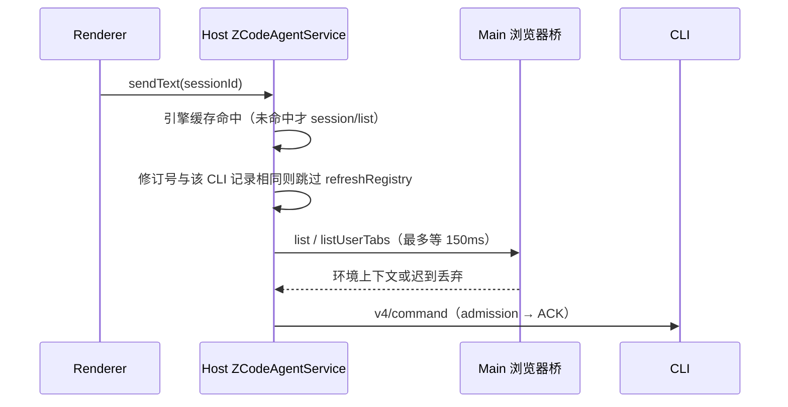
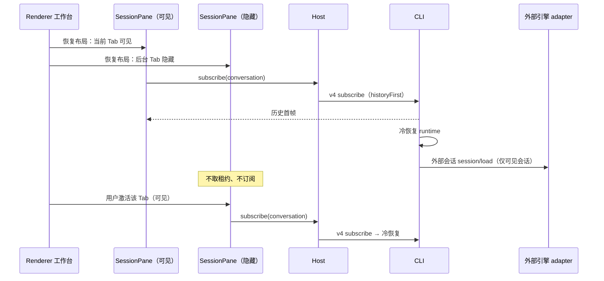

# YCode 1.1 引擎性能 spec

决策来源：[YCode 1.1 更新方案](ycode-1.1-plan.md)「性能（问题 1）」。本文按工作流分节，各节自成一体；CLI 传输、MCP、插件摘要等章节由对应工作流维护。

## Host 发送路径

范围：`packages/services/src/zcode-agent/zcodeAgentService.ts` 的 `sendConversationCommandV4`、旧 `sendPrompt` 及共用的 `session/list`、`provider/refreshRegistry` 与浏览器环境上下文。目标是热会话点发送到 CLI admission 之间不再有每次发送的 CLI 往返或 Main 往返。

### 会话引擎缓存

- 所有者：Host 的 `ZCodeAgentService` 实例。键为 `workspaceIdentity?.trim() || workspacePath` 加 `sessionId`，值为 `SessionEngine`。会话引擎创建后不可变（`packages/shared/src/external-engine/CONTRACT.md`），缓存无需失效事件。
- 写入：`session/list` 查到该会话时写入（查不到不写，不把"未找到"缓存成 `zcode`），包括会话订阅前的项目谱系查询；V4 `createSession` 命令 ACK 为 `accepted` 且带 `sessionId` 时按命令配置写入；旧 `session/create` 成功后按请求引擎写入。
- 删除：V4 `deleteSession` 命令 ACK 为 `accepted` 时删除；容量上限 2048 条，超出按写入顺序淘汰最旧项。
- 读取：命中直接返回；未命中走原 `session/list` 查询。只读进程（无外部引擎装配）仍直接视为 `zcode`。
- 外部引擎就绪门禁、`createSession` 与握手语义不变。

### Provider 注册表刷新修订号

- 修订号所有者：Host 进程的 Provider Registry（`providerRuntime.registryService`）。修订号取其快照的 `sourceRevisions.config`，由随包配置与 Personal 配置的内容哈希组成；设置页、Provisioning 等 Host 内写入在返回前已等待注册表刷新，外部写入经 Personal 配置轮询进入同一快照。
- 每个 CLI 进程（`ZCodeProtocolClient` 实例）记录最近一次成功 `provider/refreshRegistry` 时的修订号。需要刷新的入口先读当前修订号：与该 CLI 记录相同则跳过刷新；不同、未记录或修订号不可读时照旧刷新，成功后记录发起前读到的修订号，失败不记录。
- CLI 进程换代即新的 client 实例，首次使用会刷新一次。并发请求可能各刷新一次，结果一致。
- 适用入口：V4 命令（`requiresProviderRegistryRefresh` 列出的类型）、旧 `session/send`、`session/create`、`session/resume`、会话订阅首帧前与 provider 就绪后的启动刷新。模型连通性测试与工作区文本生成仍每次强制刷新。
- 不用时间窗口判断是否刷新；判断只依据修订号相等。

### 浏览器环境上下文

- 环境上下文（标签数与当前 URL）是尽力附加的信息，不能阻止 prompt 准入。Host 当前没有页面存在性的廉价事实（标签列表归 Main 的 `BrowserGuestManager` 所有），因此不做"无页面跳过"的预判，改为限定等待。
- Host 收集 `list` / `listUserTabs` 的总等待上限为 150ms。超出时本轮不附带环境上下文，直接下发命令；迟到结果丢弃，不重试、不补发。Host→Main 浏览器桥的 30s 命令预算只用于 Agent 主动发起的浏览器命令，不再出现在发送路径上。
- 失败与超时都只记 debug 日志，不改变 prompt 正文。

### 验收

| Case  | 场景                                       | 断言                                                       | 验证层        |
| ----- | ------------------------------------------ | ---------------------------------------------------------- | ------------- |
| HSP01 | 同一会话连续发送两次                       | 第二次不调用 `session/list`                                | services 单测 |
| HSP02 | V4 `createSession` accepted 后发送         | 不调用 `session/list`；`deleteSession` accepted 后重新查询 | services 单测 |
| HSP03 | 修订号不变连续发送 / 修订号变化 / CLI 换代 | 只在首发、修订号变化和新 client 时刷新                     | services 单测 |
| HSP04 | Main 不回应环境上下文请求                  | 150ms 内下发命令且不带环境上下文                           | services 单测 |

## Renderer 发送路径

### 草稿模型就绪门禁

- 所有者：Host 的 Model Selection 服务；Renderer 的 `useDraftModelReadinessGate` 只持有订阅投影（挂载时一次 `getView` + `onDidChange` 事件）。
- 首发复查 `ensureReadyForSend` 读取订阅投影：`ready` 直接放行，不发 IPC；`check-failed` 放行并交给 Host 门禁；初始读取在途时等待同一次读取，不再新发请求；只有投影为 `missing` 时才做一次权威 `getView`，确认无模型才拒绝。
- 迟到结果仍按草稿生命周期 scope 丢弃，不覆盖新草稿。

### Gen UI 上下文

- 所有者：Desktop Local Host 的 Gen UI 状态存储。Renderer 每个 SessionPane 持有一个只读上下文读取器（`createGenUiModelContextReader`），按 `buildGenUiScopeKey`（workspace identity + sessionId）缓存 `listState` 结果。
- 失效契约：`onStateChanged` 收到同一 scope 的任何变更即删除该 scope 缓存；读取期间收到变更时，本次结果只用于本次发送，不写入缓存。Host 存储对已监听目录内的文件写入发布变更，包括其他窗口写入、本窗口尚未打开过的 widget 路径。
- 发送时命中缓存直接拼接上下文；未命中才读取一次。读取失败按原逻辑忽略上下文，不阻断发送。
- 已知边界：本窗口 Host 从未打开过该会话任何 widget、而另一窗口写入了该会话状态时，本窗口缓存可能缺少该状态，直到本窗口打开该会话的 widget 或 SessionPane 重建。

### 草稿首发的"正在发送"

- 1.1 决策取代 [草稿首发：任务列表与详情同时提交](../task-first-submit-visibility.md) 中"等目录真实行再结束转圈"的规则：`sendText` ACK 为 `accepted` 后立即提升草稿并导航到新会话，Composer 的"正在发送…"随之结束。
- 侧栏真实行仍由 `ProjectDirectoryProvider` 的既有目录刷新带来，可以晚于详情出现；不构造乐观行。任务分组归属（organize）仍等真实行到达后提交。
- 目录读取失败只记 warn：会话已创建，不重发输入、不回滚导航。

## 启动恢复

- 所有者：Renderer 工作台拥有 Tab 布局与可见性；SessionPane 决定何时订阅会话；CLI 在订阅到达时冷恢复 runtime（含外部引擎 `session/load` 连接），该行为不变。
- 规则：绑定已有会话的 SessionPane 在首次可见（工作台布局中未隐藏）前不取得 `SessionDataLayer` 租约，因此不订阅、不触发 CLI 冷恢复和外部引擎后台连接。首次可见后取得租约；之后即使隐藏也保留租约，切换 Tab 不重复订阅。
- 启动时只有每栏当前 Tab（窄屏或浮窗时只有焦点栏）会恢复；其他已打开 Tab 激活时恢复。
- 不受影响：草稿 Tab 的预热、自动化、定时任务、机器人与后台任务。它们经 Host 命令进入 CLI，CLI 在命令 admission 前按原冷恢复路径恢复 runtime，不依赖界面订阅。
- 隐藏 Tab 的恢复守卫（删除检测）仍走 sessions-index，不依赖会话订阅。

### 验收

| Case | 场景                        | 断言                                              | 验证层              |
| ---- | --------------------------- | ------------------------------------------------- | ------------------- |
| SR01 | 已有会话 Tab 以隐藏状态挂载 | 不调用 `layer.acquire`                            | UI 单测             |
| SR02 | 隐藏 Tab 变为可见后再隐藏   | 可见时取得一次租约，再隐藏不释放                  | UI 单测             |
| SR03 | 真实桌面重启，恢复 6 个 Tab | 启动后只有可见会话出现 resume 日志；首发确认 ≤ 1s | 待真实 Windows 验证 |

## 本地性能摘要

- 所有者：Renderer 的 `LocalTtftObserver`（点击总时钟）；摘要经 `IPlatformService.writeLocalDiagnosticLog` 写入桌面本地日志（Renderer → Main `zcode:log` → `~/.zcode/v2/logs/YYYY-MM-DD.log`），生产包同样落盘。Web 不实现该方法，不输出摘要；不新增任何上传。
- 每次已下发命令的观测在闭合时输出一条 info 摘要：首个内容出现（`first_output`）或在此之前被排除/失败（`excluded`）。未下发命令的拒绝（例如 UI 门禁拦截、斜杠命令）不输出摘要。原 debug 明细记录保持不变。
- 字段只允许数字、布尔、枚举与生成的标识（sessionId、commandId、observationId）；不含 prompt、回复、错误正文、工作区路径或 provider/model 名称。
- 阶段（毫秒，缺失为 null）：`clickToPreviewMs`（点击 → 提交预览 commit）、`clickToAckMs`（点击 → Renderer 收到 ACK）、`clickToReceivedMs` / `clickToAdmittedMs`（点击 → CLI 收到 / 准入，仅时钟已校准时）、`enginePrepareMs`（CLI 记录的外部引擎准备）、`requestToFirstContentMs`（请求交付 → 首个内容，CLI 时钟）、`totalMs`（点击 → 首个内容或闭合）。另含 `outcome`、`engine`、`start`、`sendMode`、`quality`。
- `start`：本 Renderer 进程内该会话的第一条摘要记为 `cold`（启动后首发、打开历史会话后首发、草稿首发），同会话之后为 `warm`。它不证明引擎进程是否新建，引擎实际耗时以 `enginePrepareMs` 为准。
- 详见 [本地 TTFT 计时](../trace/local-ttft-diagnostics.md)。

## Windows 工作区路径大小写

- 已确认问题：本地 workspace key 为原始 `workspacePath` 字符串，Host 进程管理器按该 key 启动 CLI；Windows 文件系统大小写不敏感，而 `--open-workspace` 参数、deep link 与终端输入保留用户输入的大小写，Tab 去重和 Main 窗口映射也按原样比较。同一目录以不同大小写打开会得到两个 Tab、两个 CLI 进程和两份互不可见的会话列表。
- 修复：Main 在本地 Windows 路径进入工作区前，把每一段替换为磁盘上的实际大小写（逐级 `readdir` 匹配，盘符大写），不解析 junction、符号链接、subst 或网络映射。入口为 `activateOrSetWorkspace`（返回规范路径，Renderer 用它建 Tab 与草稿）和冷启动的显式工作区参数。`workspaceIdentity` 规则不变：远端 identity 与非 Windows 路径不做处理，共享 `resolveWorkspaceKey` 不变，已持久化的数据不迁移。
- 匹配失败（权限不足、路径段不存在、8.3 短名）时保留该段原文。
- 已有存量：旧版本以非规范大小写保存的 Tab、项目根或会话不会被改写；它们与规范路径仍是不同 key，需要在真实 Windows 上确认是否需要迁移。
