# 外部 Agent 引擎（Claude Code / Codex）

## 外部引擎进程与异步准备（2026-11-07，1.1）

决策来源：[YCode 1.1 更新方案](./ycode-1.1-plan.md)「性能」中的“外部引擎进程”“CLI 传输”，以及附录 B 的“外部引擎闲置连接”。仍是每个会话一个 adapter 进程；本节只改变握手何时完成、何时有空闲进程可用、何时关闭闲置进程。连接恢复、重试与 single-flight 规则见下文「原会话连接恢复与诊断」，不变。

### 异步 createSession

- 外部引擎草稿的 `createSession` 在会话记录建立、所选连接配置写入 Runtime、`engineConfigState=connecting` 发布之后就返回 ACK。ACP 握手（spawn → initialize → Codex API Key 的 `providers/set` → `session/new|resume|load` → Claude 新会话 Auto 默认与已保存配置的恢复）在 Runtime 后台继续，结果只经已有的 `engineConfigState` 投影：成功为 `ready`，失败为 `error` 并附带已有的结构化诊断 `engineConfigError`。ACK 不再表示握手已完成。
- 握手失败不会删除草稿记录，草稿与 snapshot 保留，可经已有 CAS 命令 `prepareExternalEngineSession` 重试。只有在发布 connecting 之前就失败（例如事件写入失败）才按旧规则删除 deferred 记录，并返回失败 ACK。
- 不变的部分：不隐式安装（入口缺失为 `not_ready`）；准备阶段不提交 prompt、不创建 turn；同一会话的准备是 single-flight（Runtime `externalEnginePreparation` + port `preparations` 两层合并），后台准备期间收到的 `prepareExternalEngineSession`、`setEngineConfigOption` 和 turn 都并入同一次握手；`deleteSession` 或关闭 Runtime 时先置 `shuttingDown`，再经 `closeSession` 中止后台握手和退避，之后到达的会话 ID、配置与错误一律丢弃，不再发布状态。
- 带 `firstInput` 的 `createSession` 同样不等待握手：首条输入照常 admission，turn 在提交 prompt 之前并入同一次准备；准备失败时按已有 turn 失败路径结束。

### 草稿预热 owner

- `useDraftSessionPrewarm` 仍是草稿预热会话的唯一 owner，ACK 只用来建立 binding。草稿是否就绪由该 binding 会话 snapshot 中的 `config.engineConfigState` 决定，Renderer 不另存就绪缓存。纯函数 `resolveDraftEngineReadiness` 按以下规则派生：

| owner / snapshot                                         | 阶段          | 显示        | 能否发送                                                   |
| -------------------------------------------------------- | ------------- | ----------- | ---------------------------------------------------------- |
| createSession 在途                                       | `creating`    | 正在连接…   | 否                                                         |
| 已有 binding，但还没收到该会话 snapshot，或 `connecting` | `connecting`  | 正在连接…   | 否                                                         |
| 已有 binding，`ready`                                    | `ready`       | 原生配置    | 是                                                         |
| 已有 binding，`error`                                    | `failed`      | 诊断 + 重连 | 是：先 `prepareExternalEngineSession`，成功后才 `sendText` |
| 无 binding，createSession 失败                           | `failed`      | 原错误      | 是：`waitForSession` 由 owner 重建，就绪后才 `sendText`    |
| 无 binding，预热已被丢弃（订阅失败）                     | `recreatable` | 无          | 是：同上                                                   |
| 预热被禁用（远程不可用、待恢复首发等）                   | `disabled`    | 无          | 否                                                         |

- 发送仍要等就绪，与 1.0.x 一致：外部引擎草稿发送前，如果 binding 会话的 snapshot 不是 `ready`，就经配置屏障发送 `prepareExternalEngineSession`。该命令并入后台握手，或在失败后重试一次，ACK 为 accepted/noop 时才发出 `sendText`；否则抛错，输入框保留输入。失败的草稿另提供“重新连接”入口，走同一 CAS 命令。
- 1.0.8 遗留问题：预热会话因订阅失败被 `discard()` 之后，owner 会阻止同一版本自动重建；而外部引擎草稿的 `submissionReady` 只看“有 binding 或有错误”，两者都为空，发送入口被禁用，也就不会再调用 `waitForSession`，形成死锁。修复后，被丢弃的预热属于 `recreatable` 阶段，可以发送；发送时由 owner 单飞重建，等就绪后再发送。

### 预热备用进程（spare）

- 所有者：每个 CLI 进程一个 `ExternalEngineProcessPool`（adapter 层），由协议 server 创建，并注入该进程内每个会话 app 的 ExternalEnginePort；测试连接使用的独立 port 不接入。
- 每个（引擎，连接配置 ID）至多保留一个备用进程。它已完成 spawn、`initialize`，并在 Codex API Key 配置下完成 `providers/set`，但还没有原生会话。启动路径与冷启动相同：同一入口、同一环境构造、同一连接配置解析。
- 领用：新会话（`session/new`，不含 resume/load/fork）解析出连接配置后，若备用进程的引擎、配置 ID 和 cwd 都一致且进程健康，就同步领用，跳过 spawn 和 initialize。领用后该进程归会话所有，之后与冷启动的会话连接没有区别。进程已退出、cwd 不同或备用进程仍在初始化时，按未命中处理并走冷启动；仍在初始化的那个备用进程会保留下来。备用进程不跨连接配置复用。
- 补位：同一（引擎，配置）的 `session/new` 成功后（无论是否命中），后台准备一个替代备用进程；已有健康备用进程或正在初始化时不重复创建。补位排在会话握手之后，不和会话握手争抢启动资源。
- 存在条件：只在 Host 注入了 `ZCODE_EXTERNAL_ENGINES_DIR` 的 CLI 中存在，即桌面本地工作区。远程工作区不运行外部引擎会话，所以没有备用进程。备用进程只在该引擎刚成功新建会话后补位；草稿预热按当前默认引擎（或用户刚改选的引擎）发起，因此备用进程只会属于当前默认或刚用过的引擎，自然满足“当前默认或近 24 小时用过”。启动、恢复历史会话和测试连接都不会创建备用进程。
- 回收：备用进程 10 分钟未被领用就关闭。备用进程的失败（启动失败、initialize 失败、中途退出）不向用户展示，只写日志，并回落到冷启动路径。
- 关闭：协议 server 的 `shutdown()` 在关闭各会话 app 的同时关闭 pool。pool 停止补位，关闭全部备用进程和仍在初始化的备用进程。关闭沿用 `closeAcpProcess`：Windows 用 `taskkill /T /F` 结束进程树，POSIX 结束 detached 进程组，与会话 adapter 相同。CLI 进程被强杀时，备用进程与会话 adapter 一样可能残留，这是已有边界。

### 闲置连接关闭

- 所有者仍是 port 与 pool：port 持有会话连接和该会话的在途计数（prepare、prompt、fork、setConfigOption），pool 按 60 秒节拍扫描已登记的会话连接。
- 关闭条件（全部满足）：会话连接存在；没有在途操作或准备（外部引擎的待处理交互只出现在运行中的 prompt 内，因此也一并覆盖）；该连接的原生会话已确认可恢复（经 resume/load 建立，或至少提交过一次 prompt）；最近一次使用已超过 15 分钟；不是最近活跃的 3 个可恢复会话之一。即使会话仍被订阅（Tab 打开）也会关闭。
- 未提交过 prompt 的草稿预热会话不关闭，也不占用这 3 个豁免名额：从未提交 prompt 的原生会话可能无法 resume。
- 关闭只结束 adapter 进程。订阅、已确认配置、`externalSessionId` 和 `engineConfigState=ready` 都保留。下一次发送时，turn 发现没有健康连接，就投影 connecting，按原会话 resume/load 恢复已确认配置，再投影 ready 并提交 prompt；下一次修改配置时，`setConfigOption` 得到 `not_ready`，经已有空闲恢复路径重连，然后只重试这次幂等配置。prompt 绝不自动重发。
- 关闭与使用并发：port 的释放与其他入口取得连接都在同一个同步片内完成，释放前再检查一次在途计数；释放之后到达的操作看不到旧连接，会走恢复路径。
- 常驻池（未订阅、已持久化会话的 runtime 回收）的闲置时间从 10 分钟延长为 30 分钟，LRU 上限（16 → 8）不变。

### 本地性能事件

均为 info 级，只写本机日志，不含正文、路径、密钥或命令行：

| 事件                                                           | 字段                                                                                                                                                                               |
| -------------------------------------------------------------- | ---------------------------------------------------------------------------------------------------------------------------------------------------------------------------------- |
| `external_engine.handshake.completed`                          | `engine`、`sessionId`、`method`（new/resume/load/fork）、`spare`（hit/miss/none）、`launchMs`、`initializeMs`、`providersSetMs`（有时）、`sessionMs`、`configRestoreMs`、`totalMs` |
| `external_engine.handshake.failed`                             | `engine`、`sessionId`、`code`、`method`、`totalMs`                                                                                                                                 |
| `external_engine.spare.claimed` / `.miss`                      | `engine`、`connectionProfileId`、`reason`（miss：none/warming/unhealthy/cwd）、`ageMs`（hit）                                                                                      |
| `external_engine.spare.ready` / `.expired` / `.failed`（warn） | `engine`、`connectionProfileId`、`durationMs` / `idleMs` / `code`                                                                                                                  |
| `external_engine.idle_close`                                   | `engine`、`sessionId`、`idleMs`                                                                                                                                                    |
| `external_engine.idle_resume.completed` / `.failed`            | `engine`、`sessionId`、`durationMs`（从发起恢复到 ready）、`code`（失败时）                                                                                                        |

### 状态所有者与事件顺序

| 状态                                        | 所有者                                                      | 读取方                                  |
| ------------------------------------------- | ----------------------------------------------------------- | --------------------------------------- |
| 草稿记录、连接配置绑定、`engineConfigState` | CLI Runtime（`prepareExternalEngineSession` single-flight） | V4 snapshot → Renderer                  |
| 会话 adapter 连接、在途计数、最近使用时间   | CLI ExternalEnginePort（每会话 app 一个）                   | pool 扫描                               |
| 备用进程、闲置扫描与 3 个豁免               | CLI ExternalEngineProcessPool（每 CLI 进程一个）            | port 领用 / 补位                        |
| 草稿预热 binding                            | Renderer `useDraftSessionPrewarm`                           | SessionPane（就绪阶段由 snapshot 派生） |

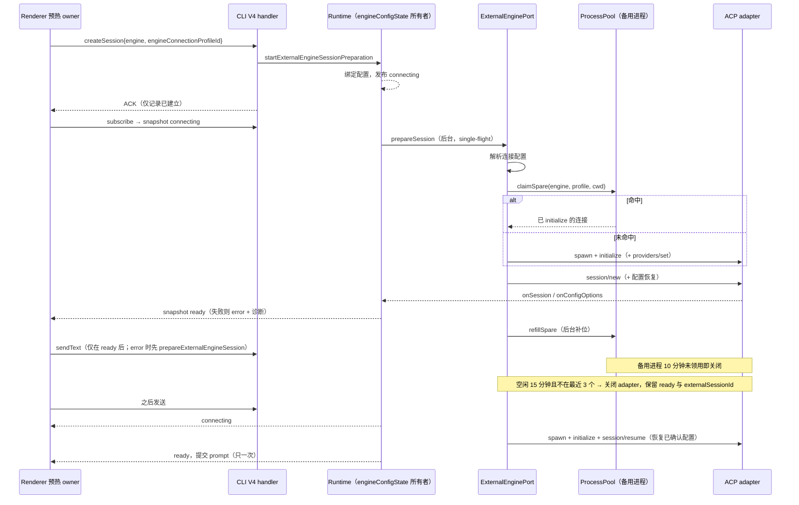

### 回归与验收

| ID  | 场景                                  | 断言                                                                                        | 层             |
| --- | ------------------------------------- | ------------------------------------------------------------------------------------------- | -------------- |
| P01 | 外部引擎草稿 createSession            | ACK 早于握手完成；ACK 时 Runtime 已为 connecting；随后 ready；不创建 turn、不发 prompt      | bootstrap/core |
| P02 | 后台握手失败                          | ACK 已 accepted；记录保留；`engineConfigState=error` 带诊断；重试可恢复                     | bootstrap/core |
| P03 | 握手中删除草稿                        | 后台握手中止，之后不再发布 ready/error，不启动迟到进程                                      | core/adapters  |
| P04 | 备用进程领用 / 补位 / 过期 / 配置隔离 | 同配置第二个新会话不再 initialize；补位后仍至多一个；10 分钟后关闭；其他配置 ID 不领用      | adapters       |
| P05 | 闲置关闭后发送与改配置                | adapter 进程退出；`externalSessionId` 与配置保留；下次发送 resume 恢复配置后只发一次 prompt | adapters       |
| P06 | 最近 3 个会话与草稿                   | 第 4 个起才关闭；从未提交 prompt 的草稿不关闭                                               | adapters       |
| P07 | CLI 关闭时存在备用进程                | pool 关闭全部备用进程与仍在初始化的备用进程，此后不再补位                                   | adapters       |
| P08 | 草稿就绪阶段与丢弃后恢复              | 发送只在 ready / failed / recreatable 时可用；丢弃后发送由 owner 重建并等待就绪             | UI             |

单测使用受控 ACP 夹具进程。Windows 整机上 `codex.exe` / `claude.exe` 的真实 spawn 耗时、进程树回收与内存下降需要在本机单独验收，未验收前不写成通过。

## 连接与认证规则（2026-11-07，1.0.8）

本节取代 2026-11-06 版本，决策来源为 [YCode 1.1 更新方案](./ycode-1.1-plan.md)「连接与认证」。就绪与检测缓存规则保持不变。

### 就绪与检测

Host 的 ready 仅表示 adapter 与官方 CLI 可启动；真实执行就绪归 Runtime 的原生握手，login status 是诊断信息，不能阻止无需官方账号的网关。状态检测按引擎 single-flight 并缓存 60 秒，设置页显式刷新与安装完成使缓存失效，版本和登录诊断并行，不在每次发送重复启动两个进程。失效会切换该引擎的检测代次，新请求不复用旧在途诊断；旧结果只能回复原调用者，不得回填缓存或广播覆盖新身份状态。

发送与冷启动门禁使用 `isLaunchReady`，只检查 adapter 安装元数据及官方 CLI 路径，不启动版本或登录查询。结果在同一 Host 内复用；健康续聊不增加文件或 CLI 检测。显式刷新、连接配置变更、安装、登录结束及界面收到配置／认证失败时仅使缓存失效；下次需要时重新检查，完整诊断继续由设置页发起。

### 三种连接方式

Claude Code 与 Codex 对称提供沿用 CLI（`inherit`）、官方登录（`official`）、API Key + Base URL（`apiKey`）。子进程环境规则只由共享纯函数 `buildEngineConnectionEnv` 定义，Host 的状态诊断、登录命令与 CLI 的 adapter 启动共用，不各自维护剔除列表。所有方式都剔除继承的 `APP_SERVER_LOGS`，避免原生 JSON-RPC 日志泄露 Authorization。

| 方式     | Codex                                                                                                                                                                                  | Claude Code                                                                                                                                                                                                                                                                                                     |
| -------- | -------------------------------------------------------------------------------------------------------------------------------------------------------------------------------------- | --------------------------------------------------------------------------------------------------------------------------------------------------------------------------------------------------------------------------------------------------------------------------------------------------------------- |
| 沿用 CLI | 原环境与 `CODEX_HOME`（缺省 `~/.codex`）不变                                                                                                                                           | 原环境不变，保留继承的 `ANTHROPIC_*`；`~/.claude/settings.json` 的 env 由 Claude 自行读取                                                                                                                                                                                                                       |
| 官方登录 | 每个配置使用独立 `CODEX_HOME`；去除 `OPENAI_API_KEY`、`OPENAI_BASE_URL`、`CODEX_API_KEY`、`CODEX_CONFIG`、`MODEL_PROVIDER`、`DEFAULT_AUTH_REQUEST`；登录按钮运行 `codex login`，可取消 | 使用用户自己的 Claude 登录，不另建配置目录；去除继承的 `ANTHROPIC_API_KEY`、`ANTHROPIC_AUTH_TOKEN`、`ANTHROPIC_BASE_URL`（即 1.0.7 行为）；登录按钮运行 `claude auth login --claudeai`，可取消                                                                                                                  |
| API Key  | 独立 `CODEX_HOME` 并按官方登录去除网关覆盖；初始化后经私有 `providers/set` 发送 Bearer；缺省地址 `https://api.openai.com/v1`；模型经 `CODEX_CONFIG`                                    | 去除全部继承的 `ANTHROPIC_*` 以及 `CLAUDE_CODE_USE_BEDROCK`、`CLAUDE_CODE_USE_VERTEX`、`CLAUDE_CODE_USE_FOUNDRY`、`CLAUDE_CODE_OAUTH_TOKEN`；官方地址（缺省 `https://api.anthropic.com`）用 `ANTHROPIC_API_KEY`，自定义网关用 `ANTHROPIC_BASE_URL` + `ANTHROPIC_AUTH_TOKEN`（Bearer）；模型经 `ANTHROPIC_MODEL` |

- 两家官方登录与 API Key 的模型字段可选；Claude 官方登录填写模型时同样设置 `ANTHROPIC_MODEL`。
- 密钥只进 CredentialService，键为 `external-engine:<engine>:<配置 ID>`。连接文件、返回 UI 的配置视图、状态、测试结果、V4 快照、argv 与日志只含 `hasApiKey`。Codex 的密钥只经私有 ACP `providers/set` 传递；Claude 官方 CLI 没有其他私有通道，密钥只出现在 adapter 子进程环境中。
- YCode 不读写 `~/.codex/auth.json`、`~/.claude/.credentials.json`，不修改用户的 `config.toml` 或 `settings.json`；管理连接的真实 HOME 不变。
- 已知限制：Claude 在子进程环境之后应用 `settings.json` 的 env；若其中配置了 `ANTHROPIC_BASE_URL` 或 `ANTHROPIC_AUTH_TOKEN`，会覆盖官方登录或 API Key 的路由。状态检测据此提示网关，YCode 不改写该文件。

### 连接配置

- Host 是连接配置唯一写者。`<YCode 数据目录>/engines/connections.json` 保存配置列表与每个引擎的上次使用配置 `lastUsed`，所有写入在文件锁内读改写并原子落盘；多窗口 Host 共享同一文件。
- 内置配置不落盘、不可编辑或删除：两家都有「沿用 CLI」（ID `inherit`），Claude 另有「官方登录」（ID `official`）。无上次使用值时 Codex 缺省 `inherit`、Claude 缺省 `official`，保持 1.0.7 行为。
- 兼容：1.0.7 文件中的配置缺省属于 Codex，旧 `activeProfileId` 作为 Codex 上次使用值的迁移来源；写入时继续把 `activeProfileId` 写成 Codex 的上次使用值并保留 `inherit` 条目，便于回退旧版本读取。
- 用户配置包含可选名称（缺省按方式与网关域名生成）、方式、Base URL、模型与密钥。列表显示名称、方式和网关域名。
- 写入是 `updateConnectionProfiles(command)` 命令：`create` 生成新 ID 并设为该引擎上次使用；`edit` 生成新 ID、隐藏旧配置，未填新密钥时复制旧密钥，上次使用指向旧 ID 时改指新 ID；`delete` 只把配置标记为隐藏，不清理目录与凭据，已绑定会话继续工作；`select` 记录上次使用，拒绝隐藏或不存在的配置。上次使用指向隐藏或不存在的配置时回落内置缺省。成功后 Host 广播 `onConnectionProfilesChanged` 并使该引擎的状态缓存失效。

### 会话绑定

- 新草稿的选择器默认上次使用配置。用户选择后 Host 先记录上次使用，再由现有草稿 owner 回收并重建预热；`createSession.config.engineConnectionProfileId` 携带所选 ID，Runtime 在首次连接准备前接收，之后不可变。
- Runtime 解析配置后经既有 `external_engine_config` entry 持久化 `connectionProfileId`，并在 `ExternalEngineConfigUpdated` 与 snapshot `config.engineConnectionProfileId` 投影。UI 只读该投影显示绑定：草稿可改选，已创建会话只读显示。
- 未显式传入时：新会话使用上次使用配置，没有则用内置缺省；旧原生会话（有 externalSessionId、无绑定）Codex 为 `inherit`、Claude 为 `official`；fork 继承源绑定，缺省同旧会话。绑定的配置不存在时明确失败，不静默换身份。

### 测试连接

- 设置页的每个配置都可「测试连接」。UI 调用 Host `testConnection({engine, profileId, workspacePath})`，Agent Service 取该本地 workspace 的 CLI，发送 `externalEngine/testConnection {operationId, engine, connectionProfileId}`。
- CLI 使用独立的 ExternalEnginePort 和临时 cwd 建立一次性原生会话，不写 SQLite，也不进任务索引。它发送 `Reply with OK`，拒绝全部工具权限，结束后关闭会话、回收进程树并删除临时目录。
- 结果分为 `success`（耗时）、`unexpectedReply`（耗时与经脱敏、≤120 字的回复摘要，覆盖以正文返回错误的引擎）、`failed`（EngineConnectionFailure：分类、HTTP 状态、脱敏消息、request id）和 `cancelled`。首个原生失败通知即结束测试，不等待引擎自行重试。
- 取消由 Host `cancelConnectionTest()` 发送 `externalEngine/cancelConnectionTest {operationId}`。这两个方法不进入 CLI 串行队列，测试期间同一 workspace 的会话请求不受阻塞。同一 Host 同时只运行一个测试。
- 无本地 workspace 时禁用测试并提示打开本地项目。日志只记录引擎、配置 ID、结果分类与耗时。

### 状态显示

- 网关用户不再显示「未登录」：`auth.gatewayHost` 存在时显示「使用网关 <host>」。
- 检测只读必要键且只保留 host：Codex 读取 `$CODEX_HOME/config.toml`（缺省 `~/.codex`）中当前 profile 或顶层 `model_provider` 对应的 `model_providers.<id>.base_url`，内置 openai provider 再看环境 `OPENAI_BASE_URL`；Claude 读取 `$CLAUDE_CONFIG_DIR/settings.json`（缺省 `~/.claude`）的 `env.ANTHROPIC_BASE_URL`，沿用 CLI 时再看环境 `ANTHROPIC_BASE_URL`。不记录文件内容或凭据，读取或解析失败视为无网关。
- API Key 配置：自定义地址显示「使用网关 <host>」；官方地址显示「OpenAI API Key」或「Anthropic API Key」，密钥缺失显示「缺少 API Key」。
- 连接列表的「沿用 CLI」行显示检测到的网关 `inheritedGatewayHost`；身份类别（订阅 / API Key）本地化显示。

### 代理与证书

Host 与 CLI 启动时已把用户的代理与证书变量封存进 `ZCODE_TOOL_ENV_PASSTHROUGH_JSON`。adapter 子进程沿用工具子进程的既有恢复规则 `applyNetworkEgressEnv`：恢复 `HTTP_PROXY`、`HTTPS_PROXY`、`ALL_PROXY`、`NO_PROXY`（含小写变体）、`SSL_CERT_FILE`、`SSL_CERT_DIR`、`NODE_EXTRA_CA_CERTS`、`REQUESTS_CA_BUNDLE` 等；只有 YCode 显式配置代理、No Proxy 或 CA 时才覆盖对应变量。网络出口与身份无关，三种连接方式一致。

### Windows 运行时补位

PATH 缺少 node 时，adapter 子进程的 PATH 前置 `<engines>/.node-runtime/<运行时哈希>/`：POSIX 为指向当前运行时的符号链接 `node`，Windows 为 `node.cmd`，以 `ELECTRON_RUN_AS_NODE=1` 调用当前运行时。cmd 按控制台代码页解码批处理，用户名含中文时内嵌路径会被解错，因此运行时路径经 adapter 写入的 `ZCODE_EXTERNAL_ENGINE_NODE` 传入，`node.cmd` 内容保持纯 ASCII。这样 npm 入口和 adapter 自带的 `codex.js` 在没有系统 Node 的机器上也能启动。不修改系统 PATH。

### 状态所有者与事件顺序

| 状态               | 所有者                                             | 读取方                                        |
| ------------------ | -------------------------------------------------- | --------------------------------------------- |
| 连接配置、上次使用 | Host `external-engine-service`（connections.json） | 设置页、输入框选择器（视图）、CLI（只读解析） |
| 密钥               | CredentialService                                  | CLI 启动 adapter 时按配置读取                 |
| 会话绑定的配置 ID  | CLI Runtime（external_engine_config entry）        | snapshot `config.engineConnectionProfileId`   |
| 草稿当前选择       | 预热会话的 snapshot；尚未预热时为上次使用值        | 输入框选择器                                  |
| 测试连接进度       | Host 单个在途测试；CLI 按 operationId 持有取消     | 设置页                                        |

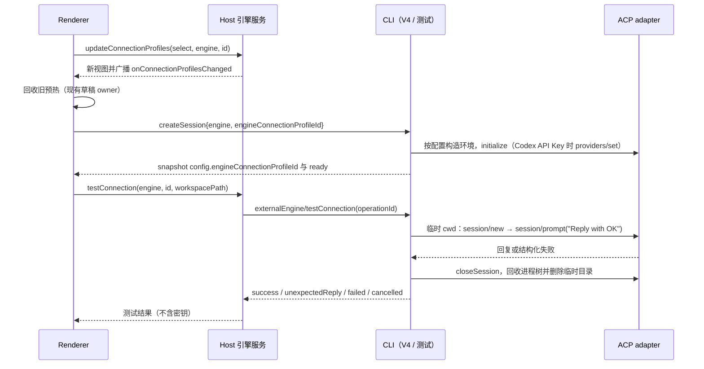

### 回归与验收

| ID  | 场景                                                                    | 断言                                                                                                     |
| --- | ----------------------------------------------------------------------- | -------------------------------------------------------------------------------------------------------- |
| C01 | Claude 沿用 CLI，环境含 `ANTHROPIC_BASE_URL`                            | adapter 环境保留原值；状态显示「使用网关 <host>」                                                        |
| C02 | Claude 官方登录与旧会话                                                 | 去除三项继承变量；旧会话绑定 `official`；登录按钮运行 `claude auth login --claudeai` 且可取消            |
| C03 | Claude API Key：官方地址 / 自定义网关                                   | 分别只设 `ANTHROPIC_API_KEY` 或 `ANTHROPIC_BASE_URL` + `ANTHROPIC_AUTH_TOKEN`；其他 `ANTHROPIC_*` 被去除 |
| C04 | 密钥位置                                                                | 不出现在 argv、连接文件、视图、状态、测试结果、snapshot 与日志                                           |
| C05 | 多个命名配置：新建、编辑、删除                                          | 编辑生成新 ID，旧会话保持旧绑定；删除只隐藏；上次使用随之更新或回落                                      |
| C06 | 输入框选择配置                                                          | 记录上次使用并重建预热；已创建会话只读显示绑定                                                           |
| C07 | 测试连接成功、失败、取消                                                | 显示耗时或 HTTP 状态 / 消息 / request id；取消后无残留进程与临时目录；同 workspace 会话不被阻塞          |
| C08 | Codex 沿用 CLI，`config.toml` 配置自定义 provider                       | 显示「使用网关 <host>」而非「未登录」                                                                    |
| C09 | 用户 shell 设置 `HTTPS_PROXY` / `NODE_EXTRA_CA_CERTS`，YCode 未配置代理 | adapter 环境保留原值；YCode 配置代理后改用 YCode 值                                                      |
| C10 | Windows 无系统 Node，使用 adapter 自带 `codex.js`                       | PATH 前置 `node.cmd` 补位并可启动                                                                        |

单测覆盖 C01–C10 的规则层；真实 Windows 整机、真实供应商请求、浏览器登录与 E2E 需单独验收，未验收前不得写成通过。

### 2026-11-06 原始规则（Codex 三种连接）

以下为 1.0.7 的 Codex 规则，仍然有效；与上文冲突时以上文为准。

Codex 设置支持沿用 CLI、官方登录和 API Key 三种连接方式。Host 是连接配置的唯一写者，密钥进入既有 CredentialService，返回 UI 的配置只含 hasApiKey。API Key 使用官方 URL或 Responses 兼容网关，模型可显式填写。YCode 管理的连接各有固定 CODEX_HOME；真实 HOME 不变，用户原有 ~/.codex 不修改。官方登录按钮运行同一官方 CLI 的 login 命令并支持取消；API Key 只通过私有 ACP providers/set 传递，不进普通会话命令、argv、快照或日志。

Codex 登录诊断与当前连接身份一致：inherit 查询原 CLI 环境，official 查询专用 CODEX_HOME 并去除继承的网关覆盖，API Key 只检查对应凭据是否存在，不查询原用户的官方登录状态。该诊断不验证上游 Key 是否有效，也不承担发送门禁。点击官方登录只做可启动性预检，不先执行版本与登录状态命令。

每个新会话准备连接时绑定配置 ID，随既有 external_engine_config entry 持久化；不能随设置切换认证目录。连接模式不可原地改写，编辑 URL/模型/密钥产生新配置 ID，已有会话继续使用旧配置。连接目录与旧配置不自动清理。

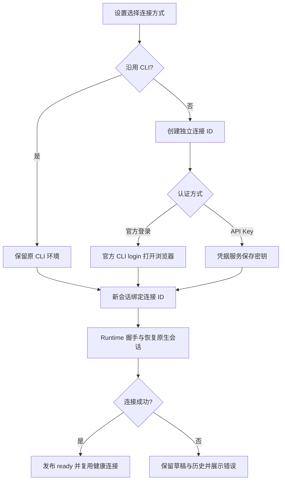

回归：无 auth.json 的网关不被 Host 拒绝；并发与重复发送不重复检测；Windows .cmd 与原生二进制检测/执行一致；三种模式、密钥不回显、取消登录、重启恢复、切换默认后旧会话与 fork 保持原连接。真实 Windows 和供应商请求须独立验收。

客户端图标：Codex 使用 `@lobehub/icons` 的 `OpenAI` 单色标识，浅色主题黑色、深色主题白色；Claude Code 使用 `Claude.Color` 原始品牌色标识。两款图标均保存为本地透明 SVG，复用现有 `TaskClientLogo` 入口，不依赖在线图标服务；资源目录保留库版本、来源、校验值及许可证。

### Claude 新会话的默认权限模式

终端会话中切换的权限模式不等于配置文件中的默认值，ACP 缺省仍可能返回 `default`（Manual）。客户端新建 Claude 会话时，若没有已确认的模式选择、原生目录当前为 `default` 且提供 `auto`，通过既有 `session/set_config_option` 选择 Auto，再发布配置就绪。原生返回的非 Manual 模式、已有会话恢复、用户已确认的模式及 Codex 不应用此默认值。目录不提供 Auto 时沿用原生值；原生因模型限制将 Auto 调整为其他模式时，显示其实际确认值，不伪装 Auto，不启用绕过权限模式。

Runtime 仍是已确认配置的唯一所有者；UI 只读配置快照。初始化失败走原连接错误路径，不吞掉失败或自动重发用户输入。

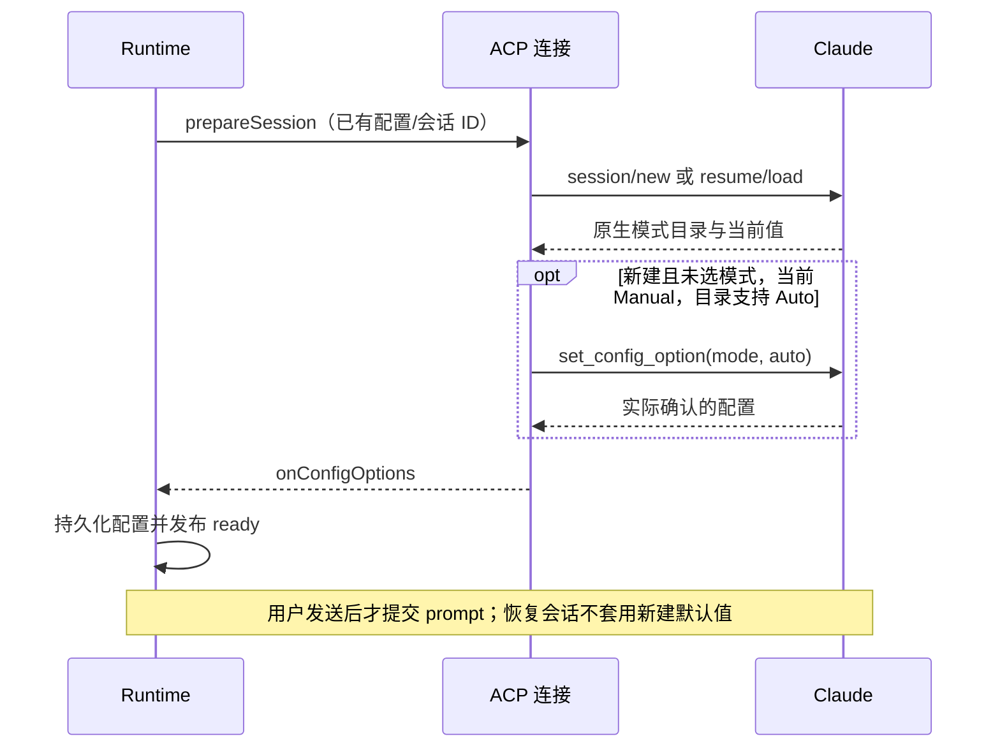

状态：2026-10-25 本地桌面集成与本轮回归修复完成；macOS 真实账号三种引擎的首发/续聊已验证，跨平台及其余产品场景待完成。

## 背景与目标

用户希望在 YCode 中直接使用 Claude Code、Codex 的官方 CLI，复用自己的订阅或 CLI 配置，而不是由 YCode 以第三方客户端身份直连两家模型 API，以免账号因第三方直连受限。

本规范新增"会话引擎"概念：每个会话在创建时选定 `zcode`、`claude-code` 或 `codex` 之一，创建后不可切换。`zcode` 引擎即现有 ZCode Agent，行为不变。

## 产品边界

- 只驱动用户本机安装或由 YCode 按需安装的官方 CLI，经官方维护的 ACP adapter 通信：
  - Claude Code：`@agentclientprotocol/claude-agent-acp`（封装 `@anthropic-ai/claude-agent-sdk`）。
  - Codex：`@agentclientprotocol/codex-acp`（驱动 `codex app-server`）。
- 优先使用用户 PATH 中的官方 CLI 二进制：Claude 通过 `CLAUDE_CODE_EXECUTABLE`，Codex 通过 `CODEX_PATH` 指定。未安装时才回退到 adapter 自带副本。
- Windows 的 npm / pnpm `.cmd` / `.bat` 包装入口按其接收用户参数的目标（`"%dp0%\<相对路径>" %*` 或 `%~dp0` 形式）解析，检测（版本、登录状态）与连接（`CLAUDE_CODE_EXECUTABLE` / `CODEX_PATH`）共用同一解析器和同一路径，跳过 cmd.exe 与 node.exe：
  - Claude：目标为 `.exe`（如 `node_modules\@anthropic-ai\claude-code\bin\claude.exe`）时直接使用该原生文件；目标为 JavaScript 时沿用该脚本。不能把批处理文件交给不支持 shell 的 Claude SDK 直接启动；未能识别或目标缺失的包装入口视为不可用，继续寻找 PATH 中后续入口或已安装 adapter 的官方副本。
  - Codex：目标为官方 `@openai/codex/bin/codex.js` 时，按该脚本的真实路径向上查找平台 optional 包 `@openai/codex-win32-<arch>`（嵌套、提升与 pnpm 布局），回退包内 `vendor`，使用 `vendor/<target-triple>/bin/codex.exe`；目标直接为 `.exe` 时使用该文件。原生文件缺失或包装入口无法识别时保留原 `.cmd`，由 adapter 的 cross-spawn 执行（原行为）。附带的 `codex-resources`、`codex-path` 与 `codex-package.json` 仍位于原生文件的安装目录；`codex.js` 额外注入的 `CODEX_MANAGED_*` 从二进制字符串看只用于安装诊断与升级提示，直接启动时不再设置。经原生文件运行真实 app-server 会话须在 Windows 上独立验收。
  - 2026-11-07 本机实测（Windows 11，npm 全局安装 Codex 0.156.0，热缓存 9 轮中位数）：`codex --version` 经 `codex.cmd` 为 171ms（157–180ms），直接执行解析出的 `codex.exe` 为 51ms（47–60ms）。
- PATH 无可用入口时，Claude 使用锁定 SDK 的平台原生 optional 包（Linux 按 libc 选择），Codex 使用安装树中的官方 JavaScript 入口；Host 与 adapter 通过同一解析器选择同一文件，不依赖已退役的 Claude SDK `cli.js`。
- YCode 不读写用户原有 `~/.claude/.credentials.json`、`~/.codex/auth.json`，不自行实现 OAuth 或设备码登录，不新增遥测。两家都可沿用已有 CLI 配置，或在设置页发起官方登录命令（Claude 为 `claude auth login --claudeai`，Codex 为专用身份目录内的 `codex login`）；API Key 连接见「连接与认证规则」。
- 不启用 claude-agent-acp 的 `--hide-claude-auth`。该开关的作用是拒绝走 claude.ai 订阅，与本功能目标相反。
- Claude 子进程的环境按会话绑定的连接方式构造：官方登录与无绑定的旧会话清除继承来的 `ANTHROPIC_API_KEY`、`ANTHROPIC_AUTH_TOKEN`、`ANTHROPIC_BASE_URL`，不被宿主环境中的密钥意外改成 API 计费；沿用 CLI 保留原环境。Codex 的 inherit 连接沿用原配置；管理连接使用独立 CODEX_HOME 与显式 provider，不能混入宿主环境的其他 API Key 或 provider 覆盖。
- adapter 只能由用户在设置页显式安装，打开会话不会隐式安装。安装使用 npm 官方 registry，并锁定版本。Claude Agent SDK 为 Anthropic 专有许可（`SEE LICENSE IN README.md`），因此不打进安装包、不再分发。
- 一期范围：本地桌面 workspace。SSH、WSL、Docker 远程 workspace 放到二期。
- 一期在外部引擎会话中禁用以下能力，并通过 `sessionActionAvailability` 灰显、给出原因：rewind、编辑重发、retry、文件回滚，以及 ZCode 自有的 compact。`/compact` 作为 slash command 透传给引擎。

## 状态所有者与接口

| 状态                                                     | 所有者                                             | 说明                                                                                                                                                                            |
| -------------------------------------------------------- | -------------------------------------------------- | ------------------------------------------------------------------------------------------------------------------------------------------------------------------------------- |
| transcript、turn/row、queue、interaction、session config | CLI V4 projection/runtime（不变）                  | 外部引擎事件翻译为 `SessionEvent` 并写入 `message`/`part` 行，冷恢复与 replayable 回放与 ZCode 会话同路径                                                                       |
| 引擎自身会话（Claude session JSONL、Codex thread）       | 引擎                                               | YCode 只保存 `externalSessionId`，不解析引擎的 transcript 文件                                                                                                                  |
| 引擎会话 id 与 engine 类型                               | CLI session record + SQLite `session` 表（新增列） | 创建时写入，之后不可变                                                                                                                                                          |
| adapter 进程                                             | CLI，每个会话一个进程                              | 子进程只经 `adapters/src/exec` 启动；空闲回收接入 `session-resident-pool`，有运行中 turn 或待处理权限时不回收；1.1 起另有备用进程与闲置连接关闭（见「外部引擎进程与异步准备」） |
| adapter 安装与登录状态                                   | Host services（`external-engine-service`）         | 只读检测加用户显式安装；就绪结果作为外部引擎会话的执行门禁                                                                                                                      |

接缝：`apps/zcode-cli/packages/core/src/runtime/methods/turn.ts` 中 `executeTurnCommand` 对 `runRegularTurnLoop` 的调用。外部引擎会话改为调用新的 `ExternalEnginePort.runTurn`；准入、TurnStarted/Complete、usage 结算、abort 全部复用。

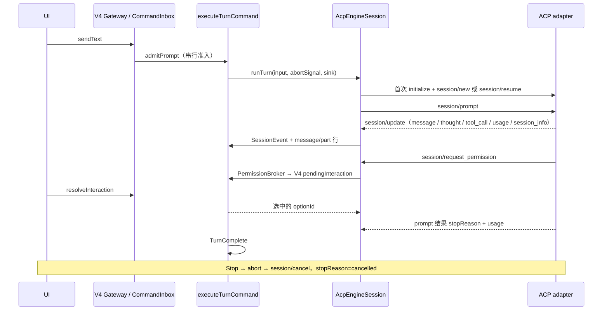

## 协议与服务契约（P1）

- 引擎契约位于受管模块 `external-engine-protocol`（`packages/shared/src/external-engine/`）：引擎值域、`EngineConfigOption`、`EXTERNAL_ENGINE_RUNTIMES`（adapter 包名与锁定版本、官方 CLI、环境变量规则）、`ExternalEngineStatus`、`engine_not_ready` 错误码以及安装布局。Host 安装方与 CLI 启动方都从这里读取，不得各自硬编码。
- V4 协议：
  - `createSession.config.engine` 可选，创建后不可变。
  - snapshot `config.engine` 可选，缺省视为 `zcode`，读取统一经 `resolveSessionEngine`；不使用 schema default，避免旧快照往返时被补写字段。
  - 两家 adapter 都把模式、模型、effort 等放在 ACP `configOptions` 中，因此投影为单一列表 `config.engineConfigOptions`，用新增的 CAS 命令 `setEngineConfigOption {configId, value}` 切换。`switchModelConfig`（provider/model/thought 属于 Registry 语义）与 `switchCollaborationMode`（ZCode 固定模式）在外部引擎会话中拒绝，不复用、不叠加分支。
- 能力降级复用现有字段，不新增协议：
  - 外部引擎会话不下发 row actions 中的 `canEdit` / `canRetry`。
  - session availability 中 `fork`、`compact`、`switchModelConfig` 为 `{allowed:false, reasonCode:"external_engine_unsupported"}`。
- 安装布局：Host 启动 CLI 时注入 `ZCODE_EXTERNAL_ENGINES_DIR=<YCode 数据目录>/.zcode/engines`。adapter 安装在 `<dir>/<engine>@<version>/`（`npm install --prefix`）。Host 另注入 `ZCODE_EXTERNAL_ENGINE_USER_HOME=<真实用户目录>`；CLI 只在启动外部 adapter 时恢复该 `HOME`（Windows 同时恢复 `USERPROFILE`），缺省时沿用当前用户目录，空值或非绝对路径拒绝启动；内置 Agent 的数据目录隔离不变。确保官方 CLI 能读到 `~/.claude`、`~/.codex`。PATH 无官方 CLI 时，Host 与 adapter 通过描述符 `bundledOfficialCli` 定位锁定安装树内的官方 CLI；Claude 使用 SDK 平台原生包，Codex 的 JavaScript 入口由同一 Node 执行，并保留真实 HOME。
- Host 服务：受管模块 `external-engine-service`（`packages/services/src/external-engine/`）提供 `IExternalEngineService`：状态（`getStatus`、`listStatuses`、`isLaunchReady`、`invalidateStatus`、`refreshStatus`、`onStatusChanged`）、安装（`installAdapter`）与连接配置（`getConnectionProfiles`、`updateConnectionProfiles`、`login`、`cancelLogin`、`testConnection`、`cancelConnectionTest`、`onConnectionProfilesChanged`）。`IServiceAccessor.externalEngineService` 为可选字段，未提供该服务的 host 中，UI 隐藏外部引擎入口；桌面远程工作区的草稿按“不支持外部引擎的工作区”灰显外部引擎。
- Host 执行门禁通过 `session/list {sessionIds, includeDrafts:true}` 读取 CLI 权威的 engine；该选项只允许精确读取已驻留草稿，不激活 runtime，不把草稿加入普通任务索引。冷恢复读取 SQLite 的 engine，不能按 Provider 值或 UI 当前草稿推断。
- 登录检测直接调用官方 CLI 的状态命令（`claude auth status`、`codex login status`），只提取身份类别，丢弃账号和密钥片段。

## 协议映射（以 P0 实测帧为准）

| ACP                                                                                      | YCode                                                                                                                                                                                                                                        |
| ---------------------------------------------------------------------------------------- | -------------------------------------------------------------------------------------------------------------------------------------------------------------------------------------------------------------------------------------------- |
| `agent_message_chunk`                                                                    | `assistantText` 流式行                                                                                                                                                                                                                       |
| `agent_thought_chunk`                                                                    | `reasoning` 行                                                                                                                                                                                                                               |
| `tool_call` / `tool_call_update`                                                         | `toolCall` 行。Claude 的 `name` 和 `_meta.claudeCode.toolName` 是原生工具名（如 `Write`），`_meta.claudeCode.toolResponse.structuredPatch` 与 ZCode `file_diff.structuredPatch` 同源；Codex 只给 `kind`（edit/execute/think）和 diff content |
| `content[].type = "diff"`（`path`、`oldText`、`newText`）                                | `toolDisplay.file_diff`                                                                                                                                                                                                                      |
| `session/request_permission` 的 options（`allow_once` / `allow_always` / `reject_once`） | V4 permission interaction；回复 `{outcome:{outcome:"selected", optionId}}`。两家 option kind 一致，`optionId` 各不相同，必须原样回传                                                                                                         |
| `usage_update`（`used`、`size`）                                                         | `sessionUsageState.contextWindow`                                                                                                                                                                                                            |
| `session/prompt` 返回的 `usage`                                                          | turn usage（input/output/cacheRead/cacheWrite）                                                                                                                                                                                              |
| `session_info_update.title`                                                              | 会话标题                                                                                                                                                                                                                                     |
| `available_commands_update`                                                              | 引擎 slash command 列表                                                                                                                                                                                                                      |
| `session/new` 返回的 `configOptions`（mode / model / effort / fast 等）                  | `engineConfigOptions` 会话配置列表，统一用 `session/set_config_option` 切换                                                                                                                                                                  |
| stopReason `cancelled`                                                                   | turn 停止                                                                                                                                                                                                                                    |
| Codex `tool_call` 中 id 前缀为 `guardian_assessment:`、`kind: "think"`                   | Codex 自动审查记录，展示为工具行，不当作权限请求                                                                                                                                                                                             |

## 运行中配置与消息分段

- 运行中的模式、模型、思考强度与 fast 等原生配置继续可操作，只有连接尚未就绪时禁用。会话创建后引擎类型仍不可切换。
- 所有配置沿现有 `configCommandBarrier -> setEngineConfigOption -> ACP session/set_config_option` 串行提交；snapshot 是已生效值的唯一来源，不在 Renderer 复制配置或接受队列。引擎决定变更对后续请求的生效时点，不能宣称已经发出的模型请求被重启或改写。
- 引擎拒绝某次配置时保留原值并提示失败；合法 JSON-RPC 业务拒绝不能关闭健康连接或中断运行中的 prompt。传输/进程失败仍按既有路径清理。
- ACP 正文与思考切换或开始工具时，Runtime 先持久化并发出前一分段的 `text_end` / `reasoning_end`；新分段先发 `text_start` / `reasoning_start` 再发 delta，均沿用对应 partId。成功、停止和失败都关闭最后分段。工具更新不能把后续正文拼入旧行。
- UI 保持真实正文与工具的事件顺序；完成后过程行进入既有“已工作”折叠区，最终正文独立展示，不新增第二个工具列表或重排历史。
- 回归覆盖两家引擎运行中配置成功/拒绝后仍可完成，正文→工具→思考→最终正文的实时投影与持久化分段，以及完成后的折叠与最终正文。交互用例继续留在 manual-review/pending。

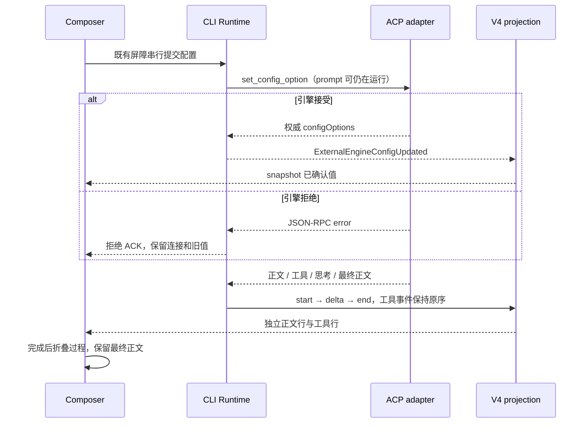

## 数据兼容

- `session` 表只新增 `engine`（缺省 `zcode`）与 `externalSessionId` 两列，不重建表，不改写已有会话。
- 旧会话一律视为 `zcode` 引擎，行为不变。
- `legacyZCodeProviderSchema` 中的 `claude` / `codex` 历史值语义是"模型供应商"，继续归一到 `glm`，不复用为引擎标识。

## Composer 配置外观

- 已创建会话的引擎不可切换，输入框只展示 16px 灰色 Logo，容器固定 28px，无文字、下拉箭头、按钮语义或点击动作；复用 `TaskClientLogo` 的本地图标、可访问名称与悬停标题。仅输入框对图标去色并降低强调，任务列表仍使用原品牌外观。新建草稿的引擎选择器保持可切换。
- 引擎选择和原生配置触发器静止时背景透明、无可见边框；保留当前文字、下拉箭头、悬停和键盘聚焦反馈。
- 模型、模式、fast 等枚举配置点击一次直接展开完整目录，当前值右侧打勾，不使用子菜单或分页。菜单沿用共享下拉层提供的视口可用高度和滚动能力，保持引擎提供的选项顺序；窄视口可滚动访问全部选项，菜单自身不得越出视口。
- `effort`、`reasoning_effort`（含连字符形式）、`thought_level` 配置使用独立深度弹层：上方显示当前档位与当前模型名，下方为带档位圆点的原生离散滑动条。档位及顺序完全来自引擎，不猜测额外档位或默认值；单一档位只展示，不允许调节。
- 拖动期间只在控件内预览，释放指针或方向键后沿现有 `onConfigChange` 提交一次原始 value；Escape 放弃尚未提交的预览。配置事实仍归 snapshot 所有，打开弹层不写配置。禁用时不允许修改。
- 释放后等待确认期间，滑块保持所选位置，不得先退回旧确认值再跳到新值；提交回调返回异步接受结果（`false` 表示失败）。确认配置回流后由 snapshot 接管，失败或关闭弹层时丢弃局部显示；较早请求的失败不得清掉后续手势。目录或确认值变化仍以新 snapshot 为准，不新增配置缓存或写入路径。
- 配置弹层在同一工具栏内互斥；旧弹层退出动画结束时，若用户已打开另一弹层，不得回焦旧触发器或关闭新弹层。保留键盘打开、方向键调节、Home/End 和 Escape 关闭能力。
- 窄工具栏复用 `useComposerToolbarFit` 的布局裁决：配置入口收为有可访问名称的图标，只读引擎 Logo 保持固定小尺寸，避免外层 `shrink-0` 裁切选项。不新建第二套宽度检测或业务状态。
- 验收：两家引擎的模式和模型一次展开完整目录；菜单不溢出视口，窄视口允许滚动，每项均能滚动到达、点击并保存选择。深度拖动及键盘调节正确回传原始值；单档、未知当前值、禁用、切换模型后的档位变化均不产生隐式配置写入。覆盖深浅主题、窄视口及减少动态效果。

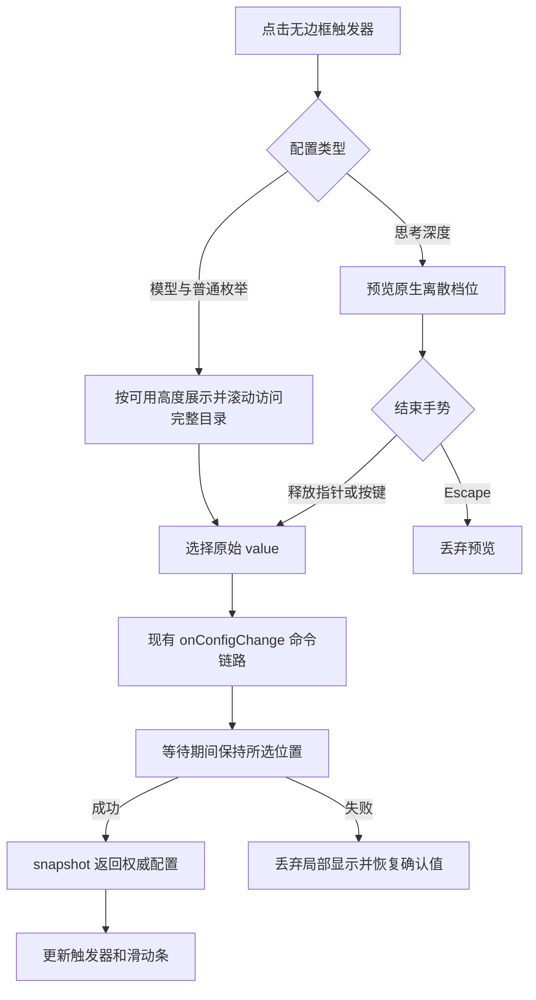

本次外观验证（2026-10-25）：macOS 开发桌面的 Claude Code 已检查模型完整展开、深度滑动条与 375px 工具栏图标收缩。真实组件的隔离浏览器预览覆盖 Zai Light / Zai Dark、1440×900 / 812×375 / 375×812 和减少动态效果；18 个模型在各尺寸均一次可见，无滚动区域。鼠标拖动期间不提交，释放一次提交；方向键、Home/End 和 Escape 丢弃预览已验证。隔离预览不调用真实供应商。

隔离桌面 E12/E13 回归通过（1/1，两家引擎）：18 项模型的视口几何与无滚动断言、从模型菜单直接打开深度弹层后的焦点、键盘提交深度、首发及续聊使用 `full / fixture-17 / high`。报告：`packages/desktop/.e2e-artifacts/desktop-e2e-20261025033149385-p63842-f0767c881ad05c2e/summary.md`。选择器相关单测 8/8；根类型检查、E2E 类型检查与架构检查通过；Lint 为 94 warnings / 0 errors。候选用例继续保留 `manual-review/pending`，不据此声明真实供应商或跨平台验收完成。

运行中配置与分段回归（2026-10-25）：修复前两家引擎分别复现正文拼接错位和配置拒绝关闭连接，共 4 个失败断言；修复后 CLI 集成/端口/运行时 15/15、UI 分组/选择器 41/41 通过。隔离 macOS 桌面 E12/E13/E14 通过（1/1，循环覆盖 Claude Code 与 Codex），验证运行中模式/模型/深度切换、配置拒绝提示与 prompt 继续、完成折叠及重新展开。报告：`packages/desktop/.e2e-artifacts/desktop-e2e-20261025040835013-p89419-a2d3594cbd1ce032/summary.md`。根类型检查、E2E 类型检查、架构检查通过；Lint 94 warnings / 0 errors。仅供应商由受控 ACP 夹具替代，不代表真实 API 运行中配置生效时点已验收；用例保留 pending。

深度回跳回归（2026-10-28）：修复前组件断言复现释放后 High 立即退回 Medium；修复后选择器与契约 11/11 通过。隔离 macOS Electron 专项 2/2 通过，覆盖两家引擎的停止重连、指针拖动、键盘调节与配置拒绝；ACP 确认延迟 400ms，释放后连续 800ms 的逐帧档位记录始终保持目标值。截图覆盖 1280px 浅色与 430px 深色 Renderer。报告：`packages/desktop/.e2e-artifacts/desktop-e2e-20261028082641620-p50764-f7fd19815ee7c90a/summary.md`。根类型、E2E 类型与架构检查通过；Lint 93 warnings / 0 errors。供应商为受控夹具，候选保持 pending，未替换已安装应用。

## 验收场景

### 设置页信息架构

- 基础设置新增同级分区 `agentEngines`（「Agent 引擎」），紧随「模型设置」。模型页仅保留供应商与模型配置，不再挂载引擎检测组件。
- 页面可见性由本地 Host 的 `externalEngineService` 能力决定；无服务时隐藏导航，历史偏好或跳转意图回退到常规设置。远端 workspace 激活时，该页仍管理本机引擎，不改用远端服务。
- 设置导航和上次停留位置继续由现有 `SettingsPage` / `settingsNavigation` 管理；引擎状态仍由 Host 服务提供，页面不新增持久化事实源。未就绪引导直达 `agentEngines`，供应商配置入口继续直达 `modelProvider`。
- 使用共享设置页标题、内容宽度、主题 token 和紧凑列表：默认展示名称、就绪状态、CLI 版本、登录或网关状态和安装操作；登录命令可复制；adapter 包名与锁定版本折叠到「技术详情」。检测和安装期间提供加载反馈。
- 每个引擎下方是连接配置列表（名称、方式、网关域名、默认标记），行内提供设为默认、测试连接、登录（官方方式）、编辑与删除；内置配置只提供前三项。新建与编辑复用同一行内表单，密钥输入框不回显已保存值。
- 打开、刷新、切换页面均只读检测；只有点击安装按钮才调用安装。复制命令只写剪贴板；只有显式点击浏览器登录按钮才启动官方登录，只有点击测试连接才发起模型请求，两者期间都可取消。

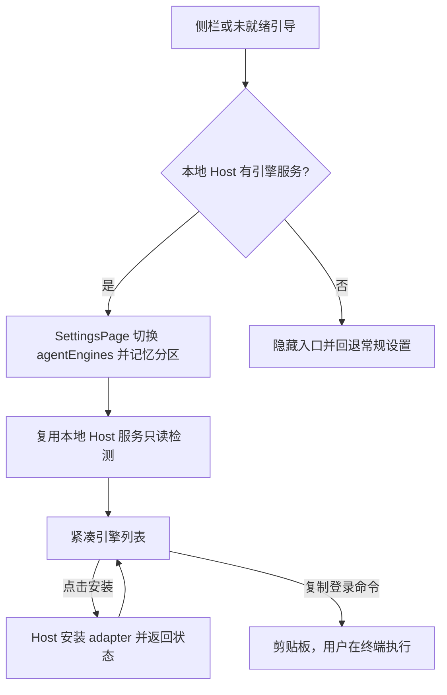

回归场景：有服务时入口紧随模型设置；无服务时隐藏并回退；模型页不检测引擎；导航可记忆、可直接跳转；技术详情可键盘展开；复制两家登录命令；刷新不安装；安装反馈保留；深浅主题与窄屏无横向溢出。

2026-10-25 验证：设置导航、能力过滤与引擎组件定向单测 31/31；隔离 macOS 桌面 E01/E03 候选 1/1，通过独立入口跳转、导航顺序、技术详情展开、模型页卸载引擎与分区记忆断言。报告：`packages/desktop/.e2e-artifacts/desktop-e2e-20261025043018995-p3513-566c0dd819dbe6ee/summary.md`。实际开发应用经浏览器检查 Zai Dark / Zai Light，1280×880、375×812、812×375，20px 界面字体及 reduced-motion 下无横向溢出，键盘可展开技术详情。根类型检查、E2E 类型检查与架构检查通过；Lint 94 warnings / 0 errors。候选保持 pending，未安装 adapter、未调用真实模型，不作为登录或供应商调用验收。

| ID  | 前置与操作                                      | 断言                                                                                 | 证据             |
| --- | ----------------------------------------------- | ------------------------------------------------------------------------------------ | ---------------- |
| E01 | 未安装 adapter，新建 Claude Code 会话并发送     | 返回 `engine_not_ready`，引导到设置页，保留草稿；不隐式安装                          | UI、协议         |
| E02 | 设置页安装 Claude adapter                       | 安装锁定版本到 YCode 管理目录；优先使用 PATH 中的官方 `claude`                       | 文件、日志       |
| E03 | 官方 CLI 未登录时发送                           | 不据登录状态阻止网关；原生握手鉴权失败时展示诊断与连接设置入口，原有身份文件不被改写 | UI、文件访问记录 |
| E04 | 发送会写文件的任务，允许或拒绝权限              | 权限卡与 ZCode 一致；允许后文件写入、diff 展示；拒绝后不写                           | UI、文件、协议   |
| E05 | 运行中点击停止                                  | `session/cancel` 送达，turn 以 cancelled 结束，可继续发送                            | UI、协议         |
| E06 | 空闲回收或重启 App 后续聊                       | 历史可见；`session/resume` 续上引擎上下文                                            | UI、协议         |
| E07 | 外部引擎会话中尝试 rewind、编辑重发、文件回滚   | 入口灰显并说明原因                                                                   | UI               |
| E08 | 桌面与自托管 Web 同时订阅外部引擎会话，断线重连 | 两条链路收敛到同一 snapshot                                                          | 协议             |
| E09 | App 退出                                        | 无残留 adapter、claude、codex 进程（macOS / Windows / Linux）                        | 进程表           |
| E10 | 启动与空闲                                      | 未选择外部引擎时不联网；显式选择可初始化官方连接，发送或安装按需联网                 | 网络记录         |
| E11 | Codex 会话按 E04–E06 重复                       | 同上；初始模式沿用用户 `config.toml`                                                 | UI、协议         |

## 验证记录

### P0 Spike（2026-10-24，macOS arm64）

- 方法：仓库外的独立脚本，用原始 NDJSON JSON-RPC 驱动 adapter，录制双向帧。adapter 版本锁定为 claude-agent-acp@0.95.0、codex-acp@2.2.2，`@agentclientprotocol/sdk@2.0.2`（三者均为 Apache-2.0）。
- 官方 CLI：Claude Code 2.1.310（原生二进制，`CLAUDE_CODE_EXECUTABLE` 指向它），codex-cli 0.159.2（`CODEX_PATH` 指向它）。
- 场景：initialize → session/new → 写文件并处理权限 → 4 秒后 cancel → 杀进程 → 新进程 initialize → session/resume → 询问先前写入的内容。
- 结果：

| 检查项                   | Claude                                                                                                  | Codex                                                                                     |
| ------------------------ | ------------------------------------------------------------------------------------------------------- | ----------------------------------------------------------------------------------------- |
| initialize / session/new | 通过；5 种模式（default/acceptEdits/plan/auto/bypassPermissions），模型 default/opus/fable/sonnet/haiku | 通过；4 种模式（read-only/workspace-write/agent/agent-full-access），初始模式来自用户配置 |
| 权限往返                 | 通过（Write，带 diff）                                                                                  | 通过（read-only 模式下 `Run command`）；默认 agent 模式由 Guardian 自动审查放行，不弹权限 |
| cancel                   | `stopReason: cancelled`                                                                                 | `stopReason: cancelled`                                                                   |
| 杀进程后 resume 续聊     | 通过（`session/resume` 成功，正确答出 banana）                                                          | 通过                                                                                      |
| sessionCapabilities      | resume / load / fork / list / close                                                                     | resume / load / fork / list / close / subagents                                           |
| 进程退出                 | code 0，无残留                                                                                          | code 0，无残留                                                                            |

- 发现：
  1. 设置 `CLAUDE_CODE_EXECUTABLE` 后，claude-agent-acp 推送的 `_auth/status_update` 报 `none / Not logged in`，但请求实际以用户 OAuth 登录成功执行。因此登录检测不能依赖该推送，改为调用官方 `claude auth status`（JSON 输出），并在 turn 失败时以 `authRequired` 兜底。Codex 的推送正确反映了自定义网关身份。
  2. 两家 adapter 都声明了 `fork`，二期可评估开放整会话 fork。
  3. Codex 的一次 `apply_patch` 工具行先报 `failed`，引擎随后改用其他方式完成写入。映射必须容忍同一 turn 内工具失败后重试。
  4. claude-agent-acp 声明了 `_meta.claudeCode.promptQueueing`。YCode 仍由 CommandInbox 串行准入，不依赖 adapter 自带的排队。
- 录制的帧暂存在仓库外。P2 编写单测前做脱敏（替换本机路径和会话 id），再作为 fixture 放入 CLI 测试目录。

以上为单机 spike 结果，不代表 Windows/Linux 验收，也不代表产品集成。

### 本地产品集成（2026-10-25，macOS arm64）

- 根 `pnpm typecheck` 通过；`pnpm lint` 为 94 warnings / 0 errors；`pnpm architecture:check --changed` 为 0 违规，架构规则测试 36/36 通过；`pnpm db:schema:check` 通过两份 SQLite 基线兼容检查。
- 协议与可选 RPC 能力测试 48/48 通过；CLI V4 投影、命令、模型配置与双引擎 App 集成测试共 321/321 通过。App 集成使用真实 stdio 子进程和 SQLite，外部供应商由受控 ACP 测试进程代替，覆盖空 Registry 启动、响应前初始命令通知、usage 事件、落盘与冷恢复续聊。
- Host 安装、状态、执行门禁和生命周期回归 67/67 通过；包含先复现后修复的 3 个释放竞态：工作区或服务释放后，迟到的外部引擎就绪结果不能重新启动 CLI 或预留 task。
- UI 聚焦测试 127 项、hook 回归 29 项、末次组件回归 19 项通过。
- 隔离 Electron E2E 的 E01/E03 候选场景通过（1/1）：两家引擎选择、内置配置隐藏、未安装发送门禁、草稿保留，以及设置页官方终端登录命令。运行报告：`packages/desktop/.e2e-artifacts/desktop-e2e-20261025020013755-p82423-9a8c2cf2cdea0973/summary.md`。
- CLI 完整类型检查 30 个任务通过；最后的 core 增量类型检查通过。真实 ACP 受控子进程测试 6/6、外部 runtime 双引擎与 busy guide 回归 3/3 通过；busy 状态的外部引擎不能接收无消费方的 steer，沿既有 admission 进入普通串行队列。
- 新增 `engine` / `externalSessionId` 后，同步修正了旧测试的整行 SQLite 预期，以及只回退迁移账本却保留新物理列的旧库夹具；provider migration 9/9、reasoning repair 19/19、async migration 9/9 定向回归通过。
- CLI 全量测试未通过：首次执行因 TUI 中文文案断言失败退出；测试与 i18n 源码均与 HEAD 相同，独立重跑复现。继续执行时 adapters、core、bootstrap 等包仍有超时、缺模块和其他断言失败，未经逐项基线复现，不能统一称为已有失败。该轮包级结果为 adapters 28 failed / 2033 passed、core 6 failed / 4081 passed、bootstrap 38 failed / 2941 passed，其中本轮引入的 5 项失败已按上述定向测试修复；未重新跑完整套件。`@zcode/cli` 最终停在 `internal-search.node-test.ts` 的 grep 子进程，约 6 分钟无输出、CPU 为 0，已仅清理本轮进程树，完整套件未自然结束。原始检查日志位于 `/tmp/cli-external-full-continue-tests.log`。
- 根 affected 官方选择命中全部 1647 个根 UT 文件，按 pre-push 合同跳过；这不等于全量测试通过。
- CLI lint 仍有 3 个 `max-lines` 错误：`adapters/src/model/runner-stream.ts`、`contracts/src/model/index.ts` 与 `bootstrap/src/zcode-protocol-v4/product-projection.ts`。前两份源码与 HEAD 字节相同；投影是既有超长文件，本次新增外部引擎事件后失去原样上游豁免，未放宽规则或扩大为整文件重构。
- 本轮未安装真实 adapter，未读取凭据或调用真实模型。P0 spike 为先前会话记录，不作为本轮产品验收；E04–E11 的真实账号桌面场景、Windows/Linux 与进程整树退出仍待分别验证。新增 E2E 保持 `manual-review/pending`。

## 关联文档修订（2026-10-25 已更新，未提交）

- `docs/desktop/standalone-coding-harness-spec.md`：补充"Provider Registry 唯一事实源"的外部引擎例外，并说明与 H07 不冲突。
- `docs/zcode-agent-next-steps.md`、`docs/zcode-agent-app-integration.md`：说明会话可选外部引擎，但仍由单一 `app-server` 拥有投影。
- `docs/zcode-protocol.md`：命令表补充 `setEngineConfigOption`，新增"会话引擎"一节。

## 真实桌面回归修复（2026-10-25）

- 已复现：已安装且官方 CLI 登录可用时，Claude Code 首发约 3 秒后只有 `ACP adapter exited`；创建外部引擎草稿时，模型/模式控件在发送前为空。
- 外部引擎连接在 CLI runtime 中初始化并投影配置，初始化不创建 user turn、不提交 prompt；UI 复用当前 deferred 草稿的唯一 owner，配置就绪后才发送。切换引擎仍回收旧草稿，由 owner 顺序创建新草稿。初始化失败必须给出可操作错误，不能静默空白；不自动安装。
- 子进程退出必须区分正常退出码和信号；原始 stderr 可能含账号或 prompt，不直接暴露。ZCode 普通 Provider 的首发、续聊及引擎切回需要真实桌面回归。

- 新增 E12：选择任一已就绪外部引擎后，首条消息之前显示原生模型/模式；连接中可编辑草稿和切换引擎，但不能发送；失败展示原因并允许发送重试。初始化不制造 TurnStarted 或 transcript。
- SIGTRAP 根因已用同一个 Electron Helper 的有/无 Node 模式对照确认；adapter 子进程显式设置 `ELECTRON_RUN_AS_NODE=1`，不依赖系统 Node。
- 草稿未持久化时只在 runtime 保存 externalSessionId，首发提升一并入库；已持久化会话才更新现有记录。

### 本轮修复验证结果（2026-10-25）

- macOS 真实桌面（独立“回归验证”任务）：ZCode / MiniMax M3.1-Flash、Claude Code / Opus 5.5、Codex / 6.1 Sol 均完成首发和第二轮；第二轮询问上一轮英文标记，正文均正确返回，验证上下文连续性。两家外部引擎在发送前已显示原生配置；Claude 不再出现 SIGTRAP。Claude 响应存在超过 55 秒的等待，官方 CLI 单独探针也曾超时，不能把短探针超时当成集成仍失败。
- 隔离桌面 E12（官方状态与 ACP 为夹具，完整 Electron/Host/CLI/stdio）：1/1 通过；断言配置所属引擎、配置切换后首发及同进程续聊。报告：`packages/desktop/.e2e-artifacts/desktop-e2e-20261025030839481-p51299-67d479c9fe477460/summary.md`。保留 pending，未转正。
- 端口回归 8 项通过；App + SQLite 首发/恢复 2 项通过；V4 接线/普通会话创建/core 外部执行定向测试通过；UI 草稿与配置反馈 39 项通过。
- 根 typecheck、CLI typecheck（30 tasks）及架构检查通过；根 lint 94 warnings / 0 errors。CLI 包级 lint 仍被未改动的旧文件长度错误阻挡：adapters 的 `model/runner-stream.ts`、`fs/index.ts`，core 的 `tool/executor/background-tasks.ts`、`runtime/methods/session-fork.ts`。本次外部引擎与命令处理文件定向 lint 通过。
- 曾把 CLI 构建与源码集成测试并行运行，构建重写 dist 导致依赖入口短暂缺失；构建完成后串行重跑相关集成测试通过。此类失败不是行为回归证据。
- 未验证：Windows/Linux 整机、真实工具执行与权限交互、真实账号重启后的冷续聊；本轮结果不扩大至这些场景。未提交或推送代码。

复跑隔离 E12（仓库根目录，使用仓库固定 Node/pnpm）：

```sh
node packages/desktop/test/e2e/helpers/external-engine-fixture.mjs /tmp/zcode-engine-fixture-bin
PATH="/tmp/zcode-engine-fixture-bin:$PATH" \
ZCODE_E2E_EXTERNAL_ENGINE_FIXTURE_BIN=/tmp/zcode-engine-fixture-bin \
E2E_PROVIDER_HTTP_MODE=replay \
E2E_PROVIDER_REPLAY_FIXTURE_PATH=packages/desktop/test/e2e/fixtures/upstream/common.json \
ZCODE_E2E_MANUAL_REVIEW=1 \
pnpm --filter @zcode/desktop test:e2e -- --spec './test/e2e/conversation-session/manual-review/pending/conversation-session-external-engine-prewarm.test.ts'
```

## Claude 工作过程显示修复（2026-10-25）

- ACP `tool_call_update` 是增量字段更新：后到的 `rawInput` 必须更新同一调用的实时输入，不能只写 transcript；不得重新开始已结束的工具。
- 工具结果优先使用原始文本输出，兼容 ACP content 文本、terminal_output 和 terminal_output_delta；空 content 不得覆盖已有输出。命令描述与完整命令在既有终端卡展开后显示。
- `_meta.claudeCode.parentToolUseId` 保留为工具事件、持久化 metadata 与 V4 row 的 `parentToolCallId`。子工具按精确父标识嵌入 Agent/Task 卡；无父行时保留可见，不按相邻次序猜配对。
- 子 Agent 的正文/思考仅进入对应 Agent 的活动内容，不拼入主回答。活动内容与最终结果分别保留，冷恢复仍可阅读。没有实际 ZCode child session 时不伪造 childSessionId，不提供无效下钻或取消入口。
- `ToolCallProgress` 复用为同一工具的参数、输出和活动刷新事实；projection 只在非终态应用，终态后的迟到进度不能重开工具。Runtime 是 ACP 工具状态唯一所有者，UI 仅从 rows 派生嵌套呈现。
- 外部引擎输入区复用 `ChatContextUsage` 显示真实 `usage_update.used/size`，无用量时不猜百分比，不恢复 ZCode compact 控制。
- 验收：先空输入后完整命令、运行中输出、空 content + rawOutput、并发 Agent 及嵌套工具、子文字隔离、失败/中止、持久化恢复和用量可见。供应商夹具与真实账号验证分开记录。

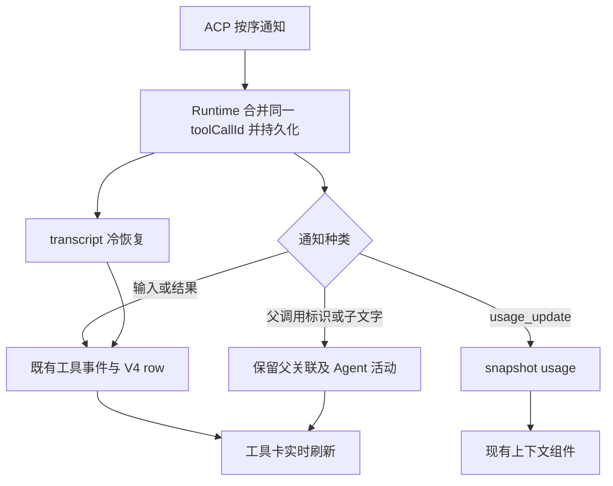

### 工作过程修复验证结果（2026-10-25）

- CLI 定向 4 文件 25/25 通过，覆盖真实 stdio 子进程、SQLite、后补输入、终端输出快照/增量、空 content、父子关联、并发 Agent、失败、迟到进度和冷恢复；供应商为受控 ACP 夹具。
- UI 定向 8 文件 130/130、分享页既有定向测试 17/17 通过；原生 Agent 的侧栏交互保持回归覆盖，外部 Agent 使用内联展开。
- 隔离 Electron E12/E14/E15 候选用例 1/1 通过，分别执行 Claude Code 与 Codex：首发前配置、同会话续聊、运行中修改模式/模型/深度、配置拒绝后继续原轮、工作过程折叠、终端命令/描述/输出、Agent 活动及子 Bash、真实用量投影均有断言。两家引擎使用不同工具 ID，展开后等待实际高度和局部动画完成，四张截图已核对。报告：`packages/desktop/.e2e-artifacts/desktop-e2e-20261025043635278-p7358-05ada641137f63e0/summary.md`。截图中的“配置修改未生效”为该用例主动注入的配置拒绝反馈。
- 根 typecheck、E2E 定向类型检查通过；根 lint 为 94 warnings / 0 errors；架构检查 0 违规；格式检查与 `git diff --check` 通过。未运行全量测试，候选 E2E 保持 `manual-review/pending`。
- 本轮没有以真实供应商账号重新执行工具场景，不扩大为 Windows/Linux 或真实账号验收。当前开发应用仍需重启以加载新的 CLI/runtime；未提交、推送或重启用户正在使用的应用。

## 历史会话原生配置恢复（2026-10-25）

- Runtime 是已确认原生配置及连接状态的唯一所有者。历史恢复必须在发送前通过原 externalSessionId 重新连接，不能静默新建原生上下文。
- 最新确认配置复用 session entry 保存，草稿首发提升时一并保存；冷恢复先读保存值，再按原生最新目录确认和恢复。缺失或不支持的值明确失败，不猜替代模型或思考档位。旧历史无 entry 时以原生 resume 返回值为准。
- 连接状态复用 ExternalEngineConfigUpdated 事件和 snapshot 投影。恢复失败保留 transcript、配置和草稿，提供显式重试；未就绪时配置禁用。重试复用 prepareSession，不提交 prompt 或创建 turn。
- 回归覆盖两家引擎：非默认模型/深度、首发落盘、全新 runtime 冷恢复、发送前即可调整、失败保留历史并重试，以及恢复后的上下文连续性。

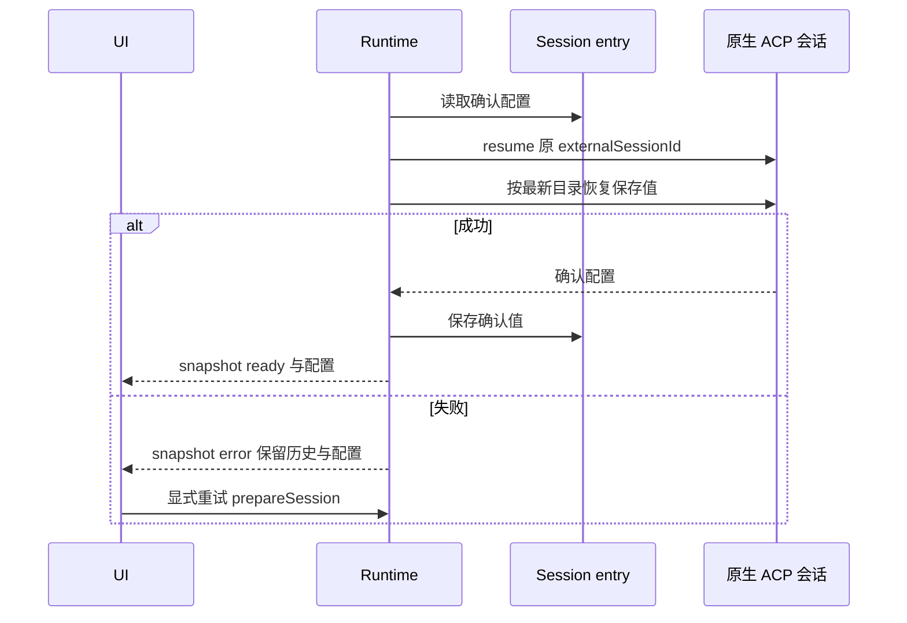

### 历史配置恢复验证结果（2026-10-25）

- 修复前，两家引擎的 App + SQLite 冷恢复回归均失败：Runtime 配置列表为 `[]`。修复后 CLI 定向 4 文件 27/27 通过，含非默认模型/深度落盘、全新 Runtime 恢复、离线历史可读、连接重试去重、失效值与错误原生会话 ID 拒绝。
- UI/协议/流式工作项定向 6 文件 124/124；真实 React 浏览器布局 9/9，覆盖 375/966px、中英文、深浅色、横屏、放大字号、减少动态效果，以及追加后旧行几何位置不变。
- 隔离 Electron 候选 E12/E14/E15/E16 1/1 通过，逐一完整重启 Electron/Host/CLI，验证 Claude Code 与 Codex 的非默认配置、未发送草稿、恢复后调节与续聊。供应商仍为 ACP 夹具。报告：`packages/desktop/.e2e-artifacts/desktop-e2e-20261025072941259-p46885-e118202d4757d38b/summary.md`。两次前置运行被测试 helper 的固定 workspace 等待阻断；改为复用已有完整重启/保留 profile helper 后通过，不放宽产品断言。
- 当前真实开发实例已重建并重启。用户截图中的历史会话恢复出 mode/model/effort/fast 四个原生控件，模型 `claude-opus-5-5`、思考 `High`，草稿 `11` 保留；只打开配置菜单验证可调，没有发送草稿或真实 prompt。
- 根 typecheck 与架构检查通过，根 lint 94 warnings / 0 errors；CLI 改动逻辑定向 lint 通过。未运行全量测试，未提交或推送。真实账号的重新发送、Windows/Linux 整机和 SSH 外部引擎不在本次验收范围。

## 原会话连接恢复与诊断（2026-10-25）

### 运行中断后的配置状态（2026-10-28）

- 非用户停止的 `runTurn` 发生连接、协议或超时故障时，adapter 清理该会话连接；Runtime 同步发布 `engineConfigState=error`，保留已确认配置和原 `externalSessionId`。`session/prompt` 的供应商 HTTP/认证/业务拒绝若连接仍健康，则单独发布请求失败并保留配置 ready，不自动重发 prompt。用户停止走下述自动恢复路径。
- 正常返回 `stopReason=cancelled` 的停止仍可复用连接，不因用户停止而显示连接失败。配置 RPC 的业务拒绝同样保留 ready；连接故障在空闲时先自动恢复，仍失败才进入已有错误与重试入口。
- ACP prompt 响应中的 `usage: null` 与缺省用量都表示本轮没有用量数据，不是协议故障；停止后保留健康连接。
- 用户停止时若 runTurn 抛错导致 adapter 回收连接（包括连接、协议、超时或取消回调异常），Runtime 自动调用既有 prepareSession，按原 externalSessionId 恢复上次确认配置；恢复期间投影 connecting，成功后 ready，无须手动重连。恢复使用独立于已取消 turn 的 signal，应用关闭时由 closeSession 中止，不创建新会话或重发 prompt。恢复失败仍保留历史、配置及草稿，发布错误并保留手动重试入口。
- 回归：两家引擎的空用量停止、停止时真实断联自动恢复、恢复失败及关闭边界；原生会话 ID 不变且 prompt 不重发；非停止的传输故障投影配置 error，健康停止、配置业务拒绝及网关请求拒绝保持原生配置可用。
- 停止成功后才退出的进程可在下一次配置操作中被发现。空闲 Runtime 收到结构化连接故障后，通过同一 prepareSession 恢复原会话，并对幂等的 set_config_option 重试一次；不重试业务拒绝，不重发 prompt，运行中或正在关闭时不另建恢复链路。

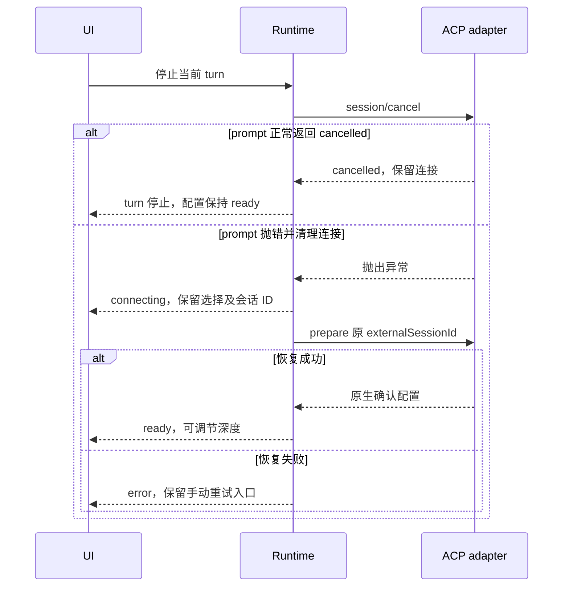

### 暂停自动恢复验证（2026-10-30）

- 生产日志中的停止失败为 `Invalid ACP object`；已安装的 Codex ACP 在无用量统计时返回 `usage:null`。修复前双引擎空用量取消回归失败，修复后保留健康进程，停止后可直接配置和续聊。
- CLI 定向 4 文件 54/54 通过，覆盖取消后自动恢复、原生 ID 与确认配置保留、关闭竞态、恢复失败、取消回调异常，以及迟到退出后幂等配置重试。无自动重发 prompt。
- 隔离 Electron 的“停止后自动恢复原会话并直接调节思考深度”通过：Claude Code/Codex 均覆盖健康停止、协议故障、进程退出，检查无需重连、配置可调、原生 ID 与 prompt 次数不变。单项证据见 `packages/desktop/.e2e-artifacts/desktop-e2e-20261030090545306-p97277-c38e88fa884990c9/summary.md`；该次 HTML 用例的菜单定位失败已在后续独立运行修正并通过。
- 根与 CLI 类型检查通过，根 Lint 为 0 errors / 93 warnings，CLI 改动文件 Lint 通过。额外 CLI 全包 Lint 为 4 errors / 66 warnings：未修改的 `adapters/src/model/runner-stream.ts`、`bootstrap/src/zcode-protocol-v4/transcript-hydration.ts`、`bootstrap/src/zcode-protocol-v4/product-projection.ts`、`contracts/src/model/index.ts` 仍有 max-lines 失败。
- 供应商使用隔离 ACP 进程夹具，候选保持 pending；未替换用户已安装应用，也不代表真实账号或跨平台验收。

### 既有连接恢复规则（2026-10-25）

- 已复现：同一个 Codex 原生会话可由独立 ACP 进程恢复，但当前桌面 prepare 连续失败；旧实现丢弃 JSON-RPC 出错方法与错误码，无法区分鉴权、会话缺失、协议不支持与暂时错误。不得据统一提示推断网络断开。
- ACP adapter 仍是连接、请求和重试的唯一所有者。prepareSession 对同一 session 合并并发调用，最多尝试三次，间隔 500ms、1500ms；只重试超时、连接中断和 RPC internal error。鉴权、资源缺失、参数或保存配置不支持立即失败。
- 初始化协商恢复能力：优先 session/resume；对明确不支持该方法且声明 loadSession 的 adapter，使用 session/load 恢复同一个 externalSessionId。load 的历史正文/工具通知只用于原生加载，不能重复追加至 YCode transcript。
- 不静默新建替代原生会话、不更换模型/权限/思考档位；已确认的 externalSessionId 在后续尝试中复用。session/new 已发送但未确认 id 时不自动重发，避免制造多个未知会话。
- runTurn 仅在 prompt 之前复用 prepare 的重试；prompt 提交后发生错误绝不自动重发。关闭会话或取消准备时中止退避与在途请求，迟到结果不得启动新连接。
- Runtime 继续拥有 connecting/ready/error 投影。失败事件与快照附加经过 schema 校验的错误分类、ACP 方法、数值错误码、HTTP 状态、request id 与边界脱敏的短摘要；不携带原始 stderr、RPC message/data、身份或用户内容。UI 按分类提供本地化处理说明及可复制诊断；旧快照保留原有通用提示。
- 2026-11-07 起，网关请求失败的结构化诊断（typed failure 能力声明、重试 n/m、URL 仅保留 scheme + host + path、失败 ID 幂等、行内错误行与“重新发送”规则）以 [native-plan-errors-spec.md](native-plan-errors-spec.md)「结构化失败」为准；本节其余连接恢复规则不变。runTurn 发现没有健康连接而重新准备时同样投影 connecting → ready / error。
- ACP 响应的 error/result 先校验再移除在途请求；畸形响应立即以 protocol 失败拒绝对应 promise 并关闭连接，不能让没有请求超时的 session/prompt 悬挂。
- 现场根因：桌面 PATH 可找到 npm 的 Codex 入口，却没有 node，脚本以 127 退出，adapter 将其报告为 initialize / RPC 1001。PATH 缺 node 时，仅为 ACP 子进程补充指向当前运行时的托管 Node 入口，并保持 Electron 的 Node 模式；不修改系统 PATH。Host 检测到官方 CLI 是 JavaScript 入口时，用当前运行时直接执行版本和登录状态查询，避免把启动失败误判为未登录。
- 验收：覆盖两家引擎的临时失败后成功、重试耗尽、不可恢复错误不重试、同会话 single-flight、关闭/取消终止重试、session/load 能力回退与历史去重，以及 prompt 错误不重发；真实桌面验证原失败会话恢复后历史仍在。

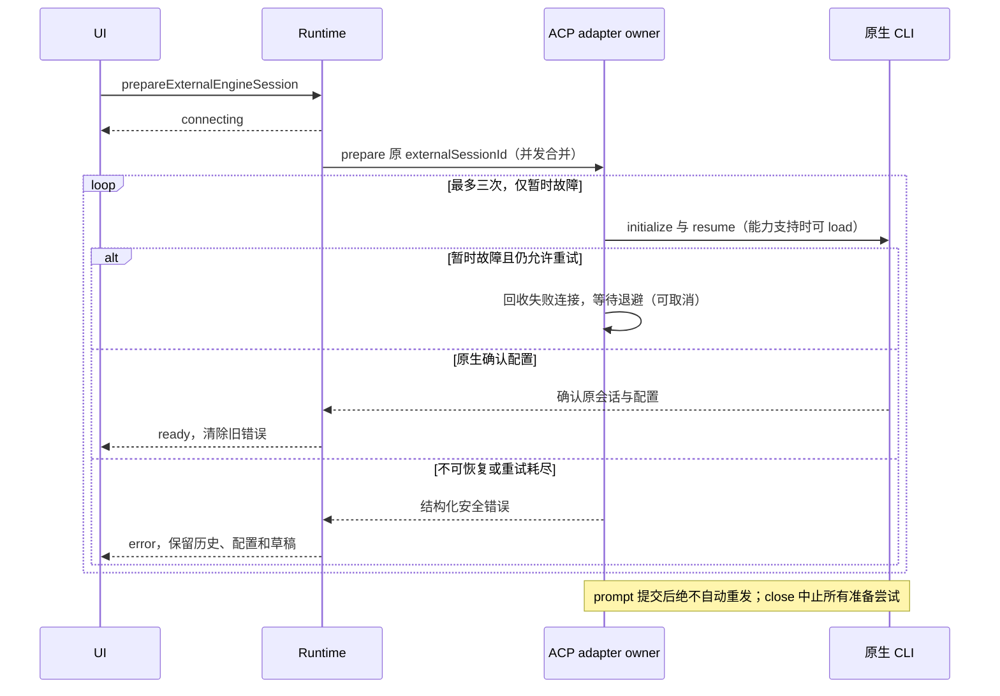

### 连接恢复验证结果（2026-10-25）

- 真实桌面先取得 initialize / RPC 1001；从当前进程环境独立运行官方 CLI，确认缺 node、退出码 127。修复后重建并加载 Agent/Host，原失败 Codex 会话恢复到 ready，官方 CLI 登录状态检测通过；未提交真实 prompt。
- 恢复前后只读校验原生会话 ID、8 条 message 与 75 条 part 的正文哈希均一致。现场刷新未自动显示的草稿已从原本地持久化记录恢复，并校验文本哈希一致；该旧草稿迁移行为不属于连接恢复自动保证的范围。
- ACP adapter 定向 2 文件 24/24、Host 状态检测 8/8 通过，包含真实子进程、缺 Node 的 npm 入口、并发准备、退避取消、load 去重及 prompt 不重发。此前 Runtime/投影及 UI/协议定向回归也通过。
- Electron 隔离候选 1/1 通过：Claude Code 与 Codex 冷重启后前两次 resume 故障、第三次自动恢复，原会话 ID、未发送草稿、持久化正文和 prompt 次数保持一致；恢复后可调整配置并续聊。报告：`packages/desktop/.e2e-artifacts/desktop-e2e-20261025084459994-p65325-b89a7216764e7a7f/summary.md`。供应商为受控 ACP 夹具，候选保持 pending，不表示人工转正或 CI 准入。
- 根与 CLI 类型检查、桌面 E2E 类型检查通过；架构检查 0 violations。根 Lint 为 94 warnings、0 errors；CLI Lint 仍受 4 个 max-lines 错误阻塞：runner-stream、transcript-hydration、product-projection 和 contracts/model，其中 product-projection 是本轮触及的原有超长文件。

## 默认引擎偏好（2026-11-06，2026-11-07 补充）

- 本机 `AppSettings.defaultSessionEngine` 保存用户最近一次显式选择；输入框选择器与引擎设置页共用该字段，未设置时使用 YCode。选择立即改变当前草稿，保存失败保留草稿并可见提示。
- 全新草稿在模型目录、readiness 与预热之前读取本机设置并固定引擎；设置尚未读取完成时不启动错误引擎。远程项目只读本机偏好，不写远端设置。
- 导航为新 Tab 预写的空正文与项目归属只表示草稿占位，不算旧版引擎意图；没有正文、编辑状态和模型/模式配置的占位仍须使用本机默认引擎。
- 已有草稿（含旧版隐式 YCode 草稿）与已创建会话不随全局偏好改变；未就绪的默认引擎仍保留选择并引导配置，不静默换引擎。
- 本机设置提交后通过现有 SettingsChanged 广播刷新所有窗口；以后创建的新草稿采用新值，不重置已经打开的独立草稿。

### 不支持外部引擎的工作区

- 工作区能否运行外部引擎只看该工作区的 `externalEngineService`（`hooks/external-engine` 对远程身份返回空）：SSH、WSL、Docker、Source Server 等远程工作区，以及没有本机引擎服务的 Web，都不能运行。
- 这类工作区的草稿一律使用 YCode：默认偏好为外部引擎的全新草稿固定为 YCode；1.0.7 已按默认值写入外部引擎的远程旧草稿同样按 YCode 投影。不调用偏好写入，`defaultSessionEngine` 保持原值，回到本机工作区的新草稿仍使用该默认引擎。
- 桌面远程工作区的草稿仍显示引擎选择器，Claude Code、Codex 灰显并就地标注“远程工作区暂不支持”，只能选择 YCode；已创建会话与 Web 维持原样（Web 无本机引擎服务，不显示选择器）。

### 按引擎记忆模型与思考深度

- 本机 `AppSettings.externalEngineConfigPreferences` 按外部引擎分别保存最近一次显式确认的原生值，键为 ACP configId、值为引擎原始 option value。只记 `model` 与思考深度（`effort`、`reasoning_effort`、`reasoning-effort`、`thought_level`，去掉 `-`/`_` 并忽略大小写匹配）；权限模式与 fast 等其它配置不记忆，Claude 新会话的 Auto 默认规则不变。
- 写入：用户在草稿或已有会话中显式修改上述配置，命令被接受且 snapshot 显示的当前值等于所选值后写入该引擎的该项。引擎拒绝、引擎改用其它值、恢复过程自动下发的值都不写入。设置服务在写队列内按引擎与 configId 合并增量，连续确认模型与深度不会互相覆盖。
- 恢复：只用于本生命周期内新固定引擎的草稿（全新草稿取得默认引擎，或用户在草稿中显式改选引擎）。该草稿的预热会话原生配置 ready 后先恢复模型；snapshot 确认模型后，再按新模型的目录恢复深度。值不在当前目录、已是当前值或连接未 ready 时跳过该项。恢复复用既有 `configCommandBarrier → setEngineConfigOption` 链路，首发仍排在同一屏障之后。
- 每个预热会话最多恢复一次；恢复期间用户显式修改任一配置即停止剩余步骤。持久化恢复出的已有草稿、已创建会话与 fork 不套用记忆，记忆变化也不重配已打开的草稿。
- Runtime 仍是已确认配置的唯一所有者；记忆只是本机偏好，Renderer 不保存第二份配置事实。

### 草稿连接中提示

- 草稿的“正在连接引擎…”只表示预热 `createSession` 在途（含排在旧代创建收口之后的新一代）。预热被禁用（存在待恢复的首发、远程连接不可用）、创建失败或预热会话被丢弃时不显示加载；失败仍显示原错误与重试入口。
- 1.1 起 createSession 的 ACK 不再等待握手：“正在连接引擎…”还包括“已有 binding、该会话 snapshot 尚未到达或为 connecting”，阶段由 `resolveDraftEngineReadiness` 派生（见「外部引擎进程与异步准备」）。

回归覆盖：跨项目/重启继承、设置迟到不启动内置引擎、旧草稿与已有会话不变、本机/SSH 设置隔离、偏好保存失败可见；SSH 草稿使用 YCode 且默认偏好不变、远程选择器灰显并说明原因；记忆只写确认的模型/深度、权限模式不记忆、恢复按目录跳过且模型先于深度、已有草稿不套用；预热禁用时不显示连接中。

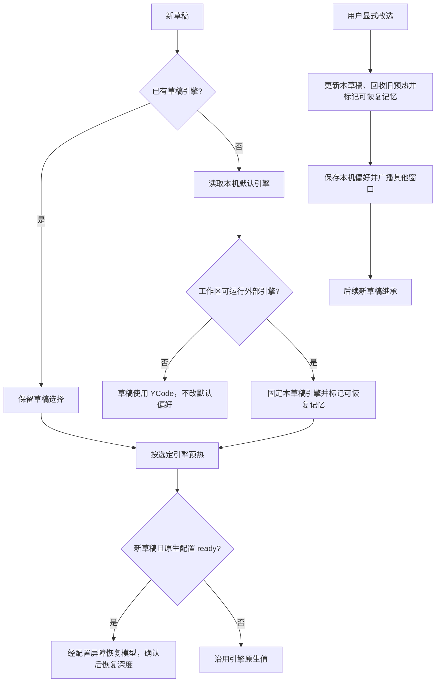

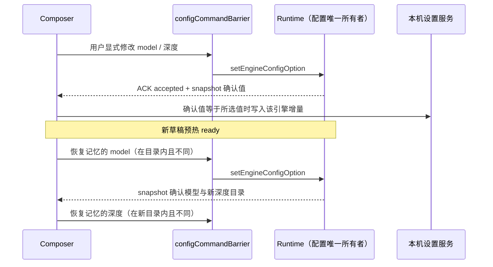

## 外部引擎原生子智能体（1.1.0）

目标：Claude Code 与 Codex 的原生子智能体产出与内置引擎相同的数据——`subagent_child` 子会话（正文独立持久化、可按 childSessionId 经 V4 订阅，实时与重启后都可读）、父会话 `snapshot.subagents` 与 `session/subagents` 已结束分页。界面（M2-D）只消费这份引擎无关合同。

### 能力声明与协议形态

- 两家 initialize 都声明 `clientCapabilities.subagents: {}`。AIR 决策不变：仅 Codex 声明 `_meta.jetbrains.air`（sessionFailure）与 `terminal_output_delta`；Claude 不声明 AIR。
- 因此 Codex 2.2.2 走 AIR 草案形态：父会话收到 `subagent_spawned {subagentSessionId, name, task, prompt?, capabilities}` 与 `subagent_state_update {subagentSessionId, state: completed|failed|cancelled|disconnected}`；子会话的正文、工具、usage 与权限请求以子 sessionId（Codex thread id）到达；重开的子会话 ID 为 `<thread>:generation:N`；嵌套子会话的 spawned 发在其直接父子会话上；`session/load` 先回放 spawned、子会话历史，再以 `disconnected` 收尾未终止的子会话。Codex 声明的 `capabilities` 为空，不支持取消。
- Claude 0.95.0 走 RFD 形态：父会话收到 `subagent_update {sessionId, title?, description?, capabilities?, state?}`（首条宣告子会话，`capabilities.cancel` 表示可经 `session/cancel {sessionId: 子}` 停止当前工作），`state` 取值 running / requires_action / idle（stopReason end_turn|cancelled|error，或缺省）/ unknown；提示词以 `session_message` 同时投给父（发送视图）与子（接收视图，`recipientSessionId=子`），前台子会话的回答以 `session_message {messageId:"<launch>:reply", senderSessionId:子}` 发回父会话。RFD 形态隐藏父会话中的 Agent/Task 工具行；idle 子会话可再次 running 并沿用原 sessionId。
- 未声明原生形态的旧 adapter 仍发普通工具行（Codex `spawnAgent` / `sendInput` / `resumeAgent` / `followupTask`，`Start subagent X`），只作降级展示，见“界面降级识别”。

### 状态所有者与接口

| 状态                                                      | 所有者                                                              | 说明                                                                                                                   |
| --------------------------------------------------------- | ------------------------------------------------------------------- | ---------------------------------------------------------------------------------------------------------------------- |
| 原生帧解析、子 sessionId 归属、子会话请求路由             | ACP adapter（connection）                                           | 把两种形态归一为 `ExternalEngineSubagentEvent`；只路由已宣告子 ID 的更新与权限，未知非主 ID 丢弃并记 debug             |
| 子会话记录、子会话正文、父会话 Agent 行、子智能体生命周期 | 父会话的外部引擎 Runtime（`core/src/external-engine/subagents.ts`） | 唯一发布 SubagentSpawned / SubagentStopped / BackgroundTask\*；子会话正文经子 Runtime 写入既有 message/part 与事件日志 |
| `snapshot.subagents`、子智能体行                          | 既有 V4 ProductProjection                                           | 不新增投影字段，live 与冷恢复同一 reducer                                                                              |
| 停止入口                                                  | 既有 `cancelBackgroundWork(workId)`                                 | 仅原生声明可取消的子会话发布 `cancellable` 后台工作                                                                    |

接口（`@zcode/contracts` external-engine 契约，严格类型；adapter 在边界做运行时校验）：

- `ExternalEngineSessionInput.onSubagent?(event)`：`spawned {nativeSessionId, parentNativeSessionId?, name, task?, prompt?, cancellable}`、`state {nativeSessionId, state: running|waiting|completed|failed|cancelled|lost, error?}`、`prompt {nativeSessionId, messageId, text}`、`reply {nativeSessionId, text}`。`parentNativeSessionId` 缺省表示主会话。
- `onChildUpdate?(nativeSessionId, update)`：已宣告子会话的普通 `session/update`（正文、思考、工具、usage）。
- `requestPermission(request)` 的 `request.childNativeSessionId`：子会话的权限请求。
- `ExternalEnginePort.cancelSubagent?(sessionId, nativeSessionId)`：向已宣告且可取消的子会话发送 `session/cancel`，否则抛 `unsupported`。
- `onDiagnostic?(event, fields)`：adapter 的无正文诊断（如丢弃未知子 ID），Runtime 记 debug。

### 事件顺序

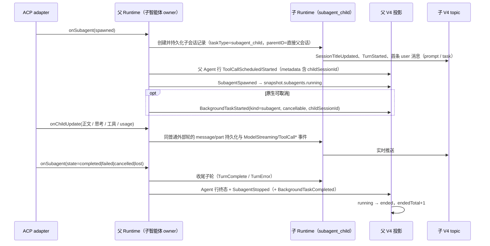

- 子会话记录必须在 `SubagentSpawned` 之前落库（与内置引擎一致）。子 Runtime 只是持久化载体：不跑模型、不连原生 adapter；冷恢复与订阅复用既有子会话路径，且 `subagent_child` 会话不发起原生连接。
- 子会话记录保存父会话的 engine，不保存 externalSessionId（原生上下文属于父原生会话）。
- 父会话 Agent 行由 Runtime 合成：工具名 `Agent`，toolCallId 为 `native-subagent:<原生ID>:<序号>`，input `{description, prompt, subagent_type}`，metadata `{childSessionId, agentId, agentType, description, nativeSessionId}`；结束时 output 为 JSON `{agentId, childSessionId, agentType, description, status, result}`，失败/取消/失联写 error。冷恢复、`session/subagents` 查询与 live 共用这条既有 Agent 工具链，不新增 V4 字段。`snapshot.subagents.running[].toolCallId` 即该行，界面据此下钻。
- running 子会话等待权限时投影为 waiting（既有 origin 规则）；RFD 的 requires_action 不另发事件。
- RFD 的回答（`<launch>:reply`）在子会话结束前到达时作为 Agent 行摘要；结束后到达的回答与子会话最终正文重复，不再改写已结束的 Agent 行（摘要取子会话最终正文）。
- 子会话生命周期绑定父轮：Codex 的 prompt 等待子会话结束后才返回；父轮结束（成功、失败、停止或断联）时仍 running 的子会话按 lost 收尾并保留正文。RFD 形态的后台子会话在父轮结束后继续运行的部分 YCode 不再观察，记为已知缺口。
- 嵌套：spawned 的父 ID 是已知子会话时，子会话记录的 parentID 为该直接父子会话，Agent 行与 SubagentSpawned 写入直接父子会话的正文与事件流；根会话 `snapshot.subagents` 只列直属子会话。

### 幂等与回放

- 幂等键为原生子 sessionId。YCode 子会话 ID 由（父会话 ID，原生子 ID）确定性派生：`sess_ext-subagent_<sha256 前 32 位>`。同一原生 ID 的重复 spawned 不重复建记录、不重复写首条消息；记录已在库中（重启后同 ID 再现）时先恢复再续写。
- `:generation:N` 是新的原生会话：建立新的子会话记录与新的 Agent 行（名称沿用原生 name，metadata.nativeSessionId 记录含后缀的完整原生 ID，可按 `:generation:` 之前的前缀关联同一原生线程），不改写已结束子会话的正文。
- RFD 同一子 ID 由 idle 再次 running：沿用同一子会话记录，开启新的子轮，父会话新增一条 Agent 行并重新发布 SubagentSpawned（投影把原子智能体行改回 running）。
- `session/load` / fork 回放期间，adapter 丢弃全部子智能体帧与子会话更新，不登记子 ID；YCode 已持久化的子会话正文是唯一事实，回放不写入任何行。
- 未宣告的非主 sessionId 的更新与权限请求一律丢弃（权限回 cancelled），记 debug，不含正文。

### 权限路由

子会话的 `session/request_permission` 进入父 Runtime 的既有审批路径：PermissionRequested / broker 以父 sessionId 登记，`origin = {kind:"subagent", agentId: 原生ID, agentType, childSessionId, description: 子会话名称, parentSessionId: 直接父会话, parentToolCallId: Agent 行, parentTurnId}`，用户在父会话的待处理交互中应答。应答按 kind 选出该请求自身的原生 optionId，原样回复子请求的 JSON-RPC id；缺少对应 kind 时回 cancelled，不猜 ID。父轮停止或结束时，与主会话请求一样取消在途子请求并先发布 PermissionResolved(cancelled)。

### 停止

只有原生声明可取消（Claude RFD `capabilities.cancel` 为对象、AIR 草案 `capabilities.cancel` 为 true；`close` 需要 session/close，暂不接入）的子会话发布 `BackgroundTaskStarted {taskId: childSessionId, taskKind:"subagent", cancellable:true, childSessionId}`，既有 Stop 按 childSessionId 关联显示。`cancelBackgroundWork(workId=childSessionId)` 由父 Runtime 转为 `ExternalEnginePort.cancelSubagent`；真实结束以原生后续 state 为准。Codex 2.2.2 不声明取消，不提供 Stop。子会话结束时发布 BackgroundTaskCompleted，界面只对 running 工作给 Stop。

### 界面降级识别

旧 adapter 没有原生形态时，Codex 以 camelCase `spawnAgent` 工具行表示派发。`packages/ui` 的工具身份与 Agent 渲染把 `spawnAgent`（及既有 `spawn_agent`）识别为 Agent 行，标签取 `nickname`、输入 `prompt` 等既有字段；`sendInput` 等其余协作调用保持普通工具行。

### 回归验收

- 真实形状帧：Codex AIR 形态与 Claude RFD 形态各一组——spawn → 子会话记录与首条消息先于 SubagentSpawned → 子正文/工具/usage 写入子会话并可按 childSessionId 读取 → state 结束后 running 变 ended。
- 嵌套子会话挂在直接父子会话；`:generation:N` 建新记录；RFD 同 ID 再运行沿用记录；`session/load` 回放不新增子会话行。
- 子会话权限进入父会话待处理交互并带来源，应答回原生 optionId；可取消/不可取消两种 Stop；未知子 ID 丢弃；父 + 子冷恢复后 `snapshot.subagents`、Agent 行与子正文一致；界面识别 camelCase `spawnAgent`。
- 夹具通过不等于真实供应商验收：真实 Claude/Codex 子智能体、Windows 整机需另行验证。
