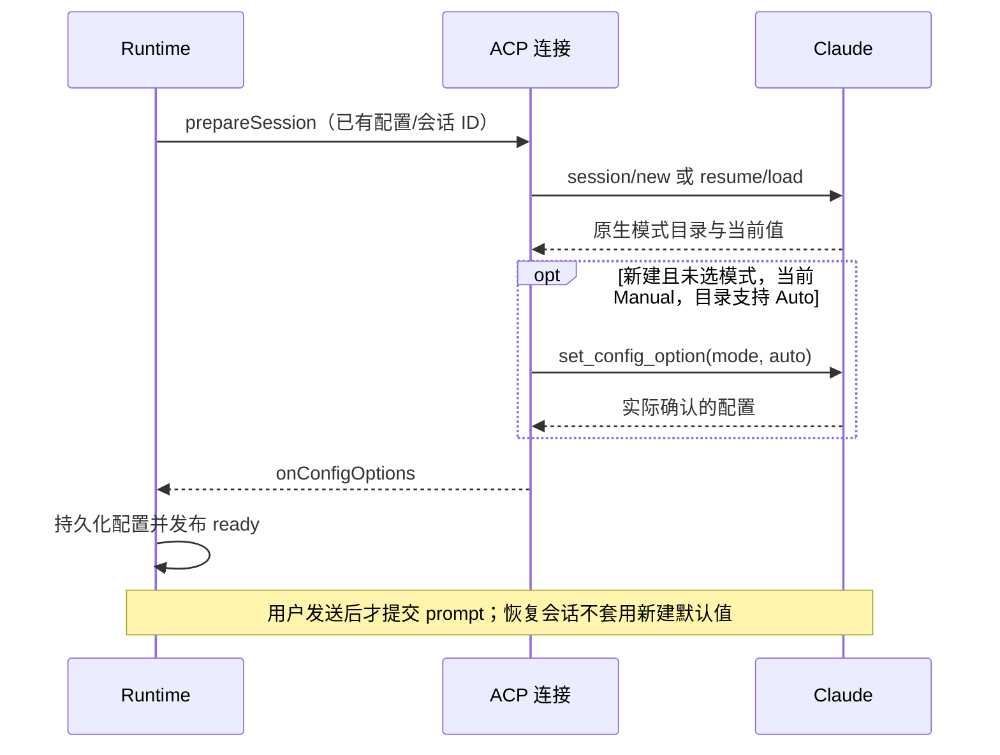
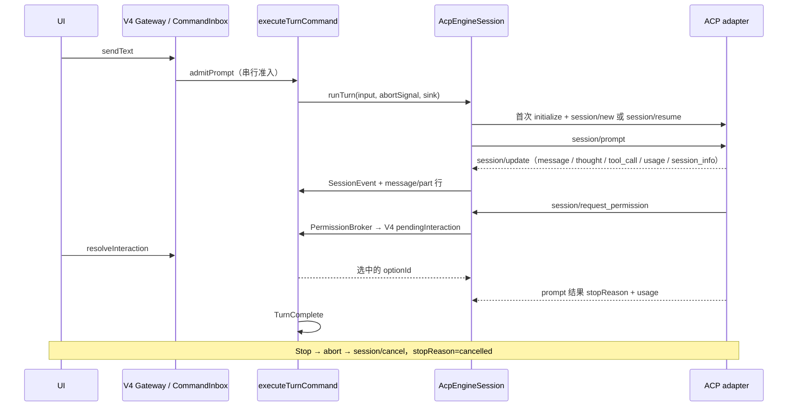
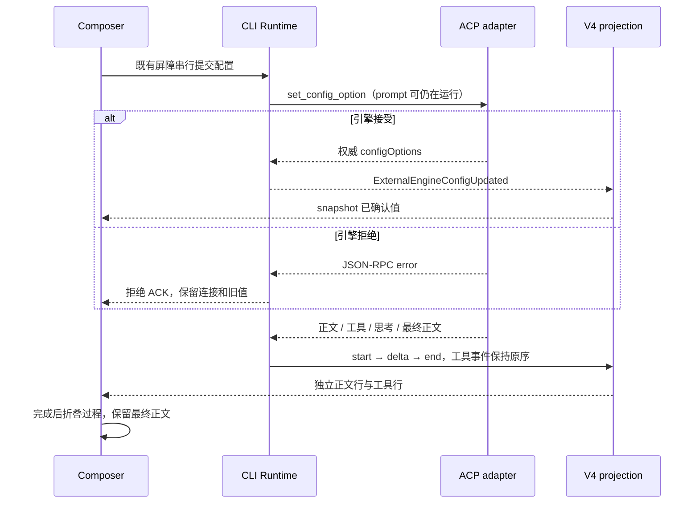
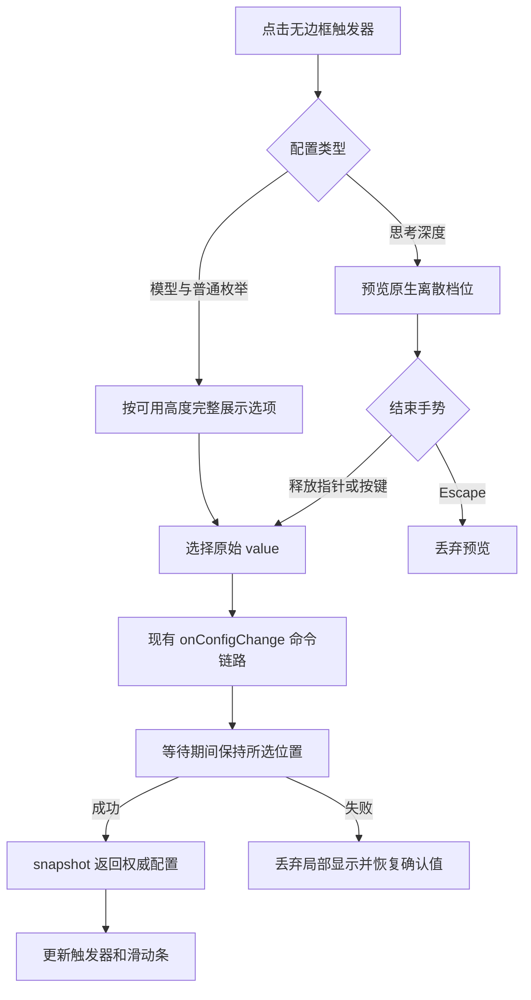
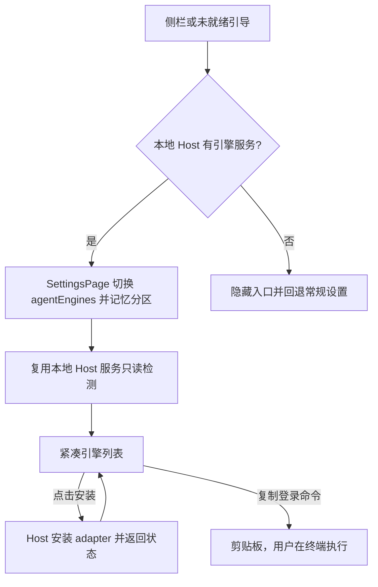
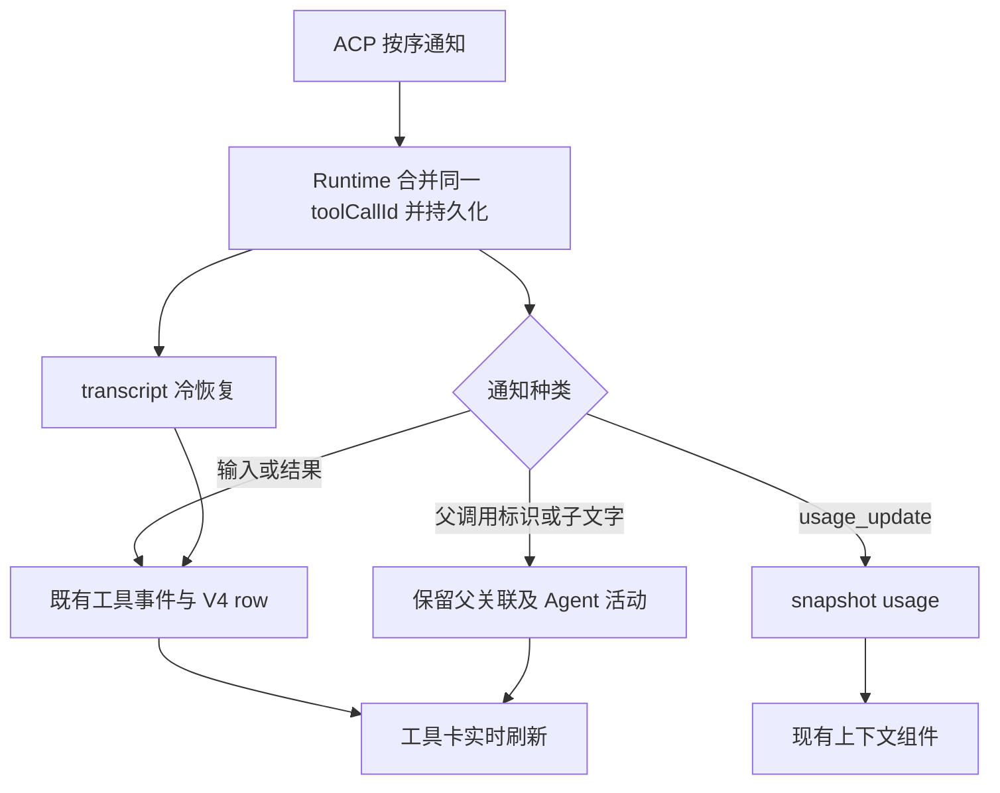
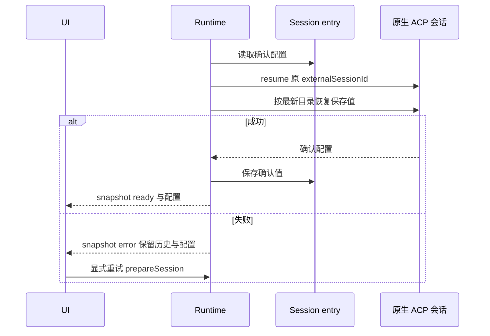
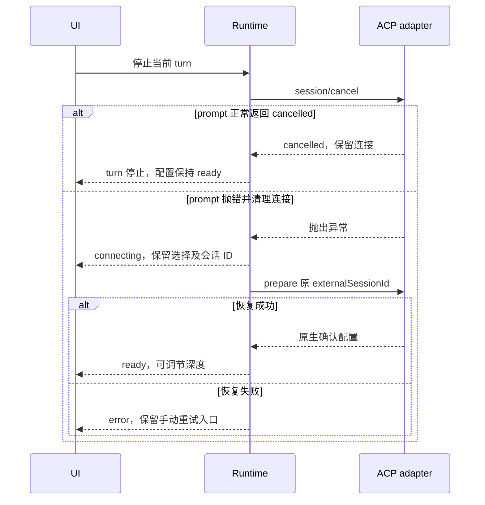
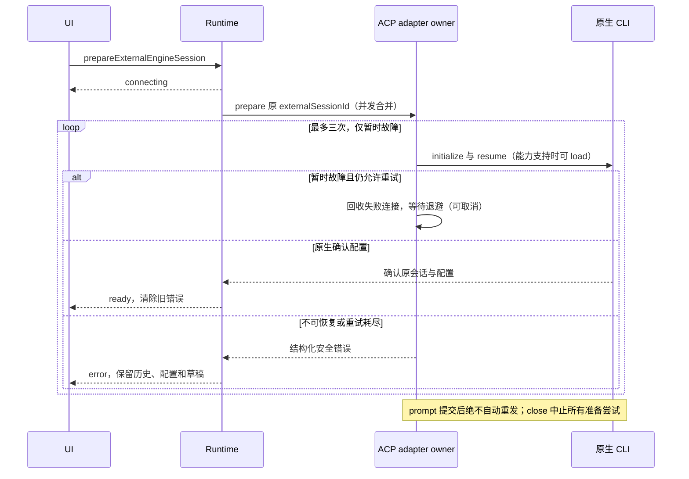

# 外部 Agent 引擎（Claude Code / Codex）

客户端图标：Codex 使用 `@lobehub/icons` 的 `OpenAI` 单色标识，浅色主题黑色、深色主题白色；Claude Code 使用 `Claude.Color` 原始品牌色标识。两款图标均保存为本地透明 SVG，复用现有 `TaskClientLogo` 入口，不依赖在线图标服务；资源目录保留库版本、来源、校验值及许可证。

### Claude 新会话的默认权限模式

终端会话中切换的权限模式不等于配置文件中的默认值，ACP 缺省仍可能返回 `default`（Manual）。客户端新建 Claude 会话时，若没有已确认的模式选择、原生目录当前为 `default` 且提供 `auto`，通过既有 `session/set_config_option` 选择 Auto，再发布配置就绪。原生返回的非 Manual 模式、已有会话恢复、用户已确认的模式及 Codex 不应用此默认值。目录不提供 Auto 时沿用原生值；原生因模型限制将 Auto 调整为其他模式时，显示其实际确认值，不伪装 Auto，不启用绕过权限模式。

Runtime 仍是已确认配置的唯一所有者；UI 只读配置快照。初始化失败走原连接错误路径，不吞掉失败或自动重发用户输入。



状态：2026-10-25 本地桌面集成与本轮回归修复完成；macOS 真实账号三种引擎的首发/续聊已验证，跨平台及其余产品场景待完成。

## 背景与目标

用户希望在 YCode 中直接使用 Claude Code、Codex 的官方 CLI，复用自己的订阅或 CLI 配置，而不是由 YCode 以第三方客户端身份直连两家模型 API，以免账号因第三方直连受限。

本规范新增"会话引擎"概念：每个会话在创建时选定 `zcode`、`claude-code` 或 `codex` 之一，创建后不可切换。`zcode` 引擎即现有 ZCode Agent，行为不变。

## 产品边界

- 只驱动用户本机安装或由 YCode 按需安装的官方 CLI，经官方维护的 ACP adapter 通信：
  - Claude Code：`@agentclientprotocol/claude-agent-acp`（封装 `@anthropic-ai/claude-agent-sdk`）。
  - Codex：`@agentclientprotocol/codex-acp`（驱动 `codex app-server`）。
- 优先使用用户 PATH 中的官方 CLI 二进制：Claude 通过 `CLAUDE_CODE_EXECUTABLE`，Codex 通过 `CODEX_PATH` 指定。未安装时才回退到 adapter 自带副本。
- YCode 不读写 `~/.claude/.credentials.json`、`~/.codex/auth.json`，不实现任何 OAuth 或设备码登录，不伪造请求头，不新增遥测。登录一律引导用户在终端执行官方命令：`claude auth login` 或 `codex login`。
- 不启用 claude-agent-acp 的 `--hide-claude-auth`。该开关的作用是拒绝走 claude.ai 订阅，与本功能目标相反。
- 启动 Claude 子进程时清除继承来的 `ANTHROPIC_API_KEY`、`ANTHROPIC_AUTH_TOKEN`、`ANTHROPIC_BASE_URL`，确保使用用户的官方登录，不被宿主环境中的密钥意外改成 API 计费。Codex 完全沿用用户 `~/.codex/config.toml` 中的 provider 与沙箱设置，YCode 不改写。
- adapter 只能由用户在设置页显式安装，打开会话不会隐式安装。安装使用 npm 官方 registry，并锁定版本。Claude Agent SDK 为 Anthropic 专有许可（`SEE LICENSE IN README.md`），因此不打进安装包、不再分发。
- 一期范围：本地桌面 workspace。SSH、WSL、Docker 远程 workspace 放到二期。
- 一期在外部引擎会话中禁用以下能力，并通过 `sessionActionAvailability` 灰显、给出原因：rewind、编辑重发、retry、文件回滚，以及 ZCode 自有的 compact。`/compact` 作为 slash command 透传给引擎。

## 状态所有者与接口

| 状态                                                     | 所有者                                             | 说明                                                                                                          |
| -------------------------------------------------------- | -------------------------------------------------- | ------------------------------------------------------------------------------------------------------------- |
| transcript、turn/row、queue、interaction、session config | CLI V4 projection/runtime（不变）                  | 外部引擎事件翻译为 `SessionEvent` 并写入 `message`/`part` 行，冷恢复与 replayable 回放与 ZCode 会话同路径     |
| 引擎自身会话（Claude session JSONL、Codex thread）       | 引擎                                               | YCode 只保存 `externalSessionId`，不解析引擎的 transcript 文件                                                |
| 引擎会话 id 与 engine 类型                               | CLI session record + SQLite `session` 表（新增列） | 创建时写入，之后不可变                                                                                        |
| adapter 进程                                             | CLI，每个会话一个进程                              | 子进程只经 `adapters/src/exec` 启动；空闲回收接入 `session-resident-pool`，有运行中 turn 或待处理权限时不回收 |
| adapter 安装与登录状态                                   | Host services（`external-engine-service`）         | 只读检测加用户显式安装；就绪结果作为外部引擎会话的执行门禁                                                    |

接缝：`apps/zcode-cli/packages/core/src/runtime/methods/turn.ts` 中 `executeTurnCommand` 对 `runRegularTurnLoop` 的调用。外部引擎会话改为调用新的 `ExternalEnginePort.runTurn`；准入、TurnStarted/Complete、usage 结算、abort 全部复用。



## 协议与服务契约（P1）

- 引擎契约位于受管模块 `external-engine-protocol`（`packages/shared/src/external-engine/`）：引擎值域、`EngineConfigOption`、`EXTERNAL_ENGINE_RUNTIMES`（adapter 包名与锁定版本、官方 CLI、环境变量规则）、`ExternalEngineStatus`、`engine_not_ready` 错误码以及安装布局。Host 安装方与 CLI 启动方都从这里读取，不得各自硬编码。
- V4 协议：
  - `createSession.config.engine` 可选，创建后不可变。
  - snapshot `config.engine` 可选，缺省视为 `zcode`，读取统一经 `resolveSessionEngine`；不使用 schema default，避免旧快照往返时被补写字段。
  - 两家 adapter 都把模式、模型、effort 等放在 ACP `configOptions` 中，因此投影为单一列表 `config.engineConfigOptions`，用新增的 CAS 命令 `setEngineConfigOption {configId, value}` 切换。`switchModelConfig`（provider/model/thought 属于 Registry 语义）与 `switchCollaborationMode`（ZCode 固定模式）在外部引擎会话中拒绝，不复用、不叠加分支。
- 能力降级复用现有字段，不新增协议：
  - 外部引擎会话不下发 row actions 中的 `canEdit` / `canRetry`。
  - session availability 中 `fork`、`compact`、`switchModelConfig` 为 `{allowed:false, reasonCode:"external_engine_unsupported"}`。
- 安装布局：Host 启动 CLI 时注入 `ZCODE_EXTERNAL_ENGINES_DIR=<YCode 数据目录>/.zcode/engines`。adapter 安装在 `<dir>/<engine>@<version>/`（`npm install --prefix`）。Host 另注入 `ZCODE_EXTERNAL_ENGINE_USER_HOME=<真实用户目录>`；CLI 只在启动外部 adapter 时恢复该 `HOME`（Windows 同时恢复 `USERPROFILE`），缺省时沿用当前用户目录，空值或非绝对路径拒绝启动；内置 Agent 的数据目录隔离不变。确保官方 CLI 能读到 `~/.claude`、`~/.codex`。PATH 无官方 CLI 时，Host 通过描述符 `bundledOfficialCliEntry` 定位安装树中的官方 CLI JS，用同一 Node 和真实 HOME 只读检测，adapter 沿用自身 fallback。
- Host 服务：受管模块 `external-engine-service`（`packages/services/src/external-engine/`）提供 `IExternalEngineService`，方法为 `getStatus`、`listStatuses`、`installAdapter`、`onStatusChanged`。`IServiceAccessor.externalEngineService` 为可选字段，未提供该服务的 host 中，UI 隐藏外部引擎入口。
- Host 执行门禁通过 `session/list {sessionIds, includeDrafts:true}` 读取 CLI 权威的 engine；该选项只允许精确读取已驻留草稿，不激活 runtime，不把草稿加入普通任务索引。冷恢复读取 SQLite 的 engine，不能按 Provider 值或 UI 当前草稿推断。
- 登录检测直接调用官方 CLI 的状态命令（`claude auth status`、`codex login status`），只提取身份类别，丢弃账号和密钥片段。

## 协议映射（以 P0 实测帧为准）

| ACP                                                                                      | YCode                                                                                                                                                                                                                                        |
| ---------------------------------------------------------------------------------------- | -------------------------------------------------------------------------------------------------------------------------------------------------------------------------------------------------------------------------------------------- |
| `agent_message_chunk`                                                                    | `assistantText` 流式行                                                                                                                                                                                                                       |
| `agent_thought_chunk`                                                                    | `reasoning` 行                                                                                                                                                                                                                               |
| `tool_call` / `tool_call_update`                                                         | `toolCall` 行。Claude 的 `name` 和 `_meta.claudeCode.toolName` 是原生工具名（如 `Write`），`_meta.claudeCode.toolResponse.structuredPatch` 与 ZCode `file_diff.structuredPatch` 同源；Codex 只给 `kind`（edit/execute/think）和 diff content |
| `content[].type = "diff"`（`path`、`oldText`、`newText`）                                | `toolDisplay.file_diff`                                                                                                                                                                                                                      |
| `session/request_permission` 的 options（`allow_once` / `allow_always` / `reject_once`） | V4 permission interaction；回复 `{outcome:{outcome:"selected", optionId}}`。两家 option kind 一致，`optionId` 各不相同，必须原样回传                                                                                                         |
| `usage_update`（`used`、`size`）                                                         | `sessionUsageState.contextWindow`                                                                                                                                                                                                            |
| `session/prompt` 返回的 `usage`                                                          | turn usage（input/output/cacheRead/cacheWrite）                                                                                                                                                                                              |
| `session_info_update.title`                                                              | 会话标题                                                                                                                                                                                                                                     |
| `available_commands_update`                                                              | 引擎 slash command 列表                                                                                                                                                                                                                      |
| `session/new` 返回的 `configOptions`（mode / model / effort / fast 等）                  | `engineConfigOptions` 会话配置列表，统一用 `session/set_config_option` 切换                                                                                                                                                                  |
| stopReason `cancelled`                                                                   | turn 停止                                                                                                                                                                                                                                    |
| Codex `tool_call` 中 id 前缀为 `guardian_assessment:`、`kind: "think"`                   | Codex 自动审查记录，展示为工具行，不当作权限请求                                                                                                                                                                                             |

## 运行中配置与消息分段

- 运行中的模式、模型、思考强度与 fast 等原生配置继续可操作，只有连接尚未就绪时禁用。会话创建后引擎类型仍不可切换。
- 所有配置沿现有 `configCommandBarrier -> setEngineConfigOption -> ACP session/set_config_option` 串行提交；snapshot 是已生效值的唯一来源，不在 Renderer 复制配置或接受队列。引擎决定变更对后续请求的生效时点，不能宣称已经发出的模型请求被重启或改写。
- 引擎拒绝某次配置时保留原值并提示失败；合法 JSON-RPC 业务拒绝不能关闭健康连接或中断运行中的 prompt。传输/进程失败仍按既有路径清理。
- ACP 正文与思考切换或开始工具时，Runtime 先持久化并发出前一分段的 `text_end` / `reasoning_end`；新分段先发 `text_start` / `reasoning_start` 再发 delta，均沿用对应 partId。成功、停止和失败都关闭最后分段。工具更新不能把后续正文拼入旧行。
- UI 保持真实正文与工具的事件顺序；完成后过程行进入既有“已工作”折叠区，最终正文独立展示，不新增第二个工具列表或重排历史。
- 回归覆盖两家引擎运行中配置成功/拒绝后仍可完成，正文→工具→思考→最终正文的实时投影与持久化分段，以及完成后的折叠与最终正文。交互用例继续留在 manual-review/pending。



## 数据兼容

- `session` 表只新增 `engine`（缺省 `zcode`）与 `externalSessionId` 两列，不重建表，不改写已有会话。
- 旧会话一律视为 `zcode` 引擎，行为不变。
- `legacyZCodeProviderSchema` 中的 `claude` / `codex` 历史值语义是"模型供应商"，继续归一到 `glm`，不复用为引擎标识。

## Composer 配置外观

- 已创建会话的引擎不可切换，输入框只展示 16px 灰色 Logo，容器固定 28px，无文字、下拉箭头、按钮语义或点击动作；复用 `TaskClientLogo` 的本地图标、可访问名称与悬停标题。仅输入框对图标去色并降低强调，任务列表仍使用原品牌外观。新建草稿的引擎选择器保持可切换。
- 引擎选择和原生配置触发器静止时背景透明、无可见边框；保留当前文字、下拉箭头、悬停和键盘聚焦反馈。
- 模型、模式、fast 等枚举配置点击一次直接展开全部选项，当前值右侧打勾，不使用子菜单、分页或滚动区域。菜单按视口可用高度分列，保持引擎提供的选项顺序，不以隐藏滚动条代替完整展示。
- `effort`、`reasoning_effort`（含连字符形式）、`thought_level` 配置使用独立深度弹层：上方显示当前档位与当前模型名，下方为带档位圆点的原生离散滑动条。档位及顺序完全来自引擎，不猜测额外档位或默认值；单一档位只展示，不允许调节。
- 拖动期间只在控件内预览，释放指针或方向键后沿现有 `onConfigChange` 提交一次原始 value；Escape 放弃尚未提交的预览。配置事实仍归 snapshot 所有，打开弹层不写配置。禁用时不允许修改。
- 释放后等待确认期间，滑块保持所选位置，不得先退回旧确认值再跳到新值；提交回调返回异步接受结果（`false` 表示失败）。确认配置回流后由 snapshot 接管，失败或关闭弹层时丢弃局部显示；较早请求的失败不得清掉后续手势。目录或确认值变化仍以新 snapshot 为准，不新增配置缓存或写入路径。
- 配置弹层在同一工具栏内互斥；旧弹层退出动画结束时，若用户已打开另一弹层，不得回焦旧触发器或关闭新弹层。保留键盘打开、方向键调节、Home/End 和 Escape 关闭能力。
- 窄工具栏复用 `useComposerToolbarFit` 的布局裁决：配置入口收为有可访问名称的图标，只读引擎 Logo 保持固定小尺寸，避免外层 `shrink-0` 裁切选项。不新建第二套宽度检测或业务状态。
- 验收：两家引擎的模式和模型一次展开，全部选项可见且无滚动容器；深度拖动及键盘调节正确回传原始值；单档、未知当前值、禁用、切换模型后的档位变化均不产生隐式配置写入。覆盖深浅主题、窄视口及减少动态效果。



本次外观验证（2026-10-25）：macOS 开发桌面的 Claude Code 已检查模型完整展开、深度滑动条与 375px 工具栏图标收缩。真实组件的隔离浏览器预览覆盖 Zai Light / Zai Dark、1440×900 / 812×375 / 375×812 和减少动态效果；18 个模型在各尺寸均一次可见，无滚动区域。鼠标拖动期间不提交，释放一次提交；方向键、Home/End 和 Escape 丢弃预览已验证。隔离预览不调用真实供应商。

隔离桌面 E12/E13 回归通过（1/1，两家引擎）：18 项模型的视口几何与无滚动断言、从模型菜单直接打开深度弹层后的焦点、键盘提交深度、首发及续聊使用 `full / fixture-17 / high`。报告：`packages/desktop/.e2e-artifacts/desktop-e2e-20261025033149385-p63842-f0767c881ad05c2e/summary.md`。选择器相关单测 8/8；根类型检查、E2E 类型检查与架构检查通过；Lint 为 94 warnings / 0 errors。候选用例继续保留 `manual-review/pending`，不据此声明真实供应商或跨平台验收完成。

运行中配置与分段回归（2026-10-25）：修复前两家引擎分别复现正文拼接错位和配置拒绝关闭连接，共 4 个失败断言；修复后 CLI 集成/端口/运行时 15/15、UI 分组/选择器 41/41 通过。隔离 macOS 桌面 E12/E13/E14 通过（1/1，循环覆盖 Claude Code 与 Codex），验证运行中模式/模型/深度切换、配置拒绝提示与 prompt 继续、完成折叠及重新展开。报告：`packages/desktop/.e2e-artifacts/desktop-e2e-20261025040835013-p89419-a2d3594cbd1ce032/summary.md`。根类型检查、E2E 类型检查、架构检查通过；Lint 94 warnings / 0 errors。仅供应商由受控 ACP 夹具替代，不代表真实 API 运行中配置生效时点已验收；用例保留 pending。

深度回跳回归（2026-10-28）：修复前组件断言复现释放后 High 立即退回 Medium；修复后选择器与契约 11/11 通过。隔离 macOS Electron 专项 2/2 通过，覆盖两家引擎的停止重连、指针拖动、键盘调节与配置拒绝；ACP 确认延迟 400ms，释放后连续 800ms 的逐帧档位记录始终保持目标值。截图覆盖 1280px 浅色与 430px 深色 Renderer。报告：`packages/desktop/.e2e-artifacts/desktop-e2e-20261028082641620-p50764-f7fd19815ee7c90a/summary.md`。根类型、E2E 类型与架构检查通过；Lint 93 warnings / 0 errors。供应商为受控夹具，候选保持 pending，未替换已安装应用。

## 验收场景

### 设置页信息架构

- 基础设置新增同级分区 `agentEngines`（「Agent 引擎」），紧随「模型设置」。模型页仅保留供应商与模型配置，不再挂载引擎检测组件。
- 页面可见性由本地 Host 的 `externalEngineService` 能力决定；无服务时隐藏导航，历史偏好或跳转意图回退到常规设置。远端 workspace 激活时，该页仍管理本机引擎，不改用远端服务。
- 设置导航和上次停留位置继续由现有 `SettingsPage` / `settingsNavigation` 管理；引擎状态仍由 Host 服务提供，页面不新增持久化事实源。未就绪引导直达 `agentEngines`，供应商配置入口继续直达 `modelProvider`。
- 使用共享设置页标题、内容宽度、主题 token 和紧凑列表：默认展示名称、就绪状态、CLI 版本、登录状态和安装操作；登录命令可复制；adapter 包名与锁定版本折叠到「技术详情」。检测和安装期间提供加载反馈。
- 打开、刷新、切换页面均只读检测；只有点击安装按钮才调用安装。复制命令只写剪贴板，不执行登录。



回归场景：有服务时入口紧随模型设置；无服务时隐藏并回退；模型页不检测引擎；导航可记忆、可直接跳转；技术详情可键盘展开；复制两家登录命令；刷新不安装；安装反馈保留；深浅主题与窄屏无横向溢出。

2026-10-25 验证：设置导航、能力过滤与引擎组件定向单测 31/31；隔离 macOS 桌面 E01/E03 候选 1/1，通过独立入口跳转、导航顺序、技术详情展开、模型页卸载引擎与分区记忆断言。报告：`packages/desktop/.e2e-artifacts/desktop-e2e-20261025043018995-p3513-566c0dd819dbe6ee/summary.md`。实际开发应用经浏览器检查 Zai Dark / Zai Light，1280×880、375×812、812×375，20px 界面字体及 reduced-motion 下无横向溢出，键盘可展开技术详情。根类型检查、E2E 类型检查与架构检查通过；Lint 94 warnings / 0 errors。候选保持 pending，未安装 adapter、未调用真实模型，不作为登录或供应商调用验收。

| ID  | 前置与操作                                      | 断言                                                                 | 证据             |
| --- | ----------------------------------------------- | -------------------------------------------------------------------- | ---------------- |
| E01 | 未安装 adapter，新建 Claude Code 会话并发送     | 返回 `engine_not_ready`，引导到设置页，保留草稿；不隐式安装          | UI、协议         |
| E02 | 设置页安装 Claude adapter                       | 安装锁定版本到 YCode 管理目录；优先使用 PATH 中的官方 `claude`       | 文件、日志       |
| E03 | 官方 CLI 未登录时发送                           | 提示在终端执行官方登录命令；YCode 不读写凭据文件                     | UI、文件访问记录 |
| E04 | 发送会写文件的任务，允许或拒绝权限              | 权限卡与 ZCode 一致；允许后文件写入、diff 展示；拒绝后不写           | UI、文件、协议   |
| E05 | 运行中点击停止                                  | `session/cancel` 送达，turn 以 cancelled 结束，可继续发送            | UI、协议         |
| E06 | 空闲回收或重启 App 后续聊                       | 历史可见；`session/resume` 续上引擎上下文                            | UI、协议         |
| E07 | 外部引擎会话中尝试 rewind、编辑重发、文件回滚   | 入口灰显并说明原因                                                   | UI               |
| E08 | 桌面与自托管 Web 同时订阅外部引擎会话，断线重连 | 两条链路收敛到同一 snapshot                                          | 协议             |
| E09 | App 退出                                        | 无残留 adapter、claude、codex 进程（macOS / Windows / Linux）        | 进程表           |
| E10 | 启动与空闲                                      | 未选择外部引擎时不联网；显式选择可初始化官方连接，发送或安装按需联网 | 网络记录         |
| E11 | Codex 会话按 E04–E06 重复                       | 同上；初始模式沿用用户 `config.toml`                                 | UI、协议         |

## 验证记录

### P0 Spike（2026-10-24，macOS arm64）

- 方法：仓库外的独立脚本，用原始 NDJSON JSON-RPC 驱动 adapter，录制双向帧。adapter 版本锁定为 claude-agent-acp@0.95.0、codex-acp@2.2.2，`@agentclientprotocol/sdk@2.0.2`（三者均为 Apache-2.0）。
- 官方 CLI：Claude Code 2.1.310（原生二进制，`CLAUDE_CODE_EXECUTABLE` 指向它），codex-cli 0.159.2（`CODEX_PATH` 指向它）。
- 场景：initialize → session/new → 写文件并处理权限 → 4 秒后 cancel → 杀进程 → 新进程 initialize → session/resume → 询问先前写入的内容。
- 结果：

| 检查项                   | Claude                                                                                                  | Codex                                                                                     |
| ------------------------ | ------------------------------------------------------------------------------------------------------- | ----------------------------------------------------------------------------------------- |
| initialize / session/new | 通过；5 种模式（default/acceptEdits/plan/auto/bypassPermissions），模型 default/opus/fable/sonnet/haiku | 通过；4 种模式（read-only/workspace-write/agent/agent-full-access），初始模式来自用户配置 |
| 权限往返                 | 通过（Write，带 diff）                                                                                  | 通过（read-only 模式下 `Run command`）；默认 agent 模式由 Guardian 自动审查放行，不弹权限 |
| cancel                   | `stopReason: cancelled`                                                                                 | `stopReason: cancelled`                                                                   |
| 杀进程后 resume 续聊     | 通过（`session/resume` 成功，正确答出 banana）                                                          | 通过                                                                                      |
| sessionCapabilities      | resume / load / fork / list / close                                                                     | resume / load / fork / list / close / subagents                                           |
| 进程退出                 | code 0，无残留                                                                                          | code 0，无残留                                                                            |

- 发现：
  1. 设置 `CLAUDE_CODE_EXECUTABLE` 后，claude-agent-acp 推送的 `_auth/status_update` 报 `none / Not logged in`，但请求实际以用户 OAuth 登录成功执行。因此登录检测不能依赖该推送，改为调用官方 `claude auth status`（JSON 输出），并在 turn 失败时以 `authRequired` 兜底。Codex 的推送正确反映了自定义网关身份。
  2. 两家 adapter 都声明了 `fork`，二期可评估开放整会话 fork。
  3. Codex 的一次 `apply_patch` 工具行先报 `failed`，引擎随后改用其他方式完成写入。映射必须容忍同一 turn 内工具失败后重试。
  4. claude-agent-acp 声明了 `_meta.claudeCode.promptQueueing`。YCode 仍由 CommandInbox 串行准入，不依赖 adapter 自带的排队。
- 录制的帧暂存在仓库外。P2 编写单测前做脱敏（替换本机路径和会话 id），再作为 fixture 放入 CLI 测试目录。

以上为单机 spike 结果，不代表 Windows/Linux 验收，也不代表产品集成。

### 本地产品集成（2026-10-25，macOS arm64）

- 根 `pnpm typecheck` 通过；`pnpm lint` 为 94 warnings / 0 errors；`pnpm architecture:check --changed` 为 0 违规，架构规则测试 36/36 通过；`pnpm db:schema:check` 通过两份 SQLite 基线兼容检查。
- 协议与可选 RPC 能力测试 48/48 通过；CLI V4 投影、命令、模型配置与双引擎 App 集成测试共 321/321 通过。App 集成使用真实 stdio 子进程和 SQLite，外部供应商由受控 ACP 测试进程代替，覆盖空 Registry 启动、响应前初始命令通知、usage 事件、落盘与冷恢复续聊。
- Host 安装、状态、执行门禁和生命周期回归 67/67 通过；包含先复现后修复的 3 个释放竞态：工作区或服务释放后，迟到的外部引擎就绪结果不能重新启动 CLI 或预留 task。
- UI 聚焦测试 127 项、hook 回归 29 项、末次组件回归 19 项通过。
- 隔离 Electron E2E 的 E01/E03 候选场景通过（1/1）：两家引擎选择、内置配置隐藏、未安装发送门禁、草稿保留，以及设置页官方终端登录命令。运行报告：`packages/desktop/.e2e-artifacts/desktop-e2e-20261025020013755-p82423-9a8c2cf2cdea0973/summary.md`。
- CLI 完整类型检查 30 个任务通过；最后的 core 增量类型检查通过。真实 ACP 受控子进程测试 6/6、外部 runtime 双引擎与 busy guide 回归 3/3 通过；busy 状态的外部引擎不能接收无消费方的 steer，沿既有 admission 进入普通串行队列。
- 新增 `engine` / `externalSessionId` 后，同步修正了旧测试的整行 SQLite 预期，以及只回退迁移账本却保留新物理列的旧库夹具；provider migration 9/9、reasoning repair 19/19、async migration 9/9 定向回归通过。
- CLI 全量测试未通过：首次执行因 TUI 中文文案断言失败退出；测试与 i18n 源码均与 HEAD 相同，独立重跑复现。继续执行时 adapters、core、bootstrap 等包仍有超时、缺模块和其他断言失败，未经逐项基线复现，不能统一称为已有失败。该轮包级结果为 adapters 28 failed / 2033 passed、core 6 failed / 4081 passed、bootstrap 38 failed / 2941 passed，其中本轮引入的 5 项失败已按上述定向测试修复；未重新跑完整套件。`@zcode/cli` 最终停在 `internal-search.node-test.ts` 的 grep 子进程，约 6 分钟无输出、CPU 为 0，已仅清理本轮进程树，完整套件未自然结束。原始检查日志位于 `/tmp/cli-external-full-continue-tests.log`。
- 根 affected 官方选择命中全部 1647 个根 UT 文件，按 pre-push 合同跳过；这不等于全量测试通过。
- CLI lint 仍有 3 个 `max-lines` 错误：`adapters/src/model/runner-stream.ts`、`contracts/src/model/index.ts` 与 `bootstrap/src/zcode-protocol-v4/product-projection.ts`。前两份源码与 HEAD 字节相同；投影是既有超长文件，本次新增外部引擎事件后失去原样上游豁免，未放宽规则或扩大为整文件重构。
- 本轮未安装真实 adapter，未读取凭据或调用真实模型。P0 spike 为先前会话记录，不作为本轮产品验收；E04–E11 的真实账号桌面场景、Windows/Linux 与进程整树退出仍待分别验证。新增 E2E 保持 `manual-review/pending`。

## 关联文档修订（2026-10-25 已更新，未提交）

- `docs/desktop/standalone-coding-harness-spec.md`：补充"Provider Registry 唯一事实源"的外部引擎例外，并说明与 H07 不冲突。
- `docs/zcode-agent-next-steps.md`、`docs/zcode-agent-app-integration.md`：说明会话可选外部引擎，但仍由单一 `app-server` 拥有投影。
- `docs/zcode-protocol.md`：命令表补充 `setEngineConfigOption`，新增"会话引擎"一节。

## 真实桌面回归修复（2026-10-25）

- 已复现：已安装且官方 CLI 登录可用时，Claude Code 首发约 3 秒后只有 `ACP adapter exited`；创建外部引擎草稿时，模型/模式控件在发送前为空。
- 外部引擎连接在 CLI runtime 中初始化并投影配置，初始化不创建 user turn、不提交 prompt；UI 复用当前 deferred 草稿的唯一 owner，配置就绪后才发送。切换引擎仍回收旧草稿，由 owner 顺序创建新草稿。初始化失败必须给出可操作错误，不能静默空白；不自动安装。
- 子进程退出必须区分正常退出码和信号；原始 stderr 可能含账号或 prompt，不直接暴露。ZCode 普通 Provider 的首发、续聊及引擎切回需要真实桌面回归。

- 新增 E12：选择任一已就绪外部引擎后，首条消息之前显示原生模型/模式；连接中可编辑草稿和切换引擎，但不能发送；失败展示原因并允许发送重试。初始化不制造 TurnStarted 或 transcript。
- SIGTRAP 根因已用同一个 Electron Helper 的有/无 Node 模式对照确认；adapter 子进程显式设置 `ELECTRON_RUN_AS_NODE=1`，不依赖系统 Node。
- 草稿未持久化时只在 runtime 保存 externalSessionId，首发提升一并入库；已持久化会话才更新现有记录。

### 本轮修复验证结果（2026-10-25）

- macOS 真实桌面（独立“回归验证”任务）：ZCode / MiniMax M3.1-Flash、Claude Code / Opus 5.5、Codex / 6.1 Sol 均完成首发和第二轮；第二轮询问上一轮英文标记，正文均正确返回，验证上下文连续性。两家外部引擎在发送前已显示原生配置；Claude 不再出现 SIGTRAP。Claude 响应存在超过 55 秒的等待，官方 CLI 单独探针也曾超时，不能把短探针超时当成集成仍失败。
- 隔离桌面 E12（官方状态与 ACP 为夹具，完整 Electron/Host/CLI/stdio）：1/1 通过；断言配置所属引擎、配置切换后首发及同进程续聊。报告：`packages/desktop/.e2e-artifacts/desktop-e2e-20261025030839481-p51299-67d479c9fe477460/summary.md`。保留 pending，未转正。
- 端口回归 8 项通过；App + SQLite 首发/恢复 2 项通过；V4 接线/普通会话创建/core 外部执行定向测试通过；UI 草稿与配置反馈 39 项通过。
- 根 typecheck、CLI typecheck（30 tasks）及架构检查通过；根 lint 94 warnings / 0 errors。CLI 包级 lint 仍被未改动的旧文件长度错误阻挡：adapters 的 `model/runner-stream.ts`、`fs/index.ts`，core 的 `tool/executor/background-tasks.ts`、`runtime/methods/session-fork.ts`。本次外部引擎与命令处理文件定向 lint 通过。
- 曾把 CLI 构建与源码集成测试并行运行，构建重写 dist 导致依赖入口短暂缺失；构建完成后串行重跑相关集成测试通过。此类失败不是行为回归证据。
- 未验证：Windows/Linux 整机、真实工具执行与权限交互、真实账号重启后的冷续聊；本轮结果不扩大至这些场景。未提交或推送代码。

复跑隔离 E12（仓库根目录，使用仓库固定 Node/pnpm）：

```sh
node packages/desktop/test/e2e/helpers/external-engine-fixture.mjs /tmp/zcode-engine-fixture-bin
PATH="/tmp/zcode-engine-fixture-bin:$PATH" \
ZCODE_E2E_EXTERNAL_ENGINE_FIXTURE_BIN=/tmp/zcode-engine-fixture-bin \
E2E_PROVIDER_HTTP_MODE=replay \
E2E_PROVIDER_REPLAY_FIXTURE_PATH=packages/desktop/test/e2e/fixtures/upstream/common.json \
ZCODE_E2E_MANUAL_REVIEW=1 \
pnpm --filter @zcode/desktop test:e2e -- --spec './test/e2e/conversation-session/manual-review/pending/conversation-session-external-engine-prewarm.test.ts'
```

## Claude 工作过程显示修复（2026-10-25）

- ACP `tool_call_update` 是增量字段更新：后到的 `rawInput` 必须更新同一调用的实时输入，不能只写 transcript；不得重新开始已结束的工具。
- 工具结果优先使用原始文本输出，兼容 ACP content 文本、terminal_output 和 terminal_output_delta；空 content 不得覆盖已有输出。命令描述与完整命令在既有终端卡展开后显示。
- `_meta.claudeCode.parentToolUseId` 保留为工具事件、持久化 metadata 与 V4 row 的 `parentToolCallId`。子工具按精确父标识嵌入 Agent/Task 卡；无父行时保留可见，不按相邻次序猜配对。
- 子 Agent 的正文/思考仅进入对应 Agent 的活动内容，不拼入主回答。活动内容与最终结果分别保留，冷恢复仍可阅读。没有实际 ZCode child session 时不伪造 childSessionId，不提供无效下钻或取消入口。
- `ToolCallProgress` 复用为同一工具的参数、输出和活动刷新事实；projection 只在非终态应用，终态后的迟到进度不能重开工具。Runtime 是 ACP 工具状态唯一所有者，UI 仅从 rows 派生嵌套呈现。
- 外部引擎输入区复用 `ChatContextUsage` 显示真实 `usage_update.used/size`，无用量时不猜百分比，不恢复 ZCode compact 控制。
- 验收：先空输入后完整命令、运行中输出、空 content + rawOutput、并发 Agent 及嵌套工具、子文字隔离、失败/中止、持久化恢复和用量可见。供应商夹具与真实账号验证分开记录。



### 工作过程修复验证结果（2026-10-25）

- CLI 定向 4 文件 25/25 通过，覆盖真实 stdio 子进程、SQLite、后补输入、终端输出快照/增量、空 content、父子关联、并发 Agent、失败、迟到进度和冷恢复；供应商为受控 ACP 夹具。
- UI 定向 8 文件 130/130、分享页既有定向测试 17/17 通过；原生 Agent 的侧栏交互保持回归覆盖，外部 Agent 使用内联展开。
- 隔离 Electron E12/E14/E15 候选用例 1/1 通过，分别执行 Claude Code 与 Codex：首发前配置、同会话续聊、运行中修改模式/模型/深度、配置拒绝后继续原轮、工作过程折叠、终端命令/描述/输出、Agent 活动及子 Bash、真实用量投影均有断言。两家引擎使用不同工具 ID，展开后等待实际高度和局部动画完成，四张截图已核对。报告：`packages/desktop/.e2e-artifacts/desktop-e2e-20261025043635278-p7358-05ada641137f63e0/summary.md`。截图中的“配置修改未生效”为该用例主动注入的配置拒绝反馈。
- 根 typecheck、E2E 定向类型检查通过；根 lint 为 94 warnings / 0 errors；架构检查 0 违规；格式检查与 `git diff --check` 通过。未运行全量测试，候选 E2E 保持 `manual-review/pending`。
- 本轮没有以真实供应商账号重新执行工具场景，不扩大为 Windows/Linux 或真实账号验收。当前开发应用仍需重启以加载新的 CLI/runtime；未提交、推送或重启用户正在使用的应用。

## 历史会话原生配置恢复（2026-10-25）

- Runtime 是已确认原生配置及连接状态的唯一所有者。历史恢复必须在发送前通过原 externalSessionId 重新连接，不能静默新建原生上下文。
- 最新确认配置复用 session entry 保存，草稿首发提升时一并保存；冷恢复先读保存值，再按原生最新目录确认和恢复。缺失或不支持的值明确失败，不猜替代模型或思考档位。旧历史无 entry 时以原生 resume 返回值为准。
- 连接状态复用 ExternalEngineConfigUpdated 事件和 snapshot 投影。恢复失败保留 transcript、配置和草稿，提供显式重试；未就绪时配置禁用。重试复用 prepareSession，不提交 prompt 或创建 turn。
- 回归覆盖两家引擎：非默认模型/深度、首发落盘、全新 runtime 冷恢复、发送前即可调整、失败保留历史并重试，以及恢复后的上下文连续性。



### 历史配置恢复验证结果（2026-10-25）

- 修复前，两家引擎的 App + SQLite 冷恢复回归均失败：Runtime 配置列表为 `[]`。修复后 CLI 定向 4 文件 27/27 通过，含非默认模型/深度落盘、全新 Runtime 恢复、离线历史可读、连接重试去重、失效值与错误原生会话 ID 拒绝。
- UI/协议/流式工作项定向 6 文件 124/124；真实 React 浏览器布局 9/9，覆盖 375/966px、中英文、深浅色、横屏、放大字号、减少动态效果，以及追加后旧行几何位置不变。
- 隔离 Electron 候选 E12/E14/E15/E16 1/1 通过，逐一完整重启 Electron/Host/CLI，验证 Claude Code 与 Codex 的非默认配置、未发送草稿、恢复后调节与续聊。供应商仍为 ACP 夹具。报告：`packages/desktop/.e2e-artifacts/desktop-e2e-20261025072941259-p46885-e118202d4757d38b/summary.md`。两次前置运行被测试 helper 的固定 workspace 等待阻断；改为复用已有完整重启/保留 profile helper 后通过，不放宽产品断言。
- 当前真实开发实例已重建并重启。用户截图中的历史会话恢复出 mode/model/effort/fast 四个原生控件，模型 `claude-opus-5-5`、思考 `High`，草稿 `11` 保留；只打开配置菜单验证可调，没有发送草稿或真实 prompt。
- 根 typecheck 与架构检查通过，根 lint 94 warnings / 0 errors；CLI 改动逻辑定向 lint 通过。未运行全量测试，未提交或推送。真实账号的重新发送、Windows/Linux 整机和 SSH 外部引擎不在本次验收范围。

## 原会话连接恢复与诊断（2026-10-25）

### 运行中断后的配置状态（2026-10-28）

- 非用户停止的 `runTurn` 抛错时，adapter 会清理该会话连接；Runtime 必须同步发布 `engineConfigState=error`，保留已确认配置和原 `externalSessionId`，不能继续发布或沿用 ready。用户停止走下述自动恢复路径。
- 正常返回 `stopReason=cancelled` 的停止仍可复用连接，不因用户停止而显示连接失败。配置 RPC 的业务拒绝同样保留 ready；连接故障在空闲时先自动恢复，仍失败才进入已有错误与重试入口。
- ACP prompt 响应中的 `usage: null` 与缺省用量都表示本轮没有用量数据，不是协议故障；停止后保留健康连接。
- 用户停止时若 runTurn 抛错导致 adapter 回收连接（包括连接、协议、超时或取消回调异常），Runtime 自动调用既有 prepareSession，按原 externalSessionId 恢复上次确认配置；恢复期间投影 connecting，成功后 ready，无须手动重连。恢复使用独立于已取消 turn 的 signal，应用关闭时由 closeSession 中止，不创建新会话或重发 prompt。恢复失败仍保留历史、配置及草稿，发布错误并保留手动重试入口。
- 回归：两家引擎的空用量停止、停止时真实断联自动恢复、恢复失败及关闭边界；原生会话 ID 不变且 prompt 不重发；非停止的 prompt 异常仍投影 error，健康停止及配置业务拒绝保持可用。
- 停止成功后才退出的进程可在下一次配置操作中被发现。空闲 Runtime 收到结构化连接故障后，通过同一 prepareSession 恢复原会话，并对幂等的 set_config_option 重试一次；不重试业务拒绝，不重发 prompt，运行中或正在关闭时不另建恢复链路。



### 暂停自动恢复验证（2026-10-30）

- 生产日志中的停止失败为 `Invalid ACP object`；已安装的 Codex ACP 在无用量统计时返回 `usage:null`。修复前双引擎空用量取消回归失败，修复后保留健康进程，停止后可直接配置和续聊。
- CLI 定向 4 文件 54/54 通过，覆盖取消后自动恢复、原生 ID 与确认配置保留、关闭竞态、恢复失败、取消回调异常，以及迟到退出后幂等配置重试。无自动重发 prompt。
- 隔离 Electron 的“停止后自动恢复原会话并直接调节思考深度”通过：Claude Code/Codex 均覆盖健康停止、协议故障、进程退出，检查无需重连、配置可调、原生 ID 与 prompt 次数不变。单项证据见 `packages/desktop/.e2e-artifacts/desktop-e2e-20261030090545306-p97277-c38e88fa884990c9/summary.md`；该次 HTML 用例的菜单定位失败已在后续独立运行修正并通过。
- 根与 CLI 类型检查通过，根 Lint 为 0 errors / 93 warnings，CLI 改动文件 Lint 通过。额外 CLI 全包 Lint 为 4 errors / 66 warnings：未修改的 `adapters/src/model/runner-stream.ts`、`bootstrap/src/zcode-protocol-v4/transcript-hydration.ts`、`bootstrap/src/zcode-protocol-v4/product-projection.ts`、`contracts/src/model/index.ts` 仍有 max-lines 失败。
- 供应商使用隔离 ACP 进程夹具，候选保持 pending；未替换用户已安装应用，也不代表真实账号或跨平台验收。

### 既有连接恢复规则（2026-10-25）

- 已复现：同一个 Codex 原生会话可由独立 ACP 进程恢复，但当前桌面 prepare 连续失败；旧实现丢弃 JSON-RPC 出错方法与错误码，无法区分鉴权、会话缺失、协议不支持与暂时错误。不得据统一提示推断网络断开。
- ACP adapter 仍是连接、请求和重试的唯一所有者。prepareSession 对同一 session 合并并发调用，最多尝试三次，间隔 500ms、1500ms；只重试超时、连接中断和 RPC internal error。鉴权、资源缺失、参数或保存配置不支持立即失败。
- 初始化协商恢复能力：优先 session/resume；对明确不支持该方法且声明 loadSession 的 adapter，使用 session/load 恢复同一个 externalSessionId。load 的历史正文/工具通知只用于原生加载，不能重复追加至 YCode transcript。
- 不静默新建替代原生会话、不更换模型/权限/思考档位；已确认的 externalSessionId 在后续尝试中复用。session/new 已发送但未确认 id 时不自动重发，避免制造多个未知会话。
- runTurn 仅在 prompt 之前复用 prepare 的重试；prompt 提交后发生错误绝不自动重发。关闭会话或取消准备时中止退避与在途请求，迟到结果不得启动新连接。
- Runtime 继续拥有 connecting/ready/error 投影。失败事件与快照附加经过 schema 校验的错误分类、ACP 方法和数值错误码；不携带原始 stderr、RPC message/data、身份或用户内容。UI 按分类提供本地化处理说明；旧快照保留原有通用提示。
- 现场根因：桌面 PATH 可找到 npm 的 Codex 入口，却没有 node，脚本以 127 退出，adapter 将其报告为 initialize / RPC 1001。PATH 缺 node 时，仅为 ACP 子进程补充指向当前运行时的托管 Node 入口，并保持 Electron 的 Node 模式；不修改系统 PATH。Host 检测到官方 CLI 是 JavaScript 入口时，用当前运行时直接执行版本和登录状态查询，避免把启动失败误判为未登录。
- 验收：覆盖两家引擎的临时失败后成功、重试耗尽、不可恢复错误不重试、同会话 single-flight、关闭/取消终止重试、session/load 能力回退与历史去重，以及 prompt 错误不重发；真实桌面验证原失败会话恢复后历史仍在。



### 连接恢复验证结果（2026-10-25）

- 真实桌面先取得 initialize / RPC 1001；从当前进程环境独立运行官方 CLI，确认缺 node、退出码 127。修复后重建并加载 Agent/Host，原失败 Codex 会话恢复到 ready，官方 CLI 登录状态检测通过；未提交真实 prompt。
- 恢复前后只读校验原生会话 ID、8 条 message 与 75 条 part 的正文哈希均一致。现场刷新未自动显示的草稿已从原本地持久化记录恢复，并校验文本哈希一致；该旧草稿迁移行为不属于连接恢复自动保证的范围。
- ACP adapter 定向 2 文件 24/24、Host 状态检测 8/8 通过，包含真实子进程、缺 Node 的 npm 入口、并发准备、退避取消、load 去重及 prompt 不重发。此前 Runtime/投影及 UI/协议定向回归也通过。
- Electron 隔离候选 1/1 通过：Claude Code 与 Codex 冷重启后前两次 resume 故障、第三次自动恢复，原会话 ID、未发送草稿、持久化正文和 prompt 次数保持一致；恢复后可调整配置并续聊。报告：`packages/desktop/.e2e-artifacts/desktop-e2e-20261025084459994-p65325-b89a7216764e7a7f/summary.md`。供应商为受控 ACP 夹具，候选保持 pending，不表示人工转正或 CI 准入。
- 根与 CLI 类型检查、桌面 E2E 类型检查通过；架构检查 0 violations。根 Lint 为 94 warnings、0 errors；CLI Lint 仍受 4 个 max-lines 错误阻塞：runner-stream、transcript-hydration、product-projection 和 contracts/model，其中 product-projection 是本轮触及的原有超长文件。
