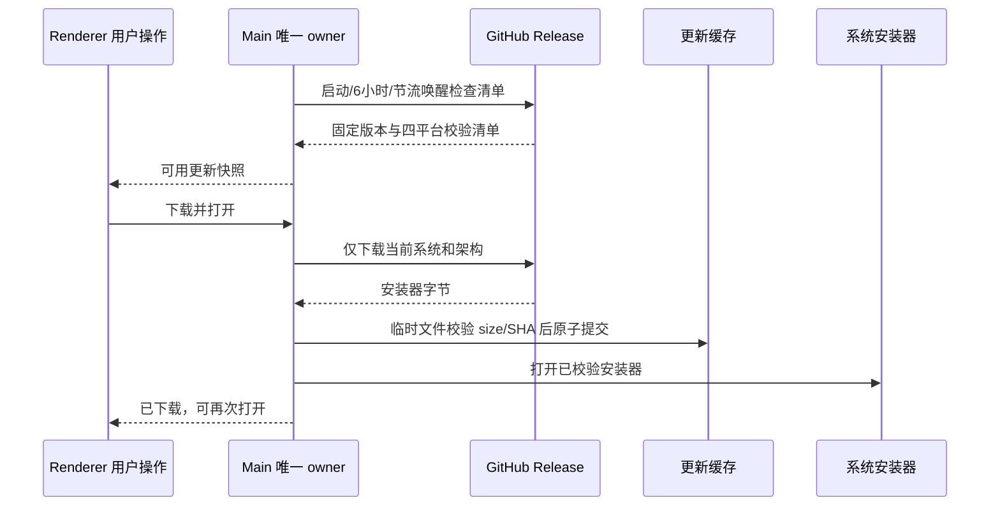

# GitHub 桌面更新

## 产品规则

更新源固定为本仓库 `https://github.com/OpenX123/ZCode/releases/latest/download/ycode-update.json`，仅检查正式发布的最新版本。应用启动后检查一次，此后每 6 小时检查；系统唤醒时仅在距上次检查已满 6 小时时检查，手动检查不受此节流。开发运行、非 macOS/Windows 或非 ARM64/x64 不发起更新请求。旧 `3.16.2` 不属于新的 `1.0.0` 发布序列，用户须先手工安装一次 `1.0.0`；禁止把版本号重置作为降级自动安装。

Main 是更新检查、候选安装包、下载和校验结果的唯一 owner。Renderer 通过 `IPlatformService` 获取快照、订阅变化、手动检查、下载并打开安装器、重新打开已校验安装器，不直接获取 GitHub 清单。各窗口只投影状态；没有第二套更新设置、缓存或定时器。

macOS 安装包未签名，因此用户点击更新后先下载、验证，再使用系统默认方式打开 DMG；Windows 打开 EXE。应用不自动退出、不静默替换安装目录，不中断运行任务。用户仍需完成安装与 macOS 首次授权步骤。只有用户操作触发安装包下载，自动检查只请求小型清单。

## 清单与安全边界

清单形状：`{schemaVersion:1,version,releaseUrl,assets:[{platform:'darwin'|'win32',arch:'arm64'|'x64',fileName,url,size,sha256}]}`。版本采用严格数字三段式 semver。清单最多 64 KiB；每个平台/架构最多一项且四种目标必须完整。安装器只接受当前运行架构，darwin 使用 `.dmg`，win32 使用 `.exe`；文件名不含路径。size 为正整数且不超过 512 MiB，sha256 为小写 64 位十六进制。

Release tag 必须等于 `v${version}`；文件名固定为 `YCode-${version}-${mac|win}-${arch}.${dmg|exe}`。releaseUrl 必须属于 `https://github.com/OpenX123/ZCode/releases/tag/<tag>`，安装器 URL 必须是同一 tag 的 `https://github.com/OpenX123/ZCode/releases/download/<tag>/<fileName>`。不接受外部仓库、任意 HTTP、认证信息、查询参数、fragment、伪装子域或路径穿越。入口 URL 校验后允许 GitHub 官方资源分发重定向；所有字节仍必须匹配清单 size/SHA。

Main 使用 Electron `net.fetch`，沿用当前 Electron 网络/代理。清单请求 15 秒超时，安装器下载 10 分钟超时；读取流时同时限制实际字节数，不能只依赖 Content-Length。下载唯一临时文件，完整 size/SHA 验证后原子发布到 `<userData>/github-updates/<version>/<sha>/<fileName>`。复用缓存及每次打开安装器前重新校验，缺失/损坏不启动安装器。

## 状态与并发

复用共享 `UpdateStatePayload`、`UpdateCheckResultPayload`。持续状态为 idle、checking、update-available、download-progress、update-downloaded、error；状态包含 currentVersion，可用更新附 version/releaseUrl，进度带 transferredBytes/totalBytes/progress。错误保留对应候选版本并允许显式重试，不自动循环下载。

同一 Main 的并发检查合并为同一个请求；下载请求合并，同一点击洪泛只打开一次安装器。检查不能覆盖正在下载的状态；已下载后仍检查更新，相同清单且缓存有效时保留已下载状态，更高版本成为新候选。每次下载固定本次候选与校验信息，后续检查不得改写正在执行的文件。失败/超时只清理本次临时文件，不删除其他有效版本。退出应用时取消网络和定时器；迟到结果不得重新广播可用或打开安装器。

## 验收场景

- 当前版本、旧版本、相同版本、畸形版本、旧 3.16.2 和开发环境分别给出真实结果；不下载错误架构。
- 清单/安装器的错误仓库、错误 tag、路径穿越、重复平台、超大响应、错误 SHA/size 均拒绝，安装器不启动。
- 并发检查和下载只请求一次；失败清理临时文件，可重试；缓存离线复用后再打开时仍校验。
- 读取快照和事件来自同一 owner；下载期间检查不冲掉进度；dispose 后网络取消且不打开安装器。
- 启动检查、6 小时检查、唤醒节流和手动检查使用同一入口；GitHub不可达显示可重试错误，不影响普通编码。
