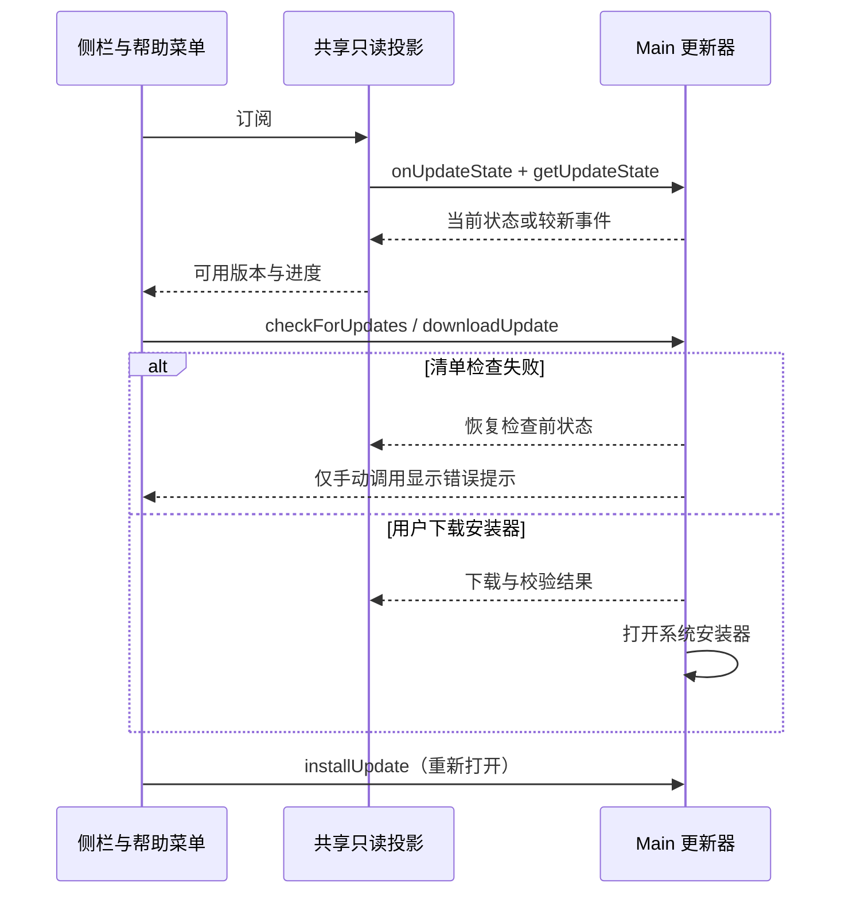

# GitHub 桌面更新界面

## 产品规则与入口

- 正式发行版本从 `1.0.0` 开始，每次正式发布递增 patch；界面只展示 Main 检查后的真实版本，不自行推算下一版本。
- 桌面侧栏底部设置行上方显示发现新版本、下载进度、失败重试与安装包已就绪状态。空闲且无新版时不占用额外空间。
- macOS、Windows 共用帮助菜单的「检查更新」入口；Web 不展示更新功能。
- 发现新版后点击更新按钮才开始下载。下载经 Main 校验后打开系统安装器；macOS 未签名应用由用户按安装器提示完成安装，界面不承诺静默替换或自动重启。
- 已下载时点击「打开安装包」可重新打开校验后的安装器。检查失败可从帮助菜单重新检查；已知目标版本的下载失败在侧栏重试下载。
- 自动检查失败保持安静，不展示侧栏报错；手动检查失败只显示即时提示。即使收到无目标版本的旧错误事件，也不展示侧栏更新按钮。已发现的更新与下载失败状态不因后续检查失败而消失。
- 手动检查无新版、开发态跳过或操作失败时提供即时提示；下载错误持续展示在侧栏，可使用键盘重试。

## 唯一状态与时序

Main 是更新状态、目标版本、校验与安装器路径的唯一权威。UI 通过 `hooks/desktop-updates` 访问 `IPlatformService`，不访问 `window.zcode`，不持久化第二份更新状态。

一个 platform 对象共享一条状态订阅和只读快照投影。先订阅再读取初始快照；读取期间若收到更新事件，迟到的旧快照必须丢弃。最后一个消费者卸载后释放订阅，重新挂载重新读取快照。更新命令的幂等与重复下载 admission 由 Main 负责。



## 展示与可访问性

- 使用现有 Button、DropdownMenu 与 toast，沿用 `text-ui-*`、主题语义颜色和 Lucide 图标。
- 下载按钮禁用时仍显示进度；进度条提供 `role=progressbar` 与数值。状态说明使用 `aria-live=polite`，错误保持可读，不只依赖颜色。
- 中文和英文文案完整对应，支持长版本号及窄侧栏；错误说明可换行，操作不挤出侧栏。
- E2E 入口：`desktop-update-action`、`desktop-update-status`、`workspace-help-menu-check-updates`。

## 验收

1. 桌面帮助菜单存在检查更新；Web 不出现该入口，不恢复商业或社区入口。
2. 新版事件使常驻按钮出现；点击下载后展示进度并禁止重复提交；下载完成后允许重新打开安装器。
3. 下载错误显示持续错误与重试，未知版本的检查错误走重新检查。
4. 双入口共享状态；初始快照迟到不能覆盖新版事件，卸载正确取消订阅。
5. 手动无新版给出当前版本提示；真实安装器下载、SHA 校验和系统打开由 Main 回归覆盖。UI E2E 仅替换更新 IPC 响应，不实际打开系统安装器或请求生产 API。

新增交互用例位于 `test/e2e/manual-review/pending/desktop-github-update.test.ts`，仅定向执行，不自动准入正式 CI。

复用已构建的 E2E 桌面产物执行（显式 replay fixture，避免 pending 默认真实 provider capture）：

```bash
E2E_PROVIDER_REPLAY_FIXTURE_PATH="$PWD/packages/desktop/test/e2e/fixtures/upstream/common.json" \
ZCODE_E2E_SKIP_BUILD=1 ZCODE_E2E_SKIP_AGENT_BUILD=1 \
pnpm --filter @zcode/desktop test:e2e:serial -- \
  --spec ./test/e2e/manual-review/pending/desktop-github-update.test.ts \
  --spec ./test/e2e/help-menu-about.test.ts
```
