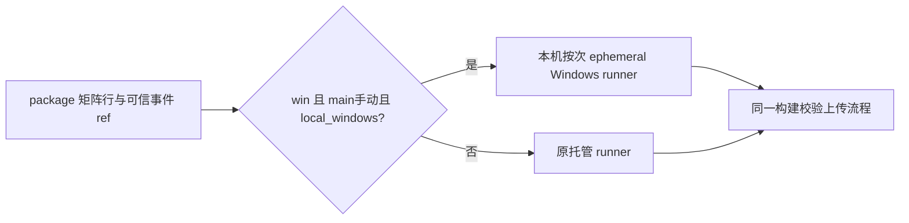
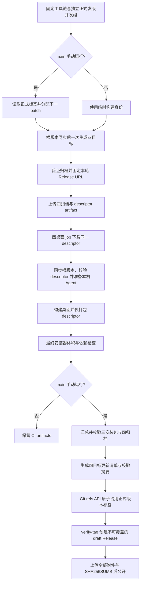
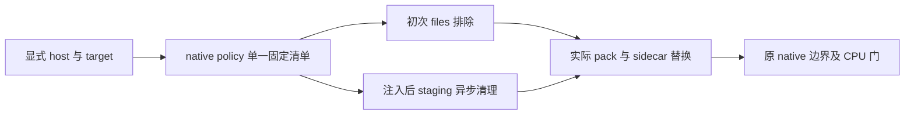

# GitHub 桌面与远程资源发布规格

## 目标与边界

GitHub Actions 仅为 macOS ARM64、Windows x64 构建桌面安装包；远程 Source Server 归档从桌面安装包移出，两个桌面目标共享同轮生成的四目标 descriptor。普通本地构建默认继续携带完整离线资源；仅设置 `ZCODE_REMOTE_ASSET_DESCRIPTOR_ONLY=1` 的发行构建启用轻量模式。

## 发布身份与唯一所有者

### Task41 按次选择本机 Windows runner

- `workflow_dispatch` 增加 boolean 输入 `local_windows`，默认 false。只有 `matrix.os == 'win'`、事件为 `workflow_dispatch`、ref 为 `refs/heads/main` 且该输入为 true 时，package job 选择 `[self-hosted, Windows, X64, ycode-windows]`；其余情况继续使用该行原托管 runner。
- push、PR、非 main 手动运行以及 macOS 矩阵均不能通过此开关路由到本机；不信任 `github.event.inputs` 的字符串真假值，使用 GitHub 类型化 `inputs` 上下文。
- 本机 runner 的注册、短路径工作目录与按次 ephemeral 生命周期由 controller 在仓库外管理；不在仓库保存 token、机器目录或安装常驻服务。workflow 不生成第二套构建或上传路径。
- 构建命令、目标矩阵、版本唯一 owner、descriptor、预算、CPU 门和当前十附件合同保持不变。该开关只选择执行宿主，不代表构建或安装验收完成。
- 测试实际求值 workflow 的 runs-on 表达式：main 手动 true/false/缺省，push/PR带true、分支/tag手动true、macOS true 均检查正确路由，同时锁定 boolean/default 与现有托管矩阵。

Task41 精确四文件：build.yml、本 spec、现 release-gate-repair 计划、github-release-workflow.test.mjs。最终 root 检查、自然远端179720基线真实push hook、本机注册 online 与路由表达式验证由controller完成。接入本机不要求立刻再次正式发版，也不为验证runner多分配一个版本；当前在途发布可继续，下一次获授权的正式dispatch才使用本机开关。注册online只证明连接就绪，不冒称本机已执行构建，不绕过旧门禁或使用旧产物冒充本次构建。

- 资源 job 是本轮 Source Server 归档与 descriptor 的唯一生成者，使用现有 `prepare:remote-assets` 一次生成四个目标；桌面 job 不重新生成资源。
- 正式应用版本从 `1.0.0` 起。仅 main 的 `workflow_dispatch` 是正式发版入口，push / PR 不发版；路径过滤与操作入口见 [GitHub 桌面构建与发布](github-release-spec.md)。每轮新的正式构建由资源 job 唯一分配版本：查询本仓库全部 `v1.0.<patch>` Git 标签，无则使用 `1.0.0`，否则使用最大 patch 加一；标签为 `v<version>`。正式发版使用独立于 push / PR 的并发组，同组串行且不取消正在执行的正式构建，避免同一版本被并发分配。
- 版本分配后只在 CI 工作区更新根 `package.json`；两种桌面目标与最终发布 job 从同一资源 job 输出恢复版本，不重新计算。Desktop metadata、Vite、Host、Server 编译常量及资源目录从根版本派生，独立 Agent CLI 包版本不在此流程修改。
- `rerun failed jobs` 继续使用先前成功资源 job 的版本与清单；重跑全部 job 时重新查询标签。完整性校验后通过 GitHub Git refs API 原子创建 `v1.0.N` 指向当前提交，再用 `--verify-tag` 创建 draft；即使后续上传失败，标签也已占用，下一轮自动跳到新 patch。已公开版本和已占用标签不得覆盖，失败不公开 Release。
- 若失败发生在标签占用后，仅重跑 publish 会明确失败并提示重跑全部 job 分配新 patch；不自动删除或覆盖旧标签、草稿或附件，不能把半成品当作最新正式版本。
- push、PR 和非 main 的手动运行使用当前根版本和临时 `build-<run_number>-<run_attempt>` 身份，不分配或发布正式版本。历史 `build-*` Release 的资源 URL 保持有效；正式 descriptor 将 archive URL 固定到本仓库 `v1.0.N` 标签下，不能运行时用 `latest` 选择远程资源。
- descriptor 沿用共享 schema，包含当前版本、四个唯一目标、文件名、字节数和 SHA-256；固定 URL 前必须验证本轮真实归档。桌面 job 下载同一份 descriptor，并再次验证版本、完整目标与固定 URL。
- `node scripts/github-release-assets.mjs` 是 CI 的实际入口；脚本经 Desktop 依赖解析共享包的公开 `@zcode/shared/source-server-release`，再使用仓库已有 `tsx/esm/api` 加载 TypeScript 及其 `.js` 源码引用，不依赖 Node 原生类型擦除提供扩展名映射。共享 schema 仍是唯一校验所有者，不复制 schema、不修改生产导入或 workflow 启动命令，也不把工具 loader 放入产品 bundle。
- 安装器后的 `node packages/desktop/scripts/audit-bundle-size.mjs` 和独立离线导入 `node packages/desktop/scripts/import-source-server-release.mjs` 同样通过已有 `tsx/esm/api` 加载此公开共享 schema；三个工具统一遵守真实 plain Node 入口可用的边界。audit 的安装器字节预算、descriptor-only 与离线四归档校验规则保持；离线导入仍在原缓存 owner 下执行 size/SHA 验证与原子写入，不新增状态、校验副本或生产 loader。
- 独立远程附件继续执行每目标 112 MiB、总量 400 MiB 的资源预算；拆出桌面包不意味着放宽远程附件限制。
- 同一次发布收集四个远程归档、一份 descriptor、macOS ARM64 的 DMG/ZIP 和 Windows x64 的 EXE，先验证八项输入，再从真实安装包生成 `ycode-update.json`；完整性与摘要检查通过后创建 draft Release，上传全部附件和校验清单，最后公开。
- 更新清单格式为 `{schemaVersion:1,version,releaseUrl,assets}`。`assets` 精确包含 darwin-arm64 和 win32-x64 两种目标；各项字段为 `platform`、`arch`、`fileName`、`url`、`size`、`sha256`，macOS 使用 DMG、Windows 使用 EXE。URL 固定当前 Release，size/SHA 从本轮真实文件生成。
- `SHA256SUMS` 覆盖三安装包、四远程归档、descriptor 和更新清单九件内容。正式 Release 总计十附件；GitHub `latest/download/ycode-update.json` 只用于发现最新应用版本，远程资源下载仍固定应用随包 descriptor。
- 不覆盖已公开的 Release、同名 Git 标签或失败草稿；检测到冲突时失败，不能静默 `--clobber`。

## 构建顺序

- 本地完整模式继续先构建远程服务，再准备桌面 Agent 与插件，避免 Server 构建清空刚生成的桌面 Agent 暂存目录。
- 轻量模式必须先下载并校验 descriptor，然后只准备当前桌面目标的本地 Agent、插件、原生工具和 helper。
- bundle 统一执行一次 `prepare:runtime-assets`，后续仅调用 `build:no-runtime-assets`；`--skip-prepare` 不允许经 build 再次隐式准备资源。
- 轻量 `extraResources` 只复制 `releases/<version>/source-server-release.json`，不携带任何远程 tar；本地运行依赖和现有原生资源不受此开关影响。
- 未被路径过滤的 push / PR 同样生成资源并构建两种桌面目标，但不公开 Release；其临时 descriptor 只用于验证打包，不能当作正式可下载产品分发。

## Task39 macOS 跨架构构建

- macOS ARM64 job 使用 `macos-15-intel`，ARM64 保留 `--os mac --arch arm64`。目标环境变量、依赖和全部预算不变；桌面矩阵仅保留 macOS ARM64、Windows x64，正式发布为十附件。
- bundle 是最终校验唯一调度者：electron-builder 后异步校验解包 `.app`，并实际解出本轮 DMG、ZIP 中的 `.app`，分别执行同一静态校验。不运行目标程序；容器缺失、损坏或包含零/多个应用均失败，临时目录和挂载点在 finally 清理。
- Mach-O 解析覆盖 thin/fat/fat64、两种字节序，验证 slice 真实头部、CPU、边界、重复和冲突，不能只相信目录或 fat 表。文件及容器 IO 均异步。
- 必需文件：主程序、Electron Framework、node-pty 目标 `pty.node` 和 `spawn-helper`、bfs/ugrep/rg 必须包含目标 CPU；`zcode-window-bounds` 必须同时含 ARM64、x64。缺失、非 Mach-O、错误 CPU 均失败。
- 扫描完整应用及实际展开的 `app.asar` 内全部 Mach-O，默认必须含目标 CPU。仅 `node_modules/<包>/prebuilds/<明确平台-架构>/` 与 `node_modules/koffi/build/koffi/<明确平台-架构>/` 下明确非目标的可选资源可豁免，并报告路径；普通 build/Release、目标 prebuild 和没有平台选择目录的 native 不豁免。原 native 边界门禁仍生效，不能放行 node-pty 其他目标残留。
- 原 prepare owner 继续校验可信归档 SHA 和工具版本，本门禁不复制下载、descriptor schema 或运行时 owner。静态架构检查不证明 ABI、签名、运行行为或旧包逐字节等价。

fixture 覆盖 thin/fat/fat64/字节序、slice 伪报/越界/重复、错误目标、缺件、Swift 非 universal、asar 内隐藏错误 native、非目标可选 prebuild 与普通 native 的相反处理；正式交叉产物通过须由最终新 HEAD 的真实 CI 提供。

Task39 精确修改七文件：本 spec、现 release-gate-repair 计划、build.yml、bundle.mjs、新根脚本 `scripts/macos-package-architecture.mjs`、其 `scripts/test/macos-package-architecture.test.mjs`、原 workflow 测试。本次包含构建配置变化，停止 Task36–38 的 f7 内容等价桥。旧 UI 回归仅保留为历史；最终新 HEAD 必须官方重建全部资产、核架构并在本机完成新 winx64 安装验收。root 完成 typecheck/lint/architecture、相关测试、独审和自然远端 `46a2c862a6739d03411159a86285d54bd82eed0b` 基线的真实 push hook；无需重做旧完整 UT。

## Task40 交叉构建中的可选 SSH 加速资源

正式 run44129691318 的 macARM64 包被 Task39 CPU 门拒绝：`app.asar.unpacked/node_modules/ssh2/lib/protocol/crypto/build/Release/sshcrypto.node` 实际为 x64。安装脚本按宿主 Node/OpenSSL 编译，builder 的 `npmRebuild:false` 保留了它；afterPack 的整包复制和重打包也没有目标资源过滤。此证据不能推断所有 native 都可删除。

- 仅当目标为 darwin 且显式 host platform/arch 与 target 不一致时，排除两个固定生成目录：`node_modules/ssh2/lib/protocol/crypto/build`、`node_modules/cpu-features/build`。同宿主目标的打包维持现状，其余 native（尤其 node-pty）、WASM、JS 和许可证保留。
- 选择既有上游 fallback：ssh2 1.17.0 的 native require 在 try/catch 中，缺绑定使用 Node crypto；ChaCha20 的 Poly1305 使用随包 WASM。cpu-features 是 optional dependency，缺失只影响算法优先级。目标重建需额外建立 Electron ABI/OpenSSL 合同，当前不以仅指定 arch 冒称兼容。
- 唯一排除清单归现有 desktop-native-package-policy 所有，初始 files 裁剪、最终 native 违规检查和 app-asar-repack 在实际 pack 前的异步 staging 清理均复用。host/target 是显式参数，调用省略 host 时才用实际进程平台；测试不改 process.arch。
- 不改变 Task39 CPU 门、预算或发布平台集合；并发提交6cf25eae的发布平台与更新逻辑保留，是否采用由用户/controller决定。禁止把未知 native 加入通配豁免或删除全部 `.node`。

验收：六目标/同宿主/交叉目标规则矩阵；真实 asar pack/unpack 中两处生成物消失、纯JS/WASM与目标 node-pty 保留，重打包旧 sidecar 不残留。复制实际 ssh2 依赖闭包到自有临时目录，经同一清理/pack/extract 后，以全新 Node 子进程确认无 sshcrypto/cpufeatures，真实 loopback SSH client/server 强制 AES-GCM、AES-CTR、ChaCha20 各完成密码认证、协商与 exec 往返；不替换 loader、上游源码或 node_modules。最终 macOS 交叉产物仍须新 HEAD 真实 CI 门禁通过；本地 fallback 测试不替代 ARM64 运行验收。

Task40 精确六文件：本 spec、现计划、desktop-native-package-policy.mjs、app-asar-repack.mjs、两者原测试。root 最终 typecheck/lint/architecture、自然6cf远端基线 hook、真实发布构建和本机新winx64安装验收继续执行；旧 f7 内容桥不恢复。

## 验收

- 缺少目标、同目标重复、归档 SHA/size 错误、URL 指向其他发布或版本不匹配，均终止构建或发布。
- 固定 Node 24.14.0 下以不带 loader 参数、无继承 `NODE_OPTIONS` 的真实 Node 子进程执行上述入口，使用本地四归档 fixture 完成 `pin --directory ... --output ...` 并核对复制文件、摘要及固定 URL；测试不得替换共享模块、访问网络或执行发布操作。
- 同一 plain Node 合同覆盖实际 audit CLI 的小安装器文件与四目标固定 URL descriptor，核对自然成功和相邻报告中的原固定预算；覆盖离线 import CLI 的本地 descriptor/archive 与目标缓存内容/摘要。两者均必须越过真实共享 schema 模块加载，不能从父测试继承 loader 或向 node_modules 注入替身；原预算、篡改、目录边界等整文件测试继续执行。
- 轻量包中 remote-assets 只能存在当前 descriptor；最终安装器按独立固定预算审计，不再按远程归档字节增加额度。
- 脚本测试覆盖首次 1.0.0、最大 patch 递增、标签过滤、跨 job 版本恢复、固定 URL、旧 build URL、篡改与缺件、三安装包完整性、双目标更新清单及历史四目标兼容与摘要；安装器运行行为由安装态 smoke 与远程连接回归验证。
- 生产 Release 资产齐全且可下载才算发布完成；Actions 成功不替代各平台已安装应用的运行验证。

## Task36 纯发布工具增量的验证边界

仅本次 Node loader 修复允许携带既有本地应用候选证据。相对已推送 `76be2adf3994cd3a17691796c51943e6542e708e`，新 HEAD 的 tracked 差异必须精确为以下四文件；不得通过重设 BASE、伪 HEAD、跳过 hook 或修改门禁取得通过：

- `scripts/github-release-assets.mjs`
- `scripts/test/github-release-assets.test.mjs`
- `docs/desktop/github-release-packaging-spec.md`
- `docs/superpowers/plans/2026-11-16-release-gate-repair.md`

相对原本地候选 `f7c38cbe78e14226a487dac62822db202e4d5e98` 的严格等价 allowlist 精确为上述四文件，加 Task35 的以下三文件（本计划已包含在上述四文件中，合计七文件）：

- `docs/testing/1.4.1-gate-repair-spec.md`
- `packages/ui/test/v4ConversationStatusPanelGitReview.test.ts`
- `packages/services/test/zcodeStdioTransport.processTree.test.ts`

验证须逐项比较全部其余 tracked tree 的 path、mode、type、blob，新增、删除、mode 或子模块变化也必须拒绝；任何其它差异或生产/依赖/配置变更均停止复用并重建重验。重新核验原 f7 包的五个固定 SHA、原生验收、92 项保护原件及证据哈希；保留 `buildCommit=f7`，HEAD/buildTime 等 metadata 不等价，不改旧 stamp/base/包或历史原件，不声称新 HEAD 构建或缓存命中。

原76be八步门禁、原BASE完整 pre-push 的 1128 files /12619 tests 成功与 remote SHA 原件仅作为祖先证据保留。新 HEAD 必须完成 root typecheck/lint/architecture、全部相关发布脚本测试及独立审查；随后以自然远端76be作为实际 push 的 hook 比较基线运行原 pre-push，保存自然退出与新 remote SHA 回读，不冒称新 HEAD 再跑了原1af基线全套。以上只避免无应用内容变化时重复本地打包和原生验收；正式 GitHub assets 始终必须由最终 HEAD 重构建。

## Task37 同类工具入口增量的验证边界

Task37 延续上节纯工具增量的证据分层，但自然远端基线为已推送的 `dac678cc71745572c7cf30e68c956ee1b2780db5`；相对该基线 tracked 差异必须精确为以下六文件：

- `packages/desktop/scripts/audit-bundle-size.mjs`
- `packages/desktop/scripts/import-source-server-release.mjs`
- `packages/desktop/test/auditBundleSize.test.ts`
- `packages/desktop/test/importSourceServerRelease.test.ts`
- `docs/desktop/github-release-packaging-spec.md`
- `docs/superpowers/plans/2026-11-16-release-gate-repair.md`

相对 f7 的 allowlist 为 Task36 上述七文件再加本节两个工具及两个测试，合计精确十一文件。全部其余 tracked path/mode/type/blob 必须一致；任何生产、依赖、配置或其它差异都停止复用、重建重验。原 f7 五 SHA、native、92 项保护及证据哈希须重新核验，旧候选 `buildCommit=f7` 与 metadata 非等价的边界不变。76be原八步/remote及dac自然hook/remote原件只保留真实祖先属性，不改写历史。新 HEAD 重新执行 root typecheck/lint/architecture、全部相关发布脚本与两份工具测试及独立审查，再以自然远端 dac 为实际 hook 基线正常 push，保存自然退出与 remote SHA；不伪装重跑原1af全套。正式 GitHub assets 必须从本次最终 HEAD 重构建。

## Task38 Windows 归档解压与验证边界

Windows 预编译 ZIP 归档仍由 `scripts/prebuilt-binary-extract.mjs` 唯一解包，下载链与仓库链共享此入口。归档先通过原固定 SHA 校验，在新建临时目录解压，临时二进制通过原目标 PE 验证后才覆盖目标；失败仍清理原临时目录且不得覆盖有效目标。Windows 分支显式加载 .NET `System.IO.Compression.FileSystem`，使用 `ZipFile.ExtractToDirectory(archivePath, extractDir)` 两参数重载；PowerShell `$ErrorActionPreference='Stop'` 令解压错误直接失败。不得调用依赖 PSModulePath 自动选源的 Expand-Archive，不引入覆盖重载、重试、扩时或新的 fallback。POSIX unzip/tar、归档 SHA、目标校验与 cleanup 合同保持。

回归必须以真实 plain Node 子进程抽取本地正式 ARM64 ZIP，验证固定归档 SHA、产出 PE machine 与文件字节；自有污染 PSModulePath 模块复现 Windows PowerShell 对三参数重载不可用的故障，新路径不加载该模块。损坏 ZIP、错误 SHA 与验证失败均不得覆盖原目标，临时目录须收口。ARM64 静态验证不等于目标架构可执行运行验证。

本任务相对已推送 `f33d8b55469539e1d6257e87dddf02cefab33af2` 的 tracked 差异精确为 `scripts/prebuilt-binary-extract.mjs`、`packages/desktop/test/prepare-native-search-tools.test.ts`、本规格及 `docs/superpowers/plans/2026-11-16-release-gate-repair.md` 四文件；相对 f7 为 Task37 十一文件再加该工具与测试，合计精确十三文件，其余 tracked path/mode/type/blob 必须一致。因为修改了解包工具，必须另有新旧实际实现对同一固定归档抽取的产出逐字节/SHA一致证据；不能仅凭 allowlist 自动认定生产内容等价。

只有新桥同时满足该产出等价、严格 tree allowlist、原 f7 五 SHA/native/92 项及原件哈希重新核验，才允许继承 f33 之前真实门禁/remote链和本地候选证据；保持原 `buildCommit=f7`、metadata 非等价及旧包/原件不改。任意额外生产/依赖/配置差异或二进制差异都停止复用并重建重验。新 HEAD 仍须通过本工具真实污染/归档/失败测试、root typecheck/lint/architecture 与独审；实际 push 以自然远端 f33 为原 hook 基线并保留自然退出和 remote 回读，不冒称原1af全套再次运行。正式 GitHub assets 必须从最终 HEAD 重构建。
