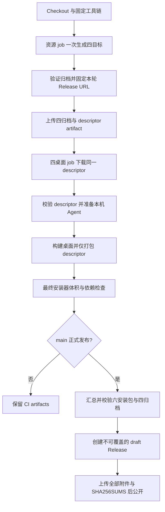

# GitHub 桌面与远程资源发布规格

## 目标与边界

GitHub Actions 为 Windows/macOS 的 ARM64、x64 构建桌面安装包；远程 Source Server 归档从桌面安装包移出，四个桌面目标共享同轮生成的四目标 descriptor。普通本地构建默认继续携带完整离线资源；仅设置 `ZCODE_REMOTE_ASSET_DESCRIPTOR_ONLY=1` 的发行构建启用轻量模式。

## 发布身份与唯一所有者

- 资源 job 是本轮 Source Server 归档与 descriptor 的唯一生成者，使用现有 `prepare:remote-assets` 一次生成四个目标；桌面 job 不重新生成资源。
- 本轮发布身份为 `build-<run_number>-<run_attempt>`，descriptor 将每个 archive URL 固定到本仓库对应标签下的附件。不能依赖 `latest` 或只按应用 semver 选择资源。
- descriptor 沿用共享 schema，包含当前版本、四个唯一目标、文件名、字节数和 SHA-256；固定 URL 前必须验证本轮真实归档。桌面 job 下载同一份 descriptor，并再次验证版本、完整目标与固定 URL。
- 独立远程附件继续执行每目标 112 MiB、总量 400 MiB 的资源预算；拆出桌面包不意味着放宽远程附件限制。
- 同一次发布收集四个远程归档、一份 descriptor、macOS 两个架构的 DMG/ZIP 和 Windows 两个架构的 EXE，共十一项资源；完整性与摘要检查通过后创建 draft Release，上传校验清单，最后公开。
- 不覆盖已公开的 Release。重跑得到新的 attempt 标签，即使应用版本未变也不串用另一轮构建的缓存。已存在的同名标签应失败，不能静默 `--clobber`。

## 构建顺序

- 本地完整模式继续先构建远程服务，再准备桌面 Agent 与插件，避免 Server 构建清空刚生成的桌面 Agent 暂存目录。
- 轻量模式必须先下载并校验 descriptor，然后只准备当前桌面目标的本地 Agent、插件、原生工具和 helper。
- bundle 统一执行一次 `prepare:runtime-assets`，后续仅调用 `build:no-runtime-assets`；`--skip-prepare` 不允许经 build 再次隐式准备资源。
- 轻量 `extraResources` 只复制 `releases/<version>/source-server-release.json`，不携带任何远程 tar；本地运行依赖和现有原生资源不受此开关影响。
- PR 同样生成资源并构建四种桌面目标，但不公开 Release；其临时 descriptor 只用于验证打包，不能当作正式可下载产品分发。

## 验收

- 缺少目标、同目标重复、归档 SHA/size 错误、URL 指向其他发布或版本不匹配，均终止构建或发布。
- 轻量包中 remote-assets 只能存在当前 descriptor；最终安装器按独立固定预算审计，不再按远程归档字节增加额度。
- 脚本测试覆盖资源固定 URL、同版本不同 attempt、篡改与缺件、六安装包完整性以及 SHA256SUMS；安装器运行行为由安装态 smoke 与远程连接回归验证。
- 生产 Release 资产齐全且可下载才算发布完成；Actions 成功不替代各平台已安装应用的运行验证。
