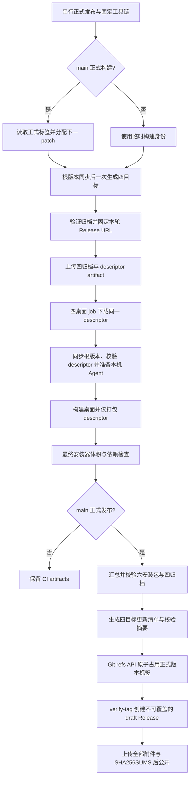

# GitHub 桌面与远程资源发布规格

## 目标与边界

GitHub Actions 为 Windows/macOS 的 ARM64、x64 构建桌面安装包；远程 Source Server 归档从桌面安装包移出，四个桌面目标共享同轮生成的四目标 descriptor。普通本地构建默认继续携带完整离线资源；仅设置 `ZCODE_REMOTE_ASSET_DESCRIPTOR_ONLY=1` 的发行构建启用轻量模式。

## 发布身份与唯一所有者

- 资源 job 是本轮 Source Server 归档与 descriptor 的唯一生成者，使用现有 `prepare:remote-assets` 一次生成四个目标；桌面 job 不重新生成资源。
- 正式应用版本从 `1.0.0` 起。每轮新的正式构建由资源 job 唯一分配版本：查询本仓库全部 `v1.0.<patch>` Git 标签，无则使用 `1.0.0`，否则使用最大 patch 加一；标签为 `v<version>`。发布流程按仓库串行，不取消正在执行的正式构建，避免同一版本被并发分配。
- 版本分配后只在 CI 工作区更新根 `package.json`；四种桌面目标与最终发布 job 从同一资源 job 输出恢复版本，不重新计算。Desktop metadata、Vite、Host、Server 编译常量及资源目录从根版本派生，独立 Agent CLI 包版本不在此流程修改。
- `rerun failed jobs` 继续使用先前成功资源 job 的版本与清单；重跑全部 job 时重新查询标签。完整性校验后通过 GitHub Git refs API 原子创建 `v1.0.N` 指向当前提交，再用 `--verify-tag` 创建 draft；即使后续上传失败，标签也已占用，下一轮自动跳到新 patch。已公开版本和已占用标签不得覆盖，失败不公开 Release。
- 若失败发生在标签占用后，仅重跑 publish 会明确失败并提示重跑全部 job 分配新 patch；不自动删除或覆盖旧标签、草稿或附件，不能把半成品当作最新正式版本。
- PR 使用当前根版本和临时 `build-<run_number>-<run_attempt>` 身份，不分配或发布正式版本。历史 `build-*` Release 的资源 URL 保持有效；正式 descriptor 将 archive URL 固定到本仓库 `v1.0.N` 标签下，不能运行时用 `latest` 选择远程资源。
- descriptor 沿用共享 schema，包含当前版本、四个唯一目标、文件名、字节数和 SHA-256；固定 URL 前必须验证本轮真实归档。桌面 job 下载同一份 descriptor，并再次验证版本、完整目标与固定 URL。
- 独立远程附件继续执行每目标 112 MiB、总量 400 MiB 的资源预算；拆出桌面包不意味着放宽远程附件限制。
- 同一次发布收集四个远程归档、一份 descriptor、macOS 两个架构的 DMG/ZIP 和 Windows 两个架构的 EXE，先验证十一项输入，再从真实安装包生成 `ycode-update.json`；完整性与摘要检查通过后创建 draft Release，上传全部附件和校验清单，最后公开。
- 更新清单格式为 `{schemaVersion:1,version,releaseUrl,assets}`。`assets` 精确包含 darwin/win32 的 arm64/x64 四种目标；各项字段为 `platform`、`arch`、`fileName`、`url`、`size`、`sha256`，macOS 使用 DMG、Windows 使用 EXE。URL 固定当前 Release，size/SHA 从本轮真实文件生成。
- `SHA256SUMS` 覆盖六安装包、四远程归档、descriptor 和更新清单十二件内容。正式 Release 总计十三附件；GitHub `latest/download/ycode-update.json` 只用于发现最新应用版本，远程资源下载仍固定应用随包 descriptor。
- 不覆盖已公开的 Release、同名 Git 标签或失败草稿；检测到冲突时失败，不能静默 `--clobber`。

## 构建顺序

- 本地完整模式继续先构建远程服务，再准备桌面 Agent 与插件，避免 Server 构建清空刚生成的桌面 Agent 暂存目录。
- 轻量模式必须先下载并校验 descriptor，然后只准备当前桌面目标的本地 Agent、插件、原生工具和 helper。
- bundle 统一执行一次 `prepare:runtime-assets`，后续仅调用 `build:no-runtime-assets`；`--skip-prepare` 不允许经 build 再次隐式准备资源。
- 轻量 `extraResources` 只复制 `releases/<version>/source-server-release.json`，不携带任何远程 tar；本地运行依赖和现有原生资源不受此开关影响。
- PR 同样生成资源并构建四种桌面目标，但不公开 Release；其临时 descriptor 只用于验证打包，不能当作正式可下载产品分发。

## 验收

- 缺少目标、同目标重复、归档 SHA/size 错误、URL 指向其他发布或版本不匹配，均终止构建或发布。
- 轻量包中 remote-assets 只能存在当前 descriptor；最终安装器按独立固定预算审计，不再按远程归档字节增加额度。
- 脚本测试覆盖首次 1.0.0、最大 patch 递增、标签过滤、跨 job 版本恢复、固定 URL、旧 build URL、篡改与缺件、六安装包完整性、四目标更新清单与摘要；安装器运行行为由安装态 smoke 与远程连接回归验证。
- 生产 Release 资产齐全且可下载才算发布完成；Actions 成功不替代各平台已安装应用的运行验证。
