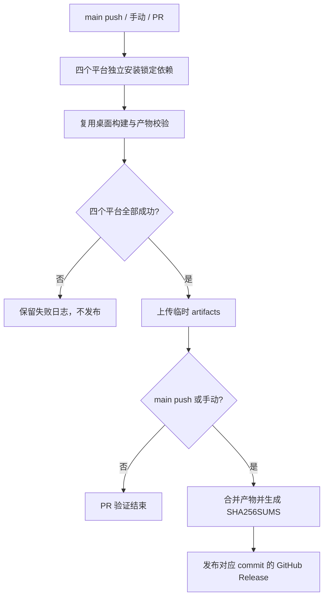

# GitHub 桌面构建与发布

## 产品规则

- 对外产品名为 YCode，唯一开发分支为 main。推送 main 或手动运行时构建 macOS ARM64、macOS x64、Windows ARM64、Windows x64。
- 四个目标各自在对应系统及架构的 GitHub 托管 runner 构建，固定 Node.js 24.14.0、pnpm 10.33.2，锁文件安装。构建使用 production 产品身份。
- 复用 `bundle:desktop`、现有原生工具及远程资源生成流程，不创建第二套打包实现。远程资源生成中的 pnpm 子进程复用打包命令执行器，通过当前包管理器的 JS 入口启动，避免 Windows `.cmd` 被直接 spawn 导致 ENOENT。
- PR 只构建与上传临时 artifact；仅 main 的 push/workflow_dispatch 可以发布 GitHub Release。四个平台全部成功后才发布，任意失败不得发布不完整版本。
- 每次运行使用独立 build 标签，发布 DMG、ZIP、EXE 与 SHA256SUMS。Release 指向触发构建的 commit，产物保留架构名；artifact 缺失视为失败。
- 无签名证书时不尝试读取开发者本机身份。README 明确说明未签名 macOS 安装方式与 `sudo xattr -rd com.apple.quarantine "/Applications/YCode.app"`。

## 所有者及顺序

GitHub Actions 是矩阵执行与 Release 发布的唯一所有者；构建脚本负责生成与校验当前目标的安装包；README 的图片取自实际界面，隐藏私人项目与会话内容。

## 验收

1. 四个平台 job 真实成功，Release 包含两种架构的 macOS DMG/ZIP 和 Windows EXE。
2. Windows 远程资源准备经过真实 pnpm JS 入口，带空格路径与非零退出码由回归测试覆盖。
3. PR 不写 Release；非 main 的手动运行不发布；下载链接使用仓库真实 Releases 地址。
4. 本地 typecheck、lint、架构及受影响测试报告真实结果；安装包构建成功不替代安装启动验收。
