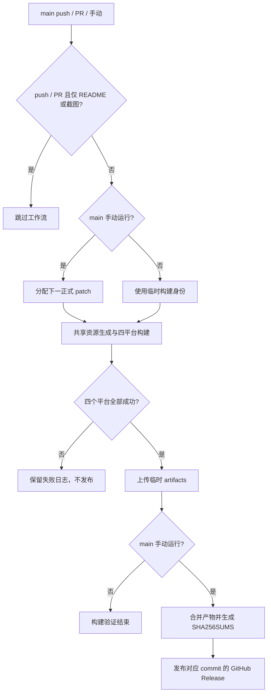

# GitHub 桌面构建与发布

## 产品规则

- 对外产品名为 YCode，当前 GitHub 主线为 main。main 的 push、以 main 为目标的 PR 和手动运行均可构建 macOS ARM64、macOS x64、Windows ARM64、Windows x64。
- push / PR 仅修改根目录 `README.md`、`README.*.md` 或 `docs/images/readme/**` 时跳过整条构建工作流；混合代码改动仍构建。过滤范围不扩展到其他文档、技能或运行时资源，避免漏掉产品输入变化。手动运行不受路径过滤影响。
- 四个目标各自在对应系统及架构的 GitHub 托管 runner 构建，固定 Node.js 24.14.0、pnpm 10.33.2，锁文件安装。构建使用 production 产品身份。
- 复用 `bundle:desktop`、现有原生工具及远程资源生成流程，不创建第二套打包实现。远程资源生成中的 pnpm 子进程复用打包命令执行器，通过当前包管理器的 JS 入口启动，避免 Windows `.cmd` 被直接 spawn 导致 ENOENT。
- push、PR 和非 main 的手动运行只构建与上传临时 artifact，不分配正式版本、不创建标签或 Release。正式发版仅允许在 GitHub Actions 的 `Build and release YCode` 页面点击 `Run workflow` 并选择 main；推送版本标签不触发此工作流。
- main 的手动运行在 `package.json` 的 `1.<minor>` 发版线上分配下一正式 patch 版本（新线从 `.0` 起，已有更高发版线的正式标签时拒绝分配，见 ADR 0005）；四个平台全部成功后才发布 DMG、ZIP、EXE 与 SHA256SUMS。Release 指向触发构建的 commit，产物保留架构名；artifact 缺失视为失败，不得发布不完整版本。
- 并发组区分事件与 ref，push / PR 可取消各自旧构建；main 的手动发版不因普通推送而取消，同组正式发版串行执行，复用现有版本分配及不可覆盖发布机制。
- 无签名证书时不尝试读取开发者本机身份。README 明确说明未签名 macOS 安装方式与 `sudo xattr -rd com.apple.quarantine "/Applications/YCode.app"`。

## 所有者及顺序

GitHub Actions 是矩阵执行与 Release 发布的唯一所有者；构建脚本负责生成与校验当前目标的安装包；README 的图片取自实际界面，隐藏私人项目与会话内容。

## 验收

1. 四个平台 job 真实成功，Release 包含两种架构的 macOS DMG/ZIP 和 Windows EXE。
2. Windows 远程资源准备经过真实 pnpm JS 入口，带空格路径与非零退出码由回归测试覆盖。
3. main 的 push、PR、非 main 的手动运行均不分配正式版本或写 Release；只有 main 的手动运行允许发布；下载链接使用仓库真实 Releases 地址。
4. 本地 typecheck、lint、架构及受影响测试报告真实结果；安装包构建成功不替代安装启动验收。
5. 根 README、翻译 README、README 截图及它们的组合改动不触发 push / PR 构建；混入源代码、工作流、其他文档或运行时资源改动时正常构建；main 手动运行不受过滤影响。
6. 版本分配与 publish 使用相同的正式发版条件；普通构建与正式发版使用不同并发组，连续手动发版不取消正在执行的正式发版。
