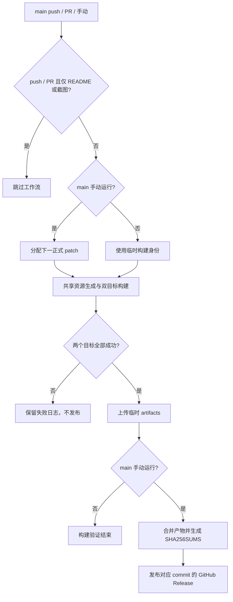

# GitHub 桌面构建与发布

## 产品规则

- 对外产品名为 YCode，当前 GitHub 主线为 main。main 的 push、以 main 为目标的 PR 和手动运行仅构建 macOS ARM64、Windows x64；不再构建 macOS x64 和 Windows ARM64 桌面安装包。远程 Source Server 的四目标资源不受桌面矩阵收缩影响。
- push / PR 仅修改根目录 `README.md`、`README.*.md` 或 `docs/images/readme/**` 时跳过整条构建工作流；混合代码改动仍构建。过滤范围不扩展到其他文档、技能或运行时资源，避免漏掉产品输入变化。手动运行不受路径过滤影响。
- 两个目标在对应系统的 GitHub 托管 runner 构建，固定 Node.js 24.14.0、pnpm 10.33.2，锁文件安装。构建使用 production 产品身份。
- 复用 `bundle:desktop`、现有原生工具及远程资源生成流程，不创建第二套打包实现。远程资源生成中的 pnpm 子进程复用打包命令执行器，通过当前包管理器的 JS 入口启动，避免 Windows `.cmd` 被直接 spawn 导致 ENOENT。
- push、PR 和非 main 的手动运行只构建与上传临时 artifact，不分配正式版本、不创建标签或 Release。正式发版仅允许在 GitHub Actions 的 `Build and release YCode` 页面点击 `Run workflow` 并选择 main；推送版本标签不触发此工作流。
- main 的手动运行在 `package.json` 的 `1.<minor>` 发版线上分配下一正式 patch 版本（新线从 `.0` 起，已有更高发版线的正式标签时拒绝分配，见 ADR 0005）；两个目标全部成功后才发布 DMG、ZIP、EXE 与 SHA256SUMS。Release 指向触发构建的 commit，产物保留架构名；artifact 缺失视为失败，不得发布不完整版本。
- 正式标签可由维护者用本机 `gh` 预建：已指向本次提交则 publish 直接复用，指向其他提交时失败；不存在才由 workflow 令牌创建。托管 runner 之外，也可在预建标签上触发 `build-macos-local.yml` 与 `build-windows-local.yml` 两个本机构建，由维护者本机生成清单并发布，步骤见下文。
- 并发组区分事件与 ref，push / PR 可取消各自旧构建；main 的手动发版不因普通推送而取消，同组正式发版串行执行，复用现有版本分配及不可覆盖发布机制。
- 无签名证书时不尝试读取开发者本机身份。README 明确说明未签名 macOS 安装方式与 `sudo xattr -rd com.apple.quarantine "/Applications/YCode.app"`。

## 所有者及顺序

GitHub Actions 是矩阵执行与 Release 发布的唯一所有者；构建脚本负责生成与校验当前目标的安装包；README 的图片取自实际界面，隐藏私人项目与会话内容。



## 本机 runner 发布步骤

适用于托管 runner 不可用或 `GITHUB_TOKEN` 无法创建标签（HTTP 403）时，仅用两台本机 runner 发布。以下以 1.4.2 为例，命令在维护者本机执行，需已 `gh auth login` 且对仓库有写权限；PowerShell 写法，bash 把 `$env:X='v'` 换成 `export X=v`。

1. 合并版本 PR 后确认 main 的版本号：

   ```powershell
   git fetch origin
   git show origin/main:package.json | Select-String '"version"'   # 必须是 1.4.2
   $sha = git rev-parse origin/main
   ```

2. 预建标签（只建一次，从不覆盖）。若提示缺少 workflow 权限，先 `gh auth refresh -s workflow`：

   ```powershell
   gh api --method POST repos/OpenX123/ZCode/git/refs -f ref=refs/tags/v1.4.2 -f sha=$sha
   gh api repos/OpenX123/ZCode/git/ref/tags/v1.4.2 --jq .object.sha   # 必须等于 $sha
   ```

3. 确认两台 runner 在线且标签匹配（`zcode-macos` / `ycode-windows`）：

   ```powershell
   gh api repos/OpenX123/ZCode/actions/runners --jq '.runners[] | [.name, .status, (.labels | map(.name) | join(","))] | @tsv'
   ```

4. 在标签 ref 上触发 Mac 构建（同时生成远程资源与 descriptor），记下 run id：

   ```powershell
   gh workflow run build-macos-local.yml --repo OpenX123/ZCode --ref v1.4.2
   gh run list --repo OpenX123/ZCode --workflow build-macos-local.yml --branch v1.4.2 --limit 1 --json databaseId,headSha,status
   $macRun = <上一条输出的 databaseId>
   ```

5. 等 Mac run 上传 descriptor 后（下列命令能列出 `source-server-descriptor-v1.4.2`）触发 Windows 构建：

   ```powershell
   gh api repos/OpenX123/ZCode/actions/runs/$macRun/artifacts --jq '.artifacts[].name'
   gh workflow run build-windows-local.yml --repo OpenX123/ZCode --ref v1.4.2 -f source_run_id=$macRun
   gh run list --repo OpenX123/ZCode --workflow build-windows-local.yml --branch v1.4.2 --limit 1 --json databaseId,headSha,status
   $winRun = <上一条输出的 databaseId>
   gh run watch $macRun --repo OpenX123/ZCode --exit-status
   gh run watch $winRun --repo OpenX123/ZCode --exit-status
   ```

6. 在标签处的独立工作树下载产物（脚本按该处 `package.json` 取版本）：

   ```powershell
   git worktree add ..\ycode-v1.4.2 v1.4.2
   Set-Location ..\ycode-v1.4.2
   pnpm install --frozen-lockfile
   gh run download $macRun --repo OpenX123/ZCode -n source-server-resources-v1.4.2 -D release-assets
   gh run download $macRun --repo OpenX123/ZCode -n ycode-mac-arm64-v1.4.2 -D release-assets
   gh run download $winRun --repo OpenX123/ZCode -n ycode-win-x64-v1.4.2 -D release-assets
   ```

7. 校验八项输入并生成 `ycode-update.json` 与 `SHA256SUMS`，确认目录恰有十个文件（DMG、ZIP、EXE、四个 `zcode-server-*.tar.gz`、`source-server-release.json`、`ycode-update.json`、`SHA256SUMS`）：

   ```powershell
   $env:GITHUB_REPOSITORY = 'OpenX123/ZCode'
   $env:RELEASE_TAG = 'v1.4.2'
   node scripts/github-release-assets.mjs verify-release --directory release-assets
   Get-ChildItem release-assets -File | Select-Object Name, Length
   Get-Content release-assets/ycode-update.json
   ```

8. 先建 draft 上传全部附件，再公开并标为 Latest（PowerShell 不会展开 `release-assets/*`，需显式列出文件）：

   ```powershell
   $assets = (Get-ChildItem release-assets -File).FullName
   gh release create v1.4.2 @assets --repo OpenX123/ZCode --verify-tag --draft --title "YCode v1.4.2" --notes "由本机 runner 从提交 $sha 构建。包含 macOS ARM64 与 Windows x64 安装包，以及按需下载的四平台远程资源。macOS x64 与 Windows ARM64 需从本页手动下载。"
   gh release edit v1.4.2 --repo OpenX123/ZCode --draft=false --latest
   ```

9. 发布后核对：

   ```powershell
   gh release view v1.4.2 --repo OpenX123/ZCode --json isLatest,isDraft,assets --jq '{isLatest, isDraft, count: (.assets | length)}'
   curl.exe -sL https://github.com/OpenX123/ZCode/releases/latest/download/ycode-update.json
   ```

也可在第 2 步后改用托管流程：`gh workflow run build.yml --repo OpenX123/ZCode --ref main`。资源 job 发现 `v1.4.2` 已指向当前 main 且未公开，会复用该版本；publish 直接使用已有标签，不再用 `GITHUB_TOKEN` 创建 ref。

## 验收

1. 两个目标 job 全部成功才发布；Release 严格包含 macOS ARM64 DMG/ZIP、Windows x64 EXE、四份远程归档、descriptor、两目标更新清单及 SHA256SUMS，共十份附件。缺少当前安装包或混入已移除架构安装包均拒绝发布。
2. Windows 远程资源准备经过真实 pnpm JS 入口，带空格路径与非零退出码由回归测试覆盖。
3. main 的 push、PR、非 main 的手动运行均不分配正式版本或写 Release；只有 main 的手动运行允许发布；下载链接使用仓库真实 Releases 地址。
4. 本地 typecheck、lint、架构及受影响测试报告真实结果；安装包构建成功不替代安装启动验收。
5. 根 README、翻译 README、README 截图及它们的组合改动不触发 push / PR 构建；混入源代码、工作流、其他文档或运行时资源改动时正常构建；main 手动运行不受过滤影响。
6. 版本分配与 publish 使用相同的正式发版条件；普通构建与正式发版使用不同并发组，连续手动发版不取消正在执行的正式发版。
