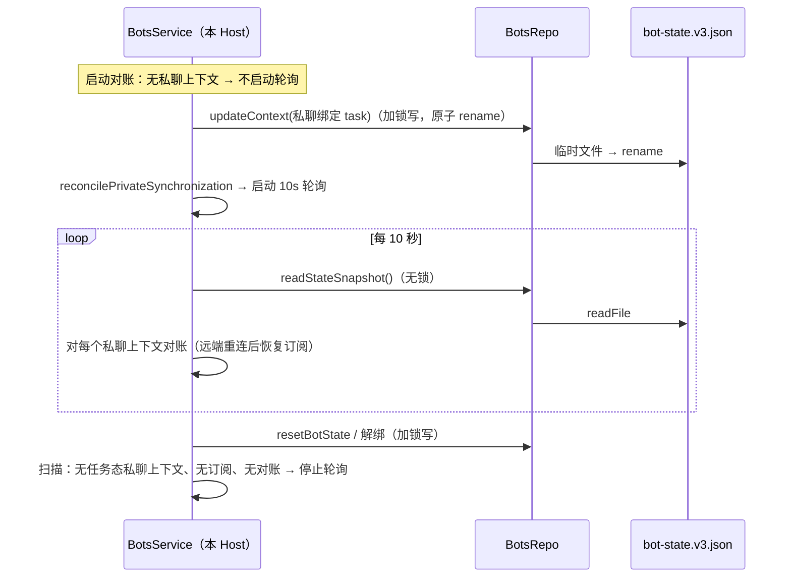
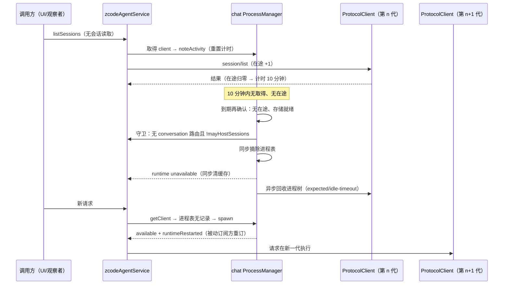
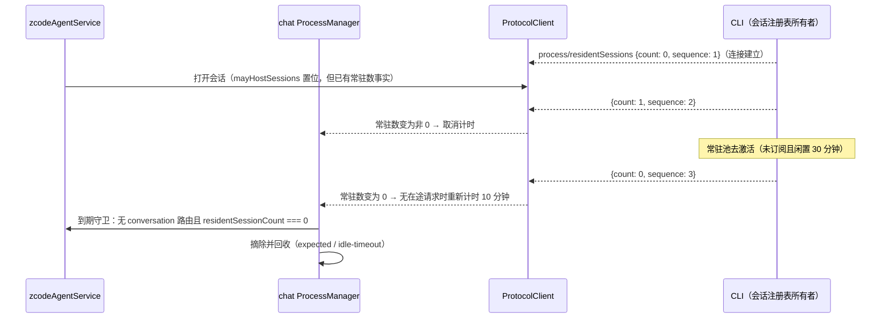
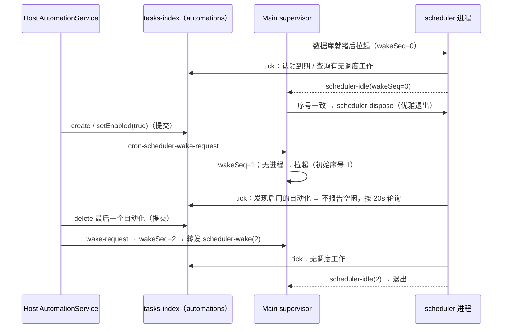

# Host 闲置资源回收与启动关键路径（1.1）

日期：2026-11-08。决策来源：2026-11-08 Windows 本机性能扫描（安装版 1.1.0）中由用户拍板的 P2（Host 启动部分）、P3（Host 部分）、P5（Host 部分）、P6。本文只写落地规则、状态所有者、事件顺序与验收；CLI 侧（外部引擎、草稿、常驻池）与 Renderer 侧（合并重复读取、只为可见工作区启动 CLI）不在本文范围。

## 证据（2026-11-08，本机）

| 项                 | 实测                                                                                                   |
| ------------------ | ------------------------------------------------------------------------------------------------------ |
| P6 私聊恢复轮询    | 本机没有任何机器人，`bot-state.v3.json` 仅 33 字节，`.lock` 仍每 10.0s 创建删除一次                    |
| P5 `getBotStates`  | 窗口打开 12 次并发读取在同一文件锁上排队，耗时 0.21→1.94s 阶梯                                         |
| P3 常驻进程        | 6 个工作区 CLI 约 1.0GB 无闲置回收；插件管理 CLI 160MB 闲置 14.5h；cron scheduler 112MB 无条件常驻     |
| P2 Host 启动       | Host fork → `initializing local services` 2.3–4.3s，期间没有任何分阶段日志                             |
| P2 存储准备 Worker | 单次加载 14.6MB `zcode.cjs` 到发出 `startup/storagePath` 约 0.95–1.05s（Electron 41 Node 24.14，本机） |

## 1. Bot 状态只读路径（P5、P6）

### 规则

- `bot-state.v3.json` 的唯一所有者是 `BotsRepo`。所有写入（`writeState`、`updateContext`、旧版本迁移）都在文件锁内完成，并以"同目录临时文件写完 → `rename` 覆盖"原子替换（`atomicWritePrivateTextFile`）。
- 新增只读快照 `BotsRepo.readStateSnapshot()`：v3 文件存在时**不加文件锁**直接读取并按 schema 校验。论证：写入方只用原子 `rename` 替换整个文件，读者只能看到替换前或替换后的完整内容，不存在半写；文件锁只用于写-写互斥与"读改写"的原子性，单纯读取不需要它。
  - v3 文件不存在（需要迁移或首次创建）时回到加锁的 `readState()`，迁移仍在锁内固定结果。
  - Windows 上读取恰好撞上替换窗口返回 `EPERM` / `EBUSY` / `EACCES` 时，同样回到加锁读取（锁内不会与写入并发），不重试、不等待。
- 只读路径使用快照：`getBotStates()`、私聊恢复轮询的状态扫描。读后会写回的路径（`serializeStateWrite` 内、`restorePrivateSynchronization` 等）保持加锁读取，避免扩大读改写的丢失更新窗口。
- 没有任何机器人上下文时，`getBotStates()` 读一次小文件后直接返回空数组，不再进入文件锁队列。

### 私聊恢复轮询只在需要时运行

- 所有者：每个 Host 的 `BotsService`。轮询间隔仍是 10 秒，语义不变（只检查既有远端连接并恢复可用订阅，不主动重连）。
- "需要恢复"定义为以下任一成立：
  1. 状态中存在任务态私聊上下文（非群、`mode === "task"`、有 `activeTaskId`）；
  2. 本进程持有私聊订阅（`privateWatches` 非空）；
  3. 本进程有进行中的私聊对账。
- 启动轮询（幂等）：任意一次私聊对账请求开始时（启动对账、写入上下文、改配置、自动化回推、重置状态都会调用 `reconcilePrivateSynchronization`），以及建立私聊订阅时。
- 停止轮询：某次扫描结束时上述三项都不成立。
- 只在本地桌面 Host（`runStartupBackgroundTasks`）运行；desktop-attached remote Host 不轮询，与原来一致。
- 跨进程边界：其它窗口 Host 新写入的私聊上下文，本 Host 在下一次本地对账触发或重启后才开始轮询（原来每个 Host 无条件轮询）。私聊订阅由处理入站消息的 Host 在写入上下文后立即对账建立，不依赖其它 Host 的轮询。

### 验收

| Case  | 场景                                          | 断言                                     | 验证层        |
| ----- | --------------------------------------------- | ---------------------------------------- | ------------- |
| BOT01 | 没有机器人，Host 运行 30 秒                   | 启动后不再读取状态文件                   | services 单测 |
| BOT02 | 远端私聊上下文初始未连接，随后连接            | 10 秒内恢复订阅                          | services 单测 |
| BOT03 | 私聊上下文被重置                              | 下一次扫描后停止轮询，之后 30 秒不再读取 | services 单测 |
| BOT04 | 状态文件锁被其它持有者占用时调用 getBotStates | 不等待锁即返回                           | services 单测 |
| BOT05 | 只有旧版状态文件时读取快照                    | 经加锁迁移写出 v3                        | services 单测 |

## 2. 会话通道工作区 CLI 闲置回收（P3）

### 规则

- 进程所有者：`zcodeAgentService` 的 chat 泳道 `ZCodeAgentProcessManager`（按 `workspaceIdentity?.trim() || workspacePath` 一个进程）。回收复用已有的空闲回收机制（`idleTimeoutMs`，原只给 mcp-status 泳道）。
- 回收条件：同一个 CLI **持续 10 分钟**同时满足：
  1. 没有在途业务请求（`pendingOperationRequestCount === 0`；观测类请求不计，也不续期）；
  2. Host 侧没有该 workspace 的会话订阅（`v4SubscriptionRoutes` 中没有 `conversation/` topic 的路由）；
  3. 该 CLI 没有常驻会话；
  4. 存储启动不在等待中。
     到期时由 manager 同步再确认 1、4 并调用 service 提供的守卫确认 2、3；任一不满足则不回收，等下一次请求归零重新计时。
- "没有会话订阅"的判定来源：Host 只有两条建立会话订阅的路径——v4 `conversation/subscribe`（成功后登记到 `v4SubscriptionRoutes`）与旧 `session/subscribe`（参数带 `sessionId`）。两者都是带会话的请求，发送时即让该 CLI 进入下条"可能承载会话"状态，因此守卫同时检查路由表与会话承载事实，不存在"有订阅却判为可回收"的组合。sessions-index 与 workspace-config 订阅不算会话订阅（见下）。
- "没有常驻会话"的判定来源：CLI 目前没有向 Host 暴露常驻会话数（常驻池只写本机日志），Host 不能观察 CLI 何时卸载会话。因此 Host 采用**失败关闭**的近似：`ZCodeProtocolClient` 记录本连接是否发送过任何"可能让会话常驻"的业务请求（`mayHostSessions`，单调置位）。判定沿用 CLI 传输层的会话分道规则：参数里带 `sessionId`、`conversation/` topic、命令信封或 `createSession` 预留会话 ID 的请求，以及不在"无会话方法"白名单内的任何方法，都会置位；只有白名单内且不带会话标识的请求不置位。白名单：`workspace/readPresentation`、`session/list`、`provider/refreshRegistry`、三个 `workspace/update*Preferences|Policy`、插件/技能/工作流目录读取、用量、进程与能力查询、`v4/sessionsIndex/reconcile`、`v4/connection/flow`、`v4/usage/stats`、`v4/commands/query`（`clock: true`），以及 topic 为 `sessions-index/` 或 `workspace-config/` 的订阅/重同步/退订。
  - 结果：承载过会话（打开过会话、预热过草稿、发过命令）的 CLI 在本代进程内不会被 Host 回收；只服务过工作区展示、任务列表等无会话读取的 CLI 会被回收。
  - 2026-11-08 起该近似只用于旧 CLI，见下条。
- 常驻会话数事实（2026-11-08，取代上条近似）：CLI 发通知 `process/residentSessions` `{ residentSessionCount, sequence }`（连接建立时发一次当前值，之后会话注册表 record 数每变化一次发一次，含草稿；协议见 `apps/zcode-cli/docs/design/v2/zcode-protocol-agent-server.md`「常驻会话数通知」）。
  - `ZCodeProtocolClient` 以 `zcodeResidentSessionsNotificationSchema` 校验并保存最近一条（`sequence` 不大于已收值的通知丢弃）；不合法的通知忽略，不改变已知值。
  - 守卫：已收到通知时，条件 3 用 `residentSessionCount === 0` 判定，不再看 `mayHostSessions`（条件 1、2、4 不变）；收到第一条之前（含旧 CLI 永不发送）常驻数未知，沿用上条 `mayHostSessions` 近似，失败关闭。
  - 计时：常驻数变为 0 时 chat 泳道 manager 重新开始 10 分钟计时（无在途请求时），常驻池卸载全部会话后无需新请求即可回收；变为非 0 时立即取消计时。到期判定与回收动作同上。
- 活动续期：Host 每次取得该 CLI 的 client（包括 service 缓存命中与 `existing-only` 观察者读取）都视为活动，重置 10 分钟计时。这样"取得 client → 其它异步准备 → 发请求"之间的空档不会被回收打断（空档需要超过 10 分钟才可能撞上）。
- 回收动作与原 idle-timeout 相同：先同步从进程表摘除并发布 runtime `unavailable`（service 同步清理该 client 的缓存与挂起表），再异步回收进程树，退出归因 `expected / idle-timeout`。
- 回收后：sessions-index / workspace-config 等被动订阅方（任务索引同步器、窗口 sessions-index 观察器、UI 列表）只使用 `existing-only`，收到 `unavailable` 后挂起，不会为此拉起进程；下一次需要 CLI 的操作按现有方式拉起新一代进程，新进程 spawn 后发布 `available` 与 `runtimeRestarted`，被动订阅方按已有换代重订路径恢复。
- 不改变 CLI 拉起的触发方。

### 状态所有者

| 状态                       | 唯一所有者                                                                  | 其他层                                               |
| -------------------------- | --------------------------------------------------------------------------- | ---------------------------------------------------- |
| 进程表、闲置计时、回收动作 | chat 泳道 `ZCodeAgentProcessManager`                                        | service 通过 `noteActivity` 续期、守卫回调确认       |
| 在途业务请求数             | `ZCodeProtocolClient`（`pending`）                                          | manager 只读                                         |
| 本连接是否可能承载会话     | `ZCodeProtocolClient`（`mayHostSessions`）                                  | service 守卫只读（仅未收到常驻数时）                 |
| 常驻会话数（最近一条通知） | CLI 会话注册表；Host 副本在 `ZCodeProtocolClient`（`residentSessionCount`） | service 守卫只读；manager 订阅变化重新计时或取消计时 |
| 会话订阅路由               | `zcodeAgentService` 的 `v4SubscriptionRoutes`                               | service 守卫只读                                     |
| service client 缓存        | `activeClientsByWorkspaceKey`                                               | 由 runtime `unavailable` 事件同步失效                |

### 事件顺序（回收与新请求并发）

- 幂等边界：回收判定与摘除在同一同步片内完成；摘除之后到达的任何取得都只会看到"无进程"并拉起新一代，不会拿到已回收的 client。取得发生在摘除之前的调用方，其计时已被续期，回收不会在 10 分钟内发生。
- 失败关闭：守卫不确定（会话承载事实已置位、存在会话路由、守卫抛错）时一律不回收。
- 已知边界：调用方若在取得 client 后超过 10 分钟才发出第一个请求，会拿到已回收的 client 并失败；Host 内所有取得到请求之间只有有界的异步准备（注册表刷新、150ms 浏览器上下文、本地索引读取），不存在这种调用方。

常驻会话数驱动的回收（2026-11-08）：

### 验收

| Case   | 场景                                              | 断言                                                                      | 验证层              |
| ------ | ------------------------------------------------- | ------------------------------------------------------------------------- | ------------------- |
| IDLE01 | 只做过 `session/list` 的工作区 CLI 闲置           | 回收（expected / idle-timeout），先 unavailable；下次请求拉起新一代       | services 单测       |
| IDLE02 | 发过带 sessionId 的请求后闲置                     | 不回收                                                                    | services 单测       |
| IDLE03 | 守卫拒绝 → 事实变化后 `noteActivity`              | 先不回收，续期后回收                                                      | services 单测       |
| IDLE04 | 闲置计时内再次取得 client                         | 从最后一次取得重新计时                                                    | services 单测       |
| IDLE05 | 请求分类                                          | 无会话读取不置位；会话标识、`createSession`、未知方法置位；观测请求不置位 | services 单测       |
| IDLE06 | 插件管理通道闲置                                  | 回收后下一次插件请求重新拉起                                              | services 单测       |
| IDLE07 | 真实桌面：打开 6 个工作区、只浏览不进会话 10 分钟 | 未承载会话的工作区 CLI 退出，任务列表在再次使用时恢复                     | 待真实 Windows 验证 |
| IDLE08 | 已收到常驻数 0，连接发过会话请求                  | 回收（不再按 `mayHostSessions` 失败关闭）                                 | services 单测       |
| IDLE09 | 已收到常驻数 > 0，连接只发过无会话读取            | 不回收                                                                    | services 单测       |
| IDLE10 | 常驻数由 1 变 0，此后没有任何请求                 | 闲置窗口后回收；变为非 0 时取消计时                                       | services 单测       |
| IDLE11 | 通知解析                                          | 保存最近一条；`sequence` 回退与不合法的通知被忽略                         | services 单测       |

## 3. 插件管理通道 CLI 闲置回收（P3）

- 插件管理泳道（`plugins/*` 管理命令与全局工作流载体）启用同一套 10 分钟空闲回收；不需要额外守卫：安装、卸载、更新等命令都是请求-响应，执行期间是在途请求，计时不会到期；回收后下一次插件管理请求透明拉起。
- MCP 状态泳道保持 5 分钟空闲回收不变。

## 4. 定时任务调度器按需运行（P3）

### 规则

- 自动化启用状态的唯一所有者：tasks-index 中的 `automations` / `automation_runs` 表（`AutomationRepo`）。不在 Main 或 Host 另建计数或缓存。
- 写入方：Host 的 `AutomationService`（UI 管理、CronCreate、Bot 等全部经它）与 scheduler 进程自身（认领、结算）。
- 调度器进程生命周期所有者：Main 的 cron scheduler supervisor。
- "有调度工作"= 存在 `enabled = 1` 或 `running = 1` 的自动化，或存在 `trigger = 'manual' AND dispatch_status = 'claimed'` 的手动运行（用于崩溃恢复），或 scheduler 本进程有在途派发。
- 启动：Main 在本地数据库准备完成后拉起 scheduler（与原来相同），scheduler 首轮照常处理错过窗口、僵尸认领与到期派发。
- 退出：scheduler 每轮 tick 末尾在没有新唤醒待处理时查询"有调度工作"；没有则向 Main 报告 `scheduler-idle`（附带该次查询前已收到的最大唤醒序号）。Main 只在序号等于自己发出的最新唤醒序号时让 scheduler 优雅退出（与退出流程相同：释放认领、关库）。
- 唤醒：`AutomationService` 每次成功新建、编辑、删除、启停、重启、立即运行后，Host 向 Main 发送已有的 `cron-scheduler-wake-request`（提交已在 SQLite 落盘之后才发送）。Main 递增唤醒序号：scheduler 运行中则转发唤醒；已退出则以当前序号拉起新进程；正在空闲退出则在退出后立即重新拉起。
- scheduler 意外退出后不自动拉起，下一次唤醒时重新拉起（原来要等应用重启）。

### 事件顺序

- 竞态：scheduler 的查询若早于某次提交，对应唤醒的序号一定大于报告中的序号，Main 忽略这次空闲报告；若空闲报告先到、Main 已发出退出，随后到达的唤醒会在退出完成后重新拉起，新进程首轮读取已提交的数据。退出中的 scheduler 发出的派发请求按原规则以 transient 拒绝，认领在退出时释放，不会重复派发。

### 验收

| Case   | 场景                                  | 断言                           | 验证层        |
| ------ | ------------------------------------- | ------------------------------ | ------------- |
| CRON01 | 无自动化时启动                        | 首轮后报告空闲，Main 让其退出  | desktop 单测  |
| CRON02 | 退出后新建/启用自动化                 | 唤醒时重新拉起                 | desktop 单测  |
| CRON03 | 唤醒序号晚于空闲报告                  | 不退出                         | desktop 单测  |
| CRON04 | 空闲退出过程中收到唤醒                | 退出完成后重新拉起             | desktop 单测  |
| CRON05 | `hasSchedulerWork` 覆盖启用/在途/手动 | 各条件分别为真，全部清空后为假 | services 单测 |
| CRON06 | AutomationService 各写操作            | 成功后各通知一次，失败不通知   | services 单测 |

## 5. Host 启动关键路径（P2）

### 打点

- `createHostDatabaseStartup` 在每个阶段完成时写一条 info（`[database-startup] stage …`），字段只有阶段名、毫秒数与布尔/枚举，不含路径或正文：
  - `tasks_baseline`（tasks-index 磁盘基线）、`tasks_index`（Worker 启动到 done）、`session_cwd`（解析 spawn cwd）、`session_storage`（每个库：`workerLoadMs` 为 Worker 启动到 `startup/storagePath`，即 bundle 加载；`observeMs`、`prepareMs`、`exitMs`、`reuse`、`compileCache`）、`services_init`，以及结束时的 `completed` / `failed` 汇总（`totalMs`）。

### 缩短关键路径

- 存储准备 Worker 启用 Node 编译缓存：给该 Worker 的环境加 `NODE_COMPILE_CACHE=<数据目录>/v2/cache/node-compile-cache`。执行的代码与顺序不变，只缓存 V8 编译结果；缓存按 Node 版本与源码校验，内容不符时自动重新编译。只作用于这个 Worker 线程，不写入 Host 进程环境，也不会传给 CLI 子进程或用户命令。本机实测（Electron 41 Node 24.14，安装版 bundle）：bundle 加载 0.95–1.03s → 0.65–0.76s（第二次启动起），缓存约 1.7MB。
- 不做的优化与取舍：
  - **tasks-index 与会话库准备并行**：CLI 存储准备在发出 `startup/storagePath` 后只等待 Host 确认 30 秒；tasks-index 遇锁等待（例如升级时另一个实例持锁）可长达 60 分钟，提前启动会话库 Worker 会在此时超时失败，并改变启动页的阶段顺序与 `finalDatabase` 语义。只打点，不并行。
  - **跳过 Host 侧会话库预准备、交给 CLI 进程自己准备**：会改变"服务开放前完成迁移"的启动门禁语义，有迁移一致性风险。不做。
  - **收到 `startup/storagePrepared` 即结束 Worker**：CLI 发出该帧前已关闭会话库，但 Worker 的事件循环不会自然排空，要等 CLI 一次性退出 watchdog（1s）才以 0 退出，`exitMs` 因此约 1.0–1.3s（本机 dev bundle 实测）。Host 提前结束可省掉这段，但会改变 SILENTDB-06"只有成功关闭并退出的 Worker 可登记、仍需退出确认"的既有规则，不在本次做。建议由 CLI 侧在 `--prepare-storage` 完成后立即以退出码退出（保留退出确认语义），属于 CLI 范围。
  - **CLI 子进程编译缓存**：每个 CLI spawn→协议就绪 2.8–3.0s 中同样有约 1s bundle 编译，但 `NODE_COMPILE_CACHE` 会被 CLI 派生的 Bash/MCP 子进程继承，需 CLI 侧在派生前清理该变量后才能安全启用。留作后续。

### 验收

| Case | 场景                 | 断言                                                       | 验证层              |
| ---- | -------------------- | ---------------------------------------------------------- | ------------------- |
| ST01 | 成功启动             | 依次输出各阶段与 `completed`，字段只有数字、布尔与短枚举   | desktop 单测        |
| ST02 | tasks-index 准备失败 | 输出 `failed`（含失败阶段），不含错误正文或路径            | desktop 单测        |
| ST03 | 会话库准备 Worker    | Worker 环境带编译缓存目录，Host 进程环境不变；回报分段耗时 | desktop 单测        |
| ST04 | 真实桌面冷启动两次   | 第二次 `session_storage.workerLoadMs` 低于第一次           | 待真实 Windows 验证 |
