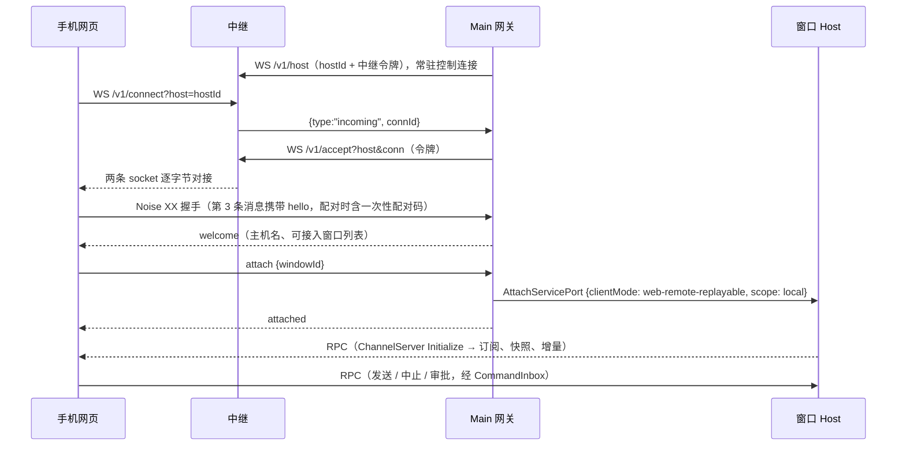
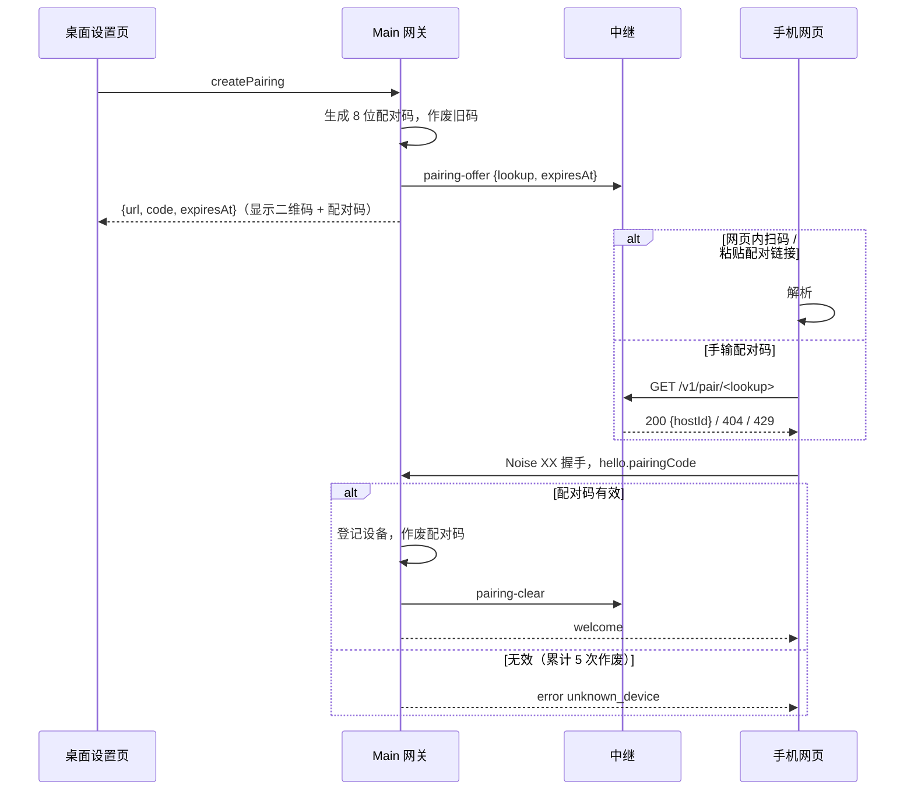

# 手机远控（自托管中继）

状态：2026-11-10 用户确认方案（自托管、网页端、直接做中继、端到端加密配对、不做常驻 Host）。

## 目标与边界

- 手机浏览器实时查看并操作**桌面窗口正在显示的同一批会话**：看对话流、发送消息、中止、回答权限审批。
- 全程自托管：中继由用户自己部署（`packages/relay`），不访问任何原厂服务，不需要产品账号。
- 手机端是网页（`packages/web` 以 `vite --base /m/` 构建的 `dist-mobile`，`main.tsx` 按 `BASE_URL === "/m/"` 进入手机启动流程），由中继同源托管，可添加到主屏幕。
- 第一版只接**本地工作区窗口**；SSH 远程工作区、关窗后继续可连（常驻 Host）不在本期范围。
- 手机不运行 Agent，也不新建第二个 runtime；会话正文与执行事实仍归 CLI，组织态归窗口 Host。

## 角色与状态所有者

| 状态                                   | 唯一所有者                   | 说明                                                                                          |
| -------------------------------------- | ---------------------------- | --------------------------------------------------------------------------------------------- |
| 会话正文、运行、CommandInbox           | CLI                          | 手机输入与桌面输入同走 CommandInbox 串行 admission                                            |
| 订阅、快照、补发                       | 窗口 Host                    | 手机以 `web-remote-replayable` attachment 接入，受 `windowHostAttachmentRpcPolicy` 白名单约束 |
| 主机密钥、已配对设备、配对码、中继配置 | Main 的 `mobile-remote` 网关 | 落盘于 `<userData>/mobile-remote/`，文件权限 0600                                             |
| 设备密钥、已配对主机列表               | 手机浏览器 localStorage      | 只存本机，不上传                                                                              |
| 连接配对与转发                         | 中继                         | 只转发密文字节，不解析内容，不落盘会话数据                                                    |

Main 网关只做转发：解密后的每条 RPC 消息原样投递到 Host attachment 端口，反向同理；不缓存、不改写、不排队业务消息。

## 连接拓扑与事件顺序

顺序约束：

1. 手机必须先完成握手并收到 `welcome`，才能发 `attach`；网关在 `attach` 之前收到的 RPC 帧直接断开连接。
2. 网关先建好端口转发、再发 `attached`；手机在发送 `attach` 前就挂好 `ChannelClient` 监听，保证不丢 Host 的 Initialize。
3. 一条手机连接只对应一个 attachment。切换窗口 = 关闭当前连接后重新连接。
4. Host 端口关闭（窗口关闭、Host 重建）→ 网关关闭手机连接；手机侧连接关闭 → 网关关闭端口，Host 自行回收该 attachment 的连接作用域。

## 安全

- **身份**：桌面主机与每台手机各有一对 X25519 静态密钥。`hostId` = 主机公钥的 base64url。
- **握手**：`Noise_XX_25519_ChaChaPoly_SHA256`，按 Noise 规范 rev34 实现（`@noble` 原语），prologue 固定为 `zcode-mobile-remote/v1`。
  - 手机校验握手得到的主机静态公钥等于二维码/已配对记录里的公钥，不等则断开。
  - 主机校验手机静态公钥：在已配对设备中 → 放行；否则 `hello.pairingCode` 必须匹配当前有效的一次性配对码（常量时间比较），成功后登记设备并作废该码。都不满足时发 `error{code:"unknown_device"}` 并断开。
- **配对码**：8 位 Crockford Base32（40 bit 随机，字母表 `0-9A-Z` 去掉 `I L O U`，展示为 `XXXX-XXXX`），10 分钟有效，一次性；桌面重新生成会作废旧码。输入时忽略大小写、空格与 `-`，`O→0`、`I/L→1`。同一张配对码累计 5 次校验失败即作废（防在线猜测）。二维码与手输共用同一个码。
- **配对码查询**（2026-11-11 用户确认）：为支持手输，中继保存「`lookup` → hostId」映射，`lookup = base64url(SHA-256("zcode-mobile-remote/pair-lookup/v1:" + 规范化配对码))`。中继不接触明文配对码，但 40 bit 码可被中继离线穷举，且中继可返回伪造 hostId；这与「网页由中继托管」属于同一信任边界，因此仍要求中继由用户自己部署。扫码路径的 hostId 直接来自二维码，不依赖查询。
- **传输帧**：握手后每个 WebSocket 二进制消息 = 一个 Noise 传输消息（nonce 隐式递增，乱序/重放即解密失败并断开）。明文第 1 字节为类型：`0` RPC 完整帧、`1` RPC 分片（后续还有）、`2` 控制 JSON。单帧明文上限 65,000 字节，超出的 RPC 消息按分片拆分。
- **中继令牌**：主机注册 `/v1/host` 与 `/v1/accept` 需要中继令牌（部署时配置）；手机 `/v1/connect` 不需要令牌，没有主机密钥也无法完成握手。
- **撤销**：桌面在设备列表中移除设备 → 立即断开该设备的现有连接，之后握手被拒。
- **信任边界**：网页由中继同源托管，中继运营者可替换前端脚本。中继必须由用户自己部署；该限制写入设置页说明。

## 控制消息（类型 2，JSON，运行时校验）

| 方向                               | 消息            | 字段                                                                                  |
| ---------------------------------- | --------------- | ------------------------------------------------------------------------------------- |
| 手机 → 主机（握手第 3 条 payload） | `hello`         | `deviceName`, `pairingCode?`, `protocolVersion: 1`                                    |
| 主机 → 手机                        | `welcome`       | `hostName`, `windows: {windowId, title, focused, workspacePath?}[]`                   |
| 手机 → 主机                        | `attach`        | `windowId`                                                                            |
| 主机 → 手机                        | `attached`      | `windowId`                                                                            |
| 主机 → 手机                        | `error`         | `code`（`unknown_device` / `window_unavailable` / `protocol` / `revoked`）, `message` |
| 双向                               | `ping` / `pong` | `ts`                                                                                  |

## 中继（packages/relay）

- Node + `ws`，单进程，无数据库。路由：
  - `GET /`、`GET /m/*`：手机网页静态文件（构建产物）。
  - `WS /v1/host?host=<hostId>&token=`：主机控制连接，同一 hostId 新连接替换旧连接。
  - `WS /v1/connect?host=<hostId>`：手机连接；主机不在线返回关闭码 4404。
  - `WS /v1/accept?host=<hostId>&conn=<connId>&token=`：主机接受某条手机连接。
  - `GET /v1/pair/<lookup>`：配对码查询，命中返回 `200 {hostId}`，未命中或过期 `404`，失败过多 `429`。
- 主机控制连接上的文本消息（主机 → 中继，运行时校验，非法消息忽略）：
  - `{type:"pairing-offer", lookup, expiresAt}`：登记当前配对码；每台主机只保留最新一条，`expiresAt` 最长截到 10 分钟后。
  - `{type:"pairing-clear"}`：撤销登记（配对成功、作废、关闭手机远控）。主机控制连接断开或被替换时登记同时清除；网关重连中继后重新登记仍有效的配对码。
- 配对码查询限流：同一客户端每分钟最多 10 次未命中，超出返回 429。客户端地址默认取 socket 地址；`RELAY_TRUST_PROXY=1` 时取 `X-Forwarded-For` 最后一跳（由自己的反向代理追加，不可伪造）。
- 等待 accept 超过 10 秒关闭手机连接（4408）；单主机并发手机连接上限 8；单消息上限 128 KiB；空闲 30 秒 ping 保活。
- 不记录消息内容，只记录连接建立与关闭（hostId 前 8 位、connId、时长、字节数）；不记录 `lookup`。反向代理的访问日志不得记录查询串（`token` 在查询串里）。

### 配对时序

## 桌面设置

设置 → 手机远控：

- 开关（默认关闭）、中继地址、中继令牌。开启后网关连上中继并显示在线状态。
- 「配对新手机」：同时显示二维码与配对码（`XXXX-XXXX`）和倒计时。二维码内容为 `<中继地址>/m/#pair=<base64url(JSON{v:1,h:hostId,n:hostName,c:配对码})>`，既可用系统相机扫码打开网页，也可在网页内扫码；配对码供手机网页手输。
- 已配对设备列表：名称、配对时间、最近连接时间、移除。

## 手机网页

- 打开 `/m/`：有 `#pair=` 时执行配对并把主机写入本机列表，随后用 `history.replaceState` 清掉 hash；否则显示已配对主机列表。
- 页面内配对（不依赖系统相机打开链接；添加到主屏幕的 PWA 与原生壳内的存储和 Safari 隔离，必须能在应用内完成配对）：
  - 「添加电脑」输入框：接受配对码（自动格式化为 `XXXX-XXXX`），也接受直接粘贴整条配对链接。配对码先经 `GET /v1/pair/<lookup>` 查到 hostId 再握手。
  - 「扫码」：页面内调用后置摄像头（`getUserMedia`，需 HTTPS），优先 `BarcodeDetector`，不支持时回退 jsQR（按需加载）。识别到配对链接即配对；链接的中继地址与当前页面不同源时拒绝并提示。
  - 摄像头不可用或被拒绝、视频播放失败、扫码解码器加载失败时，只提示原因并关闭摄像头，配对码输入始终可用；取消扫码后，尚未完成的初始化不得再次触发识别或错误回调。
- 原生壳（Capacitor / WebView 等）加载中继上的 `/m/`，网页逻辑不区分形态。壳需要声明摄像头权限：iOS `NSCameraUsageDescription`（WKWebView 需 iOS 14.3+ 才支持 `getUserMedia`），Android `CAMERA` 权限并在 `WebChromeClient.onPermissionRequest` 中授予 `VIDEO_CAPTURE`。
- 进入主机后：只有一个窗口时自动接入，多个窗口时让用户选择（默认选桌面当前聚焦的窗口）。
- 接入后渲染与 Web 端相同的 `Root`（`allowRemoteWorkspace=false`、无内嵌浏览器）。
- 断线：显示「重新连接中」，指数退避重连（1s 起，最长 15s），重连成功后重建服务并重新挂载 `Root`，由订阅的快照/续传恢复投影；手机侧不保存待发送队列。

### 移动视口与主屏幕安装

- 适配目标包含小米 Android 浏览器与 iPhone Safari，以及二者添加到主屏幕后打开的独立窗口；覆盖窄屏、横屏、浏览器地址栏收放和中文输入法键盘开合。
- 手机入口是可见视口尺寸的唯一所有者：用 `visualViewport` 的高度与纵向偏移更新根容器；不支持时退回窗口高度。共享 `RootShell`、`DesktopWindowFrame` 继承父容器高度，不再次计算独立的 `100dvh`。resize/scroll 事件在同一动画帧合并，不使用延时猜测键盘状态，不调用 `scrollTo` 争抢浏览器滚动。
- 键盘弹出时只压缩可用内容区域；头部、输入区与发送按钮留在可见视口内，对话和配对页在各自容器内滚动。横向不溢出，四边预留 `safe-area-inset-*`，手动双指缩放仍可用。
- 新建会话的居中留白按手机可见高度计算；可见高度不超过 500px 时收起问候语，优先展示完整输入区和发送按钮，不能继续用原屏幕高度的留白挤占键盘上方空间。该规则只作用于手机入口，桌面首页的留白和滚动规则不变。
- 多行聊天草稿的编辑区最多占可见高度的四分之一（且不超过原有 10rem 上限），超过后在编辑区内滚动；横屏软键盘打开后不能让长草稿把发送按钮推到屏幕外。
- 手机触屏上的所有可编辑输入区统一使用固定 `text-mobile-input-safe`（16px）兼容字号，不能依赖已停用的紧凑远控布局开关，避免 iPhone 聚焦时自动缩放。
- 仅 `/m/` 生产构建注入可安装清单与 Apple 主屏幕元数据；清单具有稳定 id、同源 `/m/` start_url/scope、standalone 模式及真实 192/512 像素图标，并提供 Apple 180 像素图标。启动地址不得含配对 hash、令牌或会话信息。
- 安装资源使用内容摘要命名，避免中继的长期资源缓存使升级失效。Service Worker 只处理导航的网络请求及断网提示，不缓存网页、RPC、会话或配对信息，不提供离线远控；安装增强失败不阻断在线配对。
- 自动化的 Chromium/WebKit、触屏尺寸与受控键盘事件只证明浏览器布局合同；小米系统浏览器、iPhone 中文键盘及系统安装对话框仍需真机验收，不能用模拟视口结果宣称真机通过。

## 验收场景

1. 桌面开启手机远控、配对新手机，手机扫码后进入会话列表，能看到桌面窗口的会话。
2. 桌面上会话正在流式输出时，手机同步看到增量内容。
3. 手机发送消息，桌面同一会话立即显示该消息并开始运行；桌面忙碌时手机输入按 CommandInbox 排队。
4. 手机中止运行，桌面同步停止。
5. 权限审批同时出现在两端；任一端回答后另一端的审批卡片消失，后到的回答无副作用。
6. 手机切到后台再回来 / 网络断开再恢复，自动重连并恢复到最新状态。
7. 桌面移除设备后，该手机立即断开且无法再连。
8. 用错误的配对码或过期配对码无法配对。
9. 中继只看到密文：抓取中继转发的数据无法还原 RPC 内容（单测覆盖帧加密）。
10. 关闭桌面窗口，手机连接被关闭并提示窗口不可用。
11. 手机网页（含添加到主屏幕后的应用）里手输桌面显示的配对码即可完成配对，不需要摄像头。
12. 手机网页内点「扫码」扫描桌面二维码完成配对；摄像头被拒绝时有提示，且仍可输入配对码。
13. 同一配对码输错 5 次后作废，桌面需重新生成；中继查询未命中过多返回 429。
14. 小米与 iPhone 窄屏/横屏下聚焦配对框和聊天框、连续中英文输入、换行、收起并再次弹出键盘：页面不自动放大、不横向溢出，输入与发送按钮始终可见，收起后恢复高度；刘海与主屏幕指示条不遮挡操作。
15. `/m/` 清单、图标与 Service Worker 可正常加载，浏览器安装资格检查无配置错误；普通 Web 构建不注入手机安装配置。系统主屏幕入口启动到 `/m/`，在独立存储中完成配对；离线只显示联网提示。

页面内配对的浏览器候选用例与证据边界见[覆盖矩阵](../testing/mobile-remote-e2e-coverage-matrix.md)。
