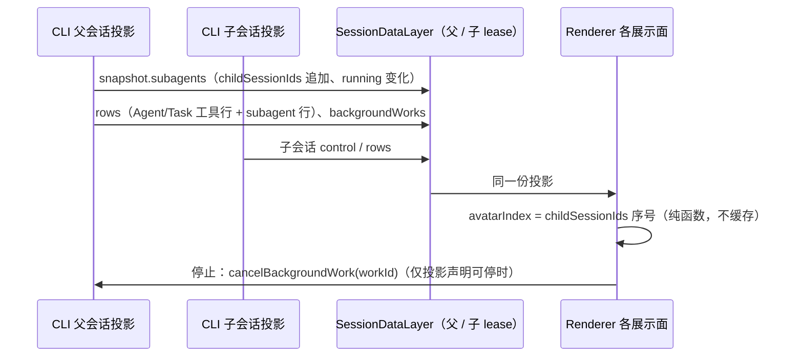
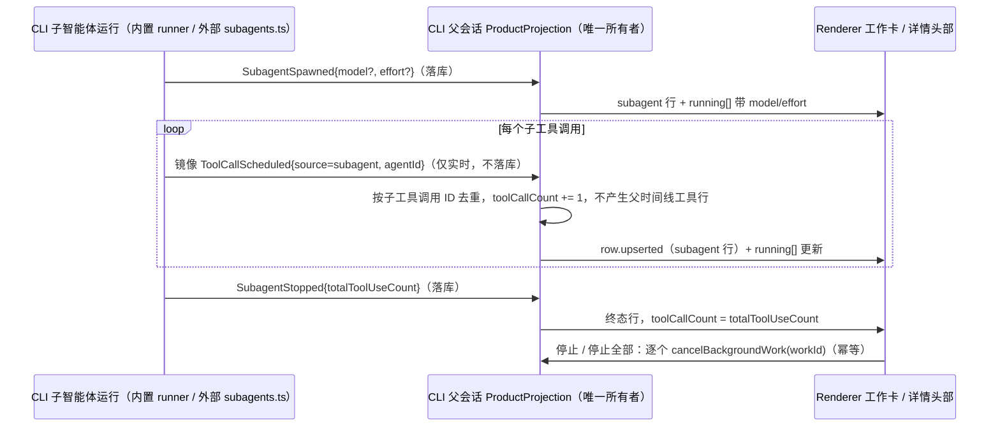

# 多智能体展示（YCode 1.1.0，1.3 工作卡更新）

决策来源：[YCode 1.1 更新方案](./ycode-1.1-plan.md)「多智能体（问题 7）」。本文定义 Renderer 如何把已有的子智能体投影画成头像、胶囊、对话行内 Subagent 工作卡、右侧详情头部和目录。1.3（W8）在协议上只增加可选的 `model`、`effort`、`toolCallCount`（见"引擎无关合同"第 6 条），不改变 Host、owner/lease 或命令。子会话详情与目录的既有规则见 [Subagent Session Side Tabs](../subagent-session-side-tabs.md) 与 [Subagent Session Directory](../subagent-session-directory.md)，状态胶囊见 [Chat Status Panel](../ui/chat-summary-panel.md)。

## 适用范围与边界

- 三个引擎共用同一套 UI：内置引擎已有子会话；Claude Code 与 Codex 的原生子智能体由 CLI 映射到同一合同（见「引擎无关合同」）。Renderer 不按引擎分支。
- 只读消费父会话 V4 `snapshot.subagents`（`revision`、`childSessionIds`、`running[]`、`endedTotal`）、父会话 `backgroundWorks`、父时间线的 Agent/Task 工具行与 `subagent` 行、子会话自身 snapshot，以及已有的 `session/subagents` 已结束分页查询。
- 除 W8 的三个可选展示字段外不新增协议字段；不新增持久化、不在 Renderer 保存第二份运行态。Workflow 的代理药丸不属于本文，保持 [workflow 展示规范](../dynamic-workflow/presentation.md) 的规则。
- 不在输入框上方新增浮条；实时活动只进右上角状态胶囊。

## 状态所有者

| 事实                                           | 唯一所有者                                                                                                    | Renderer 用法                                                           |
| ---------------------------------------------- | ------------------------------------------------------------------------------------------------------------- | ----------------------------------------------------------------------- |
| 子智能体成员与派发顺序                         | CLI 父会话 ProductProjection 的 `snapshot.subagents.childSessionIds`                                          | 派生头像序号                                                            |
| 运行中成员、`waiting` / `blocked`、`startedAt` | 同上 `snapshot.subagents.running`                                                                             | 胶囊头像串、智能体分区、详情头部运行态                                  |
| 可停止性                                       | 父会话 `backgroundWorks`（`kind=subagent`、`status=running`、精确 `childSessionId`、`cancellable !== false`） | 智能体分区与详情头部的停止按钮，命令沿用 `cancelBackgroundWork(workId)` |
| 时间线派发与单个智能体状态                     | 父时间线 Agent/Task 工具行与配对的 `subagent` 行                                                              | 工作卡成员行、旧派发行                                                  |
| 子智能体模型、档位、步骤数                     | CLI 父会话 ProductProjection 写在 `subagent` 行上，`running[]` 项是同值副本                                   | 工作卡成员行（读行）、详情头部模型标签（读 `running[]`，结束后读行）    |
| 子会话结束态与耗时                             | 子会话 snapshot（`control.phase`、`control.lastError`、`turnHeader` 行）                                      | 详情头部在父会话不再列为运行中时的结束态                                |
| 已结束列表                                     | `session/subagents` 已结束分页                                                                                | 目录                                                                    |
| 工作卡折叠/展开、派发行展开、计时刷新          | Renderer 内存                                                                                                 | 不写入 session、store 或协议，不跨刷新恢复                              |



时序规则：所有展示面在每次投影变化后重新派生，不做延迟、轮询或"自愈"重查；迟到的投影以 `revision` 为准，由数据层保证单调。

## 头像

### 形态

- 沿用瓦片脸（`WorkflowAgentFace`）：代码绘制的 SVG 圆角方块加两只眼，不使用 PNG、字母或散列色相头像。
- 颜色 = `FACE_COLORS[avatarIndex % 9]`（九个固定 HEX），只表示"这是第几个派发的实例"，**从不表示状态**。状态由表情（等待三点、运行竖眼、完成弧眼、失败下垂眼）和旁边的文字/图标表达。
- 轮廓按 `subagentType` 区分种类，16px 下可分辨：

| 变体      | 轮廓             | 类型关键字（不区分大小写，按词匹配，复合词从最后一个词向前找）           |
| --------- | ---------------- | ------------------------------------------------------------------------ |
| `base`    | 圆角方块         | general-purpose、worker、default 及所有未识别类型                        |
| `antenna` | 顶部天线         | explore / explorer / search / scout / find / locate                      |
| `visor`   | 眼部深色护目镜带 | plan / planner / planning / architect                                    |
| `glasses` | 白色方框眼镜     | review / reviewer / verify / verifier / audit / critic / check / inspect |
| `crest`   | 顶部锯齿冠       | test / tester / testing / qa / e2e                                       |
| `ears`    | 顶部圆耳         | research / researcher / investigate / analyze / analyst / study          |

- 例：`Explore` → antenna；`code-reviewer` → glasses；`test-runner` → crest；`statusline-setup` → base。
- 尺寸：16px（工作卡成员行、对话派发行、Agent 卡图标、智能体分区行）、20px（胶囊头像串、目录行）、24px（右侧详情头部）。三种尺寸使用同一几何，不做降级简化。
- 主题：机身色与眼白在浅色/深色主题相同；头像串的分隔环使用所在表面的背景色（胶囊为 `--color-popover`），随主题变化。
- 动效：只有右侧详情头部、且子智能体运行中时播放空闲表情动作；其他位置静止显示当前表情。`prefers-reduced-motion`、页面隐藏或离开视口时不播放（沿用 `startFaceMotion`）。
- `lib/subagentColors.ts` 的按类型颜色只给 Agent 卡上的类型名文字着色，不得用于头像。

### 序号（avatarIndex）

- 规则：`avatarIndex(child) = snapshot.subagents.childSessionIds.indexOf(childSessionId)`（重复项取首次出现）。
- `childSessionIds` 由 CLI 按当前分支的派发顺序产生：实时路径来自时间线行序，冷恢复种子来自活动分支消息中的工具调用顺序，二者一致，因此序号在重渲染、重连、Renderer 刷新和 CLI 冷启动后不变。
- edit/retry 剪掉旧分支后，被移除的子智能体退出清单，之后的序号随之前移；这是分支变化，不是漂移。fork 继承复制的已结束引用，fork 内序号按 fork 的清单计算。
- 尚未进入清单的派发（子会话尚未登记，或引擎没有子会话的行内兜底）使用临时序号：`清单长度 + 该成员在所属派发行中未登记成员里的顺序`（单个派发为 `清单长度`）。登记后改用清单序号；并发派发的登记顺序可能与工具调用顺序不同，此时颜色可能在登记时变化一次。
- 能算出序号时禁止名字散列；散列只保留给 workflow 中没有实例的车道。

## 右上角状态胶囊

- 收起态只显示一项，优先级：**工作流 > 运行中的智能体 > 计划/进度 > 目标 > Git**，其后依次为已完成目标、已完成进度、进度兜底、终态计划、终端运行数、已结束工作流。
- 运行中的智能体项：`snapshot.subagents.running` 非空（含 backgroundWorks 补齐的同一身份项）时出现，显示最多 3 个重叠头像（20px，按开始时间升序取前三，与展开分区行序一致）和"N 个运行中" / "N running"。N 只数运行中的子智能体，不含终端；只有终端在跑时仍按原规则显示终端计数。
- 点击：展开面板并打开"智能体"分区（与工作流项打开"工作流"分区同理）。按钮的无障碍名称包含数量（"N 个智能体运行中，展开状态"）；头像是身份而非状态图标，悬停时不替换为展开图标，只抬底色。
- 窄宽度下头像串和数量不收缩，胶囊继续受容器宽度上限约束。
- 展开态"智能体"分区：运行项左侧图标换成 16px 头像；标题、已运行时长、停止与"已结束 · N"行为不变。

## 对话行内 Subagent 工作卡（YCode 1.3，取代"对话行内派发行"）

决策来源：[引擎、输入框与子智能体体验打磨](../plans/2026-11-09-engine-composer-subagent-polish.md) W8（Q7、D7、R2-4）。

### 分组

- 候选：Agent / Task / subagent 工具调用（已配对 `subagent` 行的 Agent 卡、带外部子工具的 Agent 卡，或尚未配对的 Agent 工具行）。
- 同一轮、在可见工作项列表中**相邻**的候选为一组；中间出现任何其它可见项（正文、思考、其它工具）即断开。
- 组内**任一成员**已配对带 `childSessionId` 的 `subagent` 行时，整组（1 个或多个成员）渲染为一张 `SubagentWorkCard`，组身份锚定首个成员的行（`subagentWorkCard:<rowId>`）。尚未登记子会话的成员在卡内显示为"等待启动"，不可打开、不可停止。
- 组内没有任何成员带 `childSessionId`（旧会话、外部引擎行内兜底、子会话尚未登记）时保持旧展示：单个派发为 Agent 卡（图标换成头像）；相邻 ≥2 个为一行"A、B 和 C 开始工作"（规则见下文"旧派发行"）。
- 首个子会话登记时，该组从旧展示切换为工作卡一次；之后流式追加成员不重建组件。
- 分组只用于实时对话时间线，不改变分享只读时间线。

### 卡片布局

```
┌ Subagent 正在工作 •                                   [■ 停止全部] ┐
│ 3 个 Subagent · 已完成 1/3 · 58s                                    │
│ ┌ ◎ 主 Agent  正在协调 3 个委派任务 ┐                                │
│ ├─ (头像) explorer      gpt-6.1-sol high                   [■ 停止] │
│ │         运行中 · 58s                                               │
│ │         核对排班报错请求契约 · 16 个步骤                           │
│ ├─ (头像) reviewer  已完成 · 32s · 9 个步骤                          │
│ └─ (头像) tester    失败 · 12s · 原因：…                             │
└─────────────────────────────────────────────────────────────────────┘
```

- 头部：标题"Subagent 正在工作"（有成员运行时带脉冲圆点，`prefers-reduced-motion` 时静止）；副标题"N 个 Subagent · 已完成 M/N · 耗时"。M = 已结束（完成、失败、已停止）成员数；耗时 = 最早 `startedAt` 到现在（运行中每秒刷新）或到最晚 `endedAt`。
- 主 Agent 节点：一个 `rounded-lg` 小框，"主 Agent · 正在协调 N 个委派任务"（全部结束后为"已协调 N 个委派任务"）。成员行用树形连接线挂在其下（最后一个成员为 └）。
- 成员行（整行是原生 button，Enter/Space 激活）：16px 头像（DESIGN 头像规则：颜色 = 清单序号，轮廓 = 类型）、名称、模型 + 档位（右上，只有投影带 `model` 时显示；`effort` 只在有值时附在模型后）、状态文字 + 耗时（运行中每秒刷新）、任务摘要、"N 个步骤"（只有投影带 `toolCallCount` 时显示）、单独的"停止"按钮（可停时）。失败或已停止时附终态摘要（`summaryText`）。
- 名称 = `subagentType`（`subagent` 这一通用占位值除外，外部引擎都是它）→ 工具调用可见标题 → 本地化"智能体 N"。名称已经是标题时不再重复显示任务摘要。打开 tab 时仍只传可见标题，标题为空时由 tab 回退"子智能体"，不拼接类型或编号。
- 卡片外框 `rounded-xl`，主 Agent 节点与成员悬停底色 `rounded-lg`；颜色只用语义 token，浅色/深色同一结构。窄宽度（≤ 390px 容器）下模型标签换到名称下一行，按钮不收缩、文字截断不溢出。

### 折叠

- 全部成员结束后，卡片折叠成一行"N 个 Subagent 已完成 · 用时 Xm Ys"（有失败/已停止时追加"· K 个失败 / K 个已停止"），行尾箭头展开回看完整树。
- 运行中不可折叠；折叠/展开态只存于 Renderer 内存（与旧派发行同一模式），不写入 session、store 或协议，不跨刷新恢复。
- 与完成轮次的「已工作 N 秒」折叠的关系（2026-11-09，SAT31）：工作卡只要有活跃成员（运行中、等待中、阻塞、等待启动，与卡头 `data-state="running"` 同一判定），就不随所在轮次的工作历史折叠：历史收起时该卡渲染在折叠摘要之下（同一轮内、紧随该段被折叠的工作项之后），其余工作项仍折叠；历史展开时回到原位置。全部成员结束后该卡回到折叠内，按普通工作项随轮次折叠。判定只读 subagent 行与父会话 `running[]` 的既有投影，不新增状态。
  - 修复依据：父 Agent 派出后台子智能体后本轮结束，工作卡被折进「已工作 N 秒」，而状态胶囊仍显示"1 个运行中"，用户看不到正在工作的子智能体，违背"subagent 可视化清晰易懂"。

### 停止

- 单个"停止"：只在父会话 `backgroundWorks` 精确匹配可停 work（`kind=subagent`、`status=running`、唯一 `childSessionId`、`cancellable !== false`）且成员仍在运行时出现；规则与详情头部共用 `resolveSubagentStopWorkId`。
- "停止全部"（D7）：对每个可停的运行中成员调用既有 `cancelBackgroundWork(workId)`（runtime 是唯一所有者，命令幂等），不新增协议命令；没有可停成员时不显示（Codex 子智能体、前台不可停的子智能体）。
- 停止只经过宿主注入的 `onCancelBackgroundWork`；只读会话不注入，卡上即没有停止。

### 交互

| 点击对象                | 条件                                   | 结果                                                                    |
| ----------------------- | -------------------------------------- | ----------------------------------------------------------------------- |
| 成员行                  | 有 `childSessionId` 且宿主提供打开能力 | 通过既有 `onOpenSubagentSession` 打开或激活右侧只读实时对话；不自动打开 |
| 成员行                  | 尚未登记子会话                         | 无动作（按钮禁用，状态"等待启动"）                                      |
| 单个"停止" / "停止全部" | 可停                                   | `cancelBackgroundWork(workId)`；事件不冒泡到成员行                      |
| 折叠摘要行 / 箭头       | 全部结束                               | 展开或收起完整树                                                        |

- 成员行无障碍名称包含名称、状态和动作；有子会话的成员行携带 `v4-subagent-open-side-pane-<childSessionId>`，每个子会话只有一个直开入口。

### 旧派发行（无子会话的兜底）

- 一行文字："A、B 和 C 开始工作" / "A, B, and C started working"。名称列表用 `Intl.ListFormat(locale, { type: "conjunction" })`，每个名称前带 16px 头像。
- 名称 = 工具调用的标题/描述 → `subagentType` → 本地化"智能体 N"（N = 序号 + 1）。
- 每个名称后用图标表示终态：完成为对勾、失败为叉（危险色，伴随无障碍文字）、已停止为禁止符号；运行中不加旋转图标。行尾显示状态计数，有成员运行时计数文字使用运行扫光。
- 点击名称展开本行，并展开该智能体卡的行内详情；行尾箭头切换显示原有的逐个 Agent 卡；展开状态只存于 Renderer 内存。

## 右侧详情

- 头部：24px 头像 + 名称 + 状态（图标与文字）+ 耗时 + 模型标签（有 `model` 时，`effort` 附在其后）+ 停止按钮（可停时）。模型取父会话 `running[]` 中该子会话的项；不在运行中时取父时间线中该子会话最后一个 `subagent` 行；都没有则不显示。
- 状态：父会话 `running` 中有该子会话时取其 `running` / `waiting` / `blocked`；否则取子会话 `control`：`completedSuccess` → 已完成，`completedInterrupted` → 已停止，`error` 或存在 `lastError` → 失败，`running` / `prewarming` → 运行中。
- 耗时：运行中按父会话 `startedAt` 每秒刷新；结束后在子会话行窗口已到顶时取首个 `turnHeader.startedAt` 到最后一个 `endedAt`，否则不显示。
- 停止按钮只在父会话 `backgroundWorks` 精确匹配可停 work 时出现，发送父会话 `cancelBackgroundWork(workId)`，被拒绝时记 warn 日志。它是父会话的后台控制，不是子会话的停止，子会话仍保持只读。
- 底部：子会话只读，原输入区位置显示一行提示"子智能体由主智能体驱动，无法输入。"（i18n `subagentDisplay.sidePane.readOnlyHint`）。
- 记录区复用只读 `SessionPane`，通过同一 session lease 实时更新；多个子会话用既有标签页，标签页持久化与订阅生命周期不变。
- 适用于任意 `childSessionId`，不读取引擎类型；Tab 条图标保持 14px Bot 图标（头像最小 16px）。

## 目录

- 每行左侧显示 20px 头像（序号取父会话清单，变体取 `subagentType`），状态图标移到状态文字前。其余规则不变。

## 引擎无关合同（M2-B 映射要求）

外部引擎子智能体映射完成后，UI 不需要任何引擎分支即可得到完整展示，前提是 CLI 提供：

1. 子会话以 `taskType=subagent_child` 持久化后才发布派发；父会话 `snapshot.subagents.childSessionIds` 按派发顺序追加，同一分支内不重排。
2. `running[]` 项带原生类型 `subagentType`（如 Claude Code 的 `subagent_type`、Codex 的角色名）、任务描述 `title`、`status` 与 `startedAt`；子会话权限请求进入父会话待处理交互并标注 `origin.kind=subagent`，使该项显示为 `waiting`。
3. 父时间线保留 Agent/Task 工具行，并有 `parentToolCallId` 指向它、带 `childSessionId` 的 `subagent` 行，用于配对。
4. 只有引擎支持停止时才发布带 `childSessionId` 的 `backgroundWorks` 项；不支持时不发布或 `cancellable=false`，UI 即不显示停止。
5. 子会话 snapshot 提供 `control.phase` 与 `turnHeader` 行；缺失时详情头部只显示能确认的字段。
6. （W8，可选）`subagent` 行与 `running[]` 项可带 `model`（展示用模型 ID，不含 provider 前缀）、`effort`（思考档位原值）、`toolCallCount`（子智能体本次运行已发起的工具调用数）。来源：
   - 内置引擎：`model` / `effort` 取 `SubagentSpawned` 载荷（子智能体 profile 显式指定模型时才有；继承父模型时不发）；`toolCallCount` 由父会话投影在丢弃镜像子工具事件（`source=subagent`）前按子工具调用 ID 去重计数，`SubagentStopped.totalToolUseCount` 到达时以它为准。镜像事件不落库，CLI 冷启动后运行中成员的计数从未知开始，结束时由 `totalToolUseCount` 校正。
   - 外部引擎：不知道子智能体模型时不发 `model` / `effort`；`toolCallCount` 由 `core/src/external-engine/subagents.ts` 在写子会话工具行时计数，实时以 `source=subagent` 的镜像 `ToolCallScheduled` 通知父会话（不落库），结束时写入 `SubagentStopped.totalToolUseCount`。
   - 恢复（resume）开启新一次运行时，计数从头开始。



未满足 1–3 的旧会话（当前 Claude Code 行内兜底）仍按"无子会话"规则显示：临时序号、点击展开行内详情。

引擎覆盖：内置引擎完整支持；Claude Code 实时显示，有 `capabilities.cancel` 时可停（后台子智能体在父轮结束后不再观测，沿用已知限制）；Codex 实时显示、不可停（R2-4），卡上没有"停止"与"停止全部"。

## 验收场景

| ID   | 前置                                                          | 操作                         | 期望                                                                                                              |
| ---- | ------------------------------------------------------------- | ---------------------------- | ----------------------------------------------------------------------------------------------------------------- |
| MA01 | 同一轮并行派发 3 个 Explore / Plan / general-purpose 子智能体 | 观察时间线                   | 一张 Subagent 工作卡，三个成员头像依次为九色板前三色，轮廓分别为天线、护目镜、基础                                |
| MA02 | MA01 运行中，另有进行中的 todo 和 Git 变更                    | 观察收起胶囊                 | 显示 3 个头像与"3 个运行中"；有运行中的工作流时工作流优先                                                         |
| MA03 | 7 个并行子智能体运行中                                        | 观察胶囊；点击胶囊           | 只显示 3 个头像与"7 个运行中"；面板展开且"智能体"分区打开                                                         |
| MA04 | MA01                                                          | 点击 B 的成员行              | 右侧打开 B 的只读实时对话；头部显示同色同轮廓头像、名称、运行中、耗时与模型标签                                   |
| MA05 | 外部引擎行内兜底，两个相邻派发无子会话                        | 点击第二个名称               | 本行展开，第二个 Agent 卡行内详情展开；不打开右侧面板                                                             |
| MA06 | 两个派发之间夹一段正文或另一工具                              | 观察时间线                   | 不合并，各自显示一张工作卡（无子会话时各自为 Agent 卡）                                                           |
| MA07 | MA01 全部完成后刷新 Renderer 并冷启动 CLI                     | 重新打开会话                 | 工作卡折叠为"3 个 Subagent 已完成 · 用时…"；展开后头像颜色与轮廓不变                                              |
| MA08 | 后台子智能体可停、前台不可停                                  | 打开两者详情                 | 只有后台的头部显示停止；点击后父会话收到 `cancelBackgroundWork`                                                   |
| MA09 | 系统开启减少动态效果                                          | 打开运行中详情               | 头像不播放空闲动作，表情仍按状态显示                                                                              |
| MA10 | 浅色/深色主题、390px 与 1200px 容器、中文/英文                | 观察胶囊、工作卡、详情头部   | 文字不溢出胶囊与卡片，按钮不收缩，头像对比清晰                                                                    |
| MA11 | 内置引擎派发 1 个带模型 profile 的 explorer，运行中           | 观察工作卡                   | 成员行显示名称、模型 + 档位、运行中与每秒刷新的耗时、任务摘要、"N 个步骤"；步骤数随子工具调用增长                 |
| MA12 | 2 个可停后台子智能体 + 1 个不可停前台子智能体运行中           | 点击"停止全部"               | 只对 2 个可停成员各发一次 `cancelBackgroundWork`；不可停成员行没有"停止"                                          |
| MA13 | Codex 引擎派发子智能体                                        | 观察工作卡                   | 实时显示状态与步骤数；没有"停止"与"停止全部"；没有模型标签                                                        |
| MA14 | MA11 运行中                                                   | 点击成员行；子智能体继续工作 | 右侧打开只读子会话，正文实时增长，头部有模型标签，底部显示只读提示；不自动打开                                    |
| MA15 | 父 Agent 派出后台子智能体后本轮结束，子智能体仍在运行         | 观察时间线；子智能体全部结束 | 轮次显示「已工作 N 秒」并收起其它工作项，工作卡仍可见于摘要之下（运行中、可点开右栏）；全部结束后工作卡随轮次折叠 |

单测覆盖序号派生、变体映射、列表格式、分组、胶囊优先级、详情头部模型、派发行点击与工作卡（分组、计数、计时、折叠、停止全部、运行中豁免轮次折叠）；交互场景以待人工 review 的 E2E 覆盖（`manual-review/pending/conversation-session-multi-agent-display.test.ts`、`manual-review/pending/conversation-session-subagent-work-card.test.ts`）。Case catalog 对应 SAT31–SAT34。

## 2026-11-11 桌面体验修订

运行与结束阶段各自保留 Renderer 的展开偏好；运行中手动展开不改变全部结束后的默认折叠，结束摘要仍可手动展开回看，虚拟列表重挂沿用对应阶段的选择。

可见名称统一按任务标题/描述优先、非通用类型其次、编号兜底；类型只作辅助信息。运行卡默认展开，允许主动折叠，折叠后显示真实运行/等待/阻塞及结束计数，失败和停止不算成功。输入工具栏独立保留子任务入口，不被工作流摘要遮挡，复用父 snapshot、现有目录和打开详情动作；全部结束后保留摘要且停止动画。不得从 Agent 工具启动 ACK 或父轮完成推断子任务完成。终态沿 CLI 唯一生命周期投影收敛，旧执行事件不能覆盖新执行。

执行代次由 Spawn 的 parentToolCallId 派生，独立于原 Agent 行的显示锚点。携带执行身份的迟到 Stop/后台终态不得覆盖新一次执行；缺失身份的历史事件保留兼容。该索引仅属于 CLI 投影并由事件重放重建。
