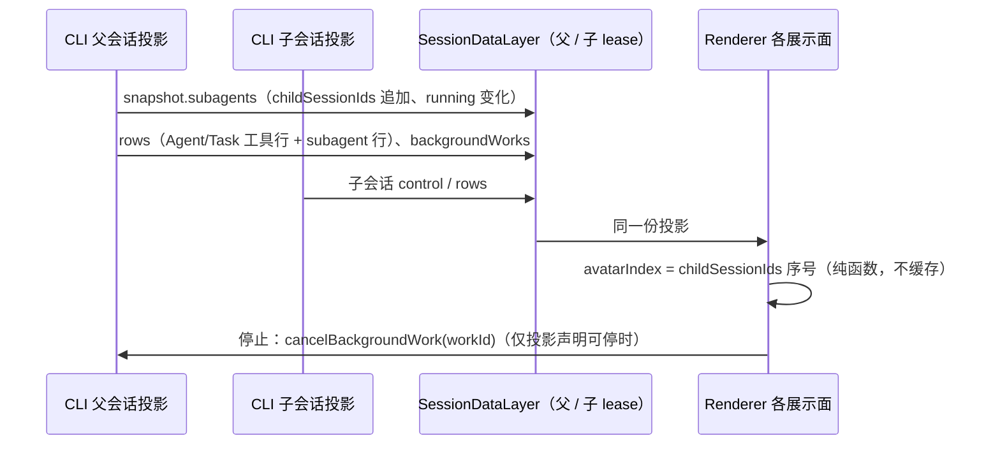

# 多智能体展示（YCode 1.1.0）

决策来源：[YCode 1.1 更新方案](./ycode-1.1-plan.md)「多智能体（问题 7）」。本文定义 Renderer 如何把已有的子智能体投影画成头像、胶囊、对话行内派发行、右侧详情头部和目录；不改变 CLI、Host 或协议。子会话详情与目录的既有规则见 [Subagent Session Side Tabs](../subagent-session-side-tabs.md) 与 [Subagent Session Directory](../subagent-session-directory.md)，状态胶囊见 [Chat Status Panel](../ui/chat-summary-panel.md)。

## 适用范围与边界

- 三个引擎共用同一套 UI：内置引擎已有子会话；Claude Code 与 Codex 的原生子智能体由 CLI 映射到同一合同（见「引擎无关合同」）。Renderer 不按引擎分支。
- 只读消费父会话 V4 `snapshot.subagents`（`revision`、`childSessionIds`、`running[]`、`endedTotal`）、父会话 `backgroundWorks`、父时间线的 Agent/Task 工具行与 `subagent` 行、子会话自身 snapshot，以及已有的 `session/subagents` 已结束分页查询。
- 不新增协议字段、不新增持久化、不在 Renderer 保存第二份运行态。Workflow 的代理药丸不属于本文，保持 [workflow 展示规范](../dynamic-workflow/presentation.md) 的规则。
- 不在输入框上方新增浮条；实时活动只进右上角状态胶囊。

## 状态所有者

| 事实                                           | 唯一所有者                                                                                                    | Renderer 用法                                                           |
| ---------------------------------------------- | ------------------------------------------------------------------------------------------------------------- | ----------------------------------------------------------------------- |
| 子智能体成员与派发顺序                         | CLI 父会话 ProductProjection 的 `snapshot.subagents.childSessionIds`                                          | 派生头像序号                                                            |
| 运行中成员、`waiting` / `blocked`、`startedAt` | 同上 `snapshot.subagents.running`                                                                             | 胶囊头像串、智能体分区、详情头部运行态                                  |
| 可停止性                                       | 父会话 `backgroundWorks`（`kind=subagent`、`status=running`、精确 `childSessionId`、`cancellable !== false`） | 智能体分区与详情头部的停止按钮，命令沿用 `cancelBackgroundWork(workId)` |
| 时间线派发与单个智能体状态                     | 父时间线 Agent/Task 工具行与配对的 `subagent` 行                                                              | 行内派发行                                                              |
| 子会话结束态与耗时                             | 子会话 snapshot（`control.phase`、`control.lastError`、`turnHeader` 行）                                      | 详情头部在父会话不再列为运行中时的结束态                                |
| 已结束列表                                     | `session/subagents` 已结束分页                                                                                | 目录                                                                    |
| 派发行展开、头部计时刷新                       | Renderer 内存                                                                                                 | 不写入 session、store 或协议，不跨刷新恢复                              |

时序规则：所有展示面在每次投影变化后重新派生，不做延迟、轮询或"自愈"重查；迟到的投影以 `revision` 为准，由数据层保证单调。

## 头像

### 形态

- 沿用瓦片脸（`WorkflowAgentFace`）：代码绘制的 SVG 圆角方块加两只眼，不使用 PNG、字母或散列色相头像。
- 颜色 = `FACE_COLORS[avatarIndex % 9]`（九个固定 HEX），只表示"这是第几个派发的实例"，**从不表示状态**。状态由表情（等待三点、运行竖眼、完成弧眼、失败下垂眼）和旁边的文字/图标表达。
- 轮廓按 `subagentType` 区分种类，16px 下可分辨：

| 变体      | 轮廓             | 类型关键字（不区分大小写，按词匹配，复合词从最后一个词向前找）           |
| --------- | ---------------- | ------------------------------------------------------------------------ |
| `base`    | 圆角方块         | general-purpose、worker、default 及所有未识别类型                        |
| `antenna` | 顶部天线         | explore / explorer / search / scout / find / locate                      |
| `visor`   | 眼部深色护目镜带 | plan / planner / planning / architect                                    |
| `glasses` | 白色方框眼镜     | review / reviewer / verify / verifier / audit / critic / check / inspect |
| `crest`   | 顶部锯齿冠       | test / tester / testing / qa / e2e                                       |
| `ears`    | 顶部圆耳         | research / researcher / investigate / analyze / analyst / study          |

- 例：`Explore` → antenna；`code-reviewer` → glasses；`test-runner` → crest；`statusline-setup` → base。
- 尺寸：16px（对话派发行、Agent 卡图标、智能体分区行）、20px（胶囊头像串、目录行）、24px（右侧详情头部）。三种尺寸使用同一几何，不做降级简化。
- 主题：机身色与眼白在浅色/深色主题相同；头像串的分隔环使用所在表面的背景色（胶囊为 `--color-popover`），随主题变化。
- 动效：只有右侧详情头部、且子智能体运行中时播放空闲表情动作；其他位置静止显示当前表情。`prefers-reduced-motion`、页面隐藏或离开视口时不播放（沿用 `startFaceMotion`）。
- `lib/subagentColors.ts` 的按类型颜色只给 Agent 卡上的类型名文字着色，不得用于头像。

### 序号（avatarIndex）

- 规则：`avatarIndex(child) = snapshot.subagents.childSessionIds.indexOf(childSessionId)`（重复项取首次出现）。
- `childSessionIds` 由 CLI 按当前分支的派发顺序产生：实时路径来自时间线行序，冷恢复种子来自活动分支消息中的工具调用顺序，二者一致，因此序号在重渲染、重连、Renderer 刷新和 CLI 冷启动后不变。
- edit/retry 剪掉旧分支后，被移除的子智能体退出清单，之后的序号随之前移；这是分支变化，不是漂移。fork 继承复制的已结束引用，fork 内序号按 fork 的清单计算。
- 尚未进入清单的派发（子会话尚未登记，或引擎没有子会话的行内兜底）使用临时序号：`清单长度 + 该成员在所属派发行中未登记成员里的顺序`（单个派发为 `清单长度`）。登记后改用清单序号；并发派发的登记顺序可能与工具调用顺序不同，此时颜色可能在登记时变化一次。
- 能算出序号时禁止名字散列；散列只保留给 workflow 中没有实例的车道。

## 右上角状态胶囊

- 收起态只显示一项，优先级：**工作流 > 运行中的智能体 > 计划/进度 > 目标 > Git**，其后依次为已完成目标、已完成进度、进度兜底、终态计划、终端运行数、已结束工作流。
- 运行中的智能体项：`snapshot.subagents.running` 非空（含 backgroundWorks 补齐的同一身份项）时出现，显示最多 3 个重叠头像（20px，按开始时间升序取前三，与展开分区行序一致）和"N 个运行中" / "N running"。N 只数运行中的子智能体，不含终端；只有终端在跑时仍按原规则显示终端计数。
- 点击：展开面板并打开"智能体"分区（与工作流项打开"工作流"分区同理）。按钮的无障碍名称包含数量（"N 个智能体运行中，展开状态"）；头像是身份而非状态图标，悬停时不替换为展开图标，只抬底色。
- 窄宽度下头像串和数量不收缩，胶囊继续受容器宽度上限约束。
- 展开态"智能体"分区：运行项左侧图标换成 16px 头像；标题、已运行时长、停止与"已结束 · N"行为不变。

## 对话行内派发行

### 分组

- 候选：Agent / Task / subagent 工具调用（已配对 `subagent` 行的 Agent 卡、带外部子工具的 Agent 卡，或尚未配对的 Agent 工具行）。
- 同一轮、在可见工作项列表中**相邻**的候选，达到 2 个及以上时合并为一行；中间出现任何其它可见项（正文、思考、其它工具）即断开。单个派发保持现有 Agent 卡（其图标换成该智能体的头像），交互不变。
- 分组只用于实时对话时间线，不改变分享只读时间线。
- 分组身份锚定第一个成员的行（`agentSpawnGroup:<rowId>`），流式追加成员不重建组件。

### 文案与布局

- 一行文字："A、B 和 C 开始工作" / "A, B, and C started working"。名称列表用 `Intl.ListFormat(locale, { type: "conjunction" })`，每个名称前带 16px 头像。
- 名称 = 工具调用的标题/描述（与 Agent 卡和右侧 tab 使用同一解析）→ `subagentType` → 本地化"智能体 N"（N = 序号 + 1）。打开 tab 时仍只传可见标题，标题为空时由 tab 回退"子智能体"，不拼接类型或编号。
- 每个名称后用图标表示终态：完成为对勾、失败为叉（危险色，伴随无障碍文字）、已停止为禁止符号；运行中不加旋转图标。行尾显示状态计数（"2 个运行中 · 1 个完成"），有成员运行时计数文字使用运行扫光。
- 行尾展开箭头切换显示原有的逐个 Agent 卡；展开状态只存于 Renderer 内存。

### 交互

| 点击对象            | 条件                                   | 结果                                                                               |
| ------------------- | -------------------------------------- | ---------------------------------------------------------------------------------- |
| 头像或名称          | 有 `childSessionId` 且宿主提供打开能力 | 通过既有 `onOpenSubagentSession` 打开或激活右侧只读实时对话（与 Agent 卡同一请求） |
| 头像或名称          | 无子会话（外部引擎行内兜底或尚未登记） | 展开本行，并展开该智能体卡的行内详情                                               |
| 展开箭头 / 行内空白 | —                                      | 展开或收起逐个 Agent 卡                                                            |

- 名称是原生 button，支持 Enter/Space；无障碍名称包含名称、状态和动作。
- 收起时只有名称按钮携带 `v4-subagent-open-side-pane-<childSessionId>`；展开后内部 Agent 卡不重复该 test id，保证每个子会话只有一个直开入口。

## 右侧详情

- 头部：24px 头像 + 名称 + 状态（图标与文字）+ 耗时 + 停止按钮（可停时）。
- 状态：父会话 `running` 中有该子会话时取其 `running` / `waiting` / `blocked`；否则取子会话 `control`：`completedSuccess` → 已完成，`completedInterrupted` → 已停止，`error` 或存在 `lastError` → 失败，`running` / `prewarming` → 运行中。
- 耗时：运行中按父会话 `startedAt` 每秒刷新；结束后在子会话行窗口已到顶时取首个 `turnHeader.startedAt` 到最后一个 `endedAt`，否则不显示。
- 停止按钮只在父会话 `backgroundWorks` 精确匹配可停 work 时出现，发送父会话 `cancelBackgroundWork(workId)`，被拒绝时记 warn 日志。它是父会话的后台控制，不是子会话的停止，子会话仍保持只读。
- 适用于任意 `childSessionId`，不读取引擎类型；Tab 条图标保持 14px Bot 图标（头像最小 16px）。

## 目录

- 每行左侧显示 20px 头像（序号取父会话清单，变体取 `subagentType`），状态图标移到状态文字前。其余规则不变。

## 引擎无关合同（M2-B 映射要求）

外部引擎子智能体映射完成后，UI 不需要任何引擎分支即可得到完整展示，前提是 CLI 提供：

1. 子会话以 `taskType=subagent_child` 持久化后才发布派发；父会话 `snapshot.subagents.childSessionIds` 按派发顺序追加，同一分支内不重排。
2. `running[]` 项带原生类型 `subagentType`（如 Claude Code 的 `subagent_type`、Codex 的角色名）、任务描述 `title`、`status` 与 `startedAt`；子会话权限请求进入父会话待处理交互并标注 `origin.kind=subagent`，使该项显示为 `waiting`。
3. 父时间线保留 Agent/Task 工具行，并有 `parentToolCallId` 指向它、带 `childSessionId` 的 `subagent` 行，用于配对。
4. 只有引擎支持停止时才发布带 `childSessionId` 的 `backgroundWorks` 项；不支持时不发布或 `cancellable=false`，UI 即不显示停止。
5. 子会话 snapshot 提供 `control.phase` 与 `turnHeader` 行；缺失时详情头部只显示能确认的字段。

未满足 1–3 的旧会话（当前 Claude Code 行内兜底）仍按"无子会话"规则显示：临时序号、点击展开行内详情。

## 验收场景

| ID   | 前置                                                          | 操作                       | 期望                                                                               |
| ---- | ------------------------------------------------------------- | -------------------------- | ---------------------------------------------------------------------------------- |
| MA01 | 同一轮并行派发 3 个 Explore / Plan / general-purpose 子智能体 | 观察时间线                 | 一行"A、B 和 C 开始工作"，三个头像依次为九色板前三色，轮廓分别为天线、护目镜、基础 |
| MA02 | MA01 运行中，另有进行中的 todo 和 Git 变更                    | 观察收起胶囊               | 显示 3 个头像与"3 个运行中"；有运行中的工作流时工作流优先                          |
| MA03 | 7 个并行子智能体运行中                                        | 观察胶囊；点击胶囊         | 只显示 3 个头像与"7 个运行中"；面板展开且"智能体"分区打开                          |
| MA04 | MA01                                                          | 点击 B 的名称              | 右侧打开 B 的只读实时对话；头部显示同色同轮廓头像、名称、运行中与耗时              |
| MA05 | 外部引擎行内兜底，两个相邻派发无子会话                        | 点击第二个名称             | 本行展开，第二个 Agent 卡行内详情展开；不打开右侧面板                              |
| MA06 | 两个派发之间夹一段正文或另一工具                              | 观察时间线                 | 不合并，各自显示 Agent 卡                                                          |
| MA07 | MA01 全部完成后刷新 Renderer 并冷启动 CLI                     | 重新打开会话               | 头像颜色与轮廓不变；行尾显示完成计数                                               |
| MA08 | 后台子智能体可停、前台不可停                                  | 打开两者详情               | 只有后台的头部显示停止；点击后父会话收到 `cancelBackgroundWork`                    |
| MA09 | 系统开启减少动态效果                                          | 打开运行中详情             | 头像不播放空闲动作，表情仍按状态显示                                               |
| MA10 | 浅色/深色主题、390px 与 1200px 容器、中文/英文                | 观察胶囊、派发行、详情头部 | 文字不溢出胶囊，名称按列表格式本地化，头像对比清晰                                 |

单测覆盖序号派生、变体映射、列表格式、分组、胶囊优先级、详情头部模型和派发行点击；交互场景以待人工 review 的 E2E 覆盖（`manual-review/pending/conversation-session-multi-agent-display.test.ts`）。
