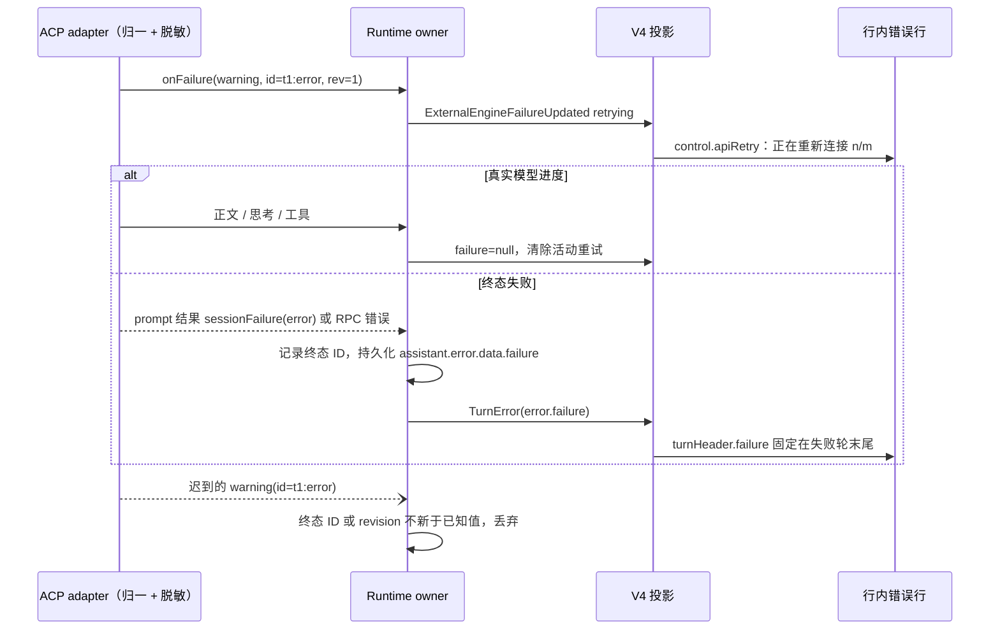

# 原生计划审批与外部引擎错误

## 行为与所有者

外部引擎仍通过现有 ACP 连接运行，Runtime 是计划、等待审批、重试及失败事件的唯一发布者，V4 和界面只保存投影。初始化声明 `plan` 能力，消费 `plan`、`plan_update` 与 `plan_removed`。执行清单与计划文档分别保留：清单的 pending 不表示计划生成仍在运行，也不能用全部 completed 判定计划轮结束。执行清单经 `snapshot.plan` 进入右上角状态胶囊的“计划”项（优先级 工作流 > 计划 > 目标 > Git），展开查看完整清单与计划文档。

Codex 的 `plan-review:` / `switch_mode` 请求及 Claude 的 `ExitPlanMode` 请求统一进入既有计划审批语义，原生 toolCallId 和选项保持不变。审批必须由用户本次明确操作，不能由权限宽松模式或会话免确认替代。原生计划卡展示清单、完整计划及“开始执行”“继续修改”；等待时停止加载动画。开始执行只回复原生允许选项，由 adapter 退出 Plan 并续跑，界面不另发实现提示。继续修改拒绝本次执行，保持 Plan 模式，恢复输入供用户继续说明。双击或 ACK 重放通过既有 interaction registry 收敛为一次应答。内置引擎继续复用同一计划审批卡及既有退出模式流程。

审批卡清场后，桌面当前面板将真实焦点交还输入框；后台面板不抢焦点，输入框仍不可编辑时保留聚焦意图，待恢复可编辑后兑现一次。沿用现有移动端自动聚焦策略，避免审批结束时自动弹出软键盘。

### Claude 计划审批识别与选项

claude-agent-acp 0.95.0 的审批请求标题为 “Approve Plan”、`kind=switch_mode`，工具名只在非标准 `name` 字段，`_meta.claudeCode.toolName` 缺失（仅子智能体或 MCP 请求才带）。Runtime 按以下任一事实识别为计划审批：`name` 或 `_meta.claudeCode.toolName` 为 `ExitPlanMode`；`kind=switch_mode` 且标题为 “Approve Plan”；`kind=switch_mode` 且 `rawInput.plan` 为字符串或 `rawInput.planFilePath` 存在。Codex `plan-review:` 规则不变。

原生选项按 adapter 顺序原样投影到审批交互（`nativeOptions`：optionId、原生名称、kind、是否推荐、是否清空上下文）。Runtime 记住会话中模式配置（Claude `mode`、Codex `collaboration_mode`）最近一次的非 Plan 值，随 `external_engine_config` entry 持久化。Claude 主按钮“开始执行”的推荐项按进入计划前的模式映射：auto → `exit-plan-auto`，bypassPermissions → `exit-plan-bypass`，acceptEdits → `exit-plan-accept-edits`，default 或未知 → `exit-plan-default`（“Yes, manually approve edits”）；映射项不存在时回退 `exit-plan-default`，再回退首个非清空上下文的 allow 项。任何路径都不隐式选择清空上下文项（`exit-plan-clear-*` 或名称含 “clear context”）。“更多”菜单列出其余 allow 原生选项及原名，清空上下文项单独标注；“继续修改”选择 reject 项。界面始终回传精确的原生 optionId，Runtime 校验它属于本次请求且与决策一致，否则按推荐项或 reject 回退；旧客户端只回 allow/deny 时同样回退。

### 引擎未发审批请求的计划

Runtime 在一轮成功结束时检查：本轮收到计划文档（`plan_update` markdown），未发出计划审批请求，且原生模式配置仍为 `plan`。满足时在 `plan.startWithoutReview` 发布 `{configId, value}`（value 为记住的非 Plan 值，Codex 缺省 `default`、Claude 缺省 `default`），随计划 entry 持久化；下一轮开始或模式离开 Plan 时清除。界面在空闲且无待处理交互时显示计划卡，“开始执行”先经既有 `setEngineConfigOption` 把原生模式切到该值，确认后再经正常发送路径以用户身份发送一条可见消息“按上面的计划开始执行”（i18n）。切换失败保留计划卡并提示，不发送消息；不自动执行。

### 停止与断联时的待审批交互

Runtime 为每次外部 turn 的原生权限请求维护在途集合。用户停止（turn signal）、adapter 断联（runTurn 失败）或 turn 结束时，取消仍在等待的 broker 请求，并对每个未收口请求发布 `PermissionResolved(decision=deny, reason=cancelled)`，再结束 turn；ACP 侧回复 `cancelled`，不因取消而判定连接故障。投影按 toolCallId 清除对应待处理交互，Codex `plan-review:*` 没有工具行也不残留审批卡。

### 断联后静默重连的连接阶段

runTurn 发现会话没有健康的 adapter 连接（`ExternalEnginePort.isSessionConnected` 为 false）时，先经既有 `engineConfigState` 发布 connecting，再准备连接，成功发布 ready，失败发布 error；界面因此显示“正在启动引擎…”，不再显示“正在等待模型…”。健康连接的续聊不发布额外状态。

## 结构化失败

### 能力声明（ACP adapter 边界）

两家 adapter 的结构化失败扩展都挂在 JetBrains AIR 客户端标记 `_meta.jetbrains.air = {version: 1, capabilities: [...]}` 下；只要该对象存在，adapter 即按 AIR 客户端改变其他呈现。核查结果（本机已安装 codex-acp 2.2.2、claude-agent-acp 0.95.0）：

- Codex：AIR 只改变工具行呈现——不再套用 Zed 兼容的标准字段；命令输出在未声明输出通道时不再分块（读取类命令结果不再附带正文）；MCP 进度不再推送；其余为附加 `_meta`。YCode 声明 `capabilities: ["sessionFailure"]`，同时声明非 AIR 专属的 `_meta.terminal_output_delta: true`，使终端命令输出仍按既有 `terminal_output_delta` 追加。残留差异：Codex 读取文件类命令的工具卡不再显示文件正文，搜索/列表结果改为结束时一次性给出；记录为已接受差异。
- Claude Code：AIR 会让权限请求去掉 `name/kind/content`、Write/Edit 的 `rawInput` 去掉文件正文、Read/Grep/Glob 结果去掉正文、未声明原生子会话时丢弃子智能体流式正文，并把子智能体协议切到 AIR 形态（属于 1.1.0 多智能体里程碑）。审批预览与工具输出会退化，本里程碑不为 Claude 声明 AIR；1.1.0 处理子会话与审批预览后再启用。Claude 的最终失败沿用 JSON-RPC 错误路径结构化（见下）；其重试只经 AIR 通道上报，未声明前不可见，属已知缺口。
- 1.1.0 起两家都声明 ACP `clientCapabilities.subagents`（Codex 仍是 AIR 客户端，走 AIR 草案子会话形态；Claude 不声明 AIR，走 RFD 形态），细则见 `docs/desktop/external-agent-engines-spec.md`「外部引擎原生子智能体」。不声明 nativeSubagentSessions / asyncTasks 等其他 AIR 能力。
- ACP `clientCapabilities.session.notices`（2026-11-09 核查 codex-acp 2.2.2，待产品确认后再声明）：形状为对象（如 `{}`），adapter 只判断其为非数组对象。声明后 Codex 用 `session/update {sessionUpdate: "notice", severity, title, description?}` 投递以下事件，而不是 typed failure / 正文：`WarningEvent`、`configWarning`、`deprecationNotice`（severity=warning，原为 typed failure）；`ModelRerouted`（severity=info，原为思考正文 “Model rerouted from … to …”）；未声明 compaction 能力时的上下文压缩（severity=info，原为回复正文 “_Context compacted…_”）。后两项会让对应文字从对话正文/思考中消失，属于 WarningEvent 之外的可见变化，因此本次未声明，等待产品决定。adapter 已实现 notice 的接收与脱敏：`readSessionNotice` 归一为 `{severity: info|warning|error, message}`（与失败摘要同口径脱敏，首行 ≤300 字），经 `onNotice` 交付，不进入 `onUpdate`；会话中 Runtime 只记日志（warning/error 记 warn，info 记 info），不设置 apiRetry、不显示；测试连接把 notice 收入 `warnings`。

### 失败来源与归一

adapter 把以下来源归一为同一 `EngineConnectionFailure`，原始文本不越过 adapter：

1. AIR typed failure：`session_info_update._meta.jetbrains.air.sessionFailure` 与 `session/prompt` 响应 `_meta.jetbrains.air.sessionFailure`，字段 `{id, revision, category, severity, title, details?}`。severity=warning 表示重试中，error 表示终态。注意区分：notice（`sessionUpdate: "notice"`）是非致命提示，不是失败，不进入本节归一，也不产生“正在重新连接”；未声明 `session.notices` 时 Codex 会把非致命 `WarningEvent` 也作为 severity=warning 的 typed failure 上报（id 含 `:notice:`、category=unknown），会话中仍按重试中显示（已知误报，待声明 notices 后消除），测试连接只以 error 判失败、把 warning 收入 `warnings`（见 external-agent-engines-spec「测试连接」）。`id` 为失败 ID（同一轮重试与终态共用 `<turnId>:error`，revision 递增）。
2. 非 typed 回退：`session_info_update._meta.codex.error` 的 `message`（如 “Reconnecting... 2/5”）、`additionalDetails`（如 “unexpected status 502 Bad Gateway: …, url: …, request id: …”）与 `codexErrorInfo.*.httpStatusCode`；`willRetry` 决定重试或终态。
3. JSON-RPC 错误：`session/prompt` 的 error（Claude 为 “Internal error: API Error: 502 …” 与 `data.errorKind`）。

归一结果的诊断字段：`httpStatus`、`attempt`/`maxAttempts`（原生展示的第 n 次重试与上限，标题 “n/m”、“attempt n of m” 可解析时给出）、`message`（上游原文首行，最多 300 字；Bearer、`sk-`/`sess-`/`key-` 等令牌、`token=`/`api_key=` 类赋值及 URL query/fragment/userinfo 脱敏）、`url`（仅 scheme + host + path）、`requestId`、`retryable`、`failureId`。请求 ID 来自结构化字段或上游 “request id: …”、`"request_id":"…"`。日志只记录 code、方法、RPC 码、HTTP 状态、请求 ID 与失败 ID，不写 message 与 URL。

### 事件顺序与幂等

- Runtime 按失败 ID 与 revision 幂等合并：revision 不新于已记录值的更新丢弃；已终态的 ID 不再接受重试。轮次结束后投影只接受当前运行轮的重试事件，迟到事件不得重开重试状态。
- 重试在收到下一段真实模型进度（正文、思考、工具）或终态时由 Runtime 发布 `failure=null` 收口；终态投影同时清空 `apiRetry`。
- typed 终态失败即使伴随 `stopReason=end_turn` 也按失败结束：Runtime 抛出 `session/prompt` 请求失败，走既有 turn 失败路径，配置保持 ready，不自动重发 prompt。非 typed 的 Codex 终态错误由 adapter 作为普通正文发送，属上游行为，声明 typed 后不再出现。
- 内置引擎的 `model_retry_scheduled` 同样投影 HTTP 状态、脱敏消息、上游请求 ID 与 URL（scheme + host + path）到 `apiRetry`；其 TurnError 的归因状态码进入 `turnHeader.failure`。

### 行内错误行与横幅

三个引擎共用一个行内错误行组件，渲染在受影响轮次末尾：

- 重试中（当前运行轮）：显示“正在重新连接 n/m”，上限未知时显示“正在重新连接（第 n 次）”，并附 HTTP 状态；展开可见上游原文、HTTP 状态、URL 与请求 ID，并可复制。
- 终态失败：`turnHeader.failure` 描述的失败固定在该轮末尾，随历史持久化（外部引擎写入 assistant message 的 `error.data.failure`，冷恢复复用 TurnError 合成），冷恢复与重启后仍可见；展开内容同上。
- 输入框上方横幅只承载与轮次无关的错误：`control.lastError.turnId` 存在且该轮已渲染行内错误时不再显示横幅；旧快照缺 `turnId` 时维持原横幅。
- “重新发送”仅在最新一轮失败、该轮没有助手正文/思考且没有工具执行、原始输入不含附件时出现，点击后经正常发送路径重新发送该轮原始用户文本；任何路径都不自动重发，在途时按钮锁定，被挡下时提示并保留按钮。

旧快照缺少新增可选字段（`failure`、`turnId`、`url`、`failureId`、`nativeOptions`、`startWithoutReview`）时仍可读取，界面按旧行为降级。计划/错误新增事件经现有 session event journal 及 V4 state.updated 交付；清单和文档恢复沿既有 session entry，不创建第二份会话业务库。

## 回归验收

- ACP plan/markdown/移除映射、清单顺序与状态、原生计划审批必须显式、原生 optionId 回复、拒绝后不实施、重复应答不双执行。
- Claude “Approve Plan” 请求（仅 `name` 字段）进入原生计划卡；主按钮按进入计划前模式选择保留上下文的原生选项，从不隐式清空上下文；“更多”列出其余原生选项并标注清空上下文项。
- 计划生成完毕仍有 pending 项时等待审批且不转圈；重启恢复原生文档和清单；既有内置 ExitPlanMode 可继续批准与反馈；Codex 未发审批时计划卡先切出 Plan 再发送可见消息。
- 审批等待中停止或断联后无残留审批卡；断联后静默重连期间显示引擎启动阶段。
- 继续修改后保留 Plan 模式且桌面当前输入框真实聚焦；后台面板不抢焦点，禁用解除后只回焦一次。
- 真实形状帧：Codex typed 重试与终态、Codex 非 typed `additionalDetails`、Claude RPC 502 与 AIR 失败帧；状态、URL（无 query）、请求 ID 可见，秘密不进入事件、快照或日志；首次重试可见，进度恢复/停止/失败后收口，迟到重试不重开。
- 定向 CLI/投影/UI 测试及受控 ACP 桌面场景；真实 Windows/网关验收另记，夹具通过不能替代真实供应商验证。
