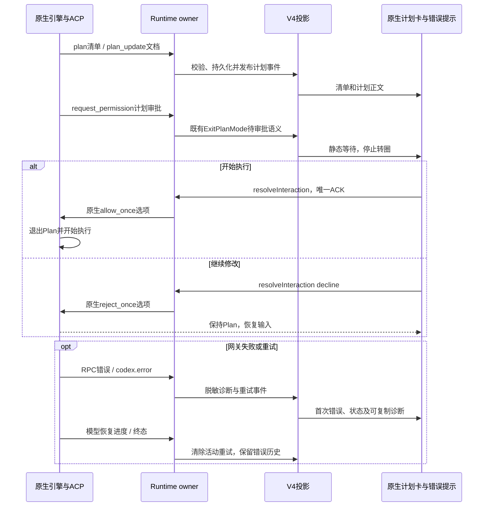

# 原生计划审批与外部引擎错误

## 行为与所有者

外部引擎仍通过现有 ACP 连接运行，Runtime 是计划、等待审批、重试及失败事件的唯一发布者，V4 和界面只保存投影。初始化声明 `plan` 能力，消费 `plan`、`plan_update` 与 `plan_removed`。执行清单与计划文档分别保留：清单的 pending 不表示计划生成仍在运行，也不能用全部 completed 判定计划轮结束。

Codex 的 `plan-review:` / `switch_mode` 请求及 Claude 的 `ExitPlanMode` 请求统一进入既有计划审批语义，原生 toolCallId 和选项保持不变。审批必须由用户本次明确操作，不能由权限宽松模式或会话免确认替代。原生计划卡展示清单、完整计划及“开始执行”“继续修改”；等待时停止加载动画。开始执行只回复原生允许选项，由 adapter 退出 Plan 并续跑，界面不另发实现提示。继续修改拒绝本次执行，保持 Plan 模式，恢复输入供用户继续说明。双击或 ACK 重放通过既有 interaction registry 收敛为一次应答。内置引擎继续复用同一计划审批卡及既有退出模式流程。

审批卡清场后，桌面当前面板将真实焦点交还输入框；后台面板不抢焦点，输入框仍不可编辑时保留聚焦意图，待恢复可编辑后兑现一次。沿用现有移动端自动聚焦策略，避免审批结束时自动弹出软键盘。

失败诊断在 ACP adapter 边界归一并脱敏：可传 HTTP 状态、固定分类、可重试标志、安全短消息和 request id；剔除凭据、带鉴权参数的 URL 和供应商请求/响应正文，stderr 不直接转发。RPC 失败保留安全诊断，`session_info_update._meta.codex.error` 的重试错误立即发布，收到下一段真实模型进度或终态时收口。首次已知重试即展示“重试中”及 HTTP/原因，不再隐藏前两次。网关请求错误和引擎进程断联分别展示；已提交 prompt 不由 YCode 自动重发。

计划/错误新增事件经现有 session event journal 及 V4 state.updated 交付；旧快照缺少新增可选字段时仍可读取。清单和文档恢复沿既有 session entry，不创建第二份会话业务库。

## 回归验收

- ACP plan/markdown/移除映射、清单顺序与状态、原生计划审批必须显式、原生 optionId 回复、拒绝后不实施、重复应答不双执行。
- 计划生成完毕仍有 pending 项时等待审批且不转圈；重启恢复原生文档和清单；既有内置 ExitPlanMode 可继续批准与反馈。
- 继续修改后保留 Plan 模式且桌面当前输入框真实聚焦；后台面板不抢焦点，禁用解除后只回焦一次。
- RPC 502 与流中重试的状态/request id 可见；秘密、URL 鉴权参数不进入事件或快照；首次重试可见，进度恢复/停止/失败后收口。
- 定向 CLI/投影/UI 测试及受控 ACP 桌面场景；真实 Windows/网关验收另记，夹具通过不能替代真实供应商验证。
