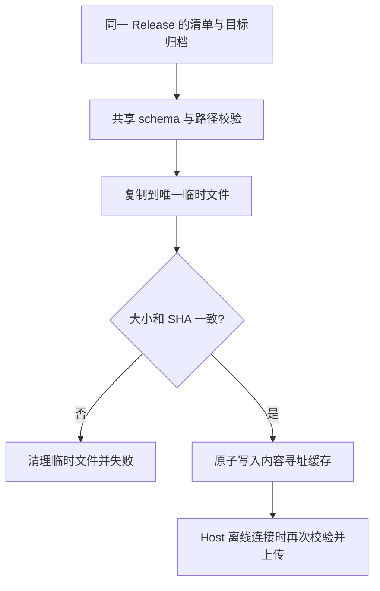

# 离线 Source Server 资源导入

日期：2026-10-26。

正式发布的桌面安装器仅携带资源清单。完全离线首次连接 SSH / WSL / Docker 前，可从同一 Release 下载目标归档，并用仓库提供的 Node.js 24 导入命令预热 Host 缓存。导入工具需要已安装仓库依赖；不假定桌面用户已经安装 Node。

## 输入与所有者

- `--descriptor`：当前已安装客户端随包的 `source-server-release.json`，或与该客户端相同 Release 的清单。
- `--archive`：清单中某一目标的归档文件。
- `--cache-dir`：客户端实际的 `remote-assets-cache` 根目录，必须显式给出，工具不猜测用户数据路径。
- Host resolver 仍是缓存可用性的唯一运行时判定者；导入工具只预热其内容寻址文件路径，不修改连接配置、会话或远端服务。

## 使用方法

在已安装依赖的本仓库中，用 Node.js 24 执行；清单和归档必须与当前安装客户端的 Release 对应。每个远程目标单独导入一次：

```bash
node packages/desktop/scripts/import-source-server-release.mjs \
  --descriptor /path/to/source-server-release.json \
  --archive /path/to/zcode-server-linux-x64.tar.gz \
  --cache-dir /path/to/remote-assets-cache
```

正式版默认缓存根目录：macOS 为 `~/Library/Application Support/ZCode/remote-assets-cache`，Windows 为 `%APPDATA%\\ZCode\\remote-assets-cache`。这些内部兼容目录沿用旧名称；如果设置过用户数据或缓存路径覆盖，应使用实际路径。工具不会要求连接远端或下载其他架构。导入后在桌面正常连接；远端仍需满足现有 SSH、解压及运行环境要求。

## 行为与验收

1. 复用共享 descriptor schema，拒绝超出 64 KiB 的清单、非普通输入文件、未知文件名或版本路径越界。
2. 将归档复制到 `<cache-dir>/source-server/<version>/<target>/<sha256>/<fileName>` 下的唯一临时文件；按复制后的字节流校验 size 和 SHA，再原子提交。
3. 不解压或执行输入，不联网，不删除其他目标或 SHA 的有效缓存。失败清理本次临时文件，损坏输入不得覆盖有效缓存。
4. Host 首次使用时再次校验清单指定的 size/SHA；只复制文件或运行导入命令不等于真实远程部署验收。
5. 测试覆盖成功导入后离线 resolver 命中、损坏归档拒绝且保留原缓存、非法版本路径拒绝。


