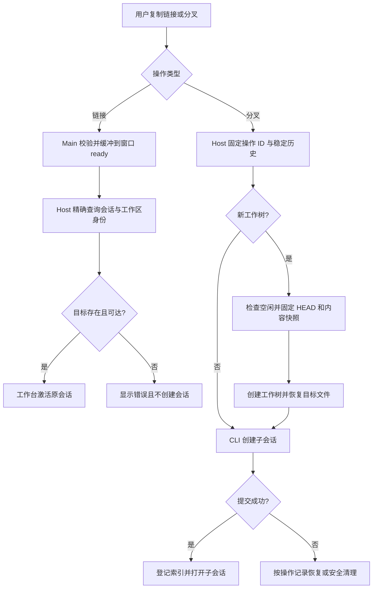

# 会话深度链接与分叉

状态：2026-11-06，按用户确认方案实施。会话事实归 CLI，组织态和跨工作区编排归执行 Host；Main 只负责协议解析和原生窗口投递。

## 会话链接

- 复用 `zcode://session/open`，携带 taskId、workspacePath、可选 workspaceIdentity 和已保存的 Source 标识，不携带凭据。身份比较使用 `workspaceIdentity?.trim() || workspacePath`。
- 链接只定位已存在的会话。Host 查权威任务索引后再激活工作区；不存在、已删除或远端不可达必须显示错误，不创建空会话、不按相同路径匹配其他 Host。
- 冷启动和 renderer 尚未注册时缓存请求，ready 后按顺序投递；已有窗口复用工作台导航。只打开链接不提交 prompt。
- 第二实例通过安全 argv／additionalData 复用同一协议路由；macOS 驻留且无主窗口时先缓存会话请求并创建主窗口，不能只聚焦空实例或丢弃链接。
- 侧栏、分组行和标题菜单使用同一复制／分叉操作。
- “复制会话链接”“在当前目录分叉”“在新工作树分叉”不依赖分栏开关；未发送的草稿不展示会话操作。远端连接失效时保持可复制既有坐标，分叉显示明确失败信息。
- 分叉请求中只生成一次操作 UUID，挂起时重复触发共用同一 Promise，失败重试复用该 UUID。返回后按 child 的路径与完整 identity 激活目标页签；上下文交接必须提示用户，且不自动发送首条输入。

## 分叉

- 同目录分叉固定最新稳定对话边界；子会话继承引擎及连接配置，不继承运行队列、pending interaction、进程或 lease。原有消息级稳定边界分叉保留。
- 外部引擎优先 ACP 原生 `session/fork`，保存新的 native session ID。不能把复制可见消息冒充原生上下文；不支持时明确采用上下文交接，背景在子会话首次输入时交给模型。
- 上下文交接保存在 `external_engine_handoff` entry 的 `data.context`；首次真实输入附加历史背景，用户消息继续保存原文，不自动提交 prompt。只有原生 ID 已绑定且首轮正常完成才保存 `consumedAt` 与 `nativeSessionId`；失败或取消保留背景，重开会话可继续交接，完成后的后续输入不重复注入。
- 工作树分叉只在源会话空闲时执行。在源 Host 固定 HEAD 与 repoRoot 内容快照，从 HEAD 创建新分支／工作树，再复制已跟踪文件当前内容和非忽略 untracked。源目录与真实 index 不变，忽略文件不复制，不自动运行 setup。
- 子 cwd = 目标工作树根 + 源 cwd 相对仓库根。目标身份在创建时确定，禁止创建后修改 cwd。CLI 支持不同工作区分别配置数据库时，由源 CLI 导出不可变分叉内容、目标 CLI 原子导入；Host 不直接修改正文库。
- 非 Git、无 HEAD、未解决冲突或无法忠实快照的子模块／嵌套仓库拒绝工作树分叉并解释原因；同目录分叉不受 Git 限制。
- 同一 operationId 只产生一个 child。提交前失败只清理本次创建且仍符合操作记录的资源；已有用户编辑的工作树保留。child 已提交后索引或导航失败，重试完成登记和打开，不再次创建。
- 跨 Host／CLI 的导出操作记录必须通过 SessionStore 的原子 claim 写入：固定 entry id 只允许首个 writer 插入，后续 writer 不得覆盖 `nativePending` 或 `complete` 载荷；失败者读取已提交记录并恢复同一结果。原子 claim 只报告是否获胜，不承担正文更新或模型选择 entry 的 upsert 语义。
- Git 准备内部失败可按记录安全回收；一旦已请求源 CLI 导出，响应丢失可能发生在历史冻结或原生分叉之后，Host 保留工作树并使用同一操作恢复。既有准备记录和已完成导出允许在父会话后来忙碌时重放；新的导出仍由 Runtime 空闲 lease 排他保护。
- 目标 CLI 导入前验证传输摘要、目标路径／身份、child 与命令 ACK 的身份一致性，以及 forkKind 与引擎、native ID、上下文交接 entry 的一致性；坏 JSON 或不一致载荷以参数错误拒绝，不能写入半个 child。目标数据库可以没有父会话，幂等事实归 child。
- 导入事务必须拒绝正文、part、entry、首次输入或命令事实占用既有全库主键，也拒绝同一 bundle 内的重复主键；不能借助 upsert 将其他会话的数据改绑或覆盖。已匹配的幂等命令事实先返回原 child，保留原有消息级分叉的重放行为。目标状态按 session 隔离，targetId 沿既有分叉语义处理。

### Git 工作树接口

- 执行 Host 的 `IGitService.prepareSessionWorktree({ workspacePath, operationId })` 返回 `operationId`、目标 `workspacePath`、`worktreeRoot`、`branchName`、`headOid`。目录为当前 Host 数据目录的 `worktrees/<repoHash>/<operationId>`，分支为 `ycode/fork-<operationId>`；同一仓库共享持久操作记录，进程内串行并以磁盘锁排除其他 Host 进程的并发写入。
- `getSessionWorktreePreparation({ workspacePath, operationId })` 只读查询已完成且目录仍存在的准备结果；不存在、尚在准备或已回滚时返回 `undefined`，不创建操作记录或目录。Host 依此恢复已提交 child 的同一操作，父会话后来进入 busy 不得阻止恢复；新操作仍必须先通过 busy 门禁，再准备工作树。
- 文件快照逐字节保存，不经过 Git clean/smudge filter；目标 index 留在原 HEAD，暂存分类不继承。拒绝冲突、子模块、嵌套仓库和特殊文件；不执行仓库 hook、不复制忽略文件。
- `rollbackSessionWorktree` 只移除 HEAD、分支、index 与完整文件指纹均符合准备记录的目标，包含新建忽略文件的用户编辑也会阻止删除；返回 `{ removed: false, reason: "modified" | "not-found" }`。删除分支使用预期 HEAD 校验。
- 准备完成后崩溃可从持久记录直接复用；创建中断且无法证明目标仍为初始 checkout 或完整快照时，保留工件并明确报错，不强制重建或覆盖。被回滚的操作 ID 保留墓碑，重试不得产生第二个目标。

## 验收

覆盖三种引擎、同目录／工作树、本地／SSH 身份、冷启动、归档历史、缺失目标、重复请求和中断恢复。真实 Git 临时仓库验证源 index 与文件不变，目标内容和分支祖先正确，覆盖二进制、删除、重命名、空格／中文路径、子目录 cwd、linked worktree；模型实际上下文与 cwd 必须对应子会话。新增桌面用例先放 manual-review/pending，不自动提升 CI。
