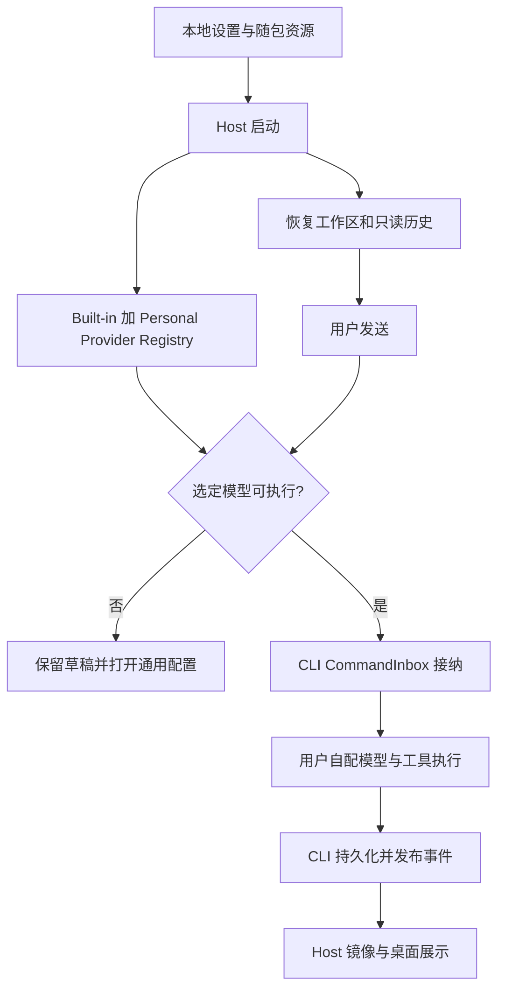
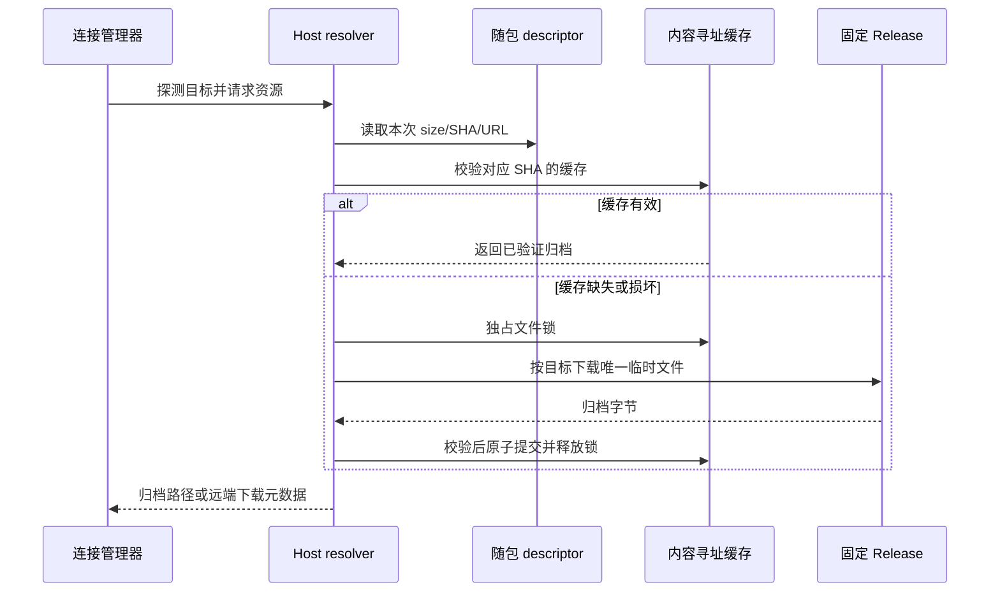
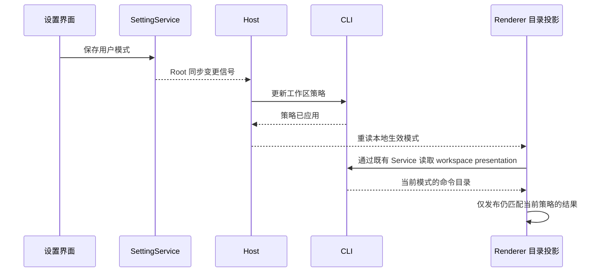

# 独立桌面 Coding Harness

状态：2026-10-24 用户确认；实现已落地，macOS arm64 生产安装包隔离启动验收通过；真实 API、外部 SSH 和其他平台验证边界见验证记录。

## 产品边界

保留桌面、CLI、SSH、会话、终端、编辑、Git、Skills、插件、MCP、Subagents、普通定时任务、动态工作流和本地 App Usage。GLM 只作为普通 API Provider，不需要产品账号。

工作区终端可显式启动用户安装的原生 Claude Code，默认传入权限模式 `auto`；原生 TUI 和会话事实由 Claude Code 管理，不恢复已移除的第三方 Agent Provider。见 [Claude Code 原生终端接入](./claude-code-native-terminal-spec.md)。

移除官方账号、套餐、额度、邀请、营销、推广、云分享、反馈上传、遥测、手机云端远控、官方更新检查、官方 Server MCP 凭证注入和闲时 ticket 调度。不新建替代商业服务或手机配对服务。

安装架构不匹配时保留本地提示，用户自行安装原生架构构建，不提供原厂下载跳转。

首次启动直接进入桌面。无模型时允许查看历史、管理项目和编辑草稿，发送前打开通用模型配置，不自动选择模型或改变计费来源。

无可用模型的横幅只提示配置模型 API，不提示开通套餐或升级。已退役商业错误分类不再驱动本地化、按钮或动作；普通 Provider 错误原文、MCP OAuth 和本地用量文案保留。

## 状态与接口

- Provider Registry 是可执行模型的唯一事实源；随包 Built-in 和 Personal Repository 提供配置，不加载 Account Overlay 或远端配置缓存。
- 例外：外部 Agent 引擎会话（Claude Code / Codex，见 [external-agent-engines-spec](./external-agent-engines-spec.md)）不经过 Provider Registry，可执行性由引擎就绪（adapter 已安装、官方 CLI 已登录）决定，未就绪返回 `engine_not_ready`。其模型调用由用户自己的官方 CLI 发起，属于用户显式配置，与 H07 不冲突；adapter 只在用户点击安装时访问 npm。
- 跨 Environment 的 Provider 配置同步仅由连接上线、Personal 配置和默认选择变更触发；账号设置与官方凭据变化不触发同步。Source 仅依赖 Personal Repository 和对应文件，旧信封的账号字段只保留校验兼容，不读取或应用旧凭据。触发器只存在于运行时代际，不是持久化历史。
- 本地 App Usage 错误只呈现本地读取失败和原始错误，不使用套餐、账号或 API Key 错误分类，也不跳转模型配置。
- CLI 不装配执行遥测 facade、port、因果传播、span writer 或空实现；turn、step、工具、命令、compact、后台标题和 Memory 直接执行既有业务生命周期。模型请求归因、ModelStatus、本地日志、TTFT、用量与耗时、compact timeline 和 AbortSignal 继续保留，不能因删除观测包装改变取消或错误语义。
- 用户操作直接执行原有命令与回调，不保留遥测采样、追踪队列、导出或事件发送旁路。桌面稳定客户端 ID 仅服务本地会话流关联，沿用旧值和文件名，不参与请求来源追踪。
- 用户设置由既有 SettingService 写入；动态工作流保留明确设置，缺省 onDemand；桌面与 SSH 的生效优先级为用户设置 > 内置 onDemand 默认，不读取发行档位、环境灰度或远端配置。独立 CLI 的通用解析器可显式传入本地环境覆盖。兼容接口中的 remote 输入但不访问其内容，快照来源仅为 override/default。
- CLI 拥有会话正文和执行事实，Host 拥有组织态和调度。workspaceIdentity 用于身份，workspacePath 用于文件操作。
- 删除官方专用 Service、RPC/IPC、preload、WebView、轮询和构建装配；共享安全与执行接口按真实引用保留。
- 内置目录和运行时随本仓库构建发布。Built-in Source 仅读取明确的随包文件并监听该本地文件，不读写旧 Active/LKG、Endpoint 缓存或刷新控制文件，不提供远端下载、应用 Release、周期检查或刷新接口。Host 向 Agent 传递同一随包路径；Personal 的锁、备份、轮询和原子更新保持原有所有者。默认插件市场使用自托管地址 `https://skill.artai.top/marketplace.json`，沿用 `zcode-plugins-official` 身份与既有安装记录；仅在该身份尚未登记时补种，不覆盖用户已有来源。本地插件与用户显式添加的来源保留，插件分发不依赖原厂账号。
- Agent 的默认、bootstrap 与 Turbo 源码构建都先清理目标 workspace 包的 dist，再按现有依赖顺序重建；防止已删除源文件的旧 JS 被 Server 整包暂存带入安装包。只清理构建输出，不触及用户数据。
- 桌面资源准备先完成 Source Server 构建，最后由桌面 Agent 准备步骤统一重建 Agent、插件及原生依赖闭包；后续 Server 构建不得清空已经完成的桌面资源。Koffi 仅服务 Windows Agent 的 MCP Job Object，放在 Agent 可解析的 `glm/node_modules` 并单独映射进安装包；当前 CUA SDK 不要求或校验过时的 Koffi 副本，macOS/Linux 不携带该 Windows 依赖。
- 正式安装包只携带 Source Server descriptor，四平台归档作为独立 Release 附件发布；descriptor 中的绝对 URL 固定本次不可变构建、size 与 SHA-256，不能运行时查询 latest。同一版本不同构建按 SHA 隔离。桌面安装器直接审计实际压缩体积，不再增加离线资源额度；四平台独立资源仍逐个校验 size/SHA 和完整性。
- 运行时不捕获或转注入旧 Agent 遥测变量；环境清洗仍拒绝 OTEL、旧遥测身份及其 tool passthrough 恢复，CUA broker 定向捕获和用户网络配置保持原有边界。
- 默认启动、空闲及普通 coding 不访问原厂业务服务；用户自配模型 API、MCP、插件及显式命令可以联网。按用途和路径验收，不封禁整个模型供应商域名。

## 数据兼容

不删除或重建数据库、旧列、正文、附件、项目或分组。旧官方凭据留在磁盘但不读取；普通模型、SSH 和 MCP 凭据不变。旧套餐模型仍可展示历史，执行时要求手动换模型，不自动回退。普通自动化保存了失效模型时阻止执行。旧闲时记录不再调度，已生成的会话保留为历史。必要配置写入复用 Repository 的锁、备份和原子更新。

旧账号设置仅在磁盘读取边界解码并保留回滚字段；缺少组织信息的旧 Team 连接保持原样。设置服务不查询官方账号、不补齐组织，也不自动修复远端连接。

搜图等依赖官方 Server MCP 的插件不默认启用。旧插件中的官方鉴权声明继续拒绝解析，不匿名降级请求。

插件目录不再声明或透传 `requiresPaidPlan`，卡片和详情不展示套餐徽标或套餐使用建议。旧目录携带该字段时忽略它，插件安装、配置、启停及普通 MCP OAuth 保持原有链路，不改写会话历史。

SSH / WSL / Docker 资源由 Host 现有 resolver 唯一管理。正式版优先读取随包本仓库 descriptor；仍带归档的源码离线构建继续校验并使用本地归档。仅有 descriptor 时，默认按探测到的目标下载一份并上传；SSH 显式选择远端下载时只返回该 descriptor 的固定 URL 与校验信息。普通本地启动和编码不触发远程资源下载。显式镜像沿用现有网络注入，失败不得回退旧缓存 descriptor 或原厂地址。随包 descriptor 缺失且无显式镜像时必须报错。

Host 下载缓存路径为 `<remoteCacheDir>/source-server/<version>/<target>/<sha256>/<fileName>`，每次复用必须验证 size/SHA；可信随包 descriptor 允许有效缓存完全离线复用。离线首次部署可预先导入独立 Release 的归档到此路径，导入过程同样校验 size/SHA。缓存文件不是版本/地址的权威，不能从旧缓存 descriptor 推导下载地址。不同根目录、目标和 SHA 不共用缓存或锁。

同一缓存内容的跨 Host/进程请求由文件锁串行化，下载先写唯一临时文件，校验后原子提交；等待者校验缓存后复用。失败、取消和超时清理本次临时文件与持有锁，不删除其他 SHA 的资源。已退出进程的锁允许安全回收；若回收进程自身退出留下标记，确认后立即返回包含锁目录的清理提示，不争抢删除回收标记。锁等待和网络请求均有时限。连接取消的信号可传入 resolver，预览元数据不得下载归档。开发态 `development-content-addressed` 仍强制消费本轮本地 descriptor/archive，缺失或损坏不得回退正式版下载。

生产与测试随包模型目录都不声明账号套餐成员或产品网关能力；普通 GLM API 模板保留。旧 Agent 二进制下载脚本删除，开发和打包统一使用源码构建入口。

新 MCP 工具结果 display 不接受官方套餐不可用标记；旧结果在 CLI 读取边界仅从内存投影剥离 `unavailable`，保留服务器、工具、描述和插件 UI，不改写持久化历史，也不恢复商业错误解析或提示。

## 已接受验收场景

| ID  | 前置与操作                                       | 断言                                                      | 证据                 |
| --- | ------------------------------------------------ | --------------------------------------------------------- | -------------------- |
| H01 | 空白隔离目录、断网启动桌面                       | 无登录页或账号等待；能浏览项目与历史；无模型可保留草稿    | UI、启动日志         |
| H02 | 配置普通 Provider 和 GLM API，保存后重启         | 使用用户凭据，配置持久化，不获取官方账号凭据              | UI、请求、配置文件   |
| H03 | 发送 coding 请求、工具调用、停止、续聊与 compact | 流式输出和权限正常；文件/终端/Subagent 可用               | UI、协议、文件       |
| H04 | 加载旧历史及套餐模型选择                         | 历史完整；执行前手动换模型；不改写旧选择                  | UI、数据库对比、请求 |
| H05 | 加载本地 Skills、插件、MCP、工作流与定时任务     | 无官方账号依赖；动态工作流默认 onDemand；失效模型阻止执行 | UI、工具协议         |
| H06 | 本地源码产物部署到 SSH、断开后重连               | 远端可执行；身份、目录、会话隔离不变                      | 真实 SSH 或隔离集成  |
| H07 | 观察启动、空闲、配置和普通 coding                | 无官方业务服务请求；用户配置模型调用不被阻断              | 网络和服务调用记录   |

## 官方协议与交互退出

- 新 sendText、editUserQuery 和 sendQueuedNow 请求拒绝 highspeedMeta；setHighspeedMetrics 不再属于命令协议。删除高速卡材料暂存、凭据注入、隐式 selectionFallback、指标写入和 Start Plan 专属重试。普通流恢复、工具结算、预算和取消沿用现有链路。
- 旧套餐选择在排队提升、编辑/retry 的历史截断前拒绝；保留原输入和选模，不切换 Provider 或计费来源。旧高速卡事件、metadata、feedback 仅供历史读取，不改写文件。
- 删除点赞/点踩上传操作、乐观状态及组件回调，保留复制、派生与时间。CronCreate 继续覆盖创建入库、派生、详情和保存。
- 常规设置不再展示或读写预览版更新与自动下载安装开关。旧 schema 字段保留兼容；硬件加速、任务通知和声音仍通过原设置所有者保存。
- 远程握手遇到桌面版本不兼容时，提示手动安装本仓库兼容构建，不触发官方检查或下载。Server 更新仍走本仓库源码产物与现有安装流程。
- 旧 `.zcode-share/*/shared-conversation.json` 通过 `IZCodeSessionService.getImportedConversation` 在工作区本地只读解析，不请求官网或恢复云分享服务。

## 工作流设置与目录同步

设置文件是用户选择的唯一来源，Host 裁决并串行同步给各 workspace CLI。Renderer 在 Host 同步完成后的本地可用性投影改变时，复用 readWorkspacePresentation 重新水合已有目录，不自行增删命令。每个 workspace identity 串行水合，同一策略共享在途请求；旧策略的迟到结果不得覆盖新策略。切换模式不修改活跃会话工具面、模型或持久化会话。

桌面 E2E 必须等待同一工作区 goal 正向项就绪，以及 workflow 项与本地模式一致，再断言入口显隐；不能把磁盘已写入等同目录已刷新。从设置页进入自动化时先关闭设置页并等待设置消失；返回后若自动化内容已显示则复用当前页，否则点击可见侧栏入口。设置返回目标可以是自动化页，不要求 coding composer 就绪；Host 策略与命令目录屏障保持不变。

## 验证与交付

实际命令、产物、先红后绿回归与证据边界见 [验证记录](./standalone-coding-harness-validation.md)。使用隔离目录，不迁移日常用户数据；不提交、推送或发布。

删除功能的专属测试随实现退役；通用 Provider、MCP OAuth、权限、取消、compact、排队、fork、耗时及历史读取断言迁到保留场景。共享 E2E helper 等待匿名工作区，不播种官方 OAuth/JWT；保留普通 API、MCP OAuth 与 SSH 测试凭据。新桌面场景保持 manual-review/pending，不自动转正或准入 CI。

回放不等同真实模型 API 验收；本机回环 SSH 不等同外部 Linux 或桌面远程身份全链路；macOS 构建不等同 Windows/Linux 实机验收。网络按服务用途与路径检查，普通 GLM API 与用户显式联网能力继续保留。
