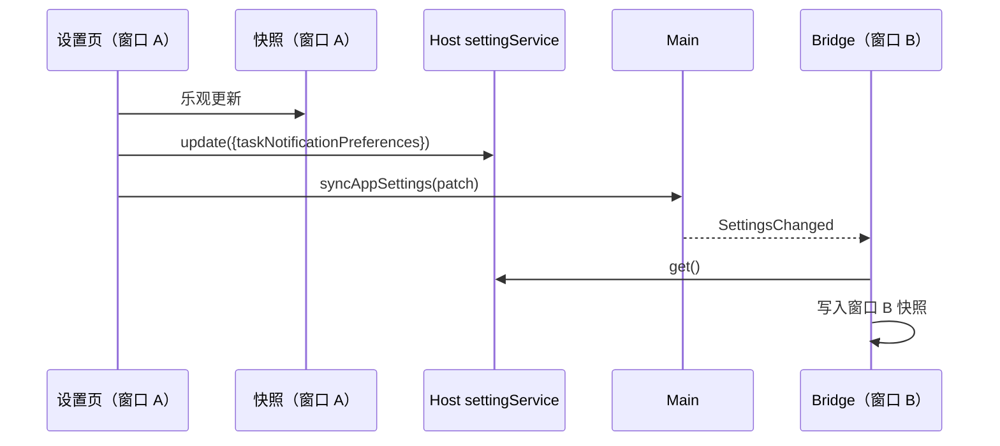

# 任务通知与提示音（1.5.0）

## 产品规则

- 任务通知总开关（`enabled`，默认开）控制系统通知、提示音和任务栏/托盘角标；关闭后三者全部停止，侧栏蓝点不受影响。
- 提示音按两类事件分别选择：
  - **任务完成**（`completed`）：通知状态 `completed`、`feedback_update`。
  - **需要你操作**（`attention`）：通知状态 `permission_request`（审批）、`elicitation_request`（提问/计划确认）、`failed`（出错）。
- 可选音色：`pop`（默认，沿用 `task-notification-pop.mp3`）、`crisp` 清脆、`soft` 柔和、`woodblock` 木鱼、`droplet` 水滴、`chime` 双音、`mute` 静音。两类默认都为 `pop`。
- 默认仅在应用所有窗口都不在前台时响；开关“窗口在前台时也播放”（`playWhenFocused`，默认关）打开后总是响。系统通知仍只在应用不在前台时弹出（规则不变）。
- 设置页每个类别旁有“试听”按钮，按当前选择立即播放一次（不受前台规则限制，静音时禁用）。
- 新增 5 个音色由仓库内脚本 `scripts/generate-notification-sounds.mjs` 用加法/FM 合成生成 16-bit PCM 单声道 WAV（22.05 kHz，每个 ≤ 0.6 s、≤ 30 KB），不引入第三方素材；生成结果提交在 `packages/ui/src/assets/notification-sounds/`，脚本可重复运行且输出确定（无随机数）。

## 状态所有者与持久化

- **唯一持久化 owner**：本机 `AppSettings.taskNotificationPreferences`（Host 设置文件，所有窗口共享）：`{ enabled, completedSound, attentionSound, playWhenFocused }`。读写经本机（base）`settingService`，远程工作区不写远端设置。
- **Renderer 唯一投影**：`packages/ui/src/lib/taskNotificationPreferences.ts` 的模块级快照（`getTaskNotificationPreferences` / `subscribeTaskNotificationPreferences` / `useTaskNotificationPreferences`）。快照只由 `TaskNotificationPreferencesBridge`（App 根部挂载一次）从设置快照写入；组件和提示音播放器只读快照。原 Zustand 字段 `notificationEnabled`、`notificationSoundEnabled` 及 `state:notificationEnabled` 广播删除，不保留第二份状态。
- **写入路径**：设置页调用 `useTaskNotificationPreferences().update(patch)` → 合并当前快照 → `useSettings.update({ taskNotificationPreferences })` → `platform.syncAppSettings` → Main 广播 `SettingsChanged` → 其他窗口 `useSettings` 刷新 → 各自 bridge 更新快照。本窗口写入前先乐观更新快照，写入失败回滚并 toast。
- **旧 key 迁移**：设置加载完成且 `taskNotificationPreferences` 缺席时，bridge 从 localStorage 旧 key 构造偏好：`zcode-notification-enabled`（`"false"` → `enabled:false`），`zcode-notification-sound-enabled`（`"false"` → 两类均为 `mute`）。存在任一旧 key 时写入设置，成功后删除旧 key；写入失败保留旧 key，下次启动重试。没有旧 key 时不写入，按默认值运行。设置加载前（首帧）快照用旧 key 推导的值，避免启动瞬间闪回默认。

## 播放链路

- Renderer 通知编排不变：`useTaskNotifications` 调 `IPlatformService.showTaskNotification(payload)`。
- **Desktop**：Main `dispatchTaskNotification` 校验与 3s 去重后计算 `appFocused`（任一应用窗口聚焦）；不在前台时弹系统通知；无论是否弹出，都向发起窗口发送 `TaskNotificationSound` 并携带 `{ category, appFocused }`（`TaskNotificationSoundCue`）。Main 不读偏好、不决定是否发声。
- **Web**：`webPlatform.showTaskNotification` 用 `document.hasFocus()` 计算 `appFocused`，不在前台且已授权时弹浏览器通知；然后同样交给播放器。
- **播放器**（`playTaskNotificationSound(cue)`，唯一判定点）：`enabled=false` → 不响；对应类别为 `mute` → 不响；`appFocused && !playWhenFocused` → 不响；否则播放对应音色。音频元素按音色懒加载并复用，播放前重置进度，播放失败静默。
- 试听 `previewTaskNotificationSound(soundId)` 直接播放，不经判定。

## 验收场景

- 旧 key `enabled=false` / `sound=false` 首次启动迁移为设置值并删除旧 key；写入失败保留旧 key。
- 设置已存在时忽略旧 key；窗口 A 改动后窗口 B 快照随 `SettingsChanged` 更新。
- 播放器：总开关关、类别静音、前台且未开“总是响”时不播放；前台开“总是响”、后台时播放对应音色；`completed`/`failed`/`permission_request` 正确映射类别。
- Main 在前台时不弹系统通知但仍发送带 `appFocused:true` 的提示音事件；去重仍生效。
- 合成脚本输出确定、文件头为合法 WAV、时长与体积在上限内。
