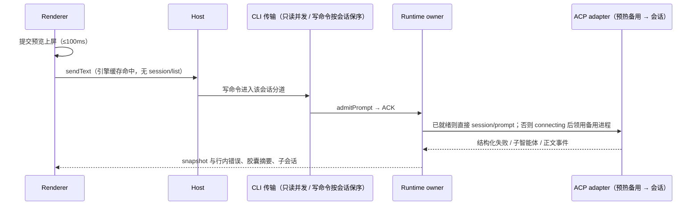

# YCode 1.1 更新方案

日期：2026-11-07。基线：`main` = 1.0.7（`c2ae3f2f` 已含默认引擎、Codex 连接方式、原生计划卡、更新关闭、首次重试错误、深链与 Fork，仅 macOS 夹具验收）。本机安装版本为 1.0.5。

本文件是 1.0.8 与 1.1.0 两个里程碑的唯一决策记录；各条行为细则同步写入对应 spec，本文只保留决策、范围、所有者与验收。

## 一、证据（本机 Windows 1.0.5 生产日志，2026-11-04 至 11-07）

| 链路 | 实测 | 结论 |
| --- | --- | --- |
| Host `sendConversationCommandV4` | n=127，p50 0.93s，p90 7.9s，最大 31.8s | 点发送到确认过慢 |
| 外部引擎发送前状态检测 | p50 0.73s，p90 3.2s；21 次在 0.4–3.3s 后报 `engine_not_ready` | 1.0.7 已改为零进程门禁 |
| MCP 启动（首个模型请求前） | p50 2.5s，p90 4.5s，最大 7.4s | 内置引擎转圈 3–4 秒主因 |
| 会话 app 启动插件阶段 | p50 0.8s，p90 1.4s（同步哈希约 42MB/600 文件） | 占用 CLI 单队列 |
| 启动恢复 6 个会话 | 每个 4.5–10.6s；期间发送 18–31s | 启动恢复阻塞发送 |
| 打开会话 `subscribeConversationV4` | p90 13.3s；`readWorkspacePresentation` p90 18.4s | 单队列排队 + 重复插件解析 |
| 首轮上下文初始化 | p50 0.25s，p90 0.74s（5–8 个 git.exe） | 次要 |

代码定位见附录 A。生产包目前不落盘 TTFT、队列等待与 ACP 握手耗时。

## 二、版本切分

- **1.0.8 Windows 稳定版**：在本机复验 1.0.7 的修复并补齐缺口，覆盖问题 2–6 与已发现的连接类缺陷。
- **1.1.0 性能与多智能体**：性能架构改造（问题 1）、多智能体展示（问题 7）、本地性能摘要。
- 发版规则扩展为按 `package.json` 的 `major.minor` 线递增 patch（见 ADR 0005）；1.0 线行为不变。推送 `main` 只产出 CI 安装包，不自动发布 Release。

## 三、决策记录

### 性能（问题 1）

行为细则见 [YCode 1.1 引擎性能 spec](engine-performance-1.1-spec.md)。

- 验收目标（本机为基准机，p95）：点发送到消息上屏 ≤ 100ms；热会话点发送到"工作中" ≤ 300ms；热续聊 YCode 自身开销 ≤ 300ms；外部引擎冷启动就绪 ≤ 3s 且尽量在输入期间完成；启动后首次发送确认 ≤ 1s；打开历史会话首屏 ≤ 500ms。
- 生产包落一份本地性能摘要：info 级、只在本机、不含正文、路径脱敏，不新增上传。
- MCP：首个模型请求不等待 MCP。CLI 按 server 配置指纹缓存上次成功的 `tools/list`；有缓存的 server 按缓存注册工具、首次调用时才启动进程；无缓存的 server 后台启动，连上后从下一次模型步骤加入。实际清单与缓存不一致时以实际为准并刷新缓存。MCP 进程继续按会话隔离。
- 内置插件：随版本不变的内置插件摘要按"应用版本 + 文件统计签名"缓存并在 CLI 进程内复用，不在每次建会话时重新哈希。
- CLI 传输：只读请求（订阅、快照、行范围、计划、文件变更、工作流、工作区展示、`session/list`、子智能体目录）不再排在单队列后；改变状态的命令按会话分道保序，不同会话互不阻塞。外部引擎 `createSession` 在记录建立后即确认，握手在后台完成，进度沿用既有 `engineConfigState`（connecting → ready / error）。
- 外部引擎进程：保持每会话一个 adapter；按（引擎，连接配置 ID）维持至多一个已完成 `initialize`（与 `providers/set`）的预热备用进程，`session/new` 时领用并在后台补位，闲置 10 分钟回收。闲置会话回收时间由 10 分钟延长至 30 分钟。Windows 上 Codex 的 npm shim 解析到原生 `codex.exe`，Claude 的 `.cmd` shim 解析到其指向的 `claude.exe`，跳过 cmd.exe / node.exe。
- 启动恢复：启动时只恢复当前可见会话；其他已打开 Tab 激活时再恢复。外部引擎后台连接只对可见会话进行。
- Host 每次发送：会话引擎创建后不可变，按 sessionId 缓存，命中时不再调用 `session/list`；provider 注册表仅在配置修订号变化时刷新；浏览器环境上下文无浏览器页面时跳过，且等待上限不阻塞发送。Renderer 每次发送的 `getView` / genUi 列表读取改为订阅缓存；草稿首发在确认后即清除"正在发送"，不再等任务树刷新。
- 首轮上下文的 git 快照合并为最少调用并按仓库索引修订缓存；`chcp` 代码页每进程只查询一次。
- CLI 侧落地细则（MCP 工具清单缓存与首次使用时启动、内置插件摘要缓存、传输分道、git 快照、本地性能事件）见 [内置引擎性能规格](./engine-performance-1.1-spec.md)。

### 默认引擎（问题 2）

- "默认"与"上一次"合一：`defaultSessionEngine` 记住最近一次显式选择（现状保留）。
- 每个引擎分别记住最近确认的模型与思考深度，新草稿在原生配置就绪后按目录可用性恢复；权限模式不记忆，沿用引擎默认（Claude 新会话 Auto 规则保留）。
- 工作区不能运行默认引擎（SSH、Web）时，该草稿使用 YCode，选择器中外部引擎灰显并说明原因，默认偏好不被覆盖。

### 计划模式（问题 3）

- 根因：1.0.5/1.0.6 的引擎权限请求未发出 `PermissionRequested`，界面不出卡片，轮次一直运行（截图 1）；1.0.7 已修。
- 执行进度进入右上角状态胶囊的"计划"项，展开查看完整清单；不在输入框上方新增浮条。
- Claude 计划审批按原生请求的工具名 `ExitPlanMode`（含 `name` 字段与 "Approve Plan" 标题）识别。主按钮"开始执行"选择"保留上下文、回到进入计划前的权限模式"对应的原生选项；"更多"菜单列出其余原生选项，清空上下文项单独标注；任何路径都不隐式选择清空上下文。
- 引擎写完计划但未发审批请求时，计划卡提供"开始执行"：先把原生模式切出 Plan，再以用户身份发送一条可见的"按上面的计划开始执行"。
- 审批等待中停止或断联时，Runtime 发布对应交互的结束事件，界面不残留审批卡。

### 连接与认证（问题 4）

- 1.0.6 根因：就绪 = 已安装且已登录；1.0.7 改为已安装且找到官方 CLI。"沿用 CLI"适用于 config.toml 网关、无 auth.json 的用户。
- Claude Code 与 Codex 对称提供三种连接：沿用 CLI / 官方登录 / API Key + Base URL。Host 是连接配置唯一写者，密钥进 CredentialService，会话绑定配置 ID 且不可变。
- 支持多个命名连接配置：列表显示名称、方式、网关域名；新草稿可选用，"上次使用的配置"按引擎记住；已有会话保持原绑定。
- 设置页提供"测试连接"：经该引擎与配置发起一次最小请求并展示结果；网关用户不再显示"未登录"，改为"使用网关 <host>"。
- "沿用 CLI"保留用户的代理与证书环境变量（`HTTP(S)_PROXY`、`NO_PROXY`、`SSL_CERT_FILE` 等），仅在 YCode 显式设置代理时覆盖。

### 更新提示（问题 5）

- 关闭 = 跳过该版本（现状保留），帮助菜单"检查更新"始终可用，不新增开关。
- 说明文案按平台区分：Windows 为"下载并校验后打开安装程序"。
- 用户开始下载后不再隐藏进度与就绪状态；下载失败时可关闭。

### 网关错误（问题 6）

- 两家 adapter 的结构化失败扩展（Codex 的 typed session failures、Claude 的 `sessionFailure` 能力）由 YCode 声明并消费，不再从正文解析。
- 三个引擎共用一个行内错误行：重试中显示"正在重新连接 n/m"（未知上限时显示次数），展开可见上游原文（最多 300 字，凭据与 query 脱敏，URL 仅保留 scheme + host + path）、HTTP 状态、请求 ID 与复制。
- 最终错误留在失败轮次末尾并随历史持久化；输入框上方横幅只承载与轮次无关的错误。
- 本轮尚无模型输出与工具执行时，错误行提供"重新发送"，用户点击才发送；有部分输出时不提供。

### 多智能体（问题 7）

- 三个引擎都纳入：内置引擎已有子会话与右侧面板；Claude Code 与 Codex 声明 ACP `clientCapabilities.subagents`，把子智能体映射为 YCode 子会话（`subagent_child`）与 `snapshot.subagents`，子会话正文独立持久化，子会话权限请求回到父会话的待处理交互并标注来源。
- 右上角状态胶囊：有子智能体运行时显示头像串（最多 3 个）与"N 个运行中"，优先级为 工作流 > 运行中的智能体 > 计划 > 目标 > Git。
- 对话流中同一轮连续派发合并为一行"A、B 和 C 开始工作"，点击头像或名称在右侧面板打开只读实时对话；引擎支持时提供停止。
- 头像沿用 DESIGN.md 的瓦片脸：颜色按父会话内的实例序号取九色板，按子智能体类型增加轮廓变体（如天线、耳朵、眼型），颜色不表示状态。

### 验收方式（问题 9）

在本机用开发版与 CI 安装包分别验收；性能基线先用夹具采集，真实供应商场景使用用户现有的 Codex / Claude 配置执行少量短 prompt，不读取或复制凭据文件。

## 四、状态所有者与事件顺序

- Runtime 仍是 transcript、配置、计划、错误、子智能体投影的唯一发布者；Host 只持有连接配置与引擎安装状态；Renderer 只保留草稿、在途提交预览与面板布局。
- 结构化失败按 adapter 的失败 ID 幂等合并；迟到的重试事件在终态后不得重开错误行。
- 子会话以原生子会话 ID 为幂等键；`session/load` 回放的子会话历史不得重复写入。

## 五、实施与验证

- 1.0.8：错误统一与计划修复（CLI 外部引擎 + 投影 + UI）、连接配置（Host + adapter 环境 + 设置页）、默认引擎与更新提示及连接类缺陷（UI + 共享设置 + CLI 小修）。
- 1.1.0：CLI 性能（MCP、插件摘要、传输分道、git/chcp、性能事件）、外部引擎进程与子智能体（预热备用、原生可执行文件、子会话映射）、Host/Renderer 发送路径与启动恢复、多智能体界面与头像。
- 每项先更新对应 spec，再补测试与实现；交付前执行 `pnpm typecheck`、`pnpm lint`、`pnpm architecture:check --changed` 与受影响单测，交互改动补 E2E 场景（`manual-review/pending`）。
- 未在真实 Windows / 真实供应商上验证的结论不得写成通过。

## 附录 A：代码定位

- MCP 门：`apps/zcode-cli/packages/core/src/runtime/turn-loop.ts:121-125`、`methods/mcp.ts:123-138`、`adapters/src/mcp/pool.ts:554-559`。
- 单队列：`apps/zcode-cli/packages/bootstrap/src/zcode-protocol/transport.ts:250-303`；外部 `createSession` 握手：`bootstrap/src/zcode-protocol-v4/commands/handlers/session-mgmt.ts:85-94`。
- 插件哈希：`apps/zcode-cli/packages/bootstrap/src/app/bundled-plugins.ts:305-387`。
- ACP 能力声明与非主会话丢弃：`apps/zcode-cli/packages/adapters/src/external-engine/connection.ts:56,340-344`。
- Codex 最终错误作为正文：`~/.zcode/engines/codex@2.2.2/.../codex-acp/dist/index.js:31777`；Claude 计划选项：`.../claude-agent-acp/dist/permissions/options/tools.js:42-98`。
- 默认引擎 SSH 问题：`packages/ui/src/v4/composer/useDraftConfigControl.ts:249-256,558-565`。
- 平台文案：`packages/ui/src/i18n/locales/zh-CN.ts:1937`。

## 附录 B：追加决策（2026-11-07 本机进程实测）

本机 1.0.5 运行三天后常驻 85 个 YCode.exe：61 个官方插件 MCP 宿主（约 4.0GB）、10 个 Claude adapter（约 0.8GB）及其 10 个 `claude.exe`（约 1.9GB）、6 个工作区 CLI（约 0.8GB），合计约 8.6GB。常驻会话的 MCP 与引擎进程从不回收，是"整体变慢"的重要来源。据此追加：

- MCP 进程闲置回收：已连接的 MCP server 无在途请求且 10 分钟未被调用时，由会话 lease 关闭并回到"待首次使用"，工具仍按清单缓存注册，下次调用经同一懒启动路径重启；持有 MCP App/UI 连接或在途调用时不回收。
- 外部引擎闲置连接：会话无运行中轮次、无待处理交互且空闲 15 分钟时关闭该会话的 adapter 进程，保留订阅、配置与 `externalSessionId`；下次发送或修改配置时按原会话恢复（UI 显示连接中）。最近活跃的 3 个会话不受此限。未订阅会话的常驻池回收维持 30 分钟。
- 验收：本机连续使用一天后，YCode 子进程数与内存占用相对 1.0.5 显著下降，且闲置后首次发送仍可在恢复后正常完成。
