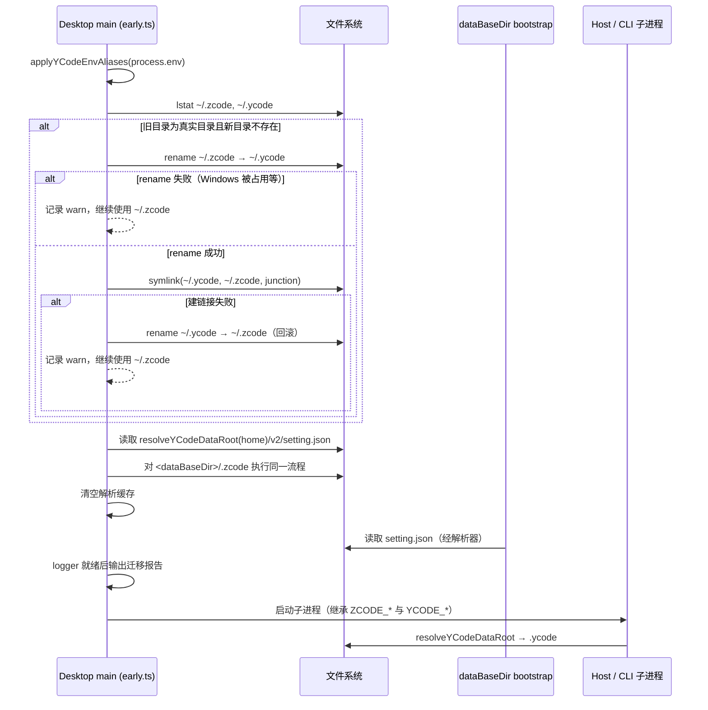

# YCode 数据目录迁移（~/.zcode → ~/.ycode）

来源：`docs/plans/2026-11-22-1.5.1-fixes-and-ycode-rename.md` 工作包 G。品牌显示规范见 `docs/desktop/ycode-branding-spec.md`。

## 产品规则

- 用户级数据根从 `<base>/.zcode` 改为 `<base>/.ycode`；Beta CLI 的 `<home>/.zcode-beta` 改为 `<home>/.ycode-beta`。`<base>` 为 home 或用户自定义的 `dataBaseDir`。
- 迁移后在旧位置留下指向新目录的链接（Windows 目录联接 junction，macOS/Linux 符号链接），写死旧路径的代码、旧版 CLI、降级到 1.5.0 都继续读写同一份数据。
- 任何失败都保留旧目录继续可用，写 `warn` 日志；同一份数据不会出现两份。
- 不改：appId `dev.zcode.app`、Electron userData（`AppData/ZCode*`）、工作区内项目级 `.zcode/` 目录、`.zcode-plugin` 清单目录、`@zcode/*` 包名、协议字段。

## 所有者与接口

| 职责                               | 唯一所有者                                                                                      | 接口                                                                                    |
| ---------------------------------- | ----------------------------------------------------------------------------------------------- | --------------------------------------------------------------------------------------- |
| 目录名决策、环境变量别名（纯函数） | `packages/shared/src/ycode-data-root/contract.ts`                                               | `chooseDataRootDirName`、`planDataDirMigration`、`readYCodeEnv`、`applyYCodeEnvAliases` |
| 数据根解析、迁移执行（同步 fs）    | `packages/shared/src/ycode-data-root/node.ts`                                                   | `resolveYCodeDataRoot`、`migrateLegacyDataDirSync`                                      |
| 本机迁移的触发时机                 | Desktop main 最早期 `packages/desktop/src/main/data-dir-migration/`                             | `index.ts` 第一条 import                                                                |
| 远程迁移                           | 部署链路（`packages/server/src/remote/deployShared.ts` 的 `buildRemoteDataDirMigrationScript`） | Source Server probe 与经典部署前执行                                                    |

所有读取用户级数据根的位置都经 `resolveYCodeDataRoot(base, flavor)`：`<base>/.ycode` 存在 → `.ycode`；否则 `<base>/.zcode` 存在（未迁移）→ `.zcode`；都不存在 → `.ycode`。解析结果只在新目录存在或旧目录是未迁移的真实目录时缓存；迁移成功后清空缓存。CLI、Server CLI 是独立进程，使用同一个函数，结果一致。

作为身份的路径保持旧拼写：非项目对话工作区 `getConversationWorkspaceDir()` 仍返回 `<base>/.zcode/workspace/default`（会话按 workspacePath 哈希、项目库按 `root_path` 识别默认工作区），经链接访问同一目录，避免历史对话失联；插件管理工作区等同理保留。Server CLI 的服务名与 Windows 管道名经 `stableServerRootId` 按 `~/.zcode/server` 计算，迁移后重新注册覆盖原服务，不留下指向同一 root 的旧服务。

迁移使用同步 fs：它必须在其它模块求值之前完成，与既有 `setting.json` 早期读取（`readFileSync`）同一约束。

## 本机迁移

### 触发条件

Desktop main 启动时，`index.ts` 第一条 import 是 `data-dir-migration/early.ts`，它只依赖 Node 内置模块与 `@zcode/shared/ycode-data-root`，先于 services、logger、`setting.json` 读取和任何子进程。

候选 base：`os.homedir()`、`HOME`、`USERPROFILE`（去重），随后读取迁移后的 `setting.json` 得到 `dataBaseDir`（与 home 不同才加入）。每个 base 处理 stable 与 beta 两种目录。

| 现状（旧 `.zcode` / 新 `.ycode`） | 动作                                                         |
| --------------------------------- | ------------------------------------------------------------ |
| 真实目录 / 不存在                 | rename 旧 → 新，再在旧位置建链接（需允许重命名，见下）       |
| 不存在 / 不存在                   | 创建新目录并建链接（全新安装，避免写死旧路径的代码另建一份） |
| 不存在 / 目录                     | 在旧位置补建链接                                             |
| 链接 / 任意                       | 无操作                                                       |
| 真实目录 / 目录                   | 无操作，`warn`（两份数据，解析优先 `.ycode`，不自动合并）    |
| 其它（文件等）                    | 无操作，`warn`                                               |

“允许重命名”仅限打包版且未处于隔离环境：`YCODE_/ZCODE_DATA_BASE_DIR`、`ZCODE_DESKTOP_HOME_DIR`、`ZCODE_E2E_RUN_ID` 任一存在即视为隔离（开发预览、E2E）；开发版可用 `YCODE_DATA_DIR_MIGRATION=1` 显式开启。`dataBaseDir` 来自用户设置，不属于隔离目录，打包版同样迁移；来自环境变量的 base 不迁移。

### 事件顺序



### 失败与回滚

- rename 失败：不做任何改动，继续使用旧目录（解析器返回 `.zcode`），下次启动再试。
- 建链接失败：把新目录 rename 回旧位置；回滚也失败时记录 `error`，此时只剩 `.ycode`，解析器仍返回它，数据只有一份，写死旧路径的代码会读不到（需人工处理，日志给出路径）。
- 迁移报告在 logger 就绪后输出：成功为 `info`，跳过和失败为 `warn`/`error`。

## 环境变量

`readYCodeEnv(env, NAME)` 先读 `YCODE_NAME` 再读 `ZCODE_NAME`。Desktop main、CLI、Server CLI 入口调用 `applyYCodeEnvAliases(process.env)`，把设置了的 `YCODE_X` 写入 `ZCODE_X`，因此既有读取点和子进程（继续收到 `ZCODE_*`）无需逐个修改。别名列表：`DATA_BASE_DIR`、`STORAGE_DIR`、`SESSION_DB_PATH`、`HOME`、`BETA`、`DESKTOP_HOME_DIR`、`DESKTOP_USER_DATA_DIR`、`DESKTOP_SESSION_DATA_DIR`、`SERVER_RUNTIME_ROOT`。`ENV` 只在 CLI Beta 判定中通过 `readYCodeEnv` 读取，不写回 `ZCODE_ENV`（Desktop 的 `ZCODE_ENV` 是编译期身份）。进程间内部变量（如 `ZCODE_VERSION`）不改。

## 远程

- 远端数据根改为 `~/.ycode/server`（`REMOTE_BASE`、经典启动命令、Agent wrapper、Source Server probe/transport、远程附件目录）。
- 每次 Source Server probe 与经典部署前，在远端执行同一段 POSIX 脚本：

```sh
if [ -d "$HOME/.zcode" ] && [ ! -L "$HOME/.zcode" ] && [ ! -e "$HOME/.ycode" ]; then
  # 有旧 Source Server 时先停止（失败不阻断；POSIX rename 不受打开文件影响）
  "$HOME/.zcode/server/bin/zcode" stop --server-root "$HOME/.zcode/server" || true
  mv "$HOME/.zcode" "$HOME/.ycode" && ln -s "$HOME/.ycode" "$HOME/.zcode" || 回滚
fi
# mv 失败或旧目录仍在而新目录缺失：建反向链接 ~/.ycode → ~/.zcode，保证新路径可用且只有一份
```

- 新 daemon 由既有 ensureDaemon 流程在 `~/.ycode/server` 启动；`resolveCanonicalServerRoot` 会把经链接的路径规整到真实目录，旧 systemd 服务描述中的 `~/.zcode/server` 也指向同一处。
- 远程用户少，不做新旧双路径并行。

## 验收

1. 临时目录：旧目录为真实目录、新目录缺失 → 迁移后 `.ycode` 含原数据，`.zcode` 为链接，经链接读写同一文件。
2. 临时目录：`.ycode` 已存在、`.zcode` 已是链接、或两者皆为目录 → 无改动；重复执行幂等。
3. 注入 rename 失败 → 原目录不变，结果为 skipped；注入建链接失败 → 回滚后原目录不变。
4. 全新目录 → 创建 `.ycode` 与链接。
5. 解析器：仅 `.zcode` → `.zcode`；`.ycode` 存在 → `.ycode`；都无 → `.ycode`。
6. `readYCodeEnv` 优先 `YCODE_*`，`applyYCodeEnvAliases` 不覆盖未设置的项。
7. 远程脚本：字符串测试覆盖条件、停止、mv、ln 与反向链接分支。
8. Server CLI：`stableServerRootId(~/.ycode/server)` 等于旧 root 的标识；`.ycode/server` 与 `.zcode/server` 都能推断 dataBaseDir。
9. 未验证（需真机）：用户机器上的 Windows junction 行为、远端实际迁移（Git Bash 的 `ln -s` 默认复制目录，不能代表真实 POSIX 远端）。

## 仍依赖链接的旧路径

以下位置继续写死 `.zcode`，迁移后经链接访问同一目录：services 中各 `resolveUserHomeDir()` 拼出的用户级 `.zcode/{skills,commands,plugins,cli/config.json,AGENTS.md}`（与项目级 `.zcode/` 共用段定义）、`hooksService`、`subagent*`、`onboarding/localUsageEvidence`、`zcodeAgentService` 插件管理工作区；desktop `mcpUserDirectory`、导出日志的包内路径名；CLI 的 `skills/commands roots`、`context` 用户级 `AGENTS.md`、`workspace-hook-trust-store`、`shared-credentials`、`cli-device-mid`、`~/.zcode/workflows` 全局工作流、`ZCODE_MAILBOX_ROOT` 默认值。
