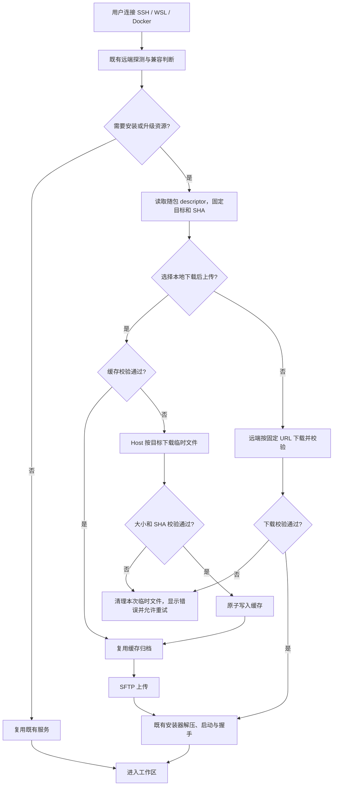

# YCode 安装包瘦身方案

日期：2026-10-26。基线：`7028284d` / GitHub Release `build-7`。
状态：原始方案与影响分析。2026-10-26 已开始实施 P0、P1 和经引用确认的 P2 裁剪；当前合同以[资源边界与预算](../desktop-bundle-size-architecture.md)、[发布规格](../desktop/github-release-packaging-spec.md)和[离线导入规格](../desktop/offline-source-server-import-spec.md)为准。下文的收益目标及剩余候选保留为方案记录，实际结果以安装产物验证为准。

## 建议与目标

先将 SSH 远程资源从桌面安装包拆出，改为首次连接时按目标下载；随后裁剪应用包中的重复依赖。继续使用 Electron 和现有本地 Agent，保持四种桌面目标。

| 阶段 | 交付内容                                     | 收益与验收目标                                                                                   |
| ---- | -------------------------------------------- | ------------------------------------------------------------------------------------------------ |
| P0   | 输出压缩前后体积清单，固定比较口径           | 每个目标记录安装器字节数、安装目录与 ASAR 分组；保存机器可读报告                                 |
| P1   | SSH 资源独立发布、按需下载与缓存             | 预计减少约 300 MB；首轮目标 Windows 安装包不超过 250 MB、macOS DMG 不超过 280 MB，实际以重建为准 |
| P2   | 按真实运行依赖裁剪 ASAR，去除重复资源        | 额外收益待构建实测，逐项提供删除前后体积和功能回归证据                                           |
| 配套 | 远程资源每轮构建一次，桌面运行资源只准备一次 | 缩短构建耗时；该项本身不计入安装包减重                                                           |

## 已确认的基线

- GitHub `build-7`：Windows x64 EXE 为 493,491,067 字节，ARM64 为 494,113,669 字节；macOS ARM64 DMG 为 534,361,027 字节，x64 为 539,922,733 字节。
- 本次 Windows x64 CI 审计：安装包 470.6 MiB，内置四个平台的离线 Source Server 归档合计 322.4 MiB。后者已经 gzip，移出安装包是主要减重来源；二次压缩使精确差值必须重打包测量。
- 本地 macOS 样本解包后：远程资源约 335 MiB、Electron 框架约 216 MiB、ASAR 298.9 MiB、内置 Agent 与插件约 55 MiB。本地样本不是各个 CI 产物的精确拆账。
- 本地 ASAR 中 `out` 56.7 MiB；完整依赖目录包括 ECharts 23.8、Mermaid 21.2、PDF.js 16.0、react-xlsx 10.3 MiB 等。完整目录的存在是裁剪候选，不足以证明整个依赖可以删除。
- 同一 `duke_sheets_wasm_bg` 文件保存了三份，单份 4,345,449 字节，SHA-256 均为 `ab475856ab69ce1c29866d8961952578c488804bc4ca6bc13a6db13eb09e20de`：renderer assets、react-xlsx/dist、sheets-wasm 各一份。

## P1：拆出远程资源

### 发布方式

1. CI 使用现有 Source Server staging 生成 Linux x64/ARM64、macOS x64/ARM64 四个归档及同一份 descriptor，集中生成一次，避免四个桌面 job 各重复生成四个平台。
2. 桌面安装包只携带小型 descriptor。descriptor 固定本次构建的下载 URL、目标、size 和 SHA-256；相对 URL 改为本仓库固定构建标签的绝对 URL。不能运行时查询 `latest` 后任选同版本归档。
3. 资源归档与四种桌面安装包在同一 GitHub draft Release 汇总，齐全且校验通过后一次发布。发布后不使用 `--clobber` 覆盖已供客户端下载的内容；重跑通过新构建标识区分，避免多个 `3.16.2` 构建串包。
4. 下载默认使用本仓库 Release；同一份内容可配置自托管镜像，继续使用既有代理网络注入。镜像必须返回 descriptor 规定的字节，不能回退到已退役原厂地址。国内直连 GitHub 的可用性需单独验收。
5. 从 `electron-builder` 的 `extraResources` 移除四个远程归档，保留 descriptor；本地 Agent、搜索工具、PTY 和本机运行依赖继续随包。

### 首次连接与缓存

- 默认沿用“本地下载后上传”：探测远端系统与架构，仅取对应的一个归档，通过 SFTP 上传，远端无需访问 GitHub。
- “远端直接下载”沿用现有选择，仅改变归档获取位置，仍汇合到同一安装器、校验、解压和启动流程。
- 完全复用 `resolveSourceServerReleaseAsset`、`downloadArchive`、`createSourceServerTransportAdapter` 和现有网络注入；不新增平行下载服务。生产 resolver 增加对随包 descriptor 的独立读取，不能继续把“缺少随包 archive”直接判为错误。
- 缓存身份包含资源根目录、目标与 SHA-256，应用版本用于索引。校验通过后先命中本地缓存，不能因为 descriptor 获取需要联网而让有效缓存离线失效。
- 同资源并发请求共享一次下载；跨窗口/Host 通过缓存层文件锁或等价机制协调，临时文件在校验后原子发布。沿用现有资源 owner，不新增 Renderer 缓存状态。
- 下载支持连接级取消、有限超时、错误反馈与重试；失败不产生可用标记，重试不删除其他版本和目标的有效缓存。首轮采用失败后整包重下，不为断点续传新建协议。
- 已安装并兼容的远端服务应走既有探测/复用逻辑。升级需要新内容时才获取对应归档，不因客户端重启重复下载安装。
- 纯离线首次部署 SSH 的使用方式会改变：需提前下载资源包，并通过受校验的导入/预热路径放入缓存；已缓存的目标可继续离线部署。离线资源作为单独附件，不另维护一套完整桌面安装器。
- 开发态 `development-content-addressed` 继续强制消费本轮本地 staging，缺资源时提示 bootstrap，不改为偷偷下载发行版。

## P2：裁剪 ASAR

1. 从 tsup 的 Main/Host externals、动态导入、Worker 和运行时资源读取点建立真实依赖清单，复用已有运行依赖补齐与原生裁剪逻辑。先区分“Vite 已生成的 renderer 静态资源”和“Node 运行时仍需加载的 external 包”。
2. renderer 已打包的前端依赖不再因生产依赖递归被整目录携带。ECharts、Mermaid、PDF.js、图标、语法包、Office 渲染相关目录逐项确认，不能按大目录直接删除。
3. 表格 WASM 原则上保留实际运行读取的一份；先确认 Office 插件、renderer 和转换服务的消费者，再改引用或打包边界。最多去掉两份约 8.3 MiB 未压缩副本，不将其当成相同数量的安装器压缩收益。
4. 同一依赖中的 CJS/ESM、完整版/压缩版、开发文件按入口裁剪；保留动态资源、native binary、Worker、字体和许可证。未确认无引用的项不删除。
5. 安装目录 smoke 覆盖终端、SSH、图表、Mermaid、Markdown、代码高亮、PDF、DOCX、XLSX、PPTX、插件；不能只验证开发服务器，因为其 node_modules 会掩盖安装包缺依赖。

## CI、预算与验收

- P0、P1、P2 独立提交并逐阶段构建四个平台；保留 `build-7` 作为下载和回滚基线。
- 桌面 bundle 当前先调用 `prepare:runtime-assets`，随后 `build` 又调用同一准备步骤；集中资源生成后，复用 `build:no-runtime-assets` 收口为一次准备、一次构建，不重新排序现有 Agent 最后装配的不变量。
- P1 取消桌面安装器的“500 MiB 加离线资源额度”折算，改为直接约束最终安装器；单独发布的远程归档仍校验 descriptor、四平台完整性、size 和 SHA。
- 用同平台、同格式的实际文件字节比较。不能把 DMG 和 ZIP 相加，也不能把安装目录未压缩大小当成下载体积。
- 执行 typecheck、lint、架构、受影响单测；重点补充冷缓存、热缓存离线、目标选择、SHA 错误、取消、失败重试、并发、同版本不同构建、下载代理、开发态禁止发行资源回退。
- E2E 覆盖四种桌面构建启动；用明确的远端环境验证 SFTP 路径、远端直接下载路径、已有服务复用与升级恢复。WSL/Docker 继续使用本地下载路径；系统覆盖与真实主机证据分开报告。
- 验收交付包括真实可下载的 6 个安装文件、远程资源、清单、校验摘要及体积对比；Actions 绿灯不替代已安装应用的启动与 SSH 验收。

## 功能摘要与模式

| 字段     | 内容                                                                                            |
| -------- | ----------------------------------------------------------------------------------------------- |
| 开发意图 | 将约 500 MB 的桌面安装包缩小，优先移出跨平台远程资源                                            |
| 能力     | build-release-engineering、remote-environment-compatibility                                     |
| 改动层级 | option-source、validation、commit-effect、persistence、recovery；UI 仅补必要的进度与错误反馈    |
| 工作模式 | impact-only；以上产品语义为提案，进入实施后先更新相关 spec 和案例                               |
| 主要种子 | electron-builder.config.js、sourceServerReleaseResolver.ts、transportAdapter.ts、tsup.config.ts |
| 范围外   | Electron 替换、模型调用协议、任务/会话存储改造、模型或插件能力删减                              |

## UI 入口矩阵

| 场景与入口                       | 共享实现                                       | 展示/草稿与默认                                          | 校验和提交                                       | 权威/持久化                                                | 模式与隔离                                        |
| -------------------------------- | ---------------------------------------------- | -------------------------------------------------------- | ------------------------------------------------ | ---------------------------------------------------------- | ------------------------------------------------- |
| 新建/编辑 SSH 连接的资源方式选择 | RemoteConnectionFields、remote-connection-flow | 表单 hook；沿用 local-download-upload 默认值及已保存偏好 | 连接命令进入 resolver 和同一 transport installer | Host 管理连接和资源缓存；远端 installer 管理已安装 release | 不改变 workspaceIdentity、目标 cwd 和已有登录凭据 |
| 重连、升级、错误重试             | SourceServerConnectionManager                  | 连接状态投影；不从 UI 猜资源版本                         | 原探测、兼容判断、固定 descriptor 和安装器       | 已确认 SHA/实际远端版本为事实；UI 不维护第二份 ready       | 失败不得删除可工作的旧服务；沿用既有升级/恢复规则 |
| WSL/Docker 工作区连接            | 同一 resolver 和 transport seam                | 固定本地获取、上传方式                                   | 探测目标、命中缓存或下载、原安装器               | 同上                                                       | 远端直下分支只适用于既有 SSH 选择                 |
| 普通本地编码与外部引擎           | 本地 Agent / CLI 原入口                        | 无远程资源下载偏好                                       | 不触发远程资源安装                               | 本地运行时继续随包                                         | 不因启动、空闲、本地对话而拉取远程归档            |

## 共享实现与差异

| 关注点      | 共享部分                            | 有意保留的差异                                 |
| ----------- | ----------------------------------- | ---------------------------------------------- |
| 界面/候选   | 连接表单与错误/进度反馈             | SSH 可选获取位置；WSL/Docker 使用本地获取      |
| 默认与来源  | 同一 descriptor 和固定构建身份      | 开发态本轮 staging；正式版固定 Release 与镜像  |
| 校验        | size、SHA、目标、版本和兼容门禁     | 本地下载后验证与远端下载验证在各自执行位置完成 |
| 提交副作用  | 同一远端安装器及启动握手            | 只有归档先落本机还是远端不同                   |
| 持久化/恢复 | 复用 Host cache 与远端 release 记录 | UI 只持有表单草稿；会话持久化不参与资源缓存    |

## 关系分级

| 等级           | 语义关系                                   | 原因与证据                                                                                         |
| -------------- | ------------------------------------------ | -------------------------------------------------------------------------------------------------- |
| must-inspect   | CI 发布 → descriptor → Host 资源选择       | URL 与 SHA 必须来自同一构建；stageRemoteAssetsCli、remoteAssetRelease、sourceServerReleaseResolver |
| must-inspect   | 包资源裁剪 → 安装态运行依赖                | tsup externals 与 electron-builder afterPack 必须使用一致闭包                                      |
| must-inspect   | 资源选择 → 远端安装、复用、升级            | SourceServerConnectionManager、transportAdapter，不只改安装包 glob                                 |
| should-inspect | 下载 → 代理、缓存、取消、并发              | remoteAssetNetwork 和 resolver；其他旧资源缓存的锁不自动证明此 resolver 已受保护                   |
| conditional    | 纯离线首次部署 → 资源预热/导入             | 拆包改变此前开箱即用的离线 SSH 能力，需明确验收                                                    |
| invariant-only | 本地会话/Provider/外部引擎/插件 → 原运行时 | 不改变模型调用、认证、数据路径和会话 owner                                                         |
| evidence-only  | 体积报告和专项测试 → 交付证据              | 不据此推断所有运行功能都已覆盖                                                                     |

## 状态所有者与落点

| 状态                              | 展示者           | 唯一权威及写入位置                       |
| --------------------------------- | ---------------- | ---------------------------------------- |
| 发布身份、归档 size/SHA、下载 URL | 随包 descriptor  | 本次 CI 资源 job，发布后内容不可变       |
| 资源下载进度和缓存可用性          | 连接状态/日志 UI | Host resolver/缓存层；验证成功后原子落盘 |
| 已安装服务与实际版本              | 连接管理器       | 远端现有 probe、release installer 和握手 |
| 用户下载方式偏好                  | 连接表单         | 原 ConnectionProfile；缺省规则不改       |

## 必须保持的不变量

- 同一目标只接受当前 descriptor 指定 SHA 的归档；缓存不能仅按 semver 命中。
- 发布版客户端与远程资源、清单必须完整对应；开发态不得回退发行资源掩盖 staging 失败。
- 下载与缓存属于 Host，远端服务状态属于实际探测和安装器，Renderer 不新增资源 ready 权威。
- 临时下载失败不成为缓存；并发、取消和迟到结果不得覆盖已确认的新内容。
- workspaceIdentity 用于隔离，workspacePath 用于执行；会话事实、Host 组织态、CLI 凭据不参与此改造。
- 原本支持的远端安装、重连、回滚和兼容判定需要场景验证；不能因移走资源删除这些检查。

## 代码追踪与证据

仓库不存在 `.codegraph/`，因此未创建索引；使用源码/精确引用追踪，围绕种子展开最多两层。

| 种子                                    | 直接路径/消费者                                                       | 证据意义                                           |
| --------------------------------------- | --------------------------------------------------------------------- | -------------------------------------------------- |
| sourceServerReleaseResolver             | host/index 注册 → ConnectionManager resolveRelease → transportAdapter | 生产和开发资源选择、缓存与远端部署的实际接缝       |
| buildSourceServerReleaseDownloadCommand | transportAdapter → remoteAssetInstaller                               | 已有远端下载校验可复用                             |
| resolveRemoteAssetDirs                  | desktopRuntimeEnv → Host 初始化                                       | 指定资源根目录、镜像与缓存目录                     |
| bundle.mjs                              | prepare:runtime-assets → build → package.json 中再次准备              | 重复准备已由入口和脚本直接确认                     |
| sourceServerReleaseResolver.test.ts     | 明确镜像、旧地址禁止回退、开发产物、metadataOnly 等                   | 已有回归入口；本次只阅读，未声称执行了新增语义测试 |
| 本地 ASAR 读取与 SHA 计算               | 三份相同 WASM、前端完整依赖目录                                       | 支持进一步依赖裁剪，不代表可以无条件删除           |

## 图谱差异与建议增量

| 状态                  | 节点/边                                                                                                  | 建议                                                                         |
| --------------------- | -------------------------------------------------------------------------------------------------------- | ---------------------------------------------------------------------------- |
| graph-drift-candidate | build-release-engineering 的种子只有 runDesktopProductionBuild，未完整描述本次 GitHub 发布/descriptor 链 | 实施后补充 package → resource descriptor → resolver → installer 的已确认语义 |
| proposed              | 独立远程资源发布、随包 descriptor、Host cache 资源消费关系                                               | 确认方案后再更新功能图；本次未修改图谱                                       |

## 实施前待定项

- 默认资源地址建议使用本仓库 Release，自托管镜像沿用配置；若要求国内稳定下载，应在切换默认安装包前完成镜像部署与实测。
- 纯离线首次 SSH 建议采用独立资源包预热/导入；具体入口在实施 spec 中明确，不能仅在 README 提示一个没有实现的能力。
- P1 的体积阈值是验收目标而非已验证结果。P2 各包是否可删和具体节省量，以安装态依赖审计及实际打包为准。
