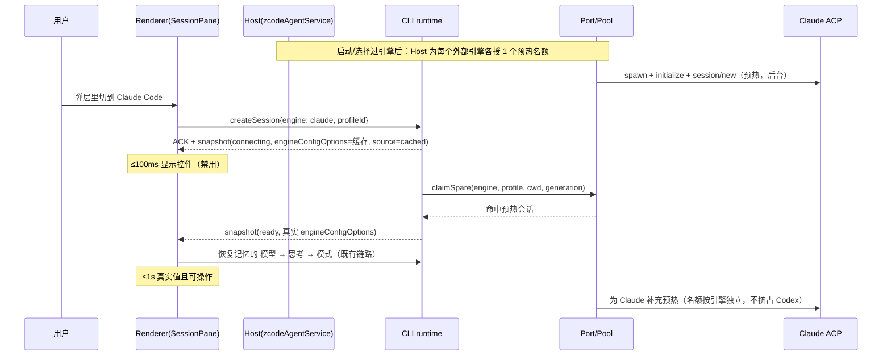
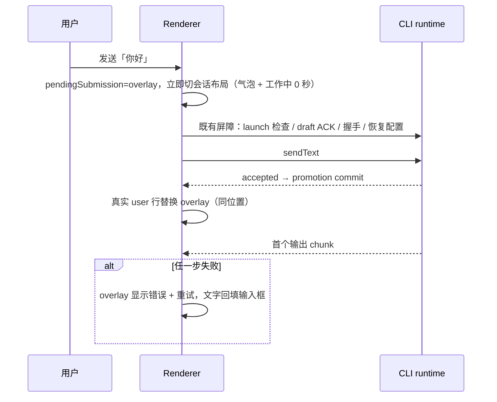

# 引擎输入区精简、无感切换与 Subagent 可视化（YCode 1.3.0）

> 状态：方案已与用户对齐（第 1 轮 Q1–Q10 全部按推荐），待用户确认本文后实施。
> 日期：2026-11-09。分支：`codex/acp-connection-experience`，基线 `4f367fab`（相对 origin/main ahead 0 / behind 0）。
> 实施方式：每项先改 spec、先写失败测试，再实现；bugfix 加中文原因注释；跨包走公开入口。

## 1. 背景：用户反馈与工作项映射

| # | 用户反馈 | 工作项 |
| --- | --- | --- |
| 1 | Claude Code 输入框里的「Default」没用，去掉 | W1 |
| 2 | 右下角「Default (recommended) · High」冗余，直接显示 High | W1 |
| 3 | ZCode 默认是自主模式、思考程度高 | W3 |
| 4 | Claude Code ↔ Codex 切换时 Claude Code 约 2s 才显示信息，要求 1s 内无感切换 | W4 |
| 5 | 「正在等待模型…」去掉 | W5 |
| 6 | 首屏「正在发送… / 你好」卡片去掉 | W5 |
| 7 | Codex 明明能用，测试连接却显示失败 | W6 |
| 8 | 输出完成后悬浮显示 tokens/s，要求统计准确 | W7 |
| 9 | 输入框上方的引擎 logo 胶囊去掉 | W2 |
| 10 | Subagent 按参考图做清晰的树形可视化，子 agent 输出可在右边栏实时查看 | W8 |
| — | 改完发新版本 | W0、W9 |

## 2. 决策记录

### 2.1 用户已确认（第 1 轮，全部按推荐）

| 编号 | 决策 |
| --- | --- |
| Q1 | 同一分支：先把未提交的「ACP 体验改造」按现状单独提交，再按本方案分批提交，一起发版 |
| Q2 | 移除输入框上方的引擎胶囊；引擎切换并入右下角「模型 · 思考」入口弹层的顶部一行；已有会话只读显示 |
| Q3 | 模型为 adapter 的 `default` 别名时，入口只显示思考档位；具体模型显示「模型 · 档位」；弹层模型行显示解析出的真实模型名，不再出现 "Default (recommended)" |
| Q4 | 三个引擎首次使用默认对齐「自主 + 高」，之后记住用户上次选择 |
| Q5 | 首屏发送后立即切换为会话布局（用户气泡 + 「工作中 N 秒」），删除「正在发送…」卡片与「正在等待模型…」行；失败时气泡下显示错误与重试并回填输入框 |
| Q6 | tokens/s = 输出 token ÷ 模型实际流式输出时长；runtime 侧打点；悬浮回复底部操作栏显示；无准确数据不显示、不估算 |
| Q7 | 主线程树形卡片（主 Agent → 子 agent 行）；点击子 agent 行在右边栏打开实时只读记录，多个用标签页；不自动打开；结束后折叠为摘要 |
| Q8 | 测试连接只以收到模型正常回复判定成功；非致命提示显示为黄色「警告」 |
| Q9 | 达标口径：从点击切换引擎到输入框显示该引擎真实模型/思考/权限控件，预热命中时 ≤1s，且无空白或加载中状态 |
| Q10 | 版本线 1.3（CI 自动分配 1.3.x）；推送 → 合入 main → CI 构建 → `workflow_dispatch` 发布公开 Release → 本机安装（独立计划任务） |

### 2.2 依据代码事实补充的下游决策（按同一原则自定，用户可推翻）

| 编号 | 决策 | 依据 |
| --- | --- | --- |
| D1 | Claude Code 的「Default」芯片是 **Agent 选择器**（id `agent`，配置了自定义 agent 才出现），不删除功能，移入弹层「更多选项」。Codex 的「Default」（id `collaboration_mode`，默认/计划）和「Off」（id `fast-mode`）同样移入「更多选项」。输入框左侧只保留附件和权限（id `mode`） | 事实 F2；与进行中 Task 5「左附件/权限、右单个模型深度入口」一致 |
| D2 | 思考档位标签按已知值本地化（low/medium/high/xhigh/max → 低/中/高/超高/最高），未知值沿用 adapter 文案；滑杆隐藏 `default` 档 | ZCode 已显示「高」，参考图显示「中」，统一中文 |
| D3 | 外部引擎记忆从「模型 + 思考」扩展到「权限模式」（按引擎 + 连接配置保存）；计划类取值（Claude `plan`）不记忆，与 ZCode「plan 不沿用」规则一致 | 事实 F3：当前 mode 不记忆，schema 拒绝 |
| D4 | 无感切换靠三件事：每个外部引擎各有 1 个预热名额（最多 2 个）、CLI runtime 缓存上次的选项清单在连接中先行展示、核对预热进程的 cwd/env 匹配。不把恢复逻辑挪进 `createSession`；如果实测恢复往返让达标失败，再单独与用户对齐 | 事实 F4：单名额互相挤占 + 无缓存 |
| D5 | **Claude Code / Codex 不显示 tokens/s**，悬浮只显示「输出 N tokens（含思考 M）· 耗时 Xs」。ZCode 原生引擎显示精确 tokens/s | 事实 F7：外部引擎只有整轮 usage，chunk 时间混入工具执行和隐藏推理，算不准；按 Q6「不估算」 |
| D6 | Codex 告警的修复方式：为 Codex 声明 ACP `session.notices` 能力并处理 `sessionUpdate:"notice"`，不在 failure 分类里加兜底分支。对话中的 notice 只记 warn 日志，不再显示成假的「重试中」 | 事实 F6 |
| D7 | 「停止全部」由 UI 对每个可停的运行中子 agent 调用既有 `cancelBackgroundWork(workId)`（runtime 是唯一所有者，命令幂等），不新增协议命令；没有可停项时不显示 | 事实 F8：无 stop-all 命令；Codex 不支持取消 |
| D8 | 引擎名统一用「YCode」（`ENGINE_LABELS` 目前写 ZCode，`TaskClientLogo` 写 YCode） | 与输入框占位文案「向 YCode 提问」一致 |

### 2.3 用户第 2 轮反馈（2026-11-09，已确认，覆盖上表冲突项）

| 编号 | 决策 |
| --- | --- |
| R2-1 | Fast 不放「更多选项」，改为参考 Codex：在「模型 · 思考」弹层左上角放一个小闪电开关，点亮表示 Fast 开启（Claude `fast`、Codex `fast-mode` 等 Fast 类选项）。引擎没有 Fast 选项时不显示闪电。D1 里 Fast 的去向以此为准 |
| R2-2 | Claude Code / Codex 可以不统计 tokens/s；如果本地 CLI 使用记录（如 Claude Code 的 `~/.claude/projects/**/*.jsonl`、Codex 的 `~/.codex/sessions` rollout）能提供逐次调用的输出 token 和生成时长，可以据此计算。只有在能证明口径与 W7 一致时才显示，否则保持 D5 |
| R2-3 | 同意多一个空闲预热进程（D4） |
| R2-4 | Codex 子 agent 不可停止可以接受（D7） |
| R2-5 | 用户已确认方案，开始执行 |

## 3. 已确认的代码事实

- **F1 引擎胶囊**：`EngineControls`（`packages/ui/src/external-engine/EngineControls.tsx:54-93`），由 `SessionPane.tsx:3998-4013` 作为 `engineSelector` 传入，`ConversationComposer.tsx:2455-2459` 渲染在输入框上方。选择后经 `useDraftConfigControl.ts:578-591` 写 draft 并保存 `defaultSessionEngine`。会话创建后引擎锁定（`SessionPane.tsx:4004,4110`）。远程/Web 工作区强制 zcode（`useDraftConfigControl.ts:256-276`）。
- **F2 外部引擎控件**：YCode 只读 ACP session config options，不读 session modes。分类在 `packages/shared/src/external-engine/config-options.ts:9-16`（model / effort / 其余 other）；other 都成为左侧芯片（`EngineControls.tsx:187`）；Fast 白名单 `fast/fast_mode/speed/service_tier`（`EngineControls.tsx:103-105`），不含 Codex 的 `fast-mode`，所以「Off」漏成了芯片。入口文案 = `模型名 · 档位名`（`EngineControls.tsx:150-153`）。Claude `default` 模型选项的 description 能解析出真实模型名（adapter `session-model.js:208-215`），目前只用作 hover 提示（`EngineConfigPicker.tsx:102`）。YCode 没向 Claude 声明 AIR `recommendedValue`，因为 Claude 的 AIR 标记会顺带切换审批预览与子智能体协议（`connection.ts:32-49`），所以 `default` 条目会保留，需要在 UI 侧处理。
- **F3 默认值**：ZCode 新用户默认 `build`（变更前确认）（`newTaskDraft.ts:24`、`shared/src/zcode-agent-model-state.ts:19-24`、`zcode-protocol-v4/session-config.ts:24`、CLI `contracts/src/config/index.ts:294-295`）；之后沿用该工作区上次提交的模式（plan → build）。思考档位取模型最高档（`packages/provider/src/model-selection-config.ts` 的 `completeNewModelSelection`，`values.at(-1)`）。外部引擎只按「引擎 + 连接配置」记忆模型和思考（`useEngineConfigMemory.ts:195-237`），mode 被跳过（`:237`），schema 也拒绝（`validationAppSettings.ts:30-36`）。Claude 新会话由 YCode 从 `default` 切到 `auto`（`connection.ts:666-687`）；Codex adapter 默认就是「Auto review」。
- **F4 切换延迟**：切换引擎会作废旧的预热会话，用新引擎重新 `createSession`（`SessionPane.tsx:1006-1044`、`useDraftSessionPrewarm.ts`）。CLI 在 `connecting` 时就 ACK，后台走 `claimSpare` → 未命中则 spawn、`initialize`、`session/new`、恢复配置（`adapters/.../external-engine/index.ts:215-344`）。选项清单要等握手结束才到达（`connection.ts:650`），而且**任何一层都没有缓存**，芯片在 `ready` 前根本不渲染（`SessionPane.tsx:4118-4135`）。Host 只预热默认引擎、每个 CLI 只调度一次（`services/src/node.ts:1777-1784`、`zcodeAgentService.ts:1265-1298`）；**每个窗口只有 1 个预热名额**（`zcodeAgentService.ts:2209-2226`），补充名额被拒时静默丢弃（`process-pool.ts:345-351`）。spec 实测 `session/new`：Claude 约 1.4–1.5s，Codex 0.8–1.1s；P12（≤1s）仍待验收（`external-agent-engines-spec.md:147-149,290`）。推断：默认引擎是 Codex 时，Codex 的预热进程长期占着名额，Claude 每次冷启动约 2s。
- **F5 等待态**：「正在发送…」卡片在 `ConversationComposer.tsx:2437-2453`（`composer-submission-preview`），由 `pendingSubmission` 驱动，覆盖了 launch 检查 → 等 draft ACK → 握手 → 恢复配置 → `sendText` ACK → promotion 的整段过程（`SessionPane.tsx:2593-2831,1140-1145`）。「正在等待模型…」在 `ConversationTurnGroup.tsx:198-244` 的 `TurnChatLoadingSlot`，i18n 键是 `chat.submission.waitingModel` / `startingEngine`，只有外部引擎带文字（`SessionPane.tsx:2069-2073`）。
- **F6 Codex 误报**：YCode 没向 Codex 声明 `session.notices`，所以 Codex 把 `WarningEvent`（Model metadata not found）作为 typed failure 发过来（`category:"unknown"`、`severity:"warning"`、id 带 `:notice:`），`failure.ts:65-96` 把它归成 `provider`。测试连接收到第一条任何级别的 failure 就中止（`connection-test.ts:83-87`）；对话里则显示成假的「重试中」（`session.ts:237-268`、`product-projection.ts:1500-1519`）。没有测试覆盖 unknown 类 warning。
- **F7 token 数据**：ZCode 原生引擎每次模型调用都有 `outputTokens`、`reasoningTokens`、`durationMs`、`timeToFirstContentMs`（`contracts/src/model/index.ts:216,517-525`、`runner-stream.ts:178-213,619`），`calculateOutputTps`（`packages/shared/src/session-debug.ts:86-101`）已经能算，但只在开发者工具里显示。外部引擎只有整轮 usage：Claude 不单独报告思考 token；Codex 有 `thoughtTokens`，但被 `connection.ts:517-533` 丢掉了。`turnHeader` 行已有 `outputTokens`、`activeMs`、`modelDurationMs`（仅 Highspeed）（`rows.ts:112-121`），v4 UI 没有读。回复底部操作栏是 `ConversationAssistantTextActions`（`ConversationRowView.tsx:1452-1520`）。
- **F8 Subagent**：三个引擎共用一套展示代码。父 snapshot 的 `subagents.running[]` 有 `childSessionId/title/summary/status/startedAt`（`zcode-protocol-v4/snapshot.ts:412-430`）。子会话是真实会话，右栏 `SubagentSessionSidePane` 已经能用只读 `SessionPane` 实时显示，并支持标签页（`workspaceSidePane.ts`、`useAppPanels.ts:941-995`）。行内现状是「A、B 和 C 开始工作」分组行加 Agent 卡（`subagent-display/ConversationAgentSpawnRow.tsx`，规则见 `docs/desktop/multi-agent-display-spec.md`）。缺的部分：model/effort 在投影里被丢掉（`product-projection.ts:4726-4745`）；没有步骤数字段；没有「停止全部」；Codex 不支持取消；Claude 后台子 agent 在父轮结束后不再观测。`SubagentDrilldown.tsx` 没人引用，疑似死代码。

## 4. 工作项

### W0 收尾并单独提交进行中的 ACP 体验改造

- 现状：64 个文件未提交，`docs/superpowers/plans/2026-11-09-acp-experience.md` 的 Task 1–3 完成；Task 4 桌面候选已有 run6 3/3 通过记录；Task 5「按 Codex 参考图精简输入区」未做。
- 动作：重跑 `pnpm typecheck`、`pnpm lint`、`pnpm architecture:check --changed`、受影响 UT，结果如实记入 `docs/testing/2026-11-09-acp-experience-verification.md`，然后单独提交。Task 5 标注「由本方案 W1/W2 取代」，原计划里不再单独实现。
- 验收：commit 只包含 ACP 改造本身；验证文档与实际输出一致。

### W1 外部引擎输入区精简（反馈 1、2）

**规则（写入 `external-agent-engines-spec.md` 的 Composer 合同）：**

1. 输入框左侧只有附件按钮和权限芯片（config option id `mode`）。
2. 其余 other 类选项（Claude `agent`、`fast`；Codex `collaboration_mode`、`fast-mode`）全部进入「模型 · 思考」弹层的「更多选项」。Fast 识别补上 `fast-mode`，改成按归一化 id（去掉 `-`/`_`）匹配。
3. 右下角入口：模型当前值为 adapter 的 `default` 别名时只显示档位（如「高」）；否则显示「模型名 · 档位」。
4. 弹层模型行：`default` 别名显示 description 解析出的真实模型名并加「默认」标记；解析不到时显示本地化的「默认模型」。界面上不再出现 "Default (recommended)"。
5. 思考滑杆：其他档位存在时隐藏 `default` 档；档位名按 D2 本地化。

**改动：** `shared/src/external-engine/config-options.ts`（增加 placement：`primary-mode` / `more`，归一化 fast 识别）、`ui/src/external-engine/EngineControls.tsx`、`EngineConfigPicker.tsx`、`ui/src/external-engine/contract.ts` 与 CONTRACT.md、两份 locale。

**测试：** `packages/ui/test/externalEnginePickers.test.ts` 补充：Claude 有 `agent` 选项时芯片不出现、在更多选项里能选；Codex `fast-mode` 只在更多选项里；`default` 模型时入口只显示档位；弹层显示解析出的模型名；滑杆无 Default 档。shared `contract.test.ts` 补充 placement 分类。

### W2 引擎切换并入模型入口，移除输入框上方胶囊（反馈 9）

- 删除 `SessionPane` → `ConversationComposer` 的 `engineSelector` 渲染位。
- 右下角入口对三个引擎统一：14px 引擎图标 + 文案（ZCode 显示「模型 档位」，外部引擎按 W1 规则）。
- 弹层顶部新增共享组件 `EngineSwitchRow`（YCode / Claude Code / Codex 三段，radio group，支持方向键）。ZCode 的模型弹层（`v4/composer/V4ComposerToolbar.tsx` 的模型选择）和外部引擎的 `EngineConfigPicker` 都挂这一行。仍走原有的 `handleSelectEngine` 写入链，不新增状态。
- 已有会话：这一行只读显示当前引擎。远程/Web 工作区：不显示这一行（引擎强制 YCode）。
- 引擎名按 D8 统一。
- 测试：UI UT 覆盖新草稿可切换、已有会话只读、远程不显示、键盘操作；桌面 E2E 候选覆盖「弹层切到 Claude Code → 控件刷新」。

### W3 默认值：自主 + 高（反馈 3）

- ZCode：新用户、无最近记录时的默认模式从 `build` 改为 `guarded`（自主模式）。改 F3 列出的默认值位置；`normalizeAvailableZCodeMode` 对非法旧值仍回落 `build`，这是安全回落，不属于「新用户默认」。
- ZCode 思考：`completeNewModelSelection` 改为模型档位里有 `high` 就用 `high`，没有就用最高档。该函数同时用于新用户初始化和用户主动选模型，两处都按「默认高」处理。
- 外部引擎首次（该引擎 + 连接配置没有记忆）：思考档位设为 `high`（有这一档时）；模式保持 Claude `auto`、Codex `Auto review`（等价「自主」）。
- 外部引擎记忆扩展到 mode（D3）：`validationAppSettings.ts` 的 schema 增加 `mode` 字段（可选，旧数据兼容），`useEngineConfigMemory.ts` 恢复顺序改为「模型 → 思考 → 模式」，不记忆 plan 类取值。
- 测试：`packages/shared/test/appSettings.test.ts`（schema）、`packages/ui/test/externalEngineConfigMemory.test.ts`（首次 high、mode 记忆、plan 不记）、provider 的 selection 单测（优先 high）、newTaskDraft 默认 guarded。

### W4 Claude Code ↔ Codex 1 秒内无感切换（反馈 4）

**达标口径（Q9）：** 点击切换后 ≤100ms 显示控件（缓存值，不可操作）；预热命中时 ≤1s 变为真实值且可操作（P95）；全程不出现空白或「加载中」。冷启动（本机首次、进程刚回收）单独记录，不计入达标。

**步骤：**

1. **先测量基线**。在本机真实 Host/CLI 日志里统计 Codex → Claude 切换时的 `external_engine.handshake.completed`（`spare`、`totalMs` 各分段）和 `external_engine.spare.miss` 的 `reason` 分布，确认根因是「单名额挤占」还是「cwd/generation 不匹配」，记入验证文档。
2. **每个外部引擎各 1 个预热名额**：Host 的 spare lease 从「每窗口 1 个」改为「每个外部引擎 1 个」（上限 2 个）。预热对象从「仅默认引擎」改为「默认引擎 ∪ 本窗口选择过的外部引擎」，只预热 launch 检查通过的引擎；集合变化时重新调度（目前每个 CLI 只调度一次）。补充名额被拒时记 info 日志。
3. **核对预热进程的 cwd/env**：如果步骤 1 里 miss 原因是 `cwd`/`generation`，就让 Host 构建 spare 时使用目标工作区的 cwd（`server.ts:828-841`），不再用 CLI 自己的 cwd。
4. **CLI runtime 缓存选项清单**：runtime 按（引擎，profileId，工作区身份 key `workspaceIdentity?.trim() || workspacePath`）在内存里保存上次握手得到的 `engineConfigOptions`。新草稿会话进入 `connecting` 时，snapshot 的 `config` 先带上缓存清单并标记 `engineConfigOptionsSource: "cached"`；UI 立即渲染控件（沿用 `configPending` 禁用交互），显示值叠加该引擎的记忆值（只用于展示），`ready` 后被真实清单替换。协议字段只增不改，同步 `packages/shared/src/zcode-protocol/index.ts` 的严格类型与运行时校验。
5. **埋点**：UI logger 记录 `[engine-switch] controls ready {engine, source, ms}`；CLI 沿用 handshake 分段日志。

**所有者与时序：**



- 状态所有者：选项清单与缓存归 CLI runtime；预热名额归 Host；草稿里选的引擎归 Renderer draft（既有）；记忆值归 AppSettings（既有）。Renderer 不缓存选项清单。
- 代价：多一个空闲的 Claude ACP 进程。实施时测内存占用并写进 spec；空闲预热沿用现有 10 分钟过期与窗口回收。
- 测试：adapters `external-engine-process-pool.test.ts`（按引擎独立名额、互不挤占、拒绝记日志）；services `externalEngineService.test.ts` / zcodeAgentService 调度测试（集合变化重新调度）；bootstrap 测试（connecting 时发布缓存清单、ready 后替换、key 隔离）；UI UT（cached 时渲染禁用控件）。桌面 E2E 候选 `external-engine-prewarm.test.ts` 补充「Codex → Claude → Codex」切换计时断言。验收数据以本机真实日志为准。

### W5 去掉「正在发送…」和「正在等待模型…」（反馈 5、6）

- **首屏发送**：删除 `composer-submission-preview` 卡片。点击发送后，`SessionPane` 立即从首屏布局切到会话布局：隐藏问候语，用 `pendingSubmission` 作为 Renderer 的 pending optimistic overlay 渲染用户气泡和「工作中 N 秒」（从点击开始计时）。发送链路（握手 → 恢复 → `sendText` ACK → promotion）不变。promotion 后真实行替换 overlay，位置不跳动，也不重复。失败时 overlay 气泡下显示错误和「重试」，文字回填输入框（保持现有回填语义）。
- **等待模型行**：所有引擎都去掉 `TurnChatLoadingSlot` 的等待模型行（包括 ZCode 的无字 spinner），只保留「工作中 N 秒」。轮次中途确实重连引擎时（CLI 发布 `connecting`），仍显示「正在启动引擎…」，因为那是一个真实且不同的状态。删除不再使用的 `chat.submission.waitingModel` 键。
- 时序：



- 测试：`packages/ui/test/v4ConversationComposerAttachmentProgress.test.ts` 等相关 UT 改为断言「无预览卡、立即出现气泡」；`chatLoadingVisibility` 单测断言等待模型行不再出现、重连仍显示；桌面 E2E 候选覆盖首发即时布局与失败回填（P11 首发屏障场景同步更新）。

### W6 Codex 测试连接误报（反馈 7）

- 在 `connection.ts:41-49` 的 Codex client capabilities 里声明 `session.notices`，处理 `sessionUpdate:"notice"`，交给新的 `onNotice` 回调。实施前先读 codex-acp 2.2.2 源码，确认声明后只改变 warning 的投递方式；如果有其他副作用，停下来和用户对齐。
- 对话：notice 只记 warn 日志（`createServiceLogger`），不设置 apiRetry，不在对话里显示。
- 测试连接（`connection-test.ts:83-87`）：只有 `severity:"error"` 的 failure 才中止；收到模型正常回复才算通过；notice 收集到结果的 `warnings[]`（shared external-engine contract 新增可选字段）。
- UI（`EngineConnectionProfiles.tsx:468-515`）：通过时显示「测试通过」，有 warnings 时在下面用黄色警告色列出。
- spec：`docs/desktop/native-plan-errors-spec.md:43` 区分「notice（非致命提示）」和「warning（重试中）」。
- 测试：adapters `external-engine-connection.test.ts` 新增「notice 后正常回复 → 通过 + warnings」「error → 失败」；session 测试断言 notice 不产生 apiRetry。

### W7 回复悬浮显示 tokens/s（反馈 8）

**计算规则（写入 spec）：**

- ZCode 原生引擎，按每次模型调用计算：生成时长 = `durationMs − timeToFirstContentMs`。
  - 推理内容有流式输出时，分子 = `outputTokens`（含推理）。
  - 推理被隐藏（`reasoningTokens > 0` 但没有收到推理 delta）时，分子 = `outputTokens − reasoningTokens`，因为隐藏推理发生在首字之前，不在生成时长里。
  - 整轮 tokens/s = Σ分子 ÷ Σ生成时长。任何一次调用缺数据，整轮就不显示 tokens/s。
- Claude Code / Codex：不显示 tokens/s（D5），只显示输出 tokens（Codex 附带思考 tokens）和耗时。`connection.ts:517-533` 保留 Codex 的 `thoughtTokens`。

**数据流：** CLI 投影在 `turnHeader` 行增加可选字段 `outputTps`、`generationMs`、`firstTokenMs`、`reasoningTokens`（只增不改，同步协议校验）；只在轮次结束时写入。UI 在 `ConversationAssistantTextActions` 的时间元素上加 hover/focus tooltip，内容如「48.2 tokens/s · 输出 1,234 tokens · 首字 1.1s · 总耗时 23s」，只对已完成的轮次显示，挂在该轮最后一条回复上。

**测试：** shared 单测覆盖聚合（多次调用、隐藏推理、缺数据不显示）；bootstrap 投影测试；UI UT 覆盖 tooltip 内容和外部引擎无 tokens/s。人工核对：同一轮与开发者工具 `DeveloperToolsPane` 的逐调用 TPS 一致。

### W8 Subagent 树形卡片与右栏实时查看（反馈 10）

**卡片（替换 `multi-agent-display-spec.md` 的「对话行内派发行」）：** 同一轮相邻的派发（1 个或多个、带 `childSessionId`）渲染为一张 `SubagentWorkCard`：

```
┌ Subagent 正在工作 · 3 个 · 已完成 1/3 · 58s              [停止全部] ┐
│ ◎ 主 Agent  正在协调 3 个委派任务                                    │
│ ├─ (头像) explorer   gpt-6.1-sol 高   运行中 · 58s           [停止]  │
│ │         核对排班报错请求契约 · 16 个步骤                            │
│ ├─ (头像) reviewer   已完成 · 32s · 9 个步骤                          │
│ └─ (头像) tester     失败 · 12s  原因：…                              │
└──────────────────────────────────────────────────────────────────────┘
```

- 子行显示：头像（沿用 DESIGN 头像规则）、名称、模型 + 档位（有数据才显示）、状态、耗时、任务摘要、步骤数、单独的「停止」（可停时）。
- 点击子行（整行是原生 button，支持 Enter/Space）：打开或激活右栏既有的 `SubagentSessionSidePane` 标签页，显示实时只读记录。不自动打开。
- 全部结束后折叠成一行：「3 个 Subagent 已完成 · 用时 1m12s」，点开可回看。
- 「停止全部」按 D7 实现；Codex 子 agent 没有停止按钮（引擎不支持取消）。
- 没有 `childSessionId` 的旧会话/行内兜底，仍用原 Agent 卡。

**右栏：** 在既有 `SubagentSessionHeader` 里加模型标签；底部输入区换成只读提示「子智能体由主智能体驱动，无法输入」（缺少就补 i18n）。

**数据（协议只增不改）：** `subagents.running[]` 项和 `subagent` 行增加可选的 `model`、`effort`、`toolCallCount`。ZCode 原生：保留 `SubagentSpawned` 里的 model/effort（`product-projection.ts:4726-4745`）；步骤数在父 runtime 丢弃子工具事件前计数（`:5916-5921`）。外部引擎：`core/src/external-engine/subagents.ts` 写子会话工具行时计数；模型未知就不发。

**引擎覆盖：** ZCode 完整支持；Claude Code 实时 + 有 `capabilities.cancel` 时可停（后台子 agent 在父轮结束后不再观测，沿用 spec 已知限制）；Codex 实时、不可停。

**清理：** `SubagentDrilldown.tsx` 用 `pnpm dep:refs` 确认没有引用后删除。

**测试：** `packages/ui/test/subagentSidePane.test.ts` 以及新卡片 UT（分组、计数、折叠、停止全部只作用于可停项、Codex 无停止）；bootstrap 投影测试（model/effort/toolCallCount）；桌面 E2E 候选覆盖卡片 → 右栏实时更新 → 停止（原生 fixture），并更新 case catalog 的 SAT 条目与 coverage matrix。

### W9 发版 1.3（反馈：发新版本）

1. W0 → W1…W8 分批提交（每项一个或多个 commit，中文 PR 描述按 AGENTS.md 写清背景、前后行为和 bugfix 根因证据）。
2. `package.json` 版本改为 `1.3.0`（CI 按 ADR 0005 在 1.3 版本线上自动分配 patch）。
3. 本地执行 `pnpm typecheck`、`pnpm lint`、`pnpm verify:pre-push`，如实记录结果。
4. 推送分支到 origin（OpenX123/ZCode），开 PR 合入 main，main 上的 push 会触发 CI 构建产物。
5. 在 main 上手动触发 `workflow_dispatch`（`.github/workflows/build.yml`），发布公开 GitHub Release 1.3.x。
6. 下载 Windows 安装包，用独立的计划任务静默安装并重启 YCode（当前会话跑在 YCode 里，安装会中断会话，装完回复「继续」即可）。

## 5. Spec 与文档更新清单

| 文档 | 更新内容 |
| --- | --- |
| `docs/desktop/external-agent-engines-spec.md` | Composer 规则（W1/W2）、首次默认与 mode 记忆（W3）、按引擎预热名额与缓存选项清单、P12 口径（W4）、notice（W6） |
| `docs/desktop/native-plan-errors-spec.md` | notice 与重试中的 warning 分开 |
| `docs/desktop/multi-agent-display-spec.md` | 行内派发行改为树形卡片、停止全部、右栏模型标签 |
| ZCode 默认模式/档位所在 spec（实施时用 grep 定位） | 新用户默认自主 + 高 |
| 轮次头/消息操作栏相关 spec（实施时定位，没有就在 `docs/desktop/` 新建一节） | tokens/s 计算规则与显示 |
| `docs/conversation-session-case-catalog.md`、`docs/testing/conversation-session-e2e-coverage-matrix.md` | 新增/更新场景 |
| `docs/superpowers/plans/2026-11-09-acp-experience.md` | Task 5 标注被本方案取代 |

## 6. 验证

- 每项：先失败测试 → 实现 → 定向 UT 通过。不跑全量单测。
- 全局：`pnpm typecheck`、`pnpm lint`、`pnpm architecture:check --changed`、`pnpm verify:pre-push`，结果原样记录，不把已有失败写成通过。
- 桌面 E2E：上面列出的候选放在 `manual-review/pending`，用隔离 fixture 执行，不用真实凭据。
- 真实运行：按 dev 预览隔离方式在本机启动 `pnpm dev:desktop`，人工走一遍：切换计时（日志取数）、首发即时布局、Codex 测试连接、tokens/s tooltip、Subagent 卡片与右栏；截深浅色、宽窄四张图。
- 验证记录写入 `docs/testing/2026-11-09-engine-composer-subagent-verification.md`。

## 7. 风险与待验证

| 风险 | 处理 |
| --- | --- |
| 多一个空闲 Claude 预热进程，内存上升 | 实测并写进 spec；沿用 10 分钟过期和窗口回收；只预热选择过的引擎 |
| 声明 `session.notices` 可能改变 Codex 其他行为 | 实施前读 adapter 源码确认；有副作用就停下来对齐 |
| overlay 与 promotion 替换时可能闪烁或重复 | 以 submission 身份去重，并加 UT + E2E 断言 |
| 恢复往返（模型 → 思考 → 模式）可能让 ≤1s 达标失败 | 先测量；超标时再和用户对齐「把期望配置随 createSession 下发」 |
| 外部引擎的 adapter 版本不在仓库内（Claude 0.95.0、Codex 2.2.2） | 行为以本机已安装版本为准，并写进验证记录 |
| 子代理调查顺带发现：外部引擎轮次结束时上下文用量指示可能跳变（`product-projection.ts:5106-5168`） | 不在本次范围，记为后续待验证 |

## 8. 非目标

- 不给外部引擎做近似 tokens/s。
- 不改远程/SSH 工作区的引擎策略（仍强制 YCode）。
- 不新增 stop-all 协议命令，也不给 Codex 实现取消。
- 不恢复已退役的手机远控与 relay 入口。
- 不改变 owner/lease、跨 Host 路由与 CommandInbox admission。
