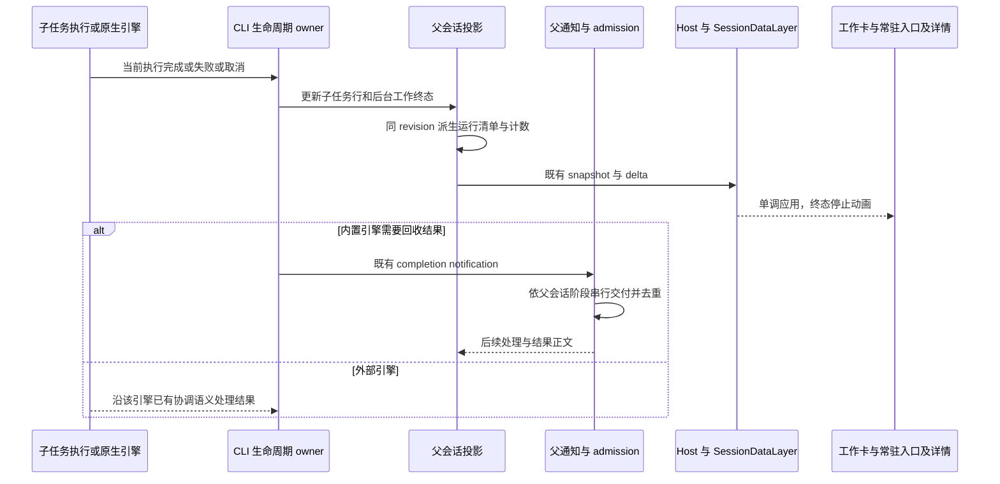
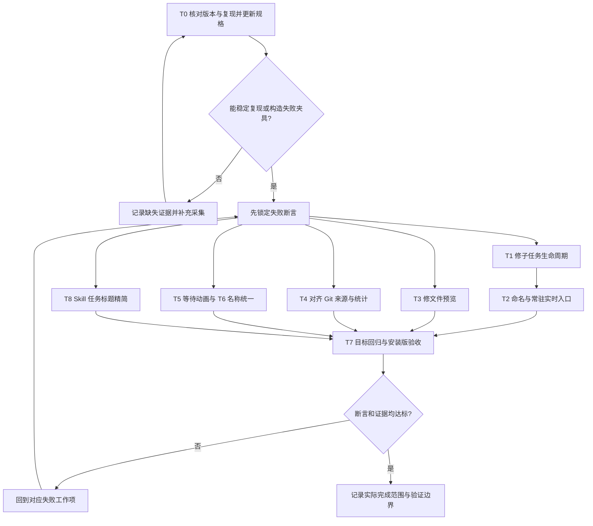

> _This was generated by AI during triage._

# YCode 桌面体验修复方案

Status: done

日期：2026-11-11。状态：桌面修复已实现并发布 v1.3.1；各项运行证据与未通过的验证边界见末尾记录。前文分诊表保留调查时的事实与待验证假设，不将其改写为全部现场问题已确认解决。

## 目标与范围

把本次反馈收敛为七项可验收修复：子 Agent 有意义的名称、折叠后持续可见的实时状态、子任务完成与结果回收、文件/Markdown 预览、Git 审阅口径、等待动画、Skill 引用任务标题精简；同时统一产品及本项目的显示名称为 **YCode**。

采用 `ask-matt` 的“集中反馈梳理 → 修复规格”路径，遵循本仓库本地 Markdown Issue 约定。本轮按用户授权实施、验证、推送与发版，排除原工作区手机端未提交改动。Claude Code 的参考依据是用户提供的截图：任务名称、常驻子任务入口、点击查看详情和持续状态反馈；未审计其内部实现，不据此宣称两者执行协议相同。

本方案是现有规格的增量修订提案，进入实现前按 T0 更新对应规格与用例。明确调整 11 月 9 日方案中的两项旧决定：**类型名优先改为任务名优先；普通等待阶段恢复简洁 spinner，继续保留发送后即时用户气泡。**

## 一、证据与分诊

调查基线：工作区 `fix/11-11`，HEAD `b54d3c2da455`，freshness 检查相对本地 `origin/main` ahead 0 / behind 0。未执行 fetch；这不是对远端最新状态的承诺。已有手机远控相关未提交改动不属于本次范围。

| 编号 | 反馈与优先级                       | 当前证据                                                                                                                                                           | 结论与待验证边界                                                                                                        |
| ---- | ---------------------------------- | ------------------------------------------------------------------------------------------------------------------------------------------------------------------ | ----------------------------------------------------------------------------------------------------------------------- |
| F1   | 名称没有任务含义，P1               | `subagent-display/model.ts` 的 `subagentWorkCardName` 明确先返回非通用 `subagentType`，因此 `Explore` 会盖过任务标题；同文件另一个名称解析入口采用标题优先         | 已确认显示规则与本次需求冲突；需要合并名称规则，不能只改一处文字                                                        |
| F2   | 折叠后看不出子任务是否还在工作，P1 | 已有工作卡、右上角状态面板与只读详情；状态胶囊目前有工作流优先级；SAT31/SAT32 覆盖矩阵仍为 partial                                                                 | 已有实现不等于现场问题已解决；补足常驻入口、折叠及工作流并存用例                                                        |
| F3   | 问着问着无响应、调查完仍运行，P0   | 截图中最终正文与运行卡冲突。父卡读取父 `subagent` 行与 `running[]`；右侧头部还读取子 snapshot；CLI 投影从最新父行派生运行清单                                      | 已确认多展示面存在不同读取路径；尚未确认是原生终态缺失、投影未收敛、通知未唤醒还是连接退出。必须逐层取证                |
| F4   | Markdown、代码文件预览空白，P0     | 截图中 Markdown 与 `service.py` 都空白。`PreviewPane` 有文件读取 effect、`renderHeavyContent` 挂载门禁；内容组件在无数据且无 loading/error 时允许返回 null         | 优先排查共享预览链路，不能先归因为 Markdown 解析器。具体失败位置待复现                                                  |
| F5   | Git 行数、文件数、分支对不上，P1   | `App.tsx` 的 `gitWorktreeChangeSummary` 累加 staged + unstaged；`gitWorktreeReviewSourceId` 却只选择其中一个。`useGitRepository` 的 last-turn 数据入口当前为空骨架 | 已确认“汇总入口 → 单一来源详情”口径不一致；分支错配、子仓库/worktree/跨任务污染尚未复现；last-turn 空骨架不等于截图根因 |
| F6   | 等待没有旋转动画，P1               | 11 月 9 日 W5 明确移除普通等待 spinner；`ConversationTurnGroup` 的 `TurnChatLoadingSlot` 只保留重试或 connecting                                                   | 已确认普通等待阶段没有 spinner 是当前规则，需按本次反馈修订                                                             |
| F7   | 这个项目应叫 YCode，P1             | 现有品牌规范已要求 YCode；截图项目仍叫 ZCode。项目编辑器已通过 `saveProject` 保存 `name`；构建基础配置和兼容路径中也仍有 ZCode 字样                                | 产品品牌与项目显示名分别核对；不能把旧数据路径、源码目录或供应商名称一并替换                                            |

| F8 | Skill 引用时左侧任务标题冗余过长，P1 | `titleFromInput` 已把正常 `[$skill](path)` 转为 `$skill` 后按 60 字符上限截断；当前合同明确保留不完整链接，历史标题不回填。Renderer 还存在初始乐观标题与后续生成标题的合并 | 复用已有标题链路；先区分安装版差异、引用变体、乐观标题、生成标题与旧历史，不把已有规范化功能重做一遍 |

### 源码与现有规格入口

- 子任务：[展示模型](../../packages/ui/src/subagent-display/model.ts)、[工作卡](../../packages/ui/src/subagent-display/SubagentWorkCard.tsx)、[右侧头部](../../packages/ui/src/subagent-display/SubagentSessionHeader.tsx)、[CLI 父投影](../../apps/zcode-cli/packages/bootstrap/src/zcode-protocol-v4/product-projection.ts)、[外部引擎帧归一](../../apps/zcode-cli/packages/adapters/src/external-engine/subagent-frames.ts)。
- 生命周期：[当前 Agent 工具合同](../../apps/zcode-cli/docs/design/v2/tool/07-subagent.md)、[主子双向消息](../subagent-respond-to-coordinator.md)、[多智能体展示](../desktop/multi-agent-display-spec.md)、[子会话侧栏](../subagent-session-side-tabs.md)。`agent-background-subagent-join.md` 与第一版 background plan 属于历史材料，不能恢复“父轮必须等待所有后台子任务”的旧方案。
- 文件：[PreviewPane](../../packages/ui/src/PreviewPane.tsx)、[内容分派](../../packages/ui/src/previewPaneContent.tsx)、[侧栏挂载门禁](../../packages/ui/src/app-shell/AnimatedSidePanePanel.tsx)、[Markdown 内容](../../packages/ui/src/previewPaneMarkdownContent.tsx)。
- Git：[App 汇总与打开来源](../../packages/ui/src/App.tsx)、[仓库数据 hook](../../packages/ui/src/hooks/useGitRepository.ts)、[状态面板模型](../../packages/ui/src/v4/conversationStatusPanelModel.ts)、[审阅面板](../../packages/ui/src/GitPane.tsx)。
- 等待与名称：[等待 slot](../../packages/ui/src/v4/ConversationTurnGroup.tsx)、[等待 guard](../../packages/ui/src/v4/chatLoadingVisibility.ts)、[旧方案 W5/W8](2026-11-09-engine-composer-subagent-polish.md)、[YCode 品牌规范](../desktop/ycode-branding-spec.md)、[项目编辑](../../packages/ui/src/project-sidebar/ProjectEditor.tsx)。

- Skill 标题：[标题权威规范](../ui/task-title-authority.md)、[现有溢出交互](../ui/task-item-title-overflow.md)、[首条输入标题清理](../../apps/zcode-cli/packages/core/src/runtime/helpers/project.ts)、[标题生成输入](../../apps/zcode-cli/packages/core/src/runtime/methods/title-generation-sidecar.ts)、[Renderer 标题合并](../../packages/ui/src/lib/zcodeTaskMetaMerge.ts)。

## 二、用户可见行为

### 1. 子 Agent 以任务命名

- 主名称优先使用明确的任务描述/任务标题，例如“排查文件预览空白”“核对 Git 统计口径”；`Explore`、`general-purpose`、模型名只作为类型或能力标签。
- 复用既有任务 `description`、可见标题、原生引擎任务字段。缺少标题时，从已有任务说明提取简短首句；最后才用本地化“子任务 N”。不新增独立模型命名请求，也不把整个提示词当名称。
- 工作卡、折叠摘要、常驻入口的列表、右侧标签页、详情头部与目录使用同一名称解析规则。长标题视觉截断并可查看全文；同名任务仍按稳定身份区分。
- 显示名称不替换可寻址 agent name、`agentId`、`childSessionId`、`toolCallId`，不影响继续对话、消息路由与历史恢复。

### 2. 折叠后依然可见实时状态

- 在现有输入工具栏内提供紧凑的常驻子任务入口，例如“2 个子任务 · 1 运行 · 1 等待”。主卡折叠、滚出视口、主轮结束和右栏关闭后，仍可看到该入口；工作流优先展示不能把它遮掉。复用现有状态面板的智能体列表与详情打开动作，不再维护另一套任务管理数据。
- 点击入口查看任务名称、状态、耗时、最近活动与可用操作；点击具体任务复用现有右侧只读实时会话。默认不强制打开右栏，不在输入框上方增加浮条。
- 有活动成员时允许用户折叠工作卡；折叠行必须显示当前状态汇总。完成、失败、停止各自计数，不能把“结束 2/2”写成“成功 2/2”。
- 运行用 spinner；等待用户用明确提示；阻塞显示已知原因；失败给出错误；停止命令待 ACK 时显示“停止中”，收到终态后才显示“已停止”。仅在确有活动项时继续计时。
- 最近活动只取真实工具、消息或引擎事件；只显示已知时间/摘要，不伪造进度。暂时没有输出本身不能证明卡死；连接丢失时明确显示“连接已断开，状态待确认”，重连后从权威投影恢复。
- 所有子任务结束后，入口保留本次会话的结束摘要并停止动画，可查看历史结果。切换父会话后仅展示目标会话任务。

### 3. 完成、停止与结果回收

- 区分三件事实：后台启动 ACK、子任务受派执行结束、父 Agent 消费结果。后台 Agent 工具返回 `completed` 可能只是启动成功，不是执行完成；主 Agent 正文“调查完成”也不能作为状态依据。
- 以实际执行/原生引擎生命周期为源，沿现有 runtime → 父投影 → 数据层 → UI 收敛终态。对齐工作卡行、`snapshot.subagents.running`、`backgroundWorks`、右侧详情和目录；按子任务及当前执行代次匹配，旧事件不得覆盖新一次运行。
- 内置引擎完成通知继续走现有父会话通知与串行 admission。验证父会话忙碌、空闲、等待用户时的交付：可恢复通知不丢失，重复交付不重复产生结果或唤醒；不能为唤醒建立另一条绕过 CommandInbox 的发送路径。
- Claude Code / Codex 按各自 adapter 的真实结束、失败、取消和 lost 事件验证；不能把内置引擎的唤醒实现硬套给原生引擎，也不能因一条父轮完成事件提前结束后台子任务。
- 停止沿用 `cancelBackgroundWork(workId)` 和 capability；重复停止可 ACK/noop。不可取消的任务不展示可点击停止。停止与自然完成并发时由 owner 裁决一次，不靠前端强写成功。
- 已确认 worker/Host 退出与暂时网络断连分别处理：前者结束受影响执行并清理活动资源，后者保留待恢复语义。正常结束只释放本次执行的订阅、计时与活动句柄，不误杀共享 Host，也不销毁可继续交互的子会话历史。

### 4. 文件与 Markdown 预览

- 按“打开意图 → source 与工作区身份 → 正确 fileService → 文件字节/文本 → 内容分派 → DOM 挂载 → 实际可见尺寸”建立一条可观测复现链。Markdown 和普通代码都空白时，先检查共享链路；读取成功后才继续分查 Markdown、代码高亮或样式。
- 非空有效文件必须显示内容；读取中、真实空文件、二进制/不支持、超限、缺失、读取失败、渲染失败分别给出明确状态。读取/渲染失败可重试或用既有外部编辑器打开，不以空白作为兜底。
- 请求及缓存绑定完整 source、工作区身份和远程连接。快速切文件/任务/工作区时，旧结果不得覆盖新 source；远程文件不读取同名本地路径。
- 核查 `renderHeavyContent` 的 active tab、可见宽度与 resize settling：面板展开、切回标签、拖拽结束后必须恢复真实内容，不能永远停在占位/未挂载状态。保留后台大文件预览降载，不能简单删掉门禁。
- 保留 Markdown 源码/预览切换、选择引用、代码审阅与其它文件类型现有能力；先复用已有错误和 loading 组件，再补实际缺失分支。

### 5. Git 统计与审阅口径

- **先修已确认矛盾**：顶部“更改”当前是 staged + unstaged 操作量汇总，因此点击后展示同一工作区下的两组列表及各组小计；可复用现有两种 dataset 的“全部更改”展示视图，不增加第二个 Git 数据 owner。单独选择 staged/unstaged 时只显示对应小计，不能把总数贴到某一个来源上。
- 文件总数按规范化路径去重，同一文件同时 staged/unstaged 时只计一个文件，但允许在两组中分别出现。`+/-` 标注为两组操作量之和，不冒充 HEAD 到工作树的净差值；若后续选择净差口径，必须连同 service 读取和全套测试一起明确变更。
- 分支对比明确显示 base/head，使用现有分支比较结果；“本轮变更”只对应该轮快照，不与实时工作树、分支对比混用。last-turn 数据尚未接通时应明确不可用，不展示看似有效的 0 或错误工作树数据。
- 分支名、文件列表、文件数与行数取自同一目标上下文和刷新代次。上下文包含 workspace identity、真实 repo root/worktree、远程目标与来源；切换时旧数据不能被冠上新分支标签。
- Agent 在另一目录执行命令时，审阅仍明确以选中的工作区/仓库为目标；不能按对话提到的分支名猜测目标，也不能静默切换仓库。复现时同时记录工具 cwd 与审阅 repo root，先区分合法差异与上下文错配。
- 二进制、重命名、mode-only、删除、未跟踪文件、子模块都纳入文件计数合同；不可获得行数时标为不可统计，不能按“行数为 0”把真实变更入口隐藏。无 upstream、detached HEAD、冲突和读取失败必须有各自显示。
- 用隔离仓库的 `git status --porcelain=v2 -z`、`git diff --numstat -z`、`git diff --cached --numstat -z` 及对应分支比较结果核对。未跟踪文件没有普通 diff 行数，需要按现有 service 的单独读取合同验证；这些命令不直接充当整个汇总的等价 oracle。

### 6. 等待动画与 YCode 名称

- 发送后仍立即显示用户气泡和“工作中 N 秒”；从已提交的等待阶段起显示轻量 spinner，主模型等待和仅有后台子任务运行分别由自己的权威事实驱动。
- 普通等待恢复动画即可，不恢复冗长“正在发送/等待模型”卡片。重连、重试使用原有说明；权限、问答、计划审批、compact 等已有明确交互的阶段不叠加误导性模型 spinner。成功、错误、停止立即结束对应动画，尊重减少动态效果设置。
- 产品在启动页、标题栏、菜单、关于页、中英文文案和安装包显示为 YCode；开发版/预览版按既有规则显示 YCode Dev / YCode Preview。核对最终安装包的实际覆盖结果，基础 `productName` 出现 ZCode 不单独构成已安装版缺陷证据。
- 用户指定的本项目在侧栏与相关项目标题显示为 YCode，复用现有 `saveProject(name)` 和项目名消费链；其他项目的用户自定义名称不改。仍显示路径时允许保留真实目录名 `ZCode`。
- 本次不重命名 `/Users/openx/github/ZCode`、Git 仓库、内部 `@zcode/*` 包、协议/命令、appId、数据目录或环境变量，不迁移会话数据。第三方 Claude Code/Codex 名称保持原样。

### 7. Skill 引用任务标题精简

- 优化左侧任务标题，并同步覆盖使用同一任务标题的顶部栏。初始标题保留一次可读技能名与需求正文，去掉技能文件绝对路径、Markdown 包装和重复的同一 Skill 引用。例如 `[$ask-matt](/Users/example/.zcode/skills/ask-matt/SKILL.md) 梳理桌面体验修复方案` 显示为 `$ask-matt 梳理桌面体验修复方案`，不让路径占满标题；后续既有模型生成标题以简短任务意图为主。
- 标准链接清理已经存在：先沿 `titleFromInput → first_input 落盘/标题事件 → Host 索引 → 侧栏/顶部` 排查本次落在哪个阶段。复用这条链路，缺口在共享 owner 修；不在侧栏和顶部各写一套正则，也不新增标题模型调用。
- 处理当前支持的 `$skill`、Skill 提及/结构化引用和 Markdown 技能链接，不凭用户口语“skill@skill”新增一套 `@skill` 触发语法。同一实际 Skill 的重复引用只保留一次；不同限定名/来源不能按短名误合并。
- 当前输入中出现了疑似缺少闭合括号的技能链接，因此 T0 必须加入这种变体。只有已知 Skill 引用、匹配标签/路径或结构化元数据能可靠证明边界时，才在**标题派生输入**中去掉 `/SKILL.md` 及其路径；路径后的中文需求必须保留。不能确定边界时保留原文，不用贪婪替换吞掉后续需求。普通链接、代码片段和用户刻意讨论的路径继续遵循原合同。
- 先清理、去重，再按现有标题上限截断，确保路径不会挤掉任务意图；标题保持单行，复用已有渐隐/悬停走马灯和顶部截断，不改全局字体、侧栏宽度或原有交互。
- 原始用户消息、发给模型的提示词、Skill 路径和技能加载逻辑完全保留。只修改派生标题，不让显示优化影响技能执行。
- 标题优先级保持“用户手动命名 > 模型生成 > 首条输入 > 占位”。明确保护 `titleOverridden`，不能因为重连、重新生成或读取旧 snapshot 把手动标题覆盖回去。
- 对仍带技能路径的旧自动标题，先核对 `titleSource` 与原始输入：仅在能证明是本问题的 `first_input` 且无手动覆盖时，提出沿 CLI 标题权威修正的定向方案，保留来源并发布既有标题事件。已有模型生成标题、手动标题和不可可靠重建者不批量重写；不直接改 Host 只读镜像，不为全列表拉起所有历史 runtime。

## 三、影响面与状态归属

变化层级：presentation、validation、commit-effect、recovery；仅在已证明缺少持久化事实时才增加 persistence 变更。覆盖三个引擎、桌面本地与 SSH；共享 Web 界面做兼容回归，不扩建本次工作区正在开发的手机远控功能。

| 场景/UI 入口                   | 共享实现与展示态                                 | 默认/校验                                          | 提交动作                              | 权威与落点                                    | 模式/隔离                                      |
| ------------------------------ | ------------------------------------------------ | -------------------------------------------------- | ------------------------------------- | --------------------------------------------- | ---------------------------------------------- |
| 子任务卡、折叠摘要、工具栏入口 | subagent-display 纯派生模型；展开态属于 Renderer | 任务标题优先；只读 snapshot；停止按 capability     | 打开既有详情；cancelBackgroundWork    | CLI 执行事实、父投影、既有 session 事件       | 父会话、子身份、执行代次隔离；无前端运行态副本 |
| 子任务右侧详情/目录            | 既有 lease、SubagentSessionHeader                | 父子投影按当前执行协调；名称同源                   | 获取/释放 lease                       | SessionDataLayer 镜像；CLI 仍为源             | 只读，不另建 transport，不改变父会话选模/输入  |
| 文件链接、文件树、右栏标签     | PreviewPane；源码/预览模式和布局属于 UI          | source scope、真实文件状态、挂载门禁               | useWorkspaceServices 读文件；显式重试 | 目标文件系统；作用域内请求结果                | 本地/远程同路径隔离；不写文件                  |
| 顶部 Git 更改、分支与审阅列表  | useGitRepository、同源 dataset selector          | repo/worktree/source/刷新版本一致                  | refresh、打开来源；已有 Git 动作      | 目标仓库的 Git 状态与既有 service             | 不把任务快照当工作树；不把本机 Git 当远端      |
| 普通等待/重连/子任务执行       | 既有 loading guard 和 ChatLoading                | 当前轮、pending overlay、interaction 与 activeWork | 无新增执行命令                        | CLI 运行事实；发送前仅既有 optimistic overlay | 不改变发送 admission、停止或重试语义           |
| 本项目与产品显示名             | 项目编辑/读取链、品牌与产品身份配置              | 仅指定项目改名；兼容标识不变                       | saveProject；既有构建配置             | 项目记录与现有品牌/i18n 配置                  | 不写其它项目、用户路径、会话或 provider 标识   |

| 左侧任务列表与顶部任务标题 | 既有初始标题/生成标题链及元数据合并 | Skill 引用精简；保留手动标题优先级 | 沿 CLI 标题更新和既有事件同步，不直接写镜像 | CLI title/titleSource；Host tasks-index 为只读投影 | 本地与远端同源；不改变原消息、技能解析或任务身份 |

### 共享、差异与影响分级

- **must-inspect**：子执行/adapter 事件 → CLI 父投影 → 卡片/胶囊/详情；完成通知 → 父会话 admission；文件 service/source → PreviewPane → 可见性门禁；Git refresh/dataset → 汇总入口 → 打开来源。每条分别对应 F3、F4、F5 的真实数据依赖。
- **should-inspect**：工作卡名称、页签与目录是否共用解析；工作流与子任务入口并存；loading guard 与停止/交互状态；项目改名后的标题读取链。
- **conditional**：SSH 连接代次、原生引擎取消能力、冷恢复/旧历史、文件读写权限和大小、detached HEAD/子模块；仅命中相关条件才扩大检查。
- **invariant-only**：Main 不承载 session 业务状态；CLI 拥有执行事实；`workspaceIdentity?.trim() || workspacePath` 负责隔离，路径负责 IO；owner/lease、stale run 防护、desktop-continuous 保留。
- **evidence-only**：已有 UT、projection/adapter 测试与 pending E2E 是测试入口，不证明截图对应安装版已修复。

三引擎共享名称/状态展示与 UI selector，原生协议、停止能力和结果交付仍有差异；不为统一 UI 重写各引擎 runtime。文本/Markdown 共享读取和壳层，具体 renderer 仍分开；Git 各来源共享工作区上下文，但比较语义不强行合并。

标题补充影响：**must-inspect** 为 CLI 初始标题/生成输入 → SessionTitleUpdated → task index syncer → 侧栏与顶部；**should-inspect** 为乐观标题与恢复合并；**invariant-only** 为手动命名优先级、原消息和 Skill 执行。`task-title-authority` 与 `task-title-overflow-marquee` 是不同语义：本次先清理标题来源，继续复用溢出展示。

### 图谱证据与漂移

仓库没有 `.codegraph/`，本次按规则跳过 CodeGraph，不建立新索引；使用已声明 seed 与限定源码搜索，沿直接调用链核对，未声称完成静态调用图的深度分析。

已核对 seed：SubagentWorkCard → 展示 model/spawnGroups，SubagentSessionHeader → 父子 lease，App → useGitRepository/状态面板，AnimatedSidePanePanel → PreviewPane → 内容组件，ConversationTurnGroup → loading guard。现有功能图的 `capability.subagents` 偏重配置与工具，对本次工作卡/运行入口覆盖不足；普通等待与代码/Markdown 预览也不能仅由 provider-retry、Office/image preview 节点代替。

Graph delta 暂为 proposed：在 T0 依据确认后的语义给既有子任务节点补显示面、生命周期 owner 与代码 seed，给普通文件预览/等待补相应关系；不在本次方案阶段批量重构图谱。未确认的根因不写成图谱事实。

## 四、实施顺序与依赖

| 任务                  | 依赖                   | 交付与完成条件                                                                                                                                             |
| --------------------- | ---------------------- | ---------------------------------------------------------------------------------------------------------------------------------------------------------- |
| T0 复现并锁定合同     | 无                     | 核对截图对应引擎、安装版本/commit、会话和实际工作区；建立隔离最小夹具，分层记录事件/投影/可见 DOM；更新本方案和对应 spec。复现不足时记录具体缺口，不能盲改 |
| T1 子任务生命周期收敛 | T0                     | 先补终态丢失、结果回收、停止竞态、退出/重连回归，再修确认失败的 owner/adapter/投影路径；逐项证明父子状态一致                                               |
| T2 名称与常驻运行入口 | T0；终态验收依赖 T1    | 合并名称解析；复用现有列表/详情；实现工具栏入口和可折叠卡片。运行、等待、结束计数一致                                                                      |
| T3 文件预览恢复       | T0                     | 按复现结果修最小共享断点；明确空态/错误；门禁解除和异步切换正确。非空 Markdown/代码实际可见                                                                |
| T4 Git 来源与统计一致 | T0                     | 统一汇总与打开目标；同源小计/总计、去重文件数及 repo/branch 归属；隔离仓库验证                                                                             |
| T5 等待动画           | T0；组合验收依赖 T1/T2 | 按新合同恢复轻量 spinner，补等待/交互/终态 guard；验证无重复或永久动画                                                                                     |
| T6 YCode 显示名称     | T0                     | 本项目复用项目名保存；核对产品/安装包显示名与兼容边界，保留其他项目名称                                                                                    |
| T8 Skill 任务标题精简 | T0                     | 复用 CLI 标题权威，补引用变体/重复引用与恢复回归；左侧和顶部一致，原消息和手动标题不变                                                                     |
| T7 联合回归与交付记录 | T1–T6、T8              | 目标 UT、CLI 相关测试、pending E2E、typecheck/lint/架构检查；记录安装版与真实引擎验证边界；按实际结果更新状态                                              |

T3、T4、T6、T8 在合同确定后可独立推进；这表示工作项依赖关系，不要求启动多个 Agent。每项先有失败证据/回归断言，再改最少代码；确认被替代路径无引用后一起删除，不新增重复状态或定时“自愈”。

## 五、场景、剪枝与验收

### 决策与维度

用户已给定：有意义命名、折叠后看见实时状态、结果不丢失、完成正确结束、预览可用、Git 统计一致、等待有动画、项目叫 YCode、Skill 引用任务标题简洁。工具栏常驻入口、Git 双来源分组与显示名兼容边界是本方案推荐默认，需在实施前写入对应 spec；本次没有额外向用户提问，也未把推荐界面形态写成既有实现事实。

优先领域为子任务生命周期、文件预览、Git 工作台与共享展示。枚举的行为维度为引擎、父会话阶段、子任务状态、连接/执行代次、展示入口、文件类型、Git 来源和仓库身份；深浅主题/中英文/窗口宽度采用代表组合，不展开全量笛卡尔积。

| 剪枝决定                                              | 理由                                           | 保留的代表验证        |
| ----------------------------------------------------- | ---------------------------------------------- | --------------------- |
| 不把全体子任务在父轮完成时强行停止                    | 合法后台任务可跨父轮；父轮完成不等于子任务结束 | YD03、YD04            |
| 不把无输出自动判死、超时自动成功                      | 没有执行终态证据；连接暂失与进程退出不同       | YD05、YD06            |
| 不增加独立命名模型或前端任务状态库                    | 已有任务描述、投影和唯一生命周期 owner         | YD01、YD02            |
| 不承诺原生引擎未提供的停止能力                        | 保留现有 capability 边界                       | YD07                  |
| 不扩大成全格式预览器重写、整个 Git 重构或内部标识迁移 | 超出反馈且会破坏既有能力/数据兼容              | YD09–YD16             |
| 不自动准入 CI 或启动全量 UT/E2E                       | 新场景先走既有人工 review/pending 流程         | T7 目标用例与证据记录 |

### 验收用例草案

以下为待 T0 确认的候选；直接来自本次反馈的预期必须保留。行为合同核对后将 accepted 项回填总目录/覆盖矩阵，才能编写 E2E；不得将本表记为已有覆盖。

| ID   | 前置与操作                                                                   | 必须断言                                                                           | 证据与状态                           |
| ---- | ---------------------------------------------------------------------------- | ---------------------------------------------------------------------------------- | ------------------------------------ |
| YD01 | 两个同类型 Explore 执行不同任务，打开卡片/目录/两侧页签                      | 主名分别描述任务，跨入口一致；身份/路由不变                                        | UI + 投影；candidate                 |
| YD02 | 子任务运行时折叠卡片、滚离卡片、关闭详情；同时启动工作流                     | 工具栏入口持续可见且计数实时更新；点击仍能定位任务                                 | UI + 父 snapshot；candidate          |
| YD03 | 父轮先结束，一个子任务继续运行，另一个结束                                   | 父轮可完成；两个子状态准确，未结束者不被假关闭                                     | UI + runtime；candidate              |
| YD04 | 父会话分别忙碌/空闲/等待用户时，内置子任务完成或失败；重放通知               | 终态收敛；按既有协调规则交付；重复事件不重复结果；需继续协调时不会永久停在“等结果” | runtime + inbox/通知 + UI；candidate |
| YD05 | 重放原生完成/失败/取消/lost 与重复、迟到事件，再恢复历史                     | 当前执行终态正确；旧执行不能覆盖新执行；各入口停止计时                             | adapter + projection + UI；candidate |
| YD06 | 网络暂断后重连；另测已确认 worker/Host 退出                                  | 暂断显示待确认且可恢复；真正退出收敛为合适中断/错误，均不永久假运行                | 连接日志 + snapshot + UI；candidate  |
| YD07 | 可停/不可停任务混合，重复停止并与自然结束竞态                                | 只发有效 workId 命令；ACK 前停止中；结束只裁决一次；不可停不伪造按钮               | 命令 ACK + runtime + UI；candidate   |
| YD08 | 子任务卡有运行/等待/失败/已停止成员，再全部结束                              | 各状态计数真实；等待不伪装运行；终态无 spinner；结束摘要可回看                     | selector UT + UI；candidate          |
| YD09 | 从文件树与回复链接分别打开含唯一标记的非空 Markdown/Python 文件              | 非空文本实际出现在可见预览区；Markdown 源码/预览切换正确                           | 文件 + 可见 DOM + 截图；candidate    |
| YD10 | 切换文件/任务/本地与远端同名路径，旧读取延迟返回                             | 最终内容只属于当前 source/身份；旧结果不覆盖、不串到本地                           | 受控 IO + UI；candidate              |
| YD11 | 拖拽/折叠侧栏、切预览标签、调整窗口后再展开                                  | active 且可见时真实内容恢复，容器尺寸非零；后台降载保留                            | DOM/尺寸 + 截图；candidate           |
| YD12 | 空文件、缺失、权限失败、超限、二进制与 renderer 异常                         | 分别有对应说明；可恢复失败可重试；普通文件失败不拖垮整个工作台                     | IO/renderer 错误 + UI；candidate     |
| YD13 | 隔离仓库同时 staged/unstaged，含同一文件与未跟踪文件                         | 顶部、打开详情、两组小计一致；唯一文件计数准确，操作量口径明确                     | Git oracle + service + UI；candidate |
| YD14 | 只有二进制/rename/mode-only 变更；切分支、worktree、嵌套仓库与远端身份       | 非行数变更仍可进入；分支与 repo 匹配；旧响应不污染新目标                           | Git oracle + scope + UI；candidate   |
| YD15 | 发送后等待首包、工具间等待、重试、问答/审批、停止/失败；父轮结束仅子任务运行 | 每阶段活动反馈正确；无误导/重复动画；子活动入口仍可见；reduced-motion 有静态反馈   | UI + phase/interaction；candidate    |
| YD16 | 本项目命名 YCode 后重启；核对正式/开发版及其它自定义项目                     | 指定项目名持久化；产品名正确；其它项目、目录、身份及会话数据不变                   | UI + 项目记录 + 包元数据；candidate  |

| YD17 | 标准/结构化 Skill 引用、重复与多个不同 Skill、Windows/空格/括号路径、不完整引用以及普通链接/代码片段 | 只清理可靠识别的 Skill 引用；技能名不重复、需求保留、清理后再截断；正文/模型输入逐字不变，非 Skill 内容不误删 | 标题 UT + CLI 落盘/事件 + 请求内容；candidate |
| YD18 | 新任务初始/生成标题、可识别的旧 first_input 标题、手动命名；切换任务与远端身份后重连重启 | 侧栏和顶部同一标题；首发不闪回完整路径；手动与模型生成标题不被回填覆盖；旧响应不串任务，旧标题修正只走权威链 | titleSource/override + Host 投影 + UI；candidate |

## 六、测试落点与交接

- 复用 UI 的 `subagentWorkCard`、`subagentSessionHeader`、`previewPaneFileContent`、`previewPaneHeavyContent`、`gitRepositoryRefresh`、`taskChangeSummary` 等现有测试入口；先检查实际文件和 runner 配置，不另造一套测试壳。
- 标题复用 core 的 `runtime-persistence.test.ts`、`external-engine-runtime.test.ts` 与现有标题合并/列表展示测试；先保留标准 Markdown 链接清理的现有回归，再补新边界。实施前更新 `docs/ui/task-title-authority.md`，明确对可靠识别的不完整 Skill 引用和旧自动标题处理的增量合同；具体用户样本未复现前不宣称根因已确认。
- CLI 分别在 adapters 的原生帧测试、bootstrap 的 `product-projection-subagent-work-card`/原生子任务测试、core 的现有生命周期/通知测试缝上补回归；根 UT 不替代 CLI 包测试。
- 子任务验收复用 SAT31–SAT34 与现有工作卡 pending E2E；预览/Git 复用相邻候选。T0/T7 回填 `docs/conversation-session-case-catalog.md`、`docs/testing/conversation-session-e2e-coverage-matrix.md`，明确 candidate/accepted/partial/covered，不能因为写了用例草案就填 covered。
- E2E 使用隔离用户目录和固定文件/Git fixture；以受控事件延迟覆盖生命周期竞态，以条件等待而非硬 sleep 断言。provider replay 只验证可控协议/渲染，真实 Claude Code/Codex 至少各验证一次运行→结束和状态回收。
- UI 代表组合：深浅主题、中英文、常规桌面和窄侧栏；Windows/Linux 的路径、Git 和打包显示名需要平台证据，macOS 截图不能替代。新增 E2E 留在 manual-review/pending，review 和转正沿现有流程执行。
- 实施前按架构技能先做检查和受控模块阅读；完成后必须运行 typecheck、lint、changed 架构检查及本项受影响测试，报告真实失败。未经额外要求不运行全量 `pnpm test` / `pnpm test:unit`，不顺手修无关失败。
- 本计划完成不等于修复完成。T7 需记录每项复现证据、根因、改动范围、回归结果、实际安装版本/commit、真实运行验收与剩余限制，才能改名为“已实现”。

## 七、本次方案验证记录

2026-11-11：读取了用户截图、当前源码、现有 spec 与覆盖矩阵；未启动/操作日常安装版、未读取用户具体会话日志、未复现真实引擎卡住、预览空白或分支错配。F1/F5/F6 是静态规则/数据流确认，不能扩写为全部现场根因已确认。

当前工作区执行 `npx --yes pnpm@10.33.2 typecheck` 通过；`npx --yes pnpm@10.33.2 lint` 通过，0 errors / 91 warnings。Node 为 `v24.14.0`，与 `mise.toml` 一致；当前 shell 无 mise/pnpm 可执行文件，使用固定版本 pnpm 入口。未运行全量测试、Desktop E2E、CLI 专项测试或构建/发布；这些仍是实施阶段任务。

方案文档包含 18 个验收场景草案与两张 Mermaid 图；本地引用均已核对存在。新增文档与本地 Issue 索引做定向格式检查，格式结果以本次交付检查为准，不代表完成运行时验收。

### 本轮增补：Skill 任务标题（2026-11-11）

本轮位于已有 `feat/mobile-remote` 工作区；freshness 相对本地 origin/main ahead 0 / behind 0，未切换分支。核对当前代码确认正常 Skill Markdown 链接清理仍存在，本轮补充 F8、T8、YD17/YD18 与标题权威边界。未修改产品代码、未回填历史标题、未重跑产品测试；只验证文档格式、引用和规划一致性。

### 实施授权与隔离（2026-11-11）

用户已授权实现、推送和新版本发布，并要求暂不包含手机端相关更改。修复在 `/Users/openx/github/YCode-desktop-fixes` 的 `fix/desktop-experience-20261111` 分支开展，固定基线 `b54d3c2da455ab9e9352239bae63341a7c64972a`。原工作区与手机端 95 个变更文件已保存校验清单，仅复制本方案并重建这一条 Issue 索引，不复制其它未提交补丁。测试缝沿本方案已列出的 UI/CLI 公开接口与现有 pending E2E；本轮按用户实施授权推进这些现有测试入口。

### Git 实施合同（2026-11-11）

`worktree` 是 UI 组合来源，复用同一刷新版本的 unstaged/staged sections；不得发送给 Git repository diff。每行按实际 section 解析 staged/unstaged diff 与缓存键，同文件两组独立展开与搜索。文件总数按 path 去重，操作行数按两组求和；分支、repoRoot、workspace 与刷新版本来自同一 repository state。二进制/mode-only 即使 +/- 为零也保留审阅入口。

预览已确认共享布局缺陷：桌面窄栏直接带 source 打开新标签时不能默认目录独占；优先展示已打开文件，手动目录偏好与紧凑临时覆盖分离。回归覆盖 Markdown 与 Python source。

## 隔离实施验收记录（2026-11-11）

### 已实现范围与根因证据

- 子任务名称统一复用任务标题优先规则；工作卡、目录和页签不再各自优先使用通用类型。
- 运行工作卡允许折叠并保留状态/结束计数；输入区常驻入口从父 snapshot 派生，不增加另一套运行事实。运行与结束阶段的展开偏好分开，全部结束后默认折叠。
- 原生后台退出独立尝试发布后台终态与 SubagentStopped，再交付父通知；任一终态发布失败不再阻断后续收口。CLI reducer 按当前执行 callId 拒绝旧 Stop/后台终态，并保持 clone/adopt/replay 与删除清理一致。这里修复可复现的事件边界，不能推断覆盖所有引擎无响应原因。
- 文件预览确认的直接原因是窄桌面栏中新 source 默认只显示目录，将正文压到零宽；改为优先正文，保留目录切换与后台降载。Markdown/Python 通过实际窗口正文断言与截图，不以面板挂载代替可见性验收。
- Git 全部更改来自同一刷新事务的 staged/unstaged 分组；文件数按路径去重、操作行数分组累加，diff/搜索缓存携带实际来源，工作区、服务实例和远端 session 变化时失效。隔离 Git 仓库同时暂存/未暂存的同一文件统计分别与 git diff --numstat、git diff --cached --numstat 一致。
- 普通等待使用 spinner；等待授权/用户输入与完成态不误显示运行动画。
- Skill 链接先规范为 $skill-name 再截断；未闭合链接只识别精确 SKILL.md 边界，按 label+完整路径去重。旧标题仅在 first_input 来源且可由原始首条输入逐字证明时恢复修正，保留手动/模型标题和原始提示词。
- 安装包产品名为 YCode；用户指定的本地项目已通过安装版的“编辑项目→保存”改名 YCode，侧栏与顶部显示同步验证。未改其它项目名、目录或存储身份。

### 检查与证据边界

- 根 typecheck、lint、changed 架构检查通过；根 lint 为 0 errors / 91 warnings，架构 0 violations。CLI core/bootstrap 类型检查通过。
- CLI 定向回归 4 文件、123 项通过；UI 定向组 10 文件、101 项通过；Git 专项 3 文件、56 项通过。这些组有重叠，不相加声称独立用例总数。最后收口另运行 7 文件、89 项通过，展开阶段增补回归 12 项通过。未运行全量测试。
- 窄栏预览桌面回放通过：packages/desktop/.e2e-artifacts/desktop-e2e-20261111-130935-948/summary.md；实际窗口录像与 Markdown/Python 截图保存在系统临时目录 ycode-desktop-qa。候选仍位于 manual-review/pending，未冒充人工确认或正式 CI 覆盖。
- 子 Agent 工作卡桌面回放首次验证运行入口、实时子会话增长和停止终态通过，发现运行期展开偏好影响结束默认折叠，已补红绿回归并修正；最终回放 1/1 通过（运行 33.8 秒），覆盖折叠状态、常驻入口、实时子会话、停止后终态与动画退出。
- 现有混合 APC05/APC09/APC11 回放通过 Markdown 正文检查后，在 HTML 浏览器面板打开断言失败，尚未完成冷恢复组合验收。该失败未被改成跳过或通过；本轮未扩展修改 HTML Browser。
- CLI lint 为 3 errors / 65 warnings，3 项均为未修改文件的 max-lines：adapters/src/model/runner-stream.ts、bootstrap/src/zcode-protocol-v4/transcript-hydration.ts、contracts/src/model/index.ts。相对固定基线逐文件无 diff，保留独立报告，不扩范围修复。
- Standards/Spec 复审没有剩余阻断项；最后一次展开状态修正的 Standards 复审通过。

### 发布隔离

固定基线 b54d3c2da455ab9e9352239bae63341a7c64972a 与 origin/main 一致。只提交本 worktree 的桌面补丁，未合并 feat/mobile-remote；该分支工作区仍独立保留。发布版本由现有 main 的手动 Build and release YCode 工作流分配；最终构建来源与正式发布证据见下节。

### 正式发布结果（2026-11-11）

- 桌面修复提交 `348e71a59c72edb1150e8c21b65a6ad19ac1c537` 已推送 main，标签 `v1.3.1` 固定指向该提交。GitHub Release 已公开并设为 Latest，包含六个安装包、四平台远程资源、资源描述符、更新清单及 SHA256SUMS，共 13 项。
- GitHub Actions run `43028267705` 的 macOS x64、Windows ARM64/x64 与共享远程资源构建成功；macOS ARM64 两次因 hosted runner 容量不足未获得 runner，均未执行构建步骤，工作流最终失败。macOS ARM64 使用同一提交、同一资源描述符的本机完整生产构建，未跳过 prepare；不将该平台记为 CI 成功。
- 四平台体积审计及原生依赖审计通过。全部公开资产逐项对比本地文件大小、GitHub SHA256 digest、SHA256SUMS、资源描述符与更新清单通过；Latest 指向 v1.3.1。
- 本机生产包 Info.plist 与 app.asar 元数据均为 1.3.1，buildCommitId 为 348e71a5；隔离 HOME 的真实窗口验证 Markdown/Python 可见正文及目录切换。生产包没有测试 store bridge，标准 WDIO 的 session-bridge-missing 不代表正式包通过或失败，本次改用真实窗口验收。
- 证据归档：`/Volumes/MacData/Archives/YCode-releases/release-43028267705`，包含构建来源、公开资产校验、大小报告、测试日志、录像、隔离资料与验收记录。日常安装版未替换。
- 保留上文 HTML 浏览器面板/冷恢复组合未完成、CLI lint 三项存量 max-lines 及候选 E2E 待人工 review 的边界。

- 公开下载验收：从 GitHub Release 重新下载 macOS ARM64 ZIP，校验公开 API digest、SHA256SUMS 与字节大小一致；Latest 下载的更新清单与发布清单一致。解压后再次验证 Info.plist 1.3.1、app.asar 的 appVersion 1.3.1 / buildCommitId 348e71a5，并从归档下载路径启动；真实窗口 URL 指向该下载包，Markdown 与 Python 唯一标记正文均可见。未替换 `/Applications/YCode.app`。

## 2026-11-12：1.3.2 现场反馈的补充修复

- 标题现场：Codex 的标题来源为 `generated`，CLI 与 Host 保存相同的完整 Skill 链接。原修复仅覆盖首条输入及 sidecar 请求素材，原生 `session_info_update` 和模型返回标题仍可绕过清理。
- 修复：在 CLI 唯一自动标题落盘入口统一清理，sidecar 在截断返回标题前清理；恢复旧 generated 标题时通过来源 CAS 防止覆盖用户重命名，并只核对历史最后一次标题事件，避免 A→B→A 恢复后 Host 仍停留在 B。原始消息、prompt 与 custom 标题保持不变。
- 预览现场：真实安装版已读入“发布验收记录.md”，正文在可访问性树中存在，但两个内部 Panel 的实际宽度均为 0；保存的 `file-manager-layout` 为 `preview: 0 / directory: 0`，而外层预览栏有可见宽度。
- 修复：在既有 ResizablePanelGroup 读取及保存入口拒绝全零、非有限和负数布局，仍复用分栏库的存储 key 与防抖。单个 Panel 的正常收起状态（100/0 或 0/100）继续保留。
- 回归：标题两文件 98 项通过，布局与原窄栏组件 10 项通过。桌面同场景差异验证中，旧实现两项均报“正文不可见”；修复后两项通过，覆盖全零旧缓存、文件树 Markdown/Python、缩窗后重新展开及消息文件卡片新预览标签。正文通过文本 Range、可见区域和 elementFromPoint 检查，且已检查实际截图。
- 最终桌面运行记录：`desktop-e2e-20261111182342223-p72444-c944a160bc2ae7ca`，2/2 通过；旧版对照为 `desktop-e2e-20261111182040323-p65004-df9268c0bf70d6a5`，2/2 失败。候选用例仍待人工 review，不自动晋升 CI。
- 根类型检查、CLI 类型检查、桌面 E2E 类型检查和架构检查通过；根 lint 无错误。CLI 独立 lint 仍有三个未修改文件的存量 max-lines 错误：runner-stream.ts、transcript-hydration.ts、model/index.ts，不将其报告为通过。
- 版本提升为 1.3.3；本次仍从桌面 main 基线隔离实现，没有合入手机端分支。正式发布与公开包验收另行记录，不能以本节的源码测试替代。
