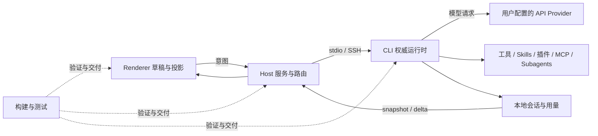

# ZCode 产品能力关系图

当前产品是独立 coding harness。Desktop、本地 Web 和 CLI 使用用户配置的普通 API Provider；SSH 工作区复用同一运行时与配置边界。规格以 [独立 coding harness](desktop/standalone-coding-harness-spec.md) 为准。

交互图数据唯一来源是 `apps/dev-docs/src/data/productCapabilityMap.ts`。运行 `pnpm dev:docs` 后打开 `http://localhost:5186/?view=capabilities`。历史预览图片未随本次删减重新生成，不作为当前能力证明。

## 运行层与状态所有者

| 区域         | 当前能力                                                                                                | 状态边界                                        |
| ------------ | ------------------------------------------------------------------------------------------------------- | ----------------------------------------------- |
| Renderer     | 会话与任务、普通模型设置、工具展示、插件/Skills/MCP 设置、浏览器/文件/终端/Git、自动化/工作流、本地用量 | 草稿与只读投影；通过 hooks/services 提交意图    |
| Host         | 窗口级 Local Host、SSH 连接和路由、工作区身份、个人配置、任务索引、扩展同步、调度、本地诊断             | 持有平台与持久化适配；不复制 CLI 正文或运行事实 |
| ZCode CLI    | Agent、会话、CommandInbox、模型执行、工具与权限、Subagents、扩展、上下文、恢复、本地 Usage DB           | 会话正文、运行态、队列和模型执行的权威来源      |
| 工程基础设施 | 构建、签名、手动分发、静态检查、单元与 E2E 测试、覆盖率和失败制品                                       | 验证和交付产品，不进入线上业务请求链            |

## 保留与退役边界

- 普通 GLM / Z.ai API 保留，与其他普通 API Provider 使用同一配置与选择机制。
- 普通自动化、动态工作流、Bot 渠道、本地 App Usage 和本地日志保留。工作流在 Desktop/SSH 默认 `onDemand`，用户设置优先。
- 官方登录、Start/Coding/Team Plan、订单支付、额度与高速卡、闲时 ticket、邀请营销、官方云配置、遥测上报、反馈上传、云分享、手机官方远控和官方自动更新已退役，不再作为图中的当前节点。
- 第三方 MCP OAuth 和浏览器站点登录态仍属于通用扩展能力。Plan Mode 是工具权限模式，与商业套餐无关。
- 历史会话、迁移代码和旧 Provider 引用可继续读取；兼容数据不等于恢复已退役产品功能。旧套餐模型不自动重映射为普通 API。
- `workspaceIdentity?.trim() || workspacePath` 仍用于隔离。SSH 的 `remoteSessionId`、owner/lease、跨 Host 路由和 stale run 防护继续保留。

## 图的维护规则

节点只记录有独立语义、权威状态或提交副作用的能力；每个节点属于唯一能力群和运行层。连线只表示交付、运行依赖、共享能力、状态投影或隔离约束，不等同于所有源码 import。

节点与连线必须一起修改，移除能力时删除关联连线并检查端点存在性。能力名与 owner 使用职责名，不绑定具体人员。图中的代码行数沿用历史审计估算，删减后尚未重新计量，不作为当前规模结论。

布局沿用 React Flow 与 ELK：先计算群内布局，再按跨群关联装箱；Renderer、Host、CLI 从左到右，工程基础设施置于下方。稳定输入与顺序保证相同数据具有确定布局。

技能中的 `zcode-feature-graph.yaml` 用于发现代码影响范围，当前能力图用于表达产品边界；两者都须用当前源码和规格核实。历史计划及截图可以保留作为变更记录，但不得重新引入已退役能力。
