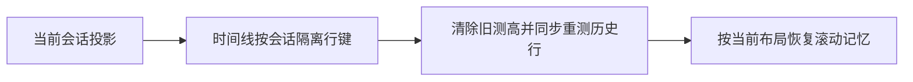

# Renderer Performance Timeline Cleanup

## 背景

2026-05-18 分析 `Heap-20260518T115447.heapsnapshot` 时，renderer 页面
`http://localhost:5174` 的 heap 里有约 10,605,795 个 `native:PerformanceMeasure`，
自身大小约 1.2 GB。保留链路来自 `window.performance` 的原生 Performance timeline，
不是业务数组、React Fiber 或监控 SDK span 缓存。

## 原因

项目使用 React 19.2 development build。React 19.2 在开发态默认启用 React
Performance Tracks，会通过 `performance.measure(...)` 记录组件渲染和调度轨迹。
长时间开发窗口不刷新时，这些 entry 会持续留在浏览器 Performance timeline 里。

本次 heap 的主因不是监控 SDK 性能采集，而是 React development build 自身写入的
Performance timeline entry。

## 处理

renderer 启动时仅在 Vite dev mode 下开启定时清理：

- 每 10 秒调用 `performance.clearMeasures()`
- 同时调用 `performance.clearMarks()`
- 生产包不启用，避免影响线上诊断数据

这保留 React 开发构建的行为，不 monkey patch `performance.measure`，风险较低；代价是
DevTools Performance 面板只能看到最近一小段时间内的 measure/mark。

## 验证建议

开发态长时间运行后，可在 DevTools Console 检查：

```js
performance.getEntriesByType("measure").length
```

该数量应保持在较低范围，不再随运行时间无界增长。

## 会话切换后的历史布局

历史虚拟列表只使用当前会话的行键与实测高度。工作区或会话切换时，清除旧缓存并在恢复滚动前同步重测已挂载的历史行。即使两个会话的历史行数或行 ID 相同，相邻轮次也不得重叠。沿用现有会话滚动记忆和内容投影。


