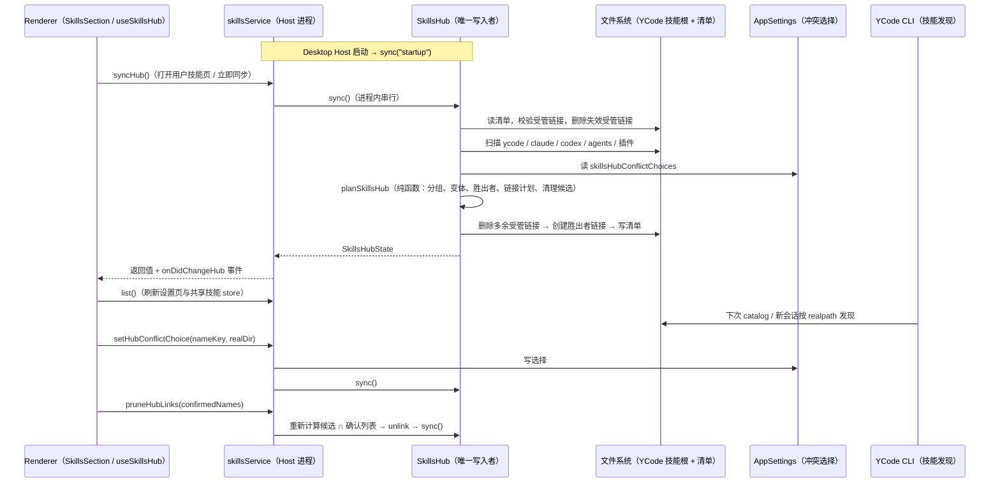

# 外部技能统一管理（Skills Hub）规格

来源：[docs/plans/2026-11-22-skills-hub.md](plans/2026-11-22-skills-hub.md)（决策已确认）。本文记录实现细节、状态所有者、事件顺序与验收场景。

## 目标

把 Claude Code、Codex 与已安装 Claude 插件中的技能自动链接进 YCode 用户技能根，按名称与内容去重，同名不同内容作为冲突让用户选择；YCode 原生引擎、设置页与 Composer（`/`、`@`、`$`）统一看到同一份结果，并标出来源。

## 名词

- **YCode 技能根**：`<home>/.zcode/skills`。迁移后 `.zcode` 是指向 `.ycode` 的链接，与 `skillsService`、CLI 现有读取路径一致。只有 `.zcode` 不存在而 `.ycode` 存在时改用 `<home>/.ycode/skills`，Hub 不会新建真实 `.zcode` 目录。
- **来源（source）**：
  | kind | 根目录 | 优先级 | 是否需要链接 |
  | --- | --- | --- | --- |
  | `ycode` | YCode 技能根下的真实目录，或解析到已知外部根之外的条目 | 0 | 否（直接可见） |
  | `claude` | `<home>/.claude/skills` | 1 | 是 |
  | `claudePlugin` | `installed_plugins.json` 中用户级已安装版本的 `<installPath>/skills` | 1 | 是 |
  | `codex` | `<home>/.codex/skills`（跳过 `.system`） | 2 | 是 |
  | `agents` | `<home>/.agents/skills` | 3 | 否（YCode 直接读取，仅参与去重） |
  | `plugin` | YCode 自己的插件技能 | — | 不参与 Hub，只用于来源标 |
- **成员（member）**：按 `realpath(技能目录)` 合并后的一个物理技能。同一真实目录从多个根被看到（例如 Claude 原目录与 YCode 根中的链接）只算一个成员。
- **分组（group）**：按 `nameKey = (frontmatter.name || 目录名).trim().toLowerCase()` 分组。
- **变体（variant）**：组内 `SKILL.md` 内容哈希（sha256，换行统一为 LF）相同的成员合并为一个变体。realpath 相同必然内容相同。
- **受管链接**：本功能在 YCode 技能根创建并记录在清单中的链接。
- **清单**：与 YCode 技能根同级的 `skills-hub.json`（通常 `<home>/.zcode/skills-hub.json`），见下文。

## 规则

### 扫描

1. 扫描 YCode 技能根、Claude、Codex、agents 与 Claude 插件技能，复用 `walkSkillMarkdownPaths`（有界深度、跳过 `node_modules` 等、对软链按 realpath 去重）。
2. Codex 根下任何路径段为 `.system` 的技能跳过。
3. Claude 插件：读取 `<home>/.claude/plugins/installed_plugins.json`，兼容 v1（`plugins[id] = {installPath}`）与 v2（`plugins[id] = [{scope, installPath}]`）。只取 `scope` 缺省或为 `user` 的条目；`<home>/.claude/settings.json` 的 `enabledPlugins[id] === false` 时跳过。只扫描 `installPath/skills`，技能真实目录必须位于 `realpath(installPath)` 内，否则忽略（防止插件内链接逃逸）。不读 marketplace 缓存，不读旧版本目录。
4. 项目级 `.claude/skills` 不处理。
5. 读取失败的技能目录记为 `scan_failed` 问题，不中断同步。

### 去重与冲突

1. 组内只有一个变体：无冲突。
2. 组内多个变体：冲突。默认胜出者为优先级最小的变体（变体优先级取成员最小值，平级按真实目录字符串排序）；用户选择以 `nameKey → 真实目录` 记录，命中某个变体的任一成员即生效；选择对应的目录消失时回到默认。
3. 胜出变体已有“非受管可见”成员（`ycode` 真实目录、`agents` 成员、或 YCode 根中已有的非受管条目解析到该成员）时，不建链接。否则为变体代表（优先级最小的可链接成员）建一个受管链接。
4. 冲突只为胜出者建链接。落败变体若通过 `ycode`/`agents` 直接可见，Hub 无法隐藏（不删除真实目录），设置页仍显示冲突供用户处理。

### 链接布局

- 链接位置：`<YCode 技能根>/<名字>`，目标为成员真实目录（`realpath`，不链接套链接）。
- Windows 使用 `junction`（无需管理员），其他平台使用目录 `symlink`；复用 `settingsSyncService` 的 `createDirectorySymlink` / `getSkillDirectorySymlinkType`。
- 名字优先使用源技能目录名；被任何现有条目占用时依次尝试 `<目录名>-<来源后缀>`、`<目录名>-<来源后缀>-2…`（后缀：`claude`、`codex`，插件为插件名）。全部占用时记 `name_unavailable` 问题。

### 清单

```json
{
  "version": 1,
  "links": {
    "<条目名>": { "target": "<真实目录>", "nameKey": "<分组>", "source": "claude", "createdAt": 0 }
  },
  "seenSkillKeys": ["<nameKey>"],
  "pendingNewSkillKeys": ["<nameKey>"]
}
```

- 只有 services 写入；写入使用临时文件 + rename。
- 同步开始时校验每个受管链接：条目不存在、不再是链接、或 `readlink` 不等于清单目标时，视为用户已接管，**只从清单移除，不动文件**。目标已不存在（源头消失）时删除该链接（只删链接）并移出清单。
- 受管链接完全按期望状态对账：不再需要的受管链接（例如切换冲突选择、胜出者已直接可见）自动删除。

### 自动清理与手动清理

- **自动**：只处理受管链接（源头消失、对账多余）。非本功能创建的条目永远不会被自动删除。
- **手动“清理 N 个多余链接”**：按计划决策 6，点按并确认后才执行。候选只包含 YCode 技能根下的**链接条目**（symlink/junction），绝不包含真实目录或文件：
  - `agents`：指向 `~/.agents/skills` 的链接（YCode 已直接读取）；
  - `duplicate`：同一真实目录或同一内容变体已有保留入口的其他链接；
  - `conflictLoser`：指向冲突落败变体的链接。
    执行时服务端重新扫描计算候选，只删除“用户确认列表 ∩ 最新候选”，删除前再次确认 `lstat` 为链接，使用 `unlink` 只删链接本体。清理后立即再同步一次，保证胜出者仍可见。

### 新发现

- 首次同步（无清单）只建立基线，不产生“新发现”。
- 之后每次同步：`当前分组 − seenSkillKeys` 追加到 `pendingNewSkillKeys`；不再存在的分组从待显示中移除。
- 设置页显示“新发现 N 个技能”，点“知道了”清空待显示。新技能默认启用（不写 override）。

### 启停与引擎

- 启停沿用 `~/.zcode/cli/config.json` 的 `skills["<SKILL.md realpath>"] = { enable: false }`，只作用于 YCode 原生引擎。
- Claude / Codex（ACP）会话使用各自技能，不受 YCode 开关影响；设置页明确说明。

### 冲突选择持久化

- 存入 AppSettings `skillsHubConflictChoices: Record<nameKey, 真实目录>`（不写 `cli/config.json`：CLI 配置 schema 为 strict，新增顶层键会让 CLI 拒绝配置）。
- 选择 `null` 表示恢复默认，删除该键。

### 同步时机与并发

- Desktop 本地 Host 启动后后台同步一次；打开技能设置页（用户范围）同步一次；点“立即同步”。不做文件监听。
- 同一进程内所有 Hub 写操作串行（promise 队列）。多个窗口 Host 并发同步时，链接创建遇 `EEXIST` 视为已被其他进程创建并重新校验，整体幂等。
- 只在 `capability.userScopeAvailable` 时可用；否则返回 `available: false`，不扫描、不写入。

### CLI 发现

- `NodeSkillAdapter.discoverSkills` 以 `realpath(SKILL.md)` 作为身份去重，`path`/`directory` 使用真实路径（与桌面 `skillsService` 一致）；经链接导入的技能不再重复。
- 插件根仍不跟随链接（信任边界不变）。

## 状态所有者与事件顺序



- 所有者：清单与受管链接只由 `SkillsHub`（services，Host 进程）写入；冲突选择由 Hub 通过 settingService 写入；UI 只读状态并发起命令，不缓存第二份事实。
- 幂等键：链接名 + 目标真实目录；重复同步不产生变化。
- 过期结果：UI 只使用最新一次命令返回或事件中的状态。

## 接口

`ISkillsService` 新增（复用 `skills` 通道，无新 RPC 装配）：

- `getHubState(): Promise<SkillsHubState>`：返回最近一次同步结果；尚未同步时执行一次同步。
- `syncHub(): Promise<SkillsHubState>`
- `pruneHubLinks({ entryNames }): Promise<SkillsHubState>`
- `setHubConflictChoice({ nameKey, realDir | null }): Promise<SkillsHubState>`
- `dismissHubDiscoveries(): Promise<SkillsHubState>`
- `onDidChangeHub: Event<SkillsHubState>`

纯领域逻辑（来源分类、分组/冲突/链接计划、清单解析、来源标文案）位于 `packages/shared/src/skills-hub`（`@zcode/shared/skills-hub`），services 与 UI 共用。

## UI

- **设置 → 技能（用户范围）** 顶部 `SkillsHubPanel`：
  - 说明：开关只作用于 YCode 原生引擎；Claude / Codex 会话使用各自的技能。
  - “新发现 N 个技能”（列出名字，可“知道了”）。
  - “立即同步”、“清理 N 个多余链接”（确认弹窗列出条目，只删链接）。
  - 冲突区块：每个冲突列出各变体的来源标与路径，可选择采用哪份，可恢复默认。
- 技能行显示来源标（YCode / Claude / Codex / Agents / 插件名）；列表上方来源筛选（全部 / YCode / Claude / Codex / Agents / 插件）。
- **Composer**：`/` 面板技能分组排在命令之前；`@` 面板新增“技能”分组（无查询时预览 3 项）；`$` 保持。技能项显示来源标；工作区技能显示“工作区”，YCode 插件技能显示插件名。
- 中英文文案：zh-CN、en-US。

## 验收场景

1. 新装到 `~/.claude/skills/foo` 的技能，在启动或“立即同步”后 YCode 技能根出现 `foo` 链接（目标为真实路径）；`/`、`@`、`$` 可见并带 “Claude” 标。
2. `~/.claude/skills/foo` 与 `~/.codex/skills/foo` 内容相同：只建一个链接，列表只出现一次。
3. 内容不同：冲突区显示两份，默认 Claude；切换为 Codex 后，链接改指 Codex 目录，选择在重启后保留。
4. 删除 `~/.claude/skills/foo` 后同步：受管链接 `foo` 被删除；任何真实目录与非本功能创建的条目不受影响。
5. 用户把受管链接替换为真实目录：同步只从清单移除，不删除该目录。
6. YCode 技能根中已有指向 `~/.agents/skills/bar` 的旧链接：计入“清理 N 个多余链接”；点按确认后只删除该链接，`~/.agents/skills/bar` 保留。
7. 关闭某技能：YCode 原生会话不可调用；Claude 会话不受影响（开关不写入外部引擎）。
8. CLI 技能目录不再重复列出经链接导入的技能。
9. Windows 使用 junction（无需管理员）；macOS/Linux 使用 symlink。
10. Codex `.system` 技能与 Claude 插件旧版本目录不被链接。
