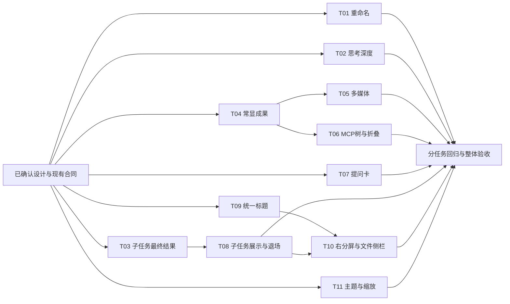

# 会话体验优化 Implementation Plan

> **给实施 Agent：** 使用已安装的 `executing-plans` 技能逐项执行；选择分任务代理执行时使用 `subagent-driven-development`，每项独立评审。以下复选框跟踪实施，不代表已完成。

**Goal（目标）：** 让会话过程可扫描、关键成果可操作、子任务结果可读，并统一会话标题、右分屏与主题入口。

**Architecture（架构）：** 保留 CLI/Host 的事实所有权，在 Renderer 派生连续 MCP 组和常显成果。修复上游子任务结果与媒体事实后复用现有渲染；布局继续由 workbench-tabs 与 Side Pane 分别管理，不新增竞争 owner。

**Tech Stack（技术栈）：** TypeScript、React、Zustand、Radix、Lucide SVG、V4 行投影、现有 artifact/媒体服务、Vitest、桌面 WebdriverIO E2E。

**Spec（设计依据）：** [会话体验优化设计说明](../../design/2026-11-15-conversation-experience-optimization.md)。实施者先读该说明，再读所属任务列出的现有 spec/contract。

## 全局约束

- Node `24.14.0`，pnpm `10.33.2`，以 `mise.toml` 为准。
- UI 使用 `text-ui-*`、现有语义颜色和共享组件，覆盖 Zai Light / Zai Dark、中英文、键盘与窄屏。
- 外部引擎继续遵守现有平台能力门禁；共享 UI 优化不扩大远端引擎支持范围。
- 不引入第二份标题、运行队列、媒体执行流或活跃面板状态。
- 改行为先更新对应 spec/contract，再补回归测试，再实现；交互需要实际 E2E 证据。
- 不运行未获用户明确要求的全量 `pnpm test` / `pnpm test:unit`；根 affected 不替代 CLI 单测或桌面 E2E。
- 所有路径相对于仓库根目录；本计划中的“新增”文件与接口是待实施设计，不表示当前源码已有。
- 重命名与 effort 的根因尚未运行复现；先完成诊断交付，不预设补丁。截图中的授权链接、密钥和真实数据不进入 fixture。

## 1. 当前完成边界

2026-11-15 已完成：读取当前 `main@1af30808`、基线检查、3 个只读调查子任务，以及 Q1—Q9 产品选择。用户均选择推荐方案，详见设计说明第 2 节。

设计阶段仅交付本文；用户随后授权按计划实施、验证后推送 GitHub、发布 1.4.1 并更新本机 YCode。实施在独立分支 `codex/conversation-experience-1.4.1` 推进，原调查基线不变。下文复选框保留最初验收清单，不表示所有平台均已实测；当前结果与限制以本节记录为准。

| 任务 | 当前实施结果                                        | 验证边界                                                                                                          |
| ---- | --------------------------------------------------- | ----------------------------------------------------------------------------------------------------------------- |
| T01  | 未复现供应商改名闪退，保留生产实现并补回归          | 63 项单测、6 项真实浏览器用例通过；不宣称已修复未复现问题。                                                       |
| T02  | 真实 ACP 目录存在 effort 配置，补配置提交与恢复回归 | 116 项单测通过、1 项既有跳过，4 项相关 Electron 场景通过；不伪造模型支持能力。                                    |
| T03  | 子任务最终结果落库、取消及失败冷恢复一致            | 相关 core、bootstrap、UI 与 2 项 Electron 场景通过。                                                              |
| T04  | 关键原文与成果常显，历史前插保持成果身份            | 定向单测及真实 Electron 展示、链接操作通过。                                                                      |
| T05  | 助手媒体持久化、同 Host 读取及行内展示              | schema、writer、投影和 UI 定向回归及 Electron 场景通过；真实账号及 SSH 未覆盖。                                   |
| T06  | 连续 MCP 服务树及尊重手动操作的折叠                 | 179 项最终定向单测及相关 Electron 场景通过；不同来源格式保守断组。                                                |
| T07  | 问题卡显式发送、可收起及按完整请求身份保存草稿      | 84 项最终定向单测、正式 Electron 交互通过；IME 为事件模拟，未实测实体第二设备。                                   |
| T08  | 子任务完成摘要与活动入口退场，保留已开详情          | 140 项定向单测及相关 Electron 场景通过；缺真实结果时显示诚实回退。                                                |
| T09  | 同源标题解析与紧凑顶栏占位修复                      | 定向单测及正式标题生成、重命名、恢复与窄窗 Electron 场景通过。                                                    |
| T10  | 会话菜单右移与独立文件侧栏保持                      | 193 项定向单测、正式双栏和子任务详情场景通过，另补真实方向键与 Enter；文件侧栏当前只读。                          |
| T11  | 太阳/月亮主题入口与设置页整体窗口缩放               | fix1 在 Node 24.14.0 下 28 项单测、4 项 Windows Electron 场景通过，I1/I2/M1 复审已关闭；I3 终端范围仍待用户选择。 |

2026-11-16 更新：T01—T10 已完成逐项独立审查；整分支审查发现的 FR-I1（流式 Markdown renderer 重新挂载）已在 `e9079d46` 修复，并通过唯一增量复审。原 Mermaid 断言未修改；相关 6 文件 91 项单测、最终 APC15 Windows Electron 1 项、根 typecheck/lint、E2E 类型检查、架构及 fixture 检查通过，根 lint 为 91 warnings / 0 errors。9 个修复文件定向格式检查通过，两份既有大型覆盖文档仍不符合全文件格式检查，未重排。

最后一次完整提交前检查的固定对象为 `528951dd`：exit 1，1103 个规格中 30 failed / 1072 passed / 1 skipped，97 failed / 11938 passed / 40 skipped tests。原始基线定向对照逐项匹配其中 29 文件的 96 个同名失败断言及 3 个导入失败；同名匹配不自动证明全部底层根因相同。剩余 Mermaid 1 项为 FR-I1，本波已修复并定向验证；未把该定向通过写成新 HEAD 的完整门禁通过，也未用伪造基线或跳过 hook 放行。用户于 2026-11-16 明确选择扩大范围，先修好这些既有门禁再发布，进入独立补充修复任务。最后一次全仓格式实跑同样固定于 `528951dd`，exit 1，1973/9222 文件不合规；不将旧报告的 1972 当已核实结果。

终端定点诊断已观察到多余的尾随字符，但尚未直接确认底层重复写入；原终端产品代码本轮未改，是否纳入额外修复等待用户决定。T11-I3、发布和本机更新继续未完成。已有 CLI 未改文件 lint 超限及验证工具告警保留记录，不记作通过。实际运行平台为 Windows；macOS、Linux 和真实 SSH 人工验收未执行。

APC15 已验证图表与 Markdown 图片/音视频在真实分段流中保持同一实例，未闭合围栏无动作、闭合后传入完整目标并实际打开 Browser。最终截图只证明打开后 Browser 结果可见；动作几何探针的负 top 与截图中可见实例不一致，原因未核实，不据此声称流式跟随期间的历史动作持续位于视口内。该限制未削弱 FR-I1 的既定验收。

## 2. 交付批次与依赖

| 批次                  | 任务                    | 独立可验收的交付                                     |
| --------------------- | ----------------------- | ---------------------------------------------------- |
| A：可用性与事实完整性 | T01、T02、T03、T04、T09 | 重命名、思考深度、子任务结果、关键内容常显、统一标题 |
| B：对话展示           | T05、T06、T07、T08      | 图文媒体、MCP 树、提问卡、子任务紧凑展示与退场       |
| C：工作区交互         | T10、T11                | 向右分屏与文件预览共存、太阳/月亮及设置入口完整性    |



这是一个总计划，内部按不同子系统拆成可独立评审的任务，不要求把所有功能混成一个提交。实施顺序以依赖为准，任务编号不是强制串行编号。

## 3. 实施前置步骤

- [ ] 运行基线检查并保留用户本地修改：

```powershell
node scripts/check-workspace-freshness.mjs
git status --short --branch
pnpm architecture:check --changed
```

- [ ] 涉及目标模块时分别获取受控上下文，先读取公开合同，不一次扩展到所有模块：

```powershell
pnpm architecture:context external-engine-ui
pnpm architecture:context cli-external-engine-runtime
pnpm architecture:context subagent-display
pnpm architecture:context project-sidebar
pnpm architecture:context conversation-workbench
```

UI 通用工具/媒体路径查 `ui`，协议查 `shared` / `external-engine-protocol`，实际涉及适配器时查 `cli-external-engine-adapter`。新增文件必须确认所属 managed module；不为方便跨模块导入私有实现。

- [ ] 为每个任务建立定向回归清单，记录修改前失败证据；纯产品规则变化允许先更新原有断言。浏览器交互调查通过 Playwright skill wrapper，优先全局 `playwright-cli`，仅全局命令不可用时采用 wrapper 的 npx fallback；桌面 E2E 保持仓库现有 WDIO 入口。

## T01：定位并修复供应商重命名闪退（UX01）

**文件与责任**

- 修改：`packages/ui/src/settings/model-provider-section/ProviderCardSections.tsx`（菜单生命周期）。
- 修改：`packages/ui/src/settings/model-provider-section/InlineEditableProviderCard.tsx`（编辑意图、焦点和确认）。
- 测试：`packages/ui/test/modelProviderModelRowEditor.test.ts`。
- 浏览器回归：`packages/ui/test/browser/manual-review/pending/provider-settings-batch.test.mjs`。
- 规范：`docs/working-memory/provider-refactor/steps/todo-132-model-option-feedback-and-provider-name-edit.md`、`docs/model-provider-regression-case-catalog.md`；只更新仍适用的合同和回归记录。

**接口与边界**：providerId 维持稳定；沿用现有名称提交路径。修复菜单到输入框的交接，保留 Enter/真实离开编辑时的现有提交与 Esc 取消，不扩大到连接/API Key 保存策略。

- [ ] 用真实 pointer 与键盘打开菜单，记录 `onSelect → editingName → input focus/blur → 菜单退出/回焦` 顺序。证据不记录表单值；将实际先后与触发 blur 的节点写入修复说明。
- [ ] 在浏览器回归中验证编辑框经过菜单退出仍挂载、获焦且可输入；不是只调用 `fireEvent.click`。在既有 `rename()` fixture 后加入：

```javascript
const input = await rename();
await input.fill("Provider Renamed");
assert.equal(await input.inputValue(), "Provider Renamed");
assert.equal(await input.evaluate((node) => node === document.activeElement), true);
await input.press("Enter");
assert.equal(mutations.length, 1);
assert.equal(mutations[0].payload.providerNameUpdate, "Provider Renamed");
```

- [ ] 先运行目标用例证明失败或确认当前版本已无该问题；若不能复现，交付版本、操作和事件证据，不制造一个无依据的修复。
- [ ] 依据证据在已有菜单退出/焦点交接点局部修复，添加中文根因注释；不新增任意 setTimeout，不重构整张供应商表单。
- [ ] 回归 Esc 后 blur 不保存、IME Enter 不提交、重复 Enter 只保存一次、同 provider 更新不闪退及切换 provider 不串写。
- [ ] 定向运行后审查 diff，仅提交该任务代码、规范与证据：

```powershell
pnpm exec vitest run packages/ui/test/modelProviderModelRowEditor.test.ts
```

真实浏览器焦点回归是额外必需证据，UT 通过不能代替。

## T02：恢复真实引擎思考深度能力（UX02）

**文件与责任**

- 能力归一化：`packages/shared/src/external-engine/config-options.ts`。
- 控件：`packages/ui/src/external-engine/EngineControls.tsx`、`EngineConfigPicker.tsx`。
- 若证据指向目录/ACK：`apps/zcode-cli/packages/adapters/src/external-engine/connection.ts`、`apps/zcode-cli/packages/core/src/external-engine/session.ts`；不要提前同时改所有层。
- 测试：`packages/ui/test/externalEnginePickers.test.ts`、`packages/shared/src/external-engine/contract.test.ts`；涉及适配器时扩展 `apps/zcode-cli/packages/adapters/tests/external-engine-connection.test.ts`。
- E2E：`packages/desktop/test/e2e/conversation-session/manual-review/pending/conversation-session-external-engine-prewarm.test.ts`。
- 规范：`docs/desktop/external-agent-engines-spec.md` 及对应 external-engine CONTRACT。

**接口与边界**：原生 configOptions 是唯一目录。`engineConfigOptionKind(configId: string)` 只归类，不创造档位。继续沿 setConfigOption/CAS/ACK 写回。

- [ ] 采集经脱敏的 `session/new/resume`、`config_option_update` 和 snapshot 的配置字段名、可选值、选中值及所属 session；分辨不支持、未下发、未知 id、更新丢失、错误绑定五种情况。
- [ ] 固化命中的原生目录 fixture。对已有名称的基础回归可直接加入：

```typescript
expect(engineConfigOptionKind("reasoning_effort")).toBe("effort");
expect(engineConfigOptionKind("thought_level")).toBe("effort");
expect(engineConfigOptionKind("collaboration_mode")).toBe("other");
```

实际修复未知别名时必须附真实字段证据，不能按上述例子再猜其他别名。

- [ ] 以 fixture 先证明丢失发生在哪一层，然后只修该边界；无 effort 的合法模型保持无控件，单档只展示。
- [ ] 验证目录先通知后响应、切模、草稿预热、恢复、停止后再打开以及旧 ACK 晚到；较旧结果不得覆盖较新选择。
- [ ] 运行定向 UT/E2E，说明真实账号是否覆盖：

```powershell
pnpm exec vitest run packages/ui/test/externalEnginePickers.test.ts packages/shared/src/external-engine/contract.test.ts
pnpm --filter @zcode/desktop test:e2e -- --spec ./test/e2e/conversation-session/manual-review/pending/conversation-session-external-engine-prewarm.test.ts
```

## T03：让子任务最终结果进入可回放详情（UX03）

**文件与责任**

- 修改：`apps/zcode-cli/packages/core/src/external-engine/subagents.ts`、`transcript-writer.ts`。
- 测试：`apps/zcode-cli/packages/core/tests/external-engine-subagents.test.ts`。
- UI 摘要读取：`packages/ui/src/subagent-display/model.ts`；UI 样式在 T08 完成。
- 规范：`docs/desktop/external-agent-engines-spec.md`、`docs/desktop/multi-agent-display-spec.md`。

**拟增加的内部接口**：在已有 `ExternalTranscriptWriter` 内增加 `settleFinalReply(reply: string): Promise<void>`；只经现有 message/part writer 写入，不创建另一个持久化通道。

- [ ] 先在现有原生子任务 fixture 覆盖 reply-only、正文与 reply 完全相同、正文与 reply 不同、空 reply、重复终态、取消/失败及嵌套子任务。断言子正文、TurnComplete.response、父摘要和冷恢复相符。
- [ ] 实现以下有序收尾；下段为任务要求的新方法与现有方法的调用合同：

```typescript
if (run.reply?.trim()) {
  await writer.settleFinalReply(run.reply);
}
await writer.finish({ aborted: end === "cancelled" });
// 后续 TurnComplete.response 读取同一 writer.response。
```

真实实现保留现有失败 error payload；不能用简化示例覆盖掉失败与取消语义。

- [ ] `settleFinalReply` 优先按原生消息/part 身份去重；缺少身份时，仅对与已写入最终正文完全相同的 reply 去重。不得用“部分包含”判断吞掉另一份结果。不同 reply 作为明确最终正文写入，先落库再完成。
- [ ] 正常完成时允许派生 resultSummary；摘要不是 child 正文的替代品。详情不从父会话临时拼接一份独立结果缓存。
- [ ] 运行 CLI 所属包测试，不使用根 affected 代替：

```powershell
pnpm --dir apps/zcode-cli/packages/core exec vitest run tests/external-engine-subagents.test.ts
```

## T04：关键正文和成果不随“已工作”折叠消失（UX04）

**文件与责任**

- 新增：受管 `packages/ui/src/v4/conversation-presentation` 五件套与公开 `index.ts`；`conversationTurnDeliverables.ts` 负责纯提取与来源引用。
- 新增测试：`packages/ui/test/conversationTurnDeliverables.test.ts`。
- 修改：`packages/ui/src/v4/conversationTurnFlowItems.ts`、`ConversationTurnRow.tsx`（接入常显片段）。
- 复用/读取：`packages/ui/src/v4/conversationTurnWorkSegments.ts` 已有 `buildConversationFlowItems` 委托，无需修改该文件。
- 复用：`packages/ui/src/v4/assistantPreviewCards.ts`、`packages/ui/src/lib/assistantPreviewCards.ts`。
- 现有测试：`packages/ui/test/v4ConversationTurnRenderUnits.test.ts`、`v4AssistantPreviewCards.test.ts`。
- 规范：`docs/ui/assistant-preview-cards.md`；设计说明第 5.1 节补入既有折叠合同所在位置。

**拟新增接口**（Renderer 私有，不加协议事实）：

```typescript
import type { AssistantTextRow } from "@zcode/shared/zcode-protocol-v4";

export interface ConversationDeliverable {
  readonly key: string;
  readonly sourceRowId: number;
  readonly start: number;
  readonly end: number;
  readonly kind: "link" | "image" | "file";
  readonly sourceFormat: "markdown" | "standaloneUrl" | "textFence";
  readonly target: string;
  readonly identityTargets?: readonly string[];
  readonly textFenceTargets?: readonly string[];
  readonly contextStart: number;
  readonly contextEnd: number;
  readonly contextText: string;
}

export function extractConversationDeliverables(
  rows: readonly AssistantTextRow[],
): readonly ConversationDeliverable[];
```

`start/end` 为实际来源正文的半开区间，来源 key 随实际来源正确更新；提取保留全部引用，先定原段完整目标组再跨来源去重。React 挂载身份由去重/最终覆盖前的完整目标组排序生成，并附完整会话 scope，与被选中来源位置分离。已加载正文不变时提取结果复用，不按每次秒表刷新扫描全历史。

- [ ] 先写解析测试；以下例子不依赖真实授权地址：

```typescript
const row = {
  rowId: 12,
  turnId: "t",
  createdAt: 1,
  createdAtSeq: 1,
  kind: "assistantText",
  state: "complete",
  text: "请打开以下入口完成操作：\n\nhttps://example.invalid/authorize\n",
} as const;
const result = extractConversationDeliverables([row]);
expect(result).toEqual(
  expect.arrayContaining([
    expect.objectContaining({
      sourceRowId: 12,
      target: "https://example.invalid/authorize",
      kind: "link",
    }),
  ]),
);
```

- [ ] 补齐闭合 Markdown、图片、纯 URL text 代码块、中文/空格路径、命令内 URL 不提升、流式未闭合、终止/失败轮及最终正文去重测试。
- [ ] 在历史折叠外展示来源片段和用途说明，不移动原正文，不给中间片段新增分叉/重试动作。完整上下文仍可展开；原有最终正文和插件固定内容行为保留。
- [ ] 回归虚拟列表前插历史、会话切换、手动展开和 streaming→terminal 转换不跳 key、不重复成果、不把另一个 Host 路径带入当前会话。
- [ ] 执行：

```powershell
pnpm exec vitest run packages/ui/test/conversationTurnDeliverables.test.ts packages/ui/test/v4ConversationTurnRenderUnits.test.ts packages/ui/test/v4AssistantPreviewCards.test.ts
```

桌面在既有 assistant-preview-cards E2E 中加一条“关键链接在非最终正文，轮次结束仍可见”的场景。

## T05：图文、媒体和普通网页卡（UX05）

本任务拆成两个独立验收小批次：先完成已送达内容的展示，再补原生 ACP 媒体到持久化/回放链路；不能用前者冒充后者已完成。

**文件与责任**

- UI：`packages/ui/src/components/ai-elements/markdown-image.tsx`、`message.tsx`、`packages/ui/src/lib/assistantPreviewCards.ts`、`packages/ui/src/previewPaneMediaContent.tsx`，只改实际缺口。
- 原生输入：`apps/zcode-cli/packages/core/src/external-engine/transcript-writer.ts`。
- 持久化合同：`apps/zcode-cli/packages/contracts/src/interfaces/session-store.port.ts` 的既有 FilePart/AttachmentStorageMetadata。
- 投影：`apps/zcode-cli/packages/bootstrap/src/zcode-protocol-v4/product-projection.ts` 与既有流式事件/冷恢复投影入口。
- 输出引用：在既有 `packages/shared/src/zcode-protocol-v4/rows.ts` 定义同源 AssistantMediaRef schema/type，经既有 V4 公开入口消费；不新增未受管的 `assistant-media.ts` 或第二个协议所有者。
- 事件合同：`apps/zcode-cli/packages/contracts/src/events/session.events.ts` 的 ModelStreamingPayload 增加同源可选媒体引用，由同一 writer 先落库再通知；不增加另一条媒体推送通道。
- 测试：现有图片/画廊/preview cards 单测；新增 `packages/ui/test/assistantMediaRendering.test.ts`、`packages/shared/test/assistantMediaRef.test.ts`、`apps/zcode-cli/packages/core/tests/external-engine-media.test.ts`、`apps/zcode-cli/packages/bootstrap/tests/product-projection-assistant-media.test.ts`。
- 规范：`docs/ui/assistant-preview-cards.md`、`docs/desktop/external-agent-engines-spec.md`；发生协议扩展时同步共享 schema 与 CLI 合同。

**接口决定**：本地及远端资源复用现有 FilePart/artifact port。当前 assistantText 行没有输出媒体引用，增加可选 `media` 字段；旧行缺省兼容，不新增一套旁路 live 媒体 stream。拟新增的有界引用形状如下，运行时 schema 与类型必须同源：

```typescript
export interface AssistantMediaRef {
  readonly id: string;
  readonly mediaType: "image" | "audio" | "video";
  readonly mimeType: string;
  readonly source:
    | { readonly kind: "artifact"; readonly uri: string }
    | { readonly kind: "url"; readonly url: string };
  readonly name?: string;
}
// assistantTextRow 的增量字段：media?: AssistantMediaRef[]。
// 正文为空但媒体非空的行仍是有效可展示结果。
```

- [ ] 先用 UI fixture 覆盖直接媒体、本地产物、无扩展名且有 MIME、无 MIME 网页、404/失效资源、重试与无自动播放；复用既有媒体组件和路径验证。
- [ ] 普通网站卡只依已收到的标题/用途/域名渲染，点击走现有浏览器/平台入口，不联网抓取网页预览，不执行任意 iframe。
- [ ] 把真实 ACP image/audio/resource 形状做成脱敏 fixture，优先复用既有 FilePart 和 artifact 存储；未知资源类型保留可读提示与引用，不静默吞掉。
- [ ] 原生媒体先持久化，再发携带可选 media 的既有 ModelStreaming 事件；base64 本体进受限 artifact 存储，不塞 command/topic frame。投影先接纳类型化媒体再处理文本增量；同时接通增量 upsert、snapshot、冷恢复和旧行缺省，不添加新的流式 kind 闭集值。
- [ ] 协议回归断言新旧助手行都能通过 schema；媒体条目 MIME/来源/引用边界校验覆盖无效值。运行时发送格式不得只满足 TypeScript 而被 strict schema 丢弃。
- [ ] E2E 同一成果在 live、滚动卸载重挂、刷新及 replayable 冷恢复后可打开；SSH 资源必须由原 Host 读取。资源本来缺失时有状态和原始链接，不假称恢复成功。
- [ ] 定向运行，CLI core 测试和 bootstrap 投影测试分别从所属包执行：

```powershell
pnpm exec vitest run packages/ui/test/assistantMediaRendering.test.ts packages/ui/test/markdownImageLoadingState.test.ts packages/ui/test/markdownImageGallery.test.ts packages/ui/test/assistantPreviewCards.test.ts
pnpm exec vitest run packages/shared/test/assistantMediaRef.test.ts
pnpm --dir apps/zcode-cli/packages/core exec vitest run tests/external-engine-media.test.ts
pnpm --dir apps/zcode-cli/packages/bootstrap exec vitest run tests/product-projection-assistant-media.test.ts
pnpm --filter @zcode/desktop test:e2e -- --spec ./test/e2e/conversation-session/conversation-session-assistant-preview-cards.test.ts
```

媒体扩展是本计划里跨层最多的一项，应独立评审；没有真实引擎能力时用 fixture 验证兼容链路，并明确真实账号覆盖限制。

## T06：连续 MCP 服务调用树与手动优先折叠（UX06）

**文件与责任**

- 新增：受管目录 `packages/ui/src/v4/conversation-presentation/conversationMcpGroups.ts`（纯连续分组），经该模块公开入口消费。
- 新增测试：`packages/ui/test/conversationMcpGroups.test.ts`。
- 修改：`packages/ui/src/v4/conversationAssistantWorkItems.ts`、`packages/ui/src/ToolCallBlocks/renderers/mcp.tsx`、`packages/ui/src/ToolCallBlocks/ToolLayout.tsx`。
- 复用并保护：`packages/ui/src/ToolCallBlocks/resolveRenderer.ts` 的专用 renderer 优先级。
- 测试：`packages/ui/test/toolLayout.test.ts`、`toolCallBlocks.test.ts`、`v4ToolCallRowAdapter.test.ts`。
- 规范：`docs/chat/mcp-tool-call-rendering.md`。

**拟新增的纯函数合同**：

```typescript
import type { ConversationRow, ToolCallRow } from "@zcode/shared/zcode-protocol-v4";

export type ConversationMcpGroupItem =
  | { readonly kind: "row"; readonly row: ConversationRow }
  | {
      readonly kind: "mcpGroup";
      readonly serverName: string;
      readonly rows: readonly ToolCallRow[];
    };

export function buildConversationMcpGroups(
  rows: readonly ConversationRow[],
): readonly ConversationMcpGroupItem[];
```

- [ ] 先测 A服务→A服务 合组，A→正文→A 拆组，A→B→A 三组，缺 metadata 历史回退，原生 parentToolCallId 不重写，Node REPL/插件交互不被通用分组接管。
- [ ] 用前述函数派生展示节点，展示 SVG 服务名/调用数/状态，子节点复用原结果与二级参数详情；真实 toolCallId 继续承担执行与权限身份。
- [ ] 将折叠状态表达为默认态与用户 override；运行默认打开一次，成功默认收起一次，手动切换后后续状态不覆盖 override。失败摘要位于折叠外。

```typescript
interface DisclosureState {
  readonly defaultOpen: boolean;
  readonly userOverride?: boolean;
}
const visibleOpen = (state: DisclosureState): boolean => state.userOverride ?? state.defaultOpen;
```

- [ ] 只对本任务 MCP 与 T08 子任务启用新策略，避免改变 read/edit 等工具既有默认；状态按完整会话/轮次/工具身份隔离，避免只用可能跨会话重复的 toolId。
- [ ] 验证 group 与 child 独立展开、冷历史默认收起、前插历史/虚拟化不串手动态、连续进度不强制重开、最终有失败时仍看到错误摘要。
- [ ] 执行：

```powershell
pnpm exec vitest run packages/ui/test/conversationMcpGroups.test.ts packages/ui/test/toolLayout.test.ts packages/ui/test/toolCallBlocks.test.ts packages/ui/test/v4ToolCallRowAdapter.test.ts
```

扩展现有 tool-history-order / tool-groups-history-restore E2E，验证时间顺序和刷新前后结果一致。

## T07：输入区上方的显式提交问题卡（UX07）

**文件与责任**

- 修改：`packages/ui/src/ElicitationDialog.tsx`（草稿、导航、显式确认、收起）。
- 修改：`packages/ui/src/v4/V4InteractionDialogs.tsx`（会话归属和重新打开入口）；历史 `ask-question.tsx` 只同步已回答展示。
- 测试：`packages/ui/test/elicitationDialog.test.ts`、`elicitationDialogRequestIdentity.test.ts`、`elicitationDialogFocus.test.ts`。
- E2E：既有 ask-user-question keyboard 和 custom multi-question 场景。
- 规范：`docs/ui/ask-user-question-header-title.md`、`docs/ask-user-question-auto-resolution.md`。

**接口与边界**：保留 `getElicitationQuestionAdvanceKind(questions, index): "next" | "submit"` 用于导航按钮；不再在选项 onClick 中调用推进/提交。继续使用现有 onRespond 和后端 pending request 身份，不新建请求队列。

- [ ] 更新原“点击即下一题/提交”的测试，新增“点击只更新草稿、下一题可返回修改、最后明确发送才调用 onRespond 一次”。
- [ ] 把选项动作与导航动作拆开，关键规则为：

```typescript
const selectOption = (question: NormalizedElicitationQuestion, optionValue: string) => {
  reportFirstInteraction("answer");
  setDrafts((current) => updateElicitationDraftsForOption(current, question, optionValue));
};
// 既有 advanceFromQuestion 保留给显式的“下一题/发送”按钮调用；
// 普通问题不再在 selectOption 中调用它。审批仍保留其独立动作分支。
```

- [ ] 沿用既有问题卡结构和视觉 token，固定在所属会话 composer 上方；选项可单选/多选，自由输入保留。收起后以等待提示重新打开，草稿不丢失。
- [ ] 首次真实选择/输入/导航沿原路径暂停普通 Ask 自动继续；后台 snapshot 对象重建不重置 request 内进度。跳过保持 decline，权限/计划审批保持独立确认规则。
- [ ] 测键盘数字/方向键只选择或导航，Enter 只有明确聚焦确认动作时提交，IME 与多行输入不误提交；非焦点栏不抢焦点，多端完成后迟到发送不重复。
- [ ] 执行：

```powershell
pnpm exec vitest run packages/ui/test/elicitationDialog.test.ts packages/ui/test/elicitationDialogRequestIdentity.test.ts packages/ui/test/elicitationDialogFocus.test.ts
pnpm --filter @zcode/desktop test:e2e -- --spec ./test/e2e/conversation-session/conversation-session-ask-user-question-keyboard-navigation.test.ts
```

## T08：紧凑子任务行、完成摘要与输入区退场（UX08）

前置：T03 的最终结果可回放；折叠策略采用 T06 的用户 override 语义。

**文件与责任**

- 修改：`packages/ui/src/subagent-display/SubagentWorkCard.tsx`、`SubagentActivityButton.tsx`、`contract.ts` 及公开入口；只读复用 T03 已接通的 `model.ts` 结果摘要与活动状态判定。
- 必要接线：`packages/ui/src/v4/SessionPane.tsx`，只传既有 manifest/liveIndex，不加第二套运行状态。
- 详情：`packages/ui/src/app-shell/SubagentSessionSidePane.tsx`，复用现有只读会话。
- 测试：`packages/ui/test/subagentWorkCard.test.ts`、`subagentDisplayModel.test.ts`、`v4ConversationTurnSubagentCardCollapse.test.ts`；新增 `packages/ui/test/subagentActivityButton.test.ts`。
- 规范：`docs/desktop/multi-agent-display-spec.md`、`docs/subagent-session-directory.md`、`docs/subagent-session-side-tabs.md`、`packages/ui/src/subagent-display/CONTRACT.md`。

- [ ] 先同步产品规则和旧测试：现有 `subagentWorkCard.test.ts` 明确断言运行时手动展开仍在结束强制折叠，需要按 Q7 改为尊重手动状态；不要同时保留相反断言。
- [ ] 成功卡加入简短结果摘要与查看结果入口；无摘要时诚实显示“已完成，可查看过程”，不编造结论。任务名和稳定头像继续由已有 resolver/index 提供。
- [ ] 输入区仅有活动成员时显示。waiting/blocked/pending 仍算活动，success/failed/cancelled 均为 ended；根据已有状态派生，不新增定时隐藏器：

```typescript
const hasActive = members.some((member) => isSubagentStatusActive(member.status));
// !hasActive 时不渲染输入区汇总；主对话历史、目录和正在查看的 Side Pane tab 保留。
```

实现使用模块现有状态判定，不复制另一份状态枚举。

- [ ] 子任务点击仍复用 onOpenSubagentSession 和 Side Pane tab identity；自动退场不调用关闭 tab、停止或取消命令。
- [ ] 验证多个任务部分完成、全部完成、失败结束、重复终态、父轮已结束但子任务仍活动、正在阅读详情，以及刷新恢复。
- [ ] 执行：

```powershell
pnpm exec vitest run packages/ui/test/subagentActivityButton.test.ts packages/ui/test/subagentWorkCard.test.ts packages/ui/test/subagentDisplayModel.test.ts packages/ui/test/v4ConversationTurnSubagentCardCollapse.test.ts
pnpm --filter @zcode/desktop test:e2e -- --spec ./test/e2e/conversation-session/manual-review/pending/conversation-session-subagent-work-card.test.ts
```

## T09：标题统一到同一事实解析规则（UX09）

**文件与责任**

- 新增：`packages/ui/src/project-sidebar/useWorkbenchSessionTitle.ts`（共享只读展示解析，不持久化 title）。
- 修改：`packages/ui/src/project-sidebar/WorkbenchLayoutButton.tsx`、`WorkbenchPaneHeaders.tsx`；侧栏任务行只在确实需要共享既有解析时改动。
- 读取：`packages/ui/src/store/zcodeSessionStoreSelectors.ts`、ProjectDirectory 的公开事实接口。
- 测试：`packages/ui/test/workspaceWorkbenchLayoutButton.test.ts`、`workbenchPaneHeaders.test.ts`；新增 `packages/ui/test/workbenchSessionTitle.test.ts`。
- 规范：`docs/ui/task-title-authority.md`。

**拟新增接口**：`useWorkbenchSessionTitle(tab: WorkbenchTab): string`。读取 workspace 完整身份、目录事实及会话元数据；沿当前修订和标题来源优先级选择，不将“缓存非空”视为永远比事实新。

- [ ] 为缓存缺失、过期占位、有手动标题、生成标题、首输入及真正无标题编写表驱动测试；同 workspacePath、不同 workspaceIdentity 的两会话不能串名。
- [ ] 栏头与菜单接入相同 hook；侧栏已经拿到任务事实时必须得到相同名称。标题栏允许视觉截断，菜单提供全名，不回退显示 sessionId 前缀。
- [ ] 标题生成或手动改名后，不用重开会话就同步各入口；冷恢复不能把有效标题降级为“新会话”。草稿统一显示已有“新会话”文案。
- [ ] 根因若在 owner 的标题版本冲突，修复已有事实链，而不是在该 hook 建立一份新的可写标题缓存。
- [ ] 执行：

```powershell
pnpm exec vitest run packages/ui/test/workbenchSessionTitle.test.ts packages/ui/test/workspaceWorkbenchLayoutButton.test.ts packages/ui/test/workbenchPaneHeaders.test.ts
```

## T10：会话菜单向右打开，保留文件侧栏上下文（UX10）

前置：T09 的标题规则；T08 的子任务详情关闭/退场规则。

**文件与责任**

- 修改：`packages/ui/src/project-sidebar/WorkbenchLayoutButton.tsx`。
- 复用：`packages/ui/src/v4/workbench-tabs/contract.ts`、`store.ts` 的 openSession；仅在回归证明缺陷时改 store。
- 响应式：`packages/ui/src/v4/V4WorkspaceChatArea.tsx`。
- 文件/详情：`packages/ui/src/hooks/useAppPanels.ts`、`packages/ui/src/lib/workspaceSidePane.ts`；只修实际 scope/焦点缺口。
- 测试：`packages/ui/test/workspaceWorkbenchLayoutButton.test.ts`、`workbenchTabsTransitions.test.ts`、`workspaceSidePane.test.ts`。
- E2E：`conversation-session-two-column-workbench.test.ts`、`conversation-session-subagent-side-tabs.test.ts`（均在桌面 pending 目录）。
- 规范：`docs/chat/two-column-workbench.md`、`docs/design/workspace-independent-panels.md`。

**接口**：`openSession(binding: WorkbenchSessionBinding, side?: "left" | "right"): string`。复用现有原子移动，既有 tab 必须保留完整绑定与身份。

- [ ] 补菜单真实会话右移、已在右栏只聚焦、唯一会话右移后左侧独立草稿、后台草稿仍可激活的测试。草稿不走 sessionId=null 的“真实会话向右打开”分支。
- [ ] 菜单选择真实会话的处理采用现有 API：

```typescript
const state = useWorkbenchTabsStore.getState();
if (tab.sessionId) {
  state.openSession(tab, "right");
} else {
  state.activateTab(tab.id);
}
```

- [ ] 保留 Side Pane 已开文件/子任务 tab 和各自 scope、预览模式与实际滚动；当前文件预览只读，不新增内置编辑器或宣称覆盖外部编辑器未保存缓冲。会话草稿单独保持；工具新操作跟随焦点会话，旧 tab 不切到另一 Host 重新解释路径。
- [ ] 以会话容器宽度测试 759/760/761px，并测试文件预览展开导致容器跨阈值；窄屏仅切可见焦点栏，恢复后双栏/比例/草稿/运行均保留。
- [ ] 覆盖本地与 SSH 相同路径不同 identity、远端断连后点菜单、切焦点后打开文件、关闭预览恢复双栏；不新增 CLI、不自动发消息、不取消运行。
- [ ] 执行：

```powershell
pnpm exec vitest run packages/ui/test/workspaceWorkbenchLayoutButton.test.ts packages/ui/test/workbenchTabsTransitions.test.ts packages/ui/test/workspaceSidePane.test.ts
pnpm --filter @zcode/desktop test:e2e -- --spec ./test/e2e/conversation-session/manual-review/pending/conversation-session-two-column-workbench.test.ts
pnpm --filter @zcode/desktop test:e2e -- --spec ./test/e2e/conversation-session/manual-review/pending/conversation-session-subagent-side-tabs.test.ts
```

## T11：太阳/月亮快捷切换与设置可达性（UX11）

**文件与责任**

- 修改：`packages/ui/src/WorkspaceSidebarFooter.tsx`。
- 复用：`packages/ui/src/App.tsx` 已有 handleSwitchTheme / 既有回调接线；theme setter 仍在 `packages/ui/src/store/index.ts`。
- 设置：`packages/ui/src/SettingsPage.tsx`、`settingsCodePreview.tsx` 及实际所属设置组件。
- 平台缩放：使用 `usePlatform()` 与 IPlatformService 既有 executeDesktopCommand/getDesktopZoomLevel/onDesktopZoomLevelChanged。
- 测试：`packages/ui/test/useTheme.test.ts`；新增 `packages/ui/test/sidebarThemeShortcut.test.ts`。
- 规范：`docs/ui/workspace-sidebar-footer.md`、`docs/ui/default-theme.md`；更新移除快捷菜单的旧回归断言。

- [ ] 先测试深→浅、浅→深、System resolved dark/light、系统偏好变化后图标更新、跨窗口广播无回环；按钮 tooltip/aria-label 表达将切换到的主题。
- [ ] 复用当前 resolveTheme 与 setter，等价逻辑如下，不另开一个 useTheme 状态 owner：

```typescript
onThemeChange(resolveTheme(theme) === "dark" ? "zai-light" : "zai-dark");
```

System 变化的显示订阅只负责展示，不写另一份主题偏好；优先复用既有订阅。

- [ ] 移除滑杆快捷菜单，换成太阳/月亮按钮；语言、界面模式和 System 在设置页保持可达。
- [ ] 在设置页补桌面整体缩小/放大/重置，复用当前窗口缩放命令与限值；不能用 `--ui-font-size` 或 UI 字号替代。普通 Web 隐藏桌面专用控件。
- [ ] 深浅主题、中英文、键盘、窄屏及 Windows/macOS/Linux 窗口控件布局验证；不改变已有主题 token。
- [ ] 执行新增与现有定向 UT，并补桌面设置交互场景：

```powershell
pnpm exec vitest run packages/ui/test/sidebarThemeShortcut.test.ts packages/ui/test/useTheme.test.ts
```

## 4. 分任务与最终验证

每个任务都遵循：更新所属 spec/contract → 新回归失败证据 → 最小实现 → 定向回归 → 审查提交。只对该任务文件做提交，不把无关本地改动带入；用户另有提交指示时按其要求。

所有实现完成后必须执行并记录退出码、失败摘要及已有失败：

```powershell
pnpm typecheck
pnpm lint
pnpm architecture:check --changed
pnpm fmt:check
```

CLI runtime/adapter/projection 有改动时另跑所属包检查；根 typecheck 不覆盖 CLI 全部项目，至少运行：

```powershell
pnpm --dir apps/zcode-cli/packages/core run typecheck
pnpm --dir apps/zcode-cli/packages/bootstrap run typecheck
```

适配器实际修改时再运行其包 typecheck 与定向 UT。新 E2E 修改还需运行桌面 typecheck:e2e；不能以 UT、mock 目录或浏览器静态检查代替真实桌面交互。

验证矩阵：

| 维度       | 必须覆盖的内容                                                                  |
| ---------- | ------------------------------------------------------------------------------- |
| 内容阶段   | 流式、正常结束、失败/取消、guided 段、历史前插、滚动卸载重挂、冷恢复            |
| 状态竞争   | 手动折叠与终态同时到达、目录更新与 ACK 乱序、请求已由另一端回答、重复子任务终态 |
| 身份       | 两个本地会话、本地与 SSH 同路径、两个不同远端 identity、连接换代                |
| 布局       | 单栏/双栏、文件 Side Pane 已开、子任务详情已开、759/760/761px 会话容器          |
| 平台与视觉 | 桌面及手机 Web 的适用能力、Zai Light/Dark、中英文、键盘/IME                     |
| 原生能力   | 支持/不支持 effort、reply-only 子任务、流式正文+reply、原生媒体/未知资源        |

真实账号、真实 SSH 和不同操作系统的人工验收未执行时，逐项标明；不得写“全平台通过”。

## 5. 计划自查与交接

- [x] UX01—UX11 均有任务、源码边界、测试入口与可观察结果。
- [x] Q1—Q9 全部落入对应交互，没有把“太阳/月亮”写成模型切换。
- [x] 计划明确区分被折叠、投影丢失和上游未提供；区分静态可解释路径与真实根因。
- [x] 计划约束不伪造 MCP 执行父子、不复制会话运行状态、不新增标题 owner、不抢用户正在查看的面板。
- [x] 任务已列出需更新的新旧冲突规范和测试，尤其是单选即提交、子任务入口常驻和终态强制折叠；实施时执行更新。
- [ ] 每批次可以独立演示，按真实验证填写结果；实施与剩余门槛见第 1 节，不将原始清单视为全平台通过证明。

评审时优先核对设计说明中的用户可见结果与此处任务分界。设计交付未自动开始实施；后续用户明确授权后，已采用独立工作树、逐任务实施与独立审查。1.4.1 正式版本继续由仓库发布工作流依据远端标签分配，发布前须复核未被占用。
