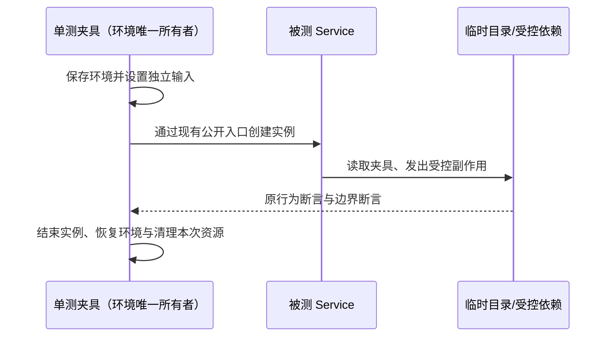
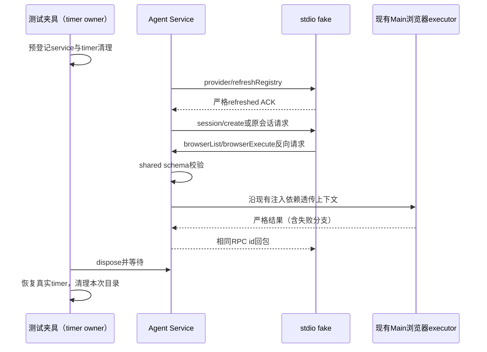
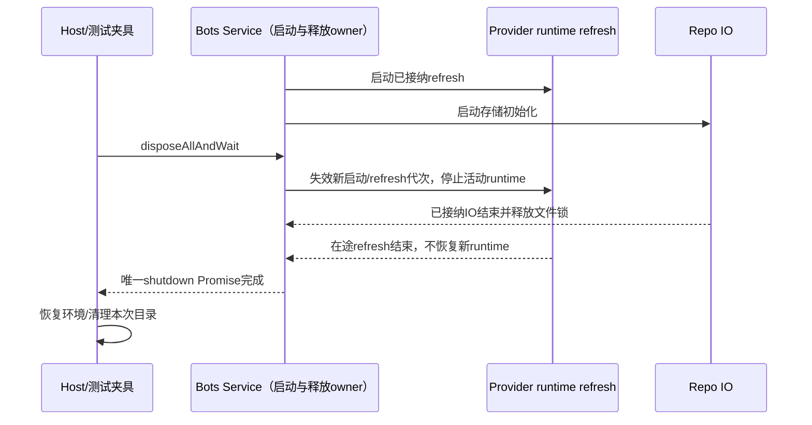
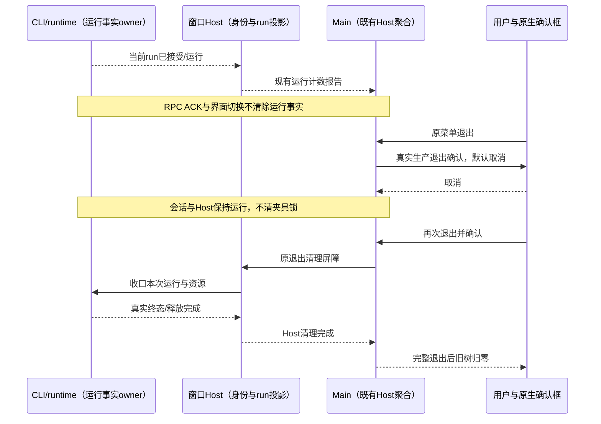

# 1.4.1 发布门禁补充修复合同

2026-11-16 用户明确授权：先修好完整提交前检查中在原始 main 复现的 96 个失败断言和 3 个导入失败，再发布 1.4.1。本合同补充会话体验计划，不重新打开已经完成的 T01—T10 与 FR-I1。

## 范围与事实

固定原始基线为 `1af30808c57b3ffc6c47a97dbf60f006604d17de`，补充修复代码起点为 `e9079d469c924f194fc2d934f2f1949acbee8aa6`。旧完整检查作用于 `528951dd`，29 文件的 96 个同名失败断言和 3 个导入失败在原始基线匹配；匹配不替代根因调查。保留原始报告，不改写历史检查结果。

当前源码与 `docs/desktop/standalone-coding-harness-spec.md`、`docs/desktop/mobile-remote-spec.md` 是产品边界。不得为过期测试恢复官方账号、官方遥测、官方云分享、官方 Server MCP 凭据注入或原厂手机 relay；用户自托管、端到端加密手机 attachment 与普通本地/SSH 能力继续受保护。若测试已经过期，先记录退役依据与仍有效的替代验收，再修改测试；不能仅删除失败断言或添加 skip 放行。

## 测试隔离与平台合同

### 最终 affected 门禁追加回归

冻结 `ce66e866` 的完整 affected 实际执行 1126 个文件后失败：11 个文件、78 条断言与 2 个未处理 rejection。该结果保留为失败，不以先前 33 文件通过替代。后续修复继续属于发布前门禁范围。

- Agent Service 测试替身必须实现当前 ProcessManager 的 `getExistingClient` 和 ProtocolClient 的 `onRuntimeActivityChanged` 合同：只返回已存在且属于对应工作区的 client，订阅可释放、当前快照可读取。不得为测试缺方法而给生产代码添加可选调用或默认成功。原模型、工作流、策略、发送与进度断言全部保留；运行事实所有者仍为 runtime。
- replay server 的 gate 与最新用户回合匹配继续是有效测试合同。已删除的上游手机 fixture 不等于这些能力退役；使用受控临时 fixture 验证同等语义，不恢复旧官方 relay/退役 E2E 资产。
- SSH 首发 helper 的单测须模拟当前 pane scope 依赖并验证原远端身份、项目草稿和已选模型，不让缺少浏览器宿主掩盖真实断言，也不改真实 E2E helper 迁就单测。
- stdio 进程树释放失败须调查实际生命周期与被等待的资源。事后 PID 消失不能证明当时清理成功；不得扩大等待预算、吞错、泛停进程或增加 skip。若需产品修复，先补拥有者和事件顺序及确定性回归，独审后再执行最终门禁。

- 单测的唯一环境所有者为每个测试夹具。HOME、USERPROFILE、SHELL、PATH 等外部输入由夹具显式控制，结束后恢复，不读取真实用户技能、配置或凭据。
- 本地目录测试按当前平台的 native path 规范化；远程路径保持远端语义，不把 Windows 路径转换强加给 SSH。
- 终端命令测试分别覆盖 POSIX、PowerShell 和 cmd 的现有启动合同，明确指定被测平台；不把 `/bin/sh` 视为 Windows 默认，不改变生产平台选择逻辑来满足错误夹具。
- 生命周期与时序修复保留 owner/lease、workspaceIdentity、remoteSessionId、stale run 与跨 Host 路由。禁止用扩大超时、重复状态、第二写入路径或全量跳过掩盖失败。

## Agent 协议回归边界

现有 `interaction/browserList` 与 `interaction/browserExecute` 是 Agent 到 Host/Main 的纯 RPC 中继，必须在 Service 的反向请求分派中恢复；输入与结果沿用 shared 严格 schema，不进入权限问题的会话事件或第二套 pending 状态。list 的 descriptors 与 execute 的 browserId/generation、requestId、session/turn、workspace identity/path/key、remoteSessionId、clientMode/sessionContext 保持原协议语义，由现有 Main executor 管实际浏览器能力与隔离。无执行器时返回既有结构化 unavailable，不能无响应；无效参数返回 invalid params。此次不改 shared 协议或添加新的授权规则，恢复依据见 browser-use 的 agent-host-main-channel spec 与现有真实 stdio 回归。

测试 stdio fake 同样必须回应 native create 前必经的 `provider/refreshRegistry`，严格结果为 `{refreshed:true}`；不能去掉生产 readiness 等待或用空 ACK 欺骗 schema。计时器由开启它的测试夹具拥有，生命周期 teardown 必须在可能挂起的 await 前登记，先停止/等待 service 与订阅，再删除临时目录；不能只靠永远到不了的测试体 finally。

## 验收（补充后仍以全部项为门槛）

### 服务释放边界

`disposeServiceResourcesAndWait` 经过既有 Bots Service 的 `disposeAllAndWait` 等待资源收口。Bots Service 是其已接纳启动任务的唯一 owner：释放先同步失效 runtime refresh 及恢复轮询入口，等待已启动的三个 Provider refresh、存储初始化和恢复 continuation；返回后不得仍占用本次 Repo 文件锁或再启动后台同步。重复释放复用同一个完成 Promise，不靠文件删除重试或额外等待时间推断完成。异常沿原日志合同记录，不产生未处理 rejection，不把关闭成功误写成业务初始化成功。该规则恢复当前异步释放的完成语义，不扩大 Bot 产品能力。

初始化并行读取中，一项失败也须等待同次已发出的其他 Repo IO 结束后，才能让关闭完成；不能把 fail-fast 的业务失败当作所有在途资源已释放。初始化仍按原错误合同报告失败。

### 上游准入文件的修改后归属

原 `main` 的 `sourceServerOperationLogs.ts` 与两份 `remoteConnectionPresentation*.ts` 已存在于上游准入快照。按现有策略，修改会使它们退出原样准入；不得更换比较基线、刷新快照或增加例外来解除检查。

Host 的 `SourceServerOperationLogs` 仍是日志历史唯一 owner，登记为 `source-server-operation-logs` 受控 adapter，owner 为 `remote`。精确 roots 仅包含现有实现文件与相邻 `source-server-operation-logs-contract` 合同目录；依赖为 `desktop`、`rpc`、`server`、`shared`，保留原类公开入口和实际调用路径。合同、示例和行为测试描述既有 run/read/remove、脱敏、日志代次与迟到回调边界，不建立第二状态或日志实现。

两份 UI presentation 文件只派生展示输入和错误分类，以精确文件 roots 纳入已有 `remote-connection-flow` 的 `remote` owner、app 层和公开入口；保留其 `shared`、`ui` 依赖。不将整个 Host 或 UI lib 纳管，不移动实现以规避规则。登记后执行完整真实基线的架构检查，新增合同需有实际行为验收。

### 跨宿主 POSIX 归档权限

归档 producer 是完整 release、组件和派生测试归档的权限唯一所有者。对 POSIX target，归档中的启动入口、随包 Node 与 native/search 可执行文件须具有安全的执行权限；普通文件不能被无差别提升为可执行，目录须可遍历。权限从显式目标文件角色产生，不能把 Windows 文件系统的 chmod/stat 表现当作 POSIX 合同。消费端不增加 chmod fallback 或放宽安装根目录权限检查。

完整包与组件包遵循同一权限分类；Windows zip 目标、macOS 无 xattr/AppleDouble 边界保持。缓存恢复 B 重包通过公开 producer/CLI 边界复用相同合同，保留其旧版本与 marker 语义。既有组件内容 hash 不因此改定义；归档字节 SHA、size 和 descriptor 必须与实际新产物一致。跨宿主回归必须至少提供 Windows 生成、Linux 独立解压并真实执行的 RED/GREEN；平台未实跑明确列出，不能以 tar 列表或 mock 代替实际执行。

Task18 采用 `@zcode/server-cli/packaging` 的窄 build-time 公共 producer（controller 选择 A），完整包、组件包和 B 直接 await 同一 `createPosixReleaseArchive`。权限分类以 R2 §7.1 为准：目录 0755、明确执行角色 0755、其他普通文件 0644；不得从 NTFS stat 推导。新增公共 surface 仅纳管对应 POSIX archive 小模块，tar 直接依赖固定本仓库已有锁定版本；若边界设计不当需返工，不能扩成通用归档框架或迁移整个 legacy 包。回归覆盖四个 POSIX target 的 header 分类、Windows zip、不变内容 hash、Linux 实际执行及 B 的旧版本/marker/独立 SHA。

B 原单次归档300000ms预算由caller持有并保持，由可选AbortSignal经producer的原生stream pipeline中止；producer等待tar/输出流销毁完成后才拒绝，拒绝后不得继续写。回归以受控输出进度/destroy屏障验证在途abort，不等待真实5min；不新增默认业务超时，不用Promise.race留下后台写入。

### 最终测试包的身份与路径边界

Task19/20阶段的测试包沿官方完整桌面构建和生产packaging hooks产生，当时未变Agent与Task18资源只复用已核身份；该阶段通过保留为历史证据。Task21改变Agent输入后，最终测试包必须由最终已审源码重新准备本地Agent、四目标完整/组件归档及新descriptor：先官方远端资源准备，再完整桌面Agent/plugin/native闭包，最后production桌面构建。四完整归档内runtime Agent、CLI dist、桌面暂存与最终包的Agent摘要必须同代相等；旧Task18归档、descriptor和旧包不能替代。每轮Linux B由本轮新A按原helper与公开权限producer派生，不改变权限或预算。

最终同轮metadata与完整桌面bundle不混用旧输入，owned真实短路径不改系统策略或用户安装，实际conpty路径均小于260；原深路径error206仍仅保留候选归因。会被官方准备覆盖的旧生成物先非覆盖保全，新资源使用独立generation root与loopback服务/state；旧包、资源服务与失败不覆盖。新包generated协议guard和仅副exe inspector差异明确，绝不安装/发布测试副本。冻结输入后只做一次保留全部生产hooks的`--dir`包装，完整生产ASAR结构及实际Electron回读一致，新Main/Host/Renderer来源可核。实际Agent argv/原协议事件/资源hash三者对应同run；必要的现有会话readiness可先启动一次隔离本地会话取得实际Agent证明，再进入锁/密码fixture。新包四场景均须原真实断言，旧包通过不外推最终产物通过。

测试包必须在官方完整桌面构建时显式设置 `VITE_ZCODE_E2E_STORE_BRIDGE=1`，在冻结和包装前核实实际 Renderer bundle 的编译值；WDIO 启动时的环境值不能替代编译输入。测试桥只提供既有只读观测和测试动作，不能在运行时注入来绕过准入，正式发布构建不得启用该测试桥。若已证打包前漏设编译值，保留原包与失败，允许修正构建环境后创建独立新代：仅重建完整桌面 out、非覆盖冻结并作该代唯一一次完整生产 hooks 包装，不重复准备未变的 Agent/四目标归档/descriptor，仍须重新核对这些输入的同代摘要、完整 ASAR、实际 Electron 全 bundle 回读与逐 run 严格准入。该环境修正不视为产品回归修复或先前失败通过。

### 当前在线设备的恢复详情可达性

设备主卡显示的当前线路具有可信专用错误与严格 cacheRecovery 时，默认主卡必须能进入既有错误详情，即使仍 online 且 updateAvailability=none。入口从该线路的当前 snapshot 派生，不依赖可选更新横幅，不把另一线路的错误冒充当前线路，不新增正常 online 更新能力。详情复用原精确定位与显式 updateProfile 重试；恢复事实清除后不得继续定位旧 locator。原多线路折叠与普通 online 断开行为保持。

### 桌面随包 Agent 的默认解析优先级

保持显式 Agent command 覆盖合同。Electron 的精确 resources/glm/zcode.cjs 已存在时，默认 stdio 与 storage preparation 必须绑定同一随包资源，不能被启动 cwd 上溯发现的仓库 dist 抢先匹配。没有精确随包资源的开发态保留 monorepo 优先及字节码/JS storage 合同；用户历史 bundle fallback 不能因此挪到开发源码之前，非 Electron 的 SSH/Node 原生部署路径不变。实际 packaged 验收须同时核对 Main/Host spawn argv、运行协议事件及随包摘要，不能仅证明未运行文件的 hash。

### 本地真实运行会话与应用退出确认

生产环境中，本地 CLI/runtime 已接受且仍在运行的会话必须参与现有应用退出确认。切换到设置、连接远端设备或原提交 RPC 返回 ACK 不代表运行已结束，不能使 Main 提前丢失该事实。运行事实仍由 CLI/runtime 产生，Host 按工作区身份和当前 run 生命周期投影，Main 聚合既有 Host 报告；不得用 Renderer 的 optimistic 状态、DOM 或新增轮询作为事实来源，也不建立第二 admission。

运行元数据采用独立、严格校验的通用 runtime activity 合同，由 Bootstrap 发布器只读合并现有 Core 执行事实与 Bootstrap 自动队列交接事实，导出完整快照。CUA sideband 继续只服务原用途，不兼作通用运行计数：当前 admission 可先预留并返回 ACK 后才发 TurnStarted，TurnComplete 后仍可能执行 foreground command 收尾、自动队列交接或目标续跑。接纳后持有的启动预留、实际执行、自动可运行工作和这些交接连续计为 busy；只留在历史投影中的 held/error-paused 输入，以及 idle 时 requireQueue 留待用户选择的输入不单独计为运行。一个 busy session 只计一次，guide 不额外增加会话数；独立 child runtime 按实际 child session 计数。

普通 V4 自动队列提升仍由既有 Bootstrap gate 唯一决定。发布器观察该 gate 已持有的评估、投影提交与提升交接，在当前判定尚未结束时不先发布 idle；不新增 Core activity lease、第二队列或新的重试定时器。队列非空、autoDrain 授权位或原 100ms retry timer 的存在均不能单独证明 busy。target 为 active/paused/budget_limited、读取失败或授权关闭导致原 gate hold 时，必须结束本次判定并释放其活动分量；不能等未来 target 完成而永久阻止退出。异步判定绑定实际 record、队首及当前事实水位，迟到旧结果不能清除新队首或新实例；复用原自动提升门槛，不改变 admission、队列顺序和调度。

快照须带真实 session 身份和单调版本，注册消费先于可执行命令，绑定已有 runtime 时先给当前完整事实；同版本幂等、旧版本忽略，关闭再恢复同 session 亦不能因版本重置或迟到旧实例快照覆盖新实例。Host 以可信 workspace identity/path fallback、source/remoteSessionId、实际 chat client 及 generation 绑定来源，非 chat lane 不参与。真实 owner 释放且无自动可运行工作才 idle；当前 session close、client unavailable/release 或 Host dispose 沿现有生命周期收口对应代际，旧 release 不得清新代。发布故障须沿既有 unavailable/权威重同步边界恢复，不吞掉末次通知后永久保留健康假象。不得建立第二队列、轮询、延时清零或以请求在途/常驻会话数替代。Host 将本地分量加入现有远端与 legacy 合计，不独立发送相互覆盖的总量。

正常菜单退出仍使用现有确认框、默认取消、生产环境条件和 Host 清理预算。真实取消不得启动 Host 释放或允许缓存锁清理；再次确认后沿原完整退出屏障收口，旧进程树归零后才允许清理本次夹具的精确 A 锁。空闲退出、远端运行计数与 legacy 提交兼容保持。重复事件、迟到旧 run 终态、独立 workspace identity/Host 和幂等释放均不能误增或误减运行事实。

Task16 的 production 新包曾在受控 SLOW turn 尚未终态时直接退出且未出现原生确认。原始 Main/Agent 时间轴已保留；当时没有直接采样 Main/Host 计数，不能把缺少更新日志直接视为具体丢失机制。Task21 必须先沿实际本地 V4 命令路径给出因果证据，再以真实事件驱动的 RED/GREEN 修复断点；不能绕过生产条件、注入计数或修改确认框来修绿。最终匹配包仍须真实取消和再次确认，不以 UT 关闭 Task16。

### 总验收

两条中断回收提示不能只将原绝对路径断言改成 redacted：以 standalone spec 的可信严格 locator、精确 Main 动作和真实 UI 恢复链路等强替代。秘密碰撞仍可定位、普通日志继续脱敏、两种 marker/多SHA/伪造拒绝/退出后重试均须验证；设计报告通过不代表实现或E2E已完成。

1. 29 文件逐一记录失败标题、当前 owning source、根因证据、产品/测试/环境分类、修复提交及定向结果；不得用同名标题直接断言根因相同。
2. 每个独立修复单元执行先失败、后通过的定向验证与独立 spec/quality 审查。行为变化先更新对应产品 spec，并补充必要交互 E2E。
3. 固定 Node `24.14.0` 与 pnpm `10.33.2`。最终运行 `pnpm typecheck`、`pnpm lint`、架构检查与正确原始基线的 `pnpm verify:pre-push`；保留真实输出及退出码，不跳过 hook、不用 HEAD 作伪基线。
4. 本补充授权不自动关闭 T11-I3 的独立 PTY E2E 范围问题，不包含全仓 1973 文件格式债的重排。
5. 发布、构建资产验证和本机升级仍沿用原计划；所有必要验收完成前不宣称可发布。
