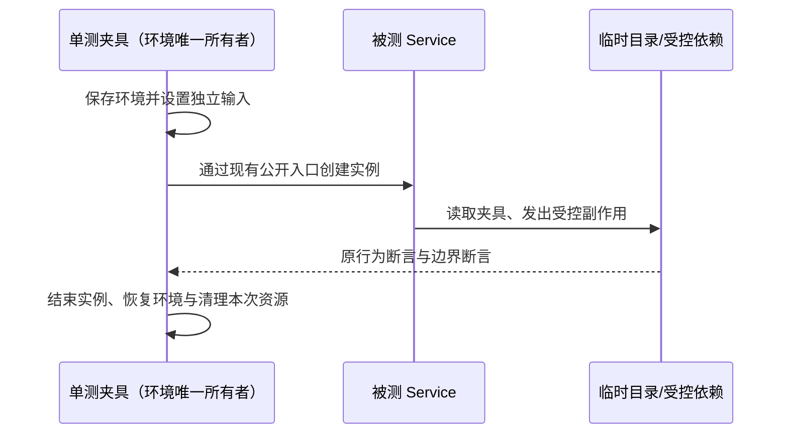
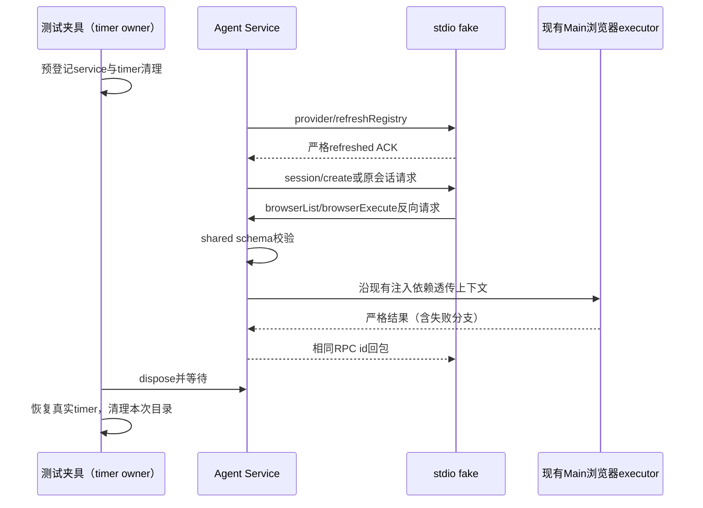
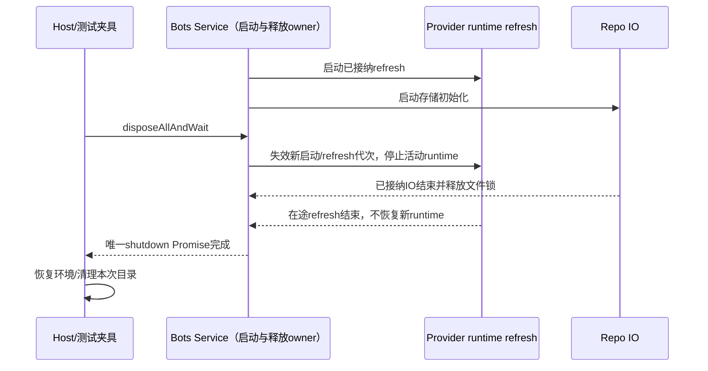

# 1.4.1 发布门禁补充修复合同

2026-11-16 用户明确授权：先修好完整提交前检查中在原始 main 复现的 96 个失败断言和 3 个导入失败，再发布 1.4.1。本合同补充会话体验计划，不重新打开已经完成的 T01—T10 与 FR-I1。

## 范围与事实

固定原始基线为 `1af30808c57b3ffc6c47a97dbf60f006604d17de`，补充修复代码起点为 `e9079d469c924f194fc2d934f2f1949acbee8aa6`。旧完整检查作用于 `528951dd`，29 文件的 96 个同名失败断言和 3 个导入失败在原始基线匹配；匹配不替代根因调查。保留原始报告，不改写历史检查结果。

当前源码与 `docs/desktop/standalone-coding-harness-spec.md`、`docs/desktop/mobile-remote-spec.md` 是产品边界。不得为过期测试恢复官方账号、官方遥测、官方云分享、官方 Server MCP 凭据注入或原厂手机 relay；用户自托管、端到端加密手机 attachment 与普通本地/SSH 能力继续受保护。若测试已经过期，先记录退役依据与仍有效的替代验收，再修改测试；不能仅删除失败断言或添加 skip 放行。

## 测试隔离与平台合同

- 单测的唯一环境所有者为每个测试夹具。HOME、USERPROFILE、SHELL、PATH 等外部输入由夹具显式控制，结束后恢复，不读取真实用户技能、配置或凭据。
- 本地目录测试按当前平台的 native path 规范化；远程路径保持远端语义，不把 Windows 路径转换强加给 SSH。
- 终端命令测试分别覆盖 POSIX、PowerShell 和 cmd 的现有启动合同，明确指定被测平台；不把 `/bin/sh` 视为 Windows 默认，不改变生产平台选择逻辑来满足错误夹具。
- 生命周期与时序修复保留 owner/lease、workspaceIdentity、remoteSessionId、stale run 与跨 Host 路由。禁止用扩大超时、重复状态、第二写入路径或全量跳过掩盖失败。

## Agent 协议回归边界

现有 `interaction/browserList` 与 `interaction/browserExecute` 是 Agent 到 Host/Main 的纯 RPC 中继，必须在 Service 的反向请求分派中恢复；输入与结果沿用 shared 严格 schema，不进入权限问题的会话事件或第二套 pending 状态。list 的 descriptors 与 execute 的 browserId/generation、requestId、session/turn、workspace identity/path/key、remoteSessionId、clientMode/sessionContext 保持原协议语义，由现有 Main executor 管实际浏览器能力与隔离。无执行器时返回既有结构化 unavailable，不能无响应；无效参数返回 invalid params。此次不改 shared 协议或添加新的授权规则，恢复依据见 browser-use 的 agent-host-main-channel spec 与现有真实 stdio 回归。

测试 stdio fake 同样必须回应 native create 前必经的 `provider/refreshRegistry`，严格结果为 `{refreshed:true}`；不能去掉生产 readiness 等待或用空 ACK 欺骗 schema。计时器由开启它的测试夹具拥有，生命周期 teardown 必须在可能挂起的 await 前登记，先停止/等待 service 与订阅，再删除临时目录；不能只靠永远到不了的测试体 finally。

## 验收（补充后仍以全部项为门槛）

### 服务释放边界

`disposeServiceResourcesAndWait` 经过既有 Bots Service 的 `disposeAllAndWait` 等待资源收口。Bots Service 是其已接纳启动任务的唯一 owner：释放先同步失效 runtime refresh 及恢复轮询入口，等待已启动的三个 Provider refresh、存储初始化和恢复 continuation；返回后不得仍占用本次 Repo 文件锁或再启动后台同步。重复释放复用同一个完成 Promise，不靠文件删除重试或额外等待时间推断完成。异常沿原日志合同记录，不产生未处理 rejection，不把关闭成功误写成业务初始化成功。该规则恢复当前异步释放的完成语义，不扩大 Bot 产品能力。

初始化并行读取中，一项失败也须等待同次已发出的其他 Repo IO 结束后，才能让关闭完成；不能把 fail-fast 的业务失败当作所有在途资源已释放。初始化仍按原错误合同报告失败。

### 总验收

1. 29 文件逐一记录失败标题、当前 owning source、根因证据、产品/测试/环境分类、修复提交及定向结果；不得用同名标题直接断言根因相同。
2. 每个独立修复单元执行先失败、后通过的定向验证与独立 spec/quality 审查。行为变化先更新对应产品 spec，并补充必要交互 E2E。
3. 固定 Node `24.14.0` 与 pnpm `10.33.2`。最终运行 `pnpm typecheck`、`pnpm lint`、架构检查与正确原始基线的 `pnpm verify:pre-push`；保留真实输出及退出码，不跳过 hook、不用 HEAD 作伪基线。
4. 本补充授权不自动关闭 T11-I3 的独立 PTY E2E 范围问题，不包含全仓 1973 文件格式债的重排。
5. 发布、构建资产验证和本机升级仍沿用原计划；所有必要验收完成前不宣称可发布。
