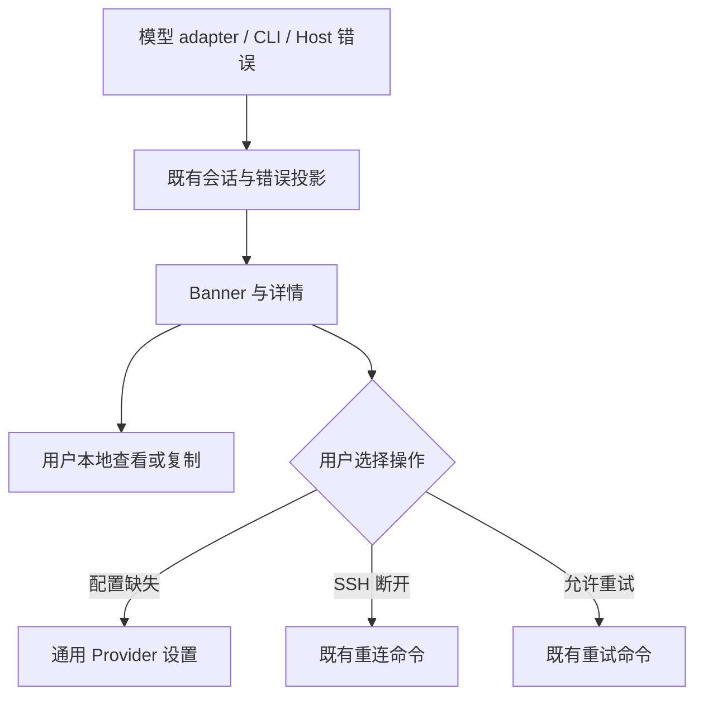

# 对话错误展示与本地排查

状态：2026-10-24 独立桌面版本。原 `chat_error_banner` ARMS 结构化上报合同已退役，本文只描述保留的产品行为与本地诊断边界。

## 状态与展示

错误来自现有模型 adapter、CLI 运行时和 Host / SSH 路由。错误 Banner 消费既有投影，不重新决定模型请求的重试、会话状态或权限。原始错误缺少归因证据时保持未知，不通过可见文案猜测根因。

- 普通模型失败保留错误详情、复制与已有重试入口。
- 缺少模型配置或历史模型已失效时，引导用户打开通用 Provider 设置；不自动换模型或计费来源。
- SSH 连接失败保留对应详情和重连操作，身份、owner / lease 与 stale run 防护仍由原有边界裁决。
- 已确认的取消保持取消语义；旧历史缺少可选诊断字段时继续读取，不改写正文或归属。
- 官方套餐升级、反馈上传和错误曝光上报入口已删除。复制动作只生成本地剪贴板内容，不发送网络请求。

## 本地证据

可以结合界面详情、已有 trace / request / session 关联值、CLI 结构化日志及模型失败因果链排查。关联值只说明证据的对应关系，不证明远端接纳或执行成功。

Banner 不采集用户操作，不创建遥测队列，不调用官方服务。本地诊断失败也不能改变请求、重试或会话状态。
