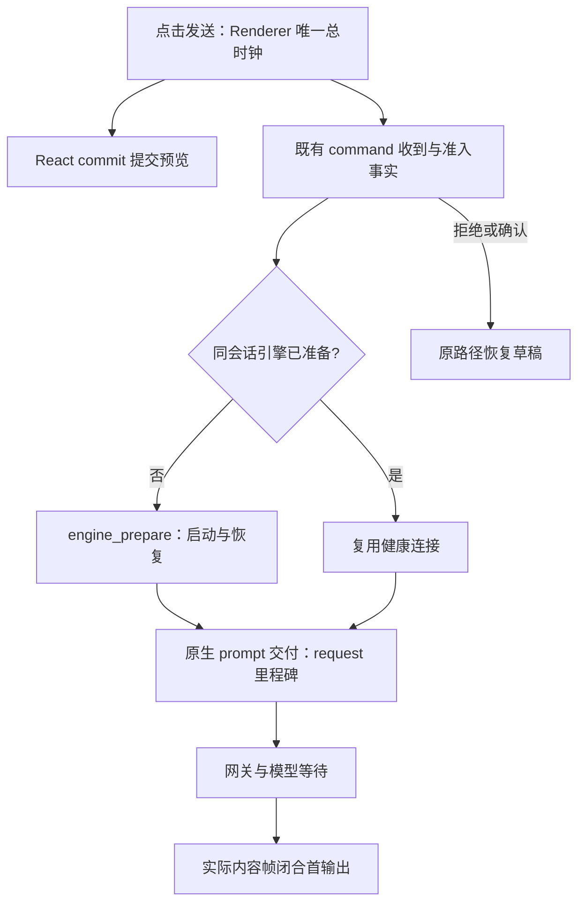

# 本地 TTFT 计时

状态：2026-10-24 独立桌面版本。保留本地发送阶段计时，删除官方 OTLP / ARMS 导出。

`packages/desktop/src/renderer/src/localTtftBootstrap.ts` 在桌面创建既有 `LocalTtftObserver`，采样时钟并跟踪窗口前后台；卸载时中断未闭合观测、清理定时器和事件监听。Observer 默认把记录交给 UI logger 的 debug 通道，不调用 IPC 上报或网络导出。

Renderer 拥有点击总时钟，CLI / Host 的既有帧提供运行阶段事实。首输出依据实际内容帧，不能把 admission ACK 当作首 Token。工作区、command、session 和观测标识必须匹配，迟到或不匹配的结果不能归入另一轮发送。

2026-11-06 补充：保留六个主阶段，明细分别记录点击至提交预览的 React commit（`optimistic_render`）、命令到达与准入（`command_received` / `command_admitted`）、外部引擎准备（`engine_prepare`）。提交预览只属于 Composer 的在途提交状态，不写入权威 transcript；失败或需要二次确认时按原路径恢复草稿。

外部引擎在准备完成后、调用原生 prompt 前发布既有本地阶段观察的 `request` 里程碑。该边界是 ACP prompt 交付起点，`model_request` 包含引擎内组装、网关和模型等待，不能冒充实际 HTTP 发出或供应商计算时间。预热与热连接继续复用 adapter 的同会话缓存，prompt 从不自动重发。界面从既有引擎配置状态派生“启动引擎 / 等待模型”；首条实际内容出现后恢复普通运行提示。

Windows 性能验收需在同一环境分别采集冷启动、预热首发、热续聊样本，报告点击至预览、准入、引擎准备及首内容的分位数。macOS 的受控夹具只证明阶段边界与交互正确，不作为 Windows 时延或供应商速度证据。

排队、用户确认、前后台切换、失败、取消、容量限制及无法完成的观测分别保留其状态；排除记录不得伪装为成功 TTFT。计时的采样、合并或记录失败不影响真实请求和内容投影。

生产 debug 不落盘，因此缺少记录不等于发送没有发生；需要阶段细节时使用明确的开发诊断运行。此计时与[本地 Usage](../../apps/zcode-cli/docs/design/v2/usage-observability.md)用途不同，均不恢复官方遥测或计费服务。
