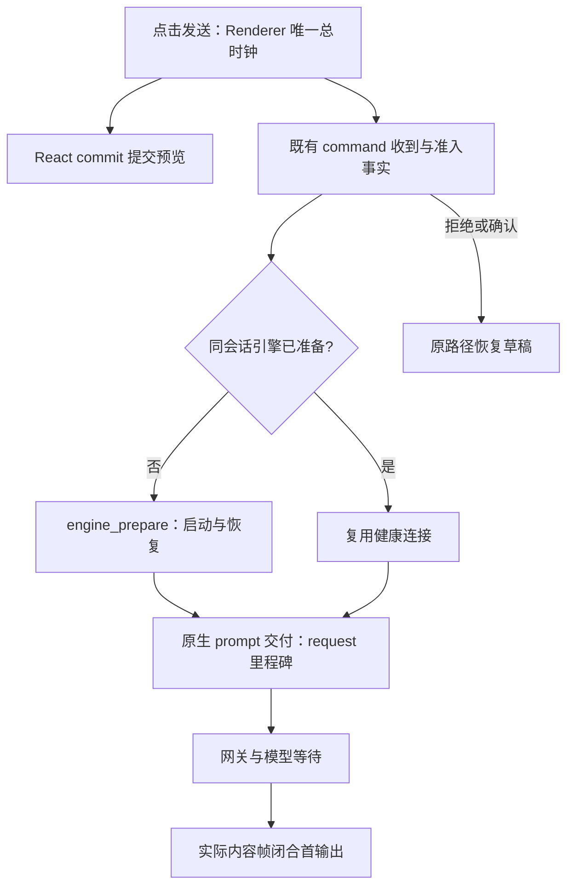

# 本地 TTFT 计时

状态：2026-10-24 独立桌面版本。保留本地发送阶段计时，删除官方 OTLP / ARMS 导出。

`packages/desktop/src/renderer/src/localTtftBootstrap.ts` 在桌面创建既有 `LocalTtftObserver`，采样时钟并跟踪窗口前后台；卸载时中断未闭合观测、清理定时器和事件监听。Observer 默认把明细记录交给 UI logger 的 debug 通道；1.1 的摘要行经 Main 写入本机日志（见下文「本地性能摘要」）。两者都不做网络导出。

Renderer 拥有点击总时钟，CLI / Host 的既有帧提供运行阶段事实。首输出依据实际内容帧，不能把 admission ACK 当作首 Token。工作区、command、session 和观测标识必须匹配，迟到或不匹配的结果不能归入另一轮发送。

2026-11-06 补充：保留六个主阶段，明细分别记录点击至提交预览的 React commit（`optimistic_render`）、命令到达与准入（`command_received` / `command_admitted`）、外部引擎准备（`engine_prepare`）。提交预览只属于 Composer 的在途提交状态，不写入权威 transcript；失败或需要二次确认时按原路径恢复草稿。

外部引擎在准备完成后、调用原生 prompt 前发布既有本地阶段观察的 `request` 里程碑。该边界是 ACP prompt 交付起点，`model_request` 包含引擎内组装、网关和模型等待，不能冒充实际 HTTP 发出或供应商计算时间。预热与热连接继续复用 adapter 的同会话缓存，prompt 从不自动重发。界面从既有引擎配置状态派生“启动引擎 / 等待模型”；首条实际内容出现后恢复普通运行提示。

Windows 性能验收需在同一环境分别采集冷启动、预热首发、热续聊样本，报告点击至预览、准入、引擎准备及首内容的分位数。macOS 的受控夹具只证明阶段边界与交互正确，不作为 Windows 时延或供应商速度证据。

排队、用户确认、前后台切换、失败、取消、容量限制及无法完成的观测分别保留其状态；排除记录不得伪装为成功 TTFT。计时的采样、合并或记录失败不影响真实请求和内容投影。

生产 debug 不落盘，因此缺少记录不等于发送没有发生；需要阶段细节时使用明确的开发诊断运行。

## 跨进程时钟校准节奏

2026-11-08：Renderer 与 CLI 的时钟偏移由 `queryConversationCommandsV4({ clock: true })` 往返探测得出，
`calibrateLocalTtftClock` 只接受往返一半不超过 10ms 的样本。修正前探测失败既不记录时间、也不退避，
而内容帧与每个检查点都会触发探测，流式期间几乎每帧一次三进程往返：2026-11-07 本机 Host 日志
`queryConversationCommandsV4` 共 3573 次、占日志行数 47%，峰值 59 次/分钟，无发送时段仍有 2246 次，
窗口最小化时照常运行。现规则：

- 校准结果仍由 `LocalTtftObserver` 按 workspace 持有；探测节奏由该 workspace 的会话传输面持有，不新增第二份校准结果。
- 只在传输调用前的 handshake（含发送命令）与 CLI 检查点时按需探测；内容帧不触发探测。
- 一次尝试顺序最多取 3 个样本，首个满足误差界的样本即为已取样本中往返最小者，取到即停；CLI 未返回 `clock`
  时不再重复取样。
- 尝试无论成功或失败都按 60 秒（与校准有效期相同）节奏退避：成功后到期才再测，失败后 60 秒内不再测。
- runtime 重启或不可用时清空该 workspace 的校准与退避，迟到的旧 runtime 探测结果丢弃。
- 校准缺失或过期时，摘要中依赖时钟的字段（`clickToReceivedMs`、`clickToAdmittedMs`，以及 `command_admission`、
  `output_return` 阶段）按现有规则为 null / 缺失，`quality` 记 `missing`，不冒充 `clock_invalid`。
- Host 对该 RPC 的成功日志记 debug（与 `backgroundBashOutputV4` 一致），失败仍记 warn。

## 本地性能摘要（1.1）

2026-11-07：生产包按 [YCode 1.1 引擎性能 spec](../desktop/engine-performance-1.1-spec.md)「本地性能摘要」落一条 info 级摘要。Observer 在每次已下发命令的观测闭合时（`first_output`，或此前的 `excluded`）调用 bootstrap 注入的摘要回调，桌面 bootstrap 经 `IPlatformService.writeLocalDiagnosticLog` 写入本机桌面日志；Web 没有该方法，不输出。上面的 debug 明细保持原样。

日志行形如 `[local-perf] send summary {...}`，字段固定：

| 字段                                        | 含义                                                                          |
| ------------------------------------------- | ----------------------------------------------------------------------------- |
| `observationId` / `commandId` / `sessionId` | 生成的标识，用于与 Host/CLI 日志对齐                                          |
| `outcome`                                   | `success` 或排除/失败原因（如 `failed`、`rejected`、`interrupted`、`guided`） |
| `engine`                                    | `zcode` / `claude-code` / `codex` / `unknown`                                 |
| `start`                                     | 本 Renderer 进程内该会话首条摘要为 `cold`，之后为 `warm`                      |
| `sendMode` / `quality`                      | 发送方式与时钟质量（`complete` / `missing` / `clock_invalid`）                |
| `clickToPreviewMs`                          | 点击 → 提交预览 React commit                                                  |
| `clickToAckMs`                              | 点击 → Renderer 收到命令 ACK                                                  |
| `clickToReceivedMs` / `clickToAdmittedMs`   | 点击 → CLI 收到 / 准入命令（仅时钟已校准）                                    |
| `enginePrepareMs`                           | CLI 记录的外部引擎准备耗时                                                    |
| `requestToFirstContentMs`                   | 请求交付 → 首个内容（CLI 时钟）                                               |
| `totalMs`                                   | 点击 → 首个内容或观测闭合                                                     |

缺失阶段写 `null`。摘要不含 prompt、回复、错误正文、工作区路径和 provider/model 名称，标识只接受 `[A-Za-z0-9_.:-]`，其他字符串一律丢弃。摘要只写本机日志，不经过网络。此计时与[本地 Usage](../../apps/zcode-cli/docs/design/v2/usage-observability.md)用途不同，均不恢复官方遥测或计费服务。
